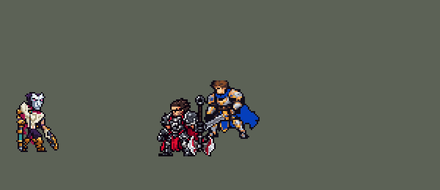

<!-- 本页上半部分由 tools/docs/gen_hero_docs.py 按仓库里现在的数据生成，手改会被覆盖；「开发记录」以下是手写的，生成时原样保留。 -->

# 烬 Jhin


| 项目 | 内容 |
|---|---|
| id | `league_jhin` |
| 所属的包 | 主包（mod_id `league`） |
| 分路 | ADC |
| 分类 / 标签 | 射手（Range） · AD / Range / CC |
| 高清帧 | 1 倍像素（无高清帧） |
| 附加包 | [烬低语附加包](#附加包)（`league_jhin_whisper`）、[游戏 AI 不按的技能替它按](#附加包)（`league_ult_press`） |



其他预览：[逐帧预览](../preview/league_jhin_frames.png)、[特效表](../preview/league_jhin_effects.png)

## 现在的技能

下面是游戏里显示的技能说明（`league/text/champion.i18n` 的简体中文，去掉了颜色和图标），冷却、距离来自 `league/champion/league_jhin.data_champion`；1 秒 = 60 tick。

### 普攻 / 被动（被动「低语」）

*攻击间隔 1.2 秒 · 攻击距离 55000*

被动 低语：四发一轮，第四发必定暴击并附加目标10%最大生命值的伤害，然后装弹2.17秒（可走动、放技能）并加速25%。烬击杀的英雄会在倒下处绽放莲花。

### 技能1 · 曼舞手雷

*冷却 6 秒 · 施放距离 55000 · 施放：指定目标 · 敌人（不含防御塔）*

掷出手雷，炸到目标后弹向其身后的敌人，最多命中4次，每次造成60 + 70% 攻击力物理伤害；每击杀一个单位，之后每次+35%。

### 技能2 · 致命华彩

*冷却 10 秒 · 施放距离 160000 · 施放：方向 · 敌方英雄*

若万众倾倒就绪，先在敌方英雄脚下种莲花：踩中后减速35%，2秒后炸开造成60 + 120% 攻击力。随后超远射击第一个敌方英雄造成90 + 90% 攻击力；他近期受过我方伤害则禁锢1.67秒。

### 大招 · 完美谢幕

*冷却 50 秒 · 施放距离 180000 · 施放：指定目标 · 敌方英雄*

架枪引导，开4枪锁定后射出的超远子弹（被控制会中断），各打中路上第一个敌方英雄造成90 + 55% 攻击力并减速80%；每中一枪后续+30%，第四枪伤害翻倍。

### 数值

攻击力 125（每级 +23）、生命 950（每级 +90）、护甲 20（每级 +7）、魔抗 15（每级 +3）、移速 900（每级 +9）。

## 附加包

附加包是可选的原生代码 mod（都在附加包合集 `league_addons` 里），**不装主包里的英雄也是完整的**。

### 烬低语附加包

[烬低语附加包](../../addons/league_jhin_whisper/README.md)：`league_jhin_whisper` v0.1.0

|  | 主包（纯数据） | 装了附加包 |
|---|---|---|
| 额外攻速 | 开枪变快 | 不变快；每 1% 换成 0.25% 攻击力（+40% 攻速 = +10% 攻击力） |
| 攻速减益 | 开枪变慢 | 一样 |
| 低语、第四发、装弹 | 主包 | 一样 |

### 游戏 AI 不按的技能替它按

[游戏 AI 不按的技能替它按](../../addons/league_ult_press/README.md)：`league_ult_press` v0.5.6（通用附加包，下面只列和烬有关的部分）

|  | 装了附加包，什么时候按 |
|---|---|
| 泽拉斯 R、烬 R（站着引导） | 自己身边 **45000 内没有敌方英雄**、生命 ≥ 40%；射程内（泽拉斯取 160000、烬取 140000）生命不到一半的，或我方有人 40000 内贴着的敌方英雄，挑生命比例最低的 |

## 相关脚本和素材

- [`tools/lol/extract_jhin.py`](../../tools/lol/extract_jhin.py)
- [`tools/art/preview_jhin.py`](../../tools/art/preview_jhin.py)
- [`tools/art/rig_jhin.py`](../../tools/art/rig_jhin.py)
- [`tools/art/import_jhin.py`](../../tools/art/import_jhin.py)
- [`tools/art/design_jhin.py`](../../tools/art/design_jhin.py)
- [`assets/source/jhin/`](../../assets/source/jhin)

## 开发记录

> 下面是原来 README 里「英雄：烬」一节，原样搬过来（只改了相对链接）。

| 部分 | 内容 |
|---|---|
| 定位 | ADC（远程射手，分类 Range），用户 10 月 2 日排的第十组的 ADC；本包第十个 ADC（艾希、金克丝、厄运小姐、伊泽瑞尔、卢锡安、薇恩、崔丝塔娜、凯特琳、卡莎之后）。戏命师：四发一轮的手炮「低语」，第四发必定暴击；手雷在敌人之间弹跳，手杖枪远程定身，大招跪地架炮连开四炮 |
| 普攻 | 「低语」：100% 攻击力的物理伤害，射程 55000（英雄联盟 550），攻击间隔 72 tick，第 8 tick 出手（动作第 3 帧，枪口在站位点右 30、上 7），子弹每 tick 7000，`y_offset` −2000（从枪口抬 7 px 出发）。每第四发换成第四枪的动作（先耍一圈枪），第 12 tick 出手：必定暴击（出手前给自己 1 tick 的 100% 暴击率，打完马上去掉），再加目标 10% 最大生命值的物理伤害；之后「装弹」2.2 秒：给自己 130 tick 的 `BlockAttack`（攻速减益不会推迟下一次普攻，所以用禁止普攻），其间照常走动、放技能，头顶的四颗子弹一颗颗亮起，移速 +25% 2 秒（英雄联盟第四发后的加速）。第一到第三发靠烬身上的三个计数标记（10 秒内不开枪就从头数） |
| 技能1 | Q「曼舞手雷」：朝 55000 内的敌人施放（小兵和野怪也算，清线、打野也用），冷却 6 秒。第 9 tick 出手（Q 动作第 3 帧，金拳头处一闪），手雷每 tick 4000 追向目标：60 + 70% 攻击力的物理伤害。打中后在附近的敌人之间最多再弹三次（英雄联盟同样最多打 4 个），每次在上一个目标落地、再炸开；前面每打死一个目标，后面的伤害 +35%（英雄联盟的击杀加伤）。弹跳靠和手雷同速、同时出发的一条宽 25000 的隐形穿透直线（厄运小姐 Q 的做法）：它碰到的单位在手雷打中后的 12 tick 窗口里各接一跳，所以不会弹回已经打过的那个（`RandomTarget` 会挑到刚打中的单位）。模拟里 25–45% 的手雷至少弹一次 |
| 技能2 | W「致命华彩」并入 E「万众倾倒」（用户选方案 A）：朝 160000 内的敌方英雄施放，冷却 10 秒，一个 0.8 秒的动作。先找近期被己方打过的英雄（`EnemyChampionRecentlyAttacked`），没有再找任意一个；第 36 tick 锁定他所在的位置（凯特琳 Q 的隐形抛物线，能躲），第 42 tick 手杖枪开枪（动作第 7 帧，枪口右 39、上 9）：长弹每 tick 16000，穿过小兵，打中这条线上第一个敌方英雄：90 + 90% 攻击力的物理伤害；他近期被烬的队友打过、或 4 秒内被烬本人打中过（普攻、Q、R），就定身 1.67 秒（英雄联盟的「被标记的英雄」）。E 有充能（15 秒一次）时，开枪前先往 75000 内的敌方英雄脚下扔一朵莲花：落地 0.4 秒后布好，5 秒内第一个踩上去的敌方英雄让它开花：周围 18000 内的敌人减速 35% 2 秒，2 秒后炸开，60 + 120% 攻击力的物理伤害。被动「绚葬之华」：烬打死的英雄身上也开一朵（普攻、W、R 各有一套击杀判定，金克丝、崔丝塔娜的写法：命中时挂一个标记，活着的话下一 tick 就被清掉） |
| 大招 | R「完美谢幕」：180000 内有敌方英雄时施放，冷却 50 秒。跪地架起大炮（0.5 秒），之后 5 秒内每 6 tick 判断一次：先找 120000 内近期被己方打过的英雄，没有再找射程内任意一个；锁定 8 tick 后开炮（炮口右 39、上 8），炮弹每 tick 20000，打中第一个敌方英雄：90 + 55% 攻击力，前面每打中一发 +30%，每发减速 80% 0.5 秒（「怯场」）；第四发伤害翻倍（技能里的普攻伤害不会暴击，所以直接按两倍算）。两炮之间至少 54 tick，打中后 34 tick。被控制时中断（英雄联盟的引导打断）。四发打完收炮 |
| 附加包 | 可选的附加包 [`addons/league_jhin_whisper`](../../addons/league_jhin_whisper/README.md)（在附加包合集里，原生代码，主包不装它也完整）：低语照英雄联盟，装备和增益给的额外攻速不加快开枪，每 1% 换成 0.25% 攻击力（主包的烬攻速照常变快）；攻速减益照常 |
| 附加包（替 AI 按） | 可选的附加包 [`addons/league_ult_press`](../../addons/league_ult_press/README.md)（在附加包合集里，原生代码，主包不装它也完整）：游戏 0.6.4 的 AI 很少按他的 R（只读观察包：每 10 分钟 1.1 次，41 局）。附加包按局面替 AI 按（用户：「有问题的英雄全部改成rust」）：他身边 45000 内没有敌方英雄、生命不低于 40% 时，140000 内生命不到一半的或我方有人 40000 内贴着的敌方英雄（生命比例最低的在前） |
| 数值 | 攻击 125（+23）、生命 950（+90）、护甲 20（+7）、魔抗 15（+3）、移速 900（+9）。数值是自己设计的，用 SDK 对战模拟调：下路，对 5 个原版射手（`archer`、`gunner`、`boomerang_hunter`、`poison_dart_hunter`、`bomber`），三套队友阵容、两边各 24 局，一批 720 局。第一版 −0.57（攻击 112、四发间隔 80 tick、装弹 2.5 秒）；攻击 120、间隔 72、装弹 2.2 秒 +0.50；攻击成长 23、生命 950 +1.19；W 90 + 90%、定身 1.67 秒、莲花 60 + 120%、手雷的隐形线加宽到 25000 后 +1.59 / +1.23；再加攻击 125、R 90 + 55%：+1.46 / +1.66。精灵图导入后子弹改从各自开枪帧的枪口出发、W 在开枪帧开枪：两批 +2.03 / +1.96（只改出发高度 +1.78 / +1.77），和包里的 ADC 持平（卡莎约 +2.2、蔚 +2.0），定下这版 |
| 亚索联动 | W 的定身是亚索大招要的控制：烬打下路、亚索打中路同队时，亚索每局 R 到被控英雄 1.44 次（同一批原版弓箭手 0.50、枪手 0.19；凯南 1.48），亚索不用调 |
| 精灵图 | 11 个动作 62 帧：待机、移动、普攻、第四枪、Q、W、R 架炮、R 瞄准（循环）、R 开炮、受击、死亡。造型按用户在 Codex 里挑的原画 A（英雄联盟的待机：金色的左手扶着手杖枪，低语垂在右手），Codex 生图草稿 A 按自己的格子读回、整行整列删到 41 行（用户选「新41 头13」）：深紫兜帽、白色面具和粉色的眼睛、白金披风和玫红里衬、金色铠甲的左臂、青色缠柄的手杖枪、象牙柄的低语。29 × 41 px，23 色；待机最高点 −29（兜帽顶），`banpick_center` 设 −10；头像截取点 (−2, −40) |
| 音效 | 英雄联盟的音效和配音（`tools/lol/extract_jhin.py`）：普攻开枪和命中、第四枪出手 / 开枪 / 命中、装弹、Q 出手 / 命中 / 弹跳、W 出手 / 开枪 / 命中、莲花扔出 / 落地 / 开花 / 爆炸、R 架炮、开炮和第四炮、命中和第四炮命中；第四枪、Q、W、R 带中文配音。开枪、扔手雷、开炮都是英雄联盟里同一刻播的几层叠在一起：开火声（`_OnMissileCast`，前 5 ms 就到最响）+ 出膛声（`_OnMissileLaunch`，250–530 ms 才最响）+ 扳机 / 甩手声（`_OnCast`）；第一版只取了出膛那层，开枪发虚（用户：「烬的技能音效…不太对」），普攻的开枪声还比开枪早 8 tick 响（在动作开始时），现在和枪口火同一 tick |

重新生成（素材来自本机的英雄联盟客户端，音频不进仓库）：

```bash
python tools/lol/extract_jhin.py --lol "D:\WeGameApps\lol" --vgmstream "<vgmstream-cli.exe 路径>"
python tools/lol/native_pose.py assets/source/jhin/poses.json --out <渲染文件夹>   # 动作参考帧
python tools/art/design_jhin.py         # 造型：Codex 的生图草稿 A 按自己的格子读回，删到 41 行；右手照英雄联盟描
python tools/art/rig_jhin.py            # 动作：走路用造型的像素重建，其余是 Codex 的动作条加修补
python tools/art/import_native.py --hero jhin
python tools/art/import_jhin.py         # 特效；--raw <Codex 的特效交付文件夹> 先把生图原稿缩成游戏尺寸的原尺寸条
python tools/art/preview_jhin.py
```

美术（原画的提示词见 [`assets/source/jhin/PICTURE_PROMPT.md`](../../assets/source/jhin/PICTURE_PROMPT.md)，造型的见 [`MODEL_PROMPTS.md`](../../assets/source/jhin/MODEL_PROMPTS.md)，动作的见 [`MODEL_STRIPS.md`](../../assets/source/jhin/MODEL_STRIPS.md)，特效的见 [`PROMPTS_FX.md`](../../assets/source/jhin/PROMPTS_FX.md)；Codex 的交接说明在 [`codex_picture/`](../../assets/source/jhin/codex_picture)、[`codex_model/`](../../assets/source/jhin/codex_model)、[`codex_strips/`](../../assets/source/jhin/codex_strips)、[`codex_fx/`](../../assets/source/jhin/codex_fx)）：

- 原画和造型：Codex 画了 A、B 两张原画，用户选 A（英雄联盟的待机）。造型 Codex 自己删到 41 行的 A（头 13 行）、B（头 11 行）丢了细节（裸露的右臂变成紫色、低语断开），`design_jhin.py` 把它的生图草稿 A 按自己的格子读回（`scripts/regrid.py`，62 × 44），颜色按 CIELAB 归到 Codex 的 24 色（按 RGB 归，披风的褐色花纹会变成肤色），两只眼睛用粉色，整行整列删到 41 行（脸、手杖、眼睛和低语的行列不删），一层描边。五个候选里用户选「新41 头13」。进游戏后用户：「右手的模型看起来有点不自然」——照英雄联盟的待机描：原稿的右臂是一截肤色短条直接连着低语的枪柄，旁边透出一道地面；补上紫色护腕和握住枪柄的手，那道缝是他身体侧面的深紫色（`design_jhin.py` 的 `HAND`）。
- 动作：Codex 画了 11 条。用户：「奇怪的地方你帮我修复 比如走路的步伐我看到已经有点奇怪了 codex太笨了」。`rig_jhin.py`：走路按造型重建——上半身（头、披风、两臂、手杖和低语）是造型本身，迈步时高一行；两条腿是造型自己的腿，各绕胯部切变，脚移动 1–4 列，摆动的脚抬 1–2 行，两腿比站姿靠拢一些，近处的脚在一个周期里两次从远处那只的前面换到后面（交叉步），两脚最多相距 12 列（用户：「你改的很不错 走路」）。其余是 Codex 的动作条加修补（`FIX`，每处是一段字符画）：普攻开枪那帧原来下垂的手臂没擦掉，和平伸的小臂连成一根悬空的肤色棍子；第一次改成上臂从肩膀垂到腰边、小臂平伸握枪，手肘成了直角（用户：「手臂怎么90度角？看着一股怪味」），照英雄联盟的开枪动作重描：上臂从肩膀斜着往前下方伸，手肘微弯，小臂几乎水平接到枪柄，手前面一圈紫色护腕（两个方案里用户选手肘微弯，另一个是整条直臂），枪的位置不动；第四枪举枪的手臂原来 16 行长（造型的手臂 6 行），枪、手和穗子下移 7 行；第四枪开枪的小臂是一条没有描边的金色亮线，改成带描边的肤色手臂，从肩膀到枪柄一条直线（肩膀处原来还立着下垂手臂的头两行，也是个直角）；Q 的金色手臂原来横穿 23 格，改成 2 行的小臂、紫色护腕和 4 行的金拳头；死亡时头顶漂着的碎片去掉，第 3–4 帧被压成两行的低语换成第 5 帧那把整枪，飞出去的低语往回 5 格；大炮的穗子接回炮管。之后用户：「死亡时候还有模型缺失」——跪伏的第 5–8 帧披风和低下的头之间是空的（地面透过来），补成身体的深紫色；一样透出地面的细缝（兜帽和面具之间、手臂和身体之间、大炮下面、死亡第 1、3、4 帧）也补上，包括只有导入补描边后才封口的（`GAP`）；兜帽后面每个动作都有的 3 + 1 格小洞补成描边。普攻、第四枪、Q 的收招帧和待机就是造型本身，从造型重画（右手跟着改）。
- 导入：待机 6 帧都用造型，第 3–5 帧下沉一格呼吸（`BOB`）：接缝最早在膝盖，手杖的箍和斜着的低语每次呼吸都错开一行（用户：「上下摆动导致模型变形 盖伦就没这问题」），四个方案里用户选了肩膀下面；肩膀的接缝又把手臂、披风和肩甲压扁一行（2026-10-04，用户：「烬是模型上下摆动导致有点微小的变形」），改成盖伦的做法：接缝在靴子里（站位点下 9/10 行：腿上只有 1 格不透明度、3 格颜色不同），鞋底那一行不动，手杖和低语跟着手整根下沉、不再被切（`BOB_CARRY`：站位点左边 −11 列以外、右边 +6 列以外整列一起动）；按眼睛的粉色定头的位置（`EYES`）；描边补齐（`COMPLETE`）。
- 特效用 Codex 画的 27 张（146 帧，生图原稿整理成 8 倍方格，`import_jhin.py --raw` 同瑞兹：每个游戏像素取覆盖的原稿像素里最多的颜色，四分之一以上不透明才画，颜色归到包里给每张的色阶——金、玫红、紫、青、手雷的铁灰、烟——光效外圈最暗的一档去掉，手雷罐和莲花保留描边；四种子弹上下对称，游戏按飞行方向转）。位置：抬枪的闪光在低语上 (19, −21)，枪口火焰在普攻 (30, −7)、第四枪 (35, −8)、W (39, −9)、R (39, −8)（Codex 把枪口火的白芯登记在格子左边中点，按它对上），Q 的闪光在金拳头 (10, −10)，装弹的四颗子弹在兜帽上方 (−2, −36)，命中在上半身 (0, −8)，定身、莲花、减速在脚底。R 的开幕光幕 Codex 画成两根高光柱，按宽 36 会有 72 行高，改按身高 40 行。时长：子弹第一 tick 空着（出生那一 tick 画面朝上），飞行帧铺满最长飞行的两倍，最后一帧留 1 秒；装弹 2.2 秒；定身保持到 100 tick；莲花开花的 4–8 帧循环到 2 秒后的爆炸。之后用户：「攻击特效不太对」——抬枪的闪光在枪还垂着时就出现，枪口火持续 180–300 ms，枪一往上抬，火还挂在原来枪口的位置；现在抬枪闪光只在举枪那帧（51 ms），枪口火缩到 83–150 ms，普攻、W、R 开枪的那帧加长、前后帧缩短（`rig_jhin.py` 的 `RETIME`，每个动作总时长不变），子弹飞过枪口前不画（普攻、第四枪 4 tick，W、R 2 tick）。

逐帧预览：[`docs/preview/league_jhin_frames.png`](../preview/league_jhin_frames.png?v=1014g)，特效：[`docs/preview/league_jhin_effects.png`](../preview/league_jhin_effects.png?v=1014g)。
