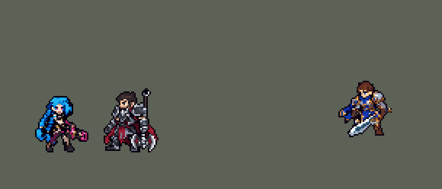

<!-- 本页上半部分由 tools/docs/gen_hero_docs.py 按仓库里现在的数据生成，手改会被覆盖；「开发记录」以下是手写的，生成时原样保留。 -->

# 金克丝 Jinx


| 项目 | 内容 |
|---|---|
| id | `league_jinx` |
| 所属的包 | 主包（mod_id `league`） |
| 分路 | ADC |
| 分类 / 标签 | 射手（Range） · AD / Range / CC |
| 高清帧 | PPU 2.2 |
| 附加包 | [参与击杀附加包：金克丝、崔丝塔娜、易、图奇](#附加包)（`league_takedowns`） |



其他预览：[逐帧预览](../preview/league_jinx_frames.png)、[特效表](../preview/league_jinx_effects.png)

## 现在的技能

下面是游戏里显示的技能说明（`league/text/champion.i18n` 的简体中文，去掉了颜色和图标），冷却、距离来自 `league/champion/league_jinx.data_champion`；1 秒 = 60 tick。

### 普攻 / 被动

*攻击间隔 1 秒 · 攻击距离 64500*

枪炮交响曲！：近处有敌人时用砰砰，造成100% 攻击力的物理伤害，每发加15% 攻击速度（至多3层）；否则换鱼骨头，射程更远，对目标及周围敌人造成110% 攻击力的伤害。罪恶快感：亲手击杀英雄后6秒内25% 攻击速度，100% 移动速度（逐渐回落）。

### 技能1 · 震荡电磁波！

*冷却 6 秒 · 施放距离 100000 · 施放：方向 · 敌人（不含防御塔）*

蓄力0.4秒后射出电磁波，对命中的第一个敌人造成75 + 120% 攻击力的物理伤害并减速25%，持续2秒。

### 技能2 · 嚼火者手雷！

*冷却 10 秒 · 施放距离 80000 · 施放：地点 · 敌方英雄*

向敌方英雄脚下扔出3只嚼火者手雷，0.5秒后布好，最多留5秒。敌方英雄踩上时手雷爆炸，禁锢范围内的敌方英雄1.5秒并造成80 + 100% 攻击力的物理伤害，随后手雷消失。

### 大招 · 超究极死神飞弹！

*冷却 50 秒 · 施放距离 250000 · 施放：方向 · 敌方英雄*

发射一枚飞得很远的飞弹，穿过小兵和野怪，命中第一个敌方英雄后爆炸，对周围敌人造成175 + 90% 攻击力 + 10% 目标最大生命值的物理伤害。

### 数值

攻击力 100（每级 +20）、生命 900（每级 +90）、护甲 20（每级 +7）、魔抗 15（每级 +3）、移速 900（每级 +9）。

## 附加包

附加包是可选的原生代码 mod（都在附加包合集 `league_addons` 里），**不装主包里的英雄也是完整的**。

### 参与击杀附加包：金克丝、崔丝塔娜、易、图奇

[参与击杀附加包：金克丝、崔丝塔娜、易、图奇](../../addons/league_takedowns/README.md)：`league_takedowns` v0.3.1

| 英雄 | 主包（纯数据） | 装了附加包 |
|---|---|---|
| 金克丝 | 罪恶快感：亲手击杀英雄后 | 每一次英雄击杀和助攻（几个人同时阵亡也各算一次） |

## 相关脚本和素材

- [`tools/lol/extract_jinx.py`](../../tools/lol/extract_jinx.py)
- [`tools/art/preview_jinx.py`](../../tools/art/preview_jinx.py)
- [`tools/art/import_jinx.py`](../../tools/art/import_jinx.py)
- [`assets/source/jinx/`](../../assets/source/jinx)

## 开发记录

> 下面是原来 README 里「英雄：金克丝」一节，原样搬过来（只改了相对链接）。

| 部分 | 内容 |
|---|---|
| 定位 | ADC（Range），第二组第四个 |
| 普攻 | Q「枪炮交响曲！」：射程 52500 内有敌人时用轻机枪「砰砰」，100% 攻击力，每发叠一层「火力全开」：攻速 +15% / +30% / +45%，2.5 秒。附近没有敌人时换火箭发射器「鱼骨头」：射程 64500，打中目标和它周围 20000 内的敌人，110% 攻击力，拿火箭时攻速 −10%。换枪有音效，由随机选敌（`RandomTarget`）量距离决定。被动「罪恶快感」：亲手击杀敌方英雄（普攻、火箭、R）后 6 秒攻速 +25%，移速 +100%，2 秒后降到 +60%，4 秒后 +30%。击杀用一枚只打英雄的隐形子弹判断：命中时给金克丝挂标记，目标身上挂一个每 tick 清标记的短效果，目标死了效果随之消失，几 tick 后标记还在就是击杀（模拟器里 13 次普攻击杀、3 次火箭击杀全部认出，没有误判） |
| 技能1 | W「震荡电磁波！」：蓄力 0.4 秒（英雄联盟 0.6 秒），射出电磁波，打中第一个敌人：75 + 120% 攻击力的物理伤害，减速 25%，2 秒。射程 100000（LoL Reborn 150000，太远时会拿去打远处的小兵），冷却 6 秒 |
| 技能2 | E「嚼火者手雷！」：往敌方英雄脚下扔三只夹子（射程 80000，飞 0.4 秒），落地 0.25 秒后布好，最多留 5 秒。敌方英雄走进 15000 内时夹子咬合爆炸：禁锢 1.5 秒，80 + 100% 攻击力的物理伤害，然后夹子消失。游戏里没有"留在原地、踩到才触发一次"的效果，做成 20 段、每段 0.25 秒：每段显示夹子、查一次附近的敌方英雄，咬到人后这个夹子作废。最早是一段接一段由隐藏飞行物生成、靠挂在金克丝身上的锁停下：玩家反映「夹子反复触发」，是她死后锁挂不到死人身上，定住的英雄每段被咬一口（模拟 24 局有 2 次，各咬 8、18 口）；0.36.1 让死后的检查发不出来，但那只在模拟器里验证过，新版本又有玩家看到「被秒的英雄同时碰到了两个炸弹」。模拟里旧链条在她死后确实照样往下走（7 次死时有夹子，之后又出现 19 段）。现在照提莫蘑菇改成扁平写法：20 段都是这次施法自己的延迟效果，施法者死了排着的延迟效果就停（同样 6 次，0 段）；每个夹子咬一次就作废（夹子自己的标记）；被咬的人禁锢的 1.5 秒内别的夹子不咬他（共用锁）；从第三段起每段还要上一段留下的标记（死后什么都加不上，所以万一还往下走，也最多再咬一口）；两次投掷轮流用两套标记，冷却缩短时两个夹子互不干扰（原版吟游诗人的大招每 3 tick 把友军技能冷却砍一半，E 4 秒多就能再放，两个夹子确实会同时在场）。模拟 12 局：放 E 176 次（改前 169）、咬中 69%（改前 63%），同一个英雄 1.5 秒内被咬两次、死后再咬都是 0。冷却 10 秒 |
| 大招 | R「超究极死神飞弹！」：对 250000 内的敌方英雄发射，飞弹飞 300000（速度 4500），穿过小兵和野怪，撞到第一个敌方英雄就爆炸：半径 62000 内的敌人受到 175 + 90% 攻击力 + 目标 10% 最大生命值的物理伤害；没撞到英雄就不炸。英雄联盟里伤害随飞行距离增加、按已损失生命加成，数据做不到，改成固定数值加最大生命值百分比。冷却 50 秒。英雄联盟是全图大招，第一版也飞越全图（施放、飞行都是 1000000），但这个引擎把直线的终点（脚下 + 方向 × 射程）按 x、y 各自截进地图，终点出了地图整条直线就拐弯：SDK 模拟 240 局 1336 发，偏转中位数 7.5°，一成超过 23°，最多 45°，三分之一飞向地图的角，撞到英雄的 56%（瞄准的那个 23%）。0.86.12 改成施放 250000、飞 300000：只有站在地图边上时才拐（七八发里一发），撞到英雄 67%（瞄准的 43%），240 局里大招击杀从 38 次增加到 58 次。爆炸原来是飞弹终点的效果，射程短了以后没撞到人也会在半路炸开（英雄联盟没撞到英雄不炸），现在改由撞到英雄时丢出的隐形抛物线弹（1 tick 落地，布兰德被动的写法）在被撞的英雄身上炸，晚 1 tick，罪恶快感的击杀判定跟着晚 2 tick（58 次大招击杀认出 56 次，另两次是 7–8 tick 后才死的）。用标记判断「撞到才炸」的写法也试过：敌方 AI 看不到藏在标记后面的伤害，就不再躲飞弹（命中 80%），没有用。击杀差（ADC 位对 5 个原版射手，四批种子各 360 局）：修改前 +4.46，修改后 +4.46，持平（10 分钟伤害 11100 → 12000）。示意图 [`docs/preview/ult_lines_before_after.png`](../preview/ult_lines_before_after.png?v=1014g) |
| 附加包 | 可选的附加包 [`addons/league_takedowns`](../../addons/league_takedowns/README.md)（在附加包合集里，原生代码，主包不装它也完整）：罪恶快感照英雄联盟按**参与击杀**算——她的每一次英雄击杀和助攻都触发（主包只认她亲手的击杀） |
| 连招 | 用户要求（「有连招要做连招」「都要帮我补」）：英雄联盟的 **E W**——嚼火者手雷咬住敌方英雄后（咬合的下一 tick）打开 1.5 秒的窗口（和禁锢一样长）；窗口里放 W 不再蓄力 0.4 秒，第 1 tick 就射出电磁波（同样的伤害和减速），打向 AI 选的目标，通常就是被禁锢的那个；用掉就关窗。和莫德凯撒、布隆一样由用掉的那个技能自己打出来，不锁技能栏：W 在冷却就不接；两个分支里都有 W 的伤害，AI 不会放空技能。改动由 `tools/fix/combo_jinx.py` 写入（重跑 `fix_jinx_trap.py` 之后要再跑一次） |
| 数值 | 攻击 100（+20）、生命 900（+90）、护甲 20（+7）、魔抗 15（+3）、移速 900（+9），和原版射手一样。先照搬 LoL Reborn 的数值，模拟里伤害比原版射手低约 40%，用户说"加强吧"：换成原版射手的属性，W 蓄力缩短、伤害提高、射程缩短。加强后 10 分钟伤害约 8900（原来 6800），和德莱厄斯、阿木木、亚索、索拉卡一队时击杀领先 5.2（艾希 4.0）。亚索的大招只对被控制的英雄放，金克丝 E 的禁锢也算：队友里有金克丝时 10 分钟平均放 3.1 次（原版射手 2.5 次） |
| 精灵图 | 9 个动作 60 帧：待机、跑步、机枪普攻、火箭、W、E、R、受击、死亡。头顶到脚底 34 px，22 色，动作全部取自英雄联盟原版动画 |
| 特效 | 机枪子弹、机枪命中、鱼骨头火箭、火箭爆炸、电击枪蓄力、电磁波、电磁波命中和减速、扔出的夹子、夹子落地、布好的夹子、咬合爆炸、夹子消失、死神飞弹、飞弹大爆炸、罪恶快感 |
| 图标 | 官方技能图标（W / E / R），64×64 |
| 音频 | 从本地客户端提取的 15 条技能音效和 4 条中文语音（W、E、R，罪恶快感没有专门的台词，用她的笑声）。不提交到仓库，按下面的命令在本地生成 |
| 高清帧（PPU 2.2） | 2026-10-23 用 PPU 重做（用户：「接下来可以重做金克丝」）。先给 Codex 做了设计图包（[`tools/art/pack_jinx_ppu.py`](../../tools/art/pack_jinx_ppu.py) / [`PICTURE_PROMPT_PPU.md`](../../assets/source/jinx/PICTURE_PROMPT_PPU.md)），最后用的是用户自己的一张侧面像素图（「你用PPU处理一下这能用吗」「不换角度了 PPU可以调高点」）：灰底抠掉，按它 22.23 px 的格子读回成 88 × 82、54 色（[`tools/art/design_jinx_hd.py`](../../tools/art/design_jinx_hd.py)），PPU 2.2 时头顶到脚底 37.3 px（旧版 37 px）。原图没有鱼骨头（「得画鱼骨头吧？」）：照英雄联盟的火箭发射器在同样的格子上画，放在所有部件后面、只填空格，鲨鱼头从她后脑旁边探出来，辫子在它前面（第一次贴在辫子和头发上面，用户：「穿模了吧」）；扛在肩上的样子另画一张。用户：「设计图和 PPU 2.2 通过」。动作不找 Codex（「动作帧你自己做吧 不通过codex了 做到完美了喊我review」），全部用设计图自己的格子摆（[`tools/art/rig_jinx_hd.py`](../../tools/art/rig_jinx_hd.py)）：部件逐格切开（鱼骨头、两条辫子和辫梢、两条腿、身体、头、两只手臂和近侧前臂、轻机枪、电击枪），只整格平移、转 90°、按行错开（辫子摆动），站着拼回来和设计图逐格一样。手臂一律不动：挪开手臂就会露出原图没画的身体（第一版重采样的前臂和借来的拳头、镜像的手、斜切的上臂、补画的腰，用户：「手有点变形啊」「你再查查吧哥们 各种变形」）；W 把设计图自己的电击枪转 90° 放进握机枪后把的手里，E、普攻和受击是整个人连腿一起前后挪（只挪上身会改变短裤盖住丝袜的多少，用户：「放技能的时候左腿有点变形」）。跑步的大腿用设计图自己丝袜的每一行沿大腿骨排（韦鲁斯的办法），靴子整只从膝盖挂下来、不转不切（「腿部也太多变形的地方了」「走路时和待机时 左腿不一样了？」），迈步照英雄联盟侧面的跑步手调（关节：`hd/poses_side.json`）；分出来的辫梢跟着辫子摆（「头发断了？」）。死亡照英雄联盟仰面倒下：头、身体、手臂绕胯部转 90°，辫子收到背后压在身下，只画近侧的腿（先翘起再放平，靴子整只转），掉下的机枪横在大腿前面（「死亡后腿断了？」「这里不是很明显吗」）。用户：「OK完美」。弹道跟着新枪口：机枪口在站位点前 19 px、和站位点差不多高（低 1 px），子弹不再抬高（`y_offset` 5000）；鱼骨头的火箭从鲨鱼嘴出（8 px 高，`y_offset` −3000）；R 的飞弹从扛在肩上的鱼骨头嘴里出（11 px 高，`y_offset` −6000；判定半径 28000，弹道最多上移 6 px）；W 的电击枪口正好 5 px 高，用默认值。塞拉斯偷到的 R 跟着改（league_sylas 0.2.6），佛耶戈的灵魂和妮蔻的变身表（`souls.rs`）加上 `hd_` / `lo_` 帧；巴德、李青、烈娜塔、萨勒芬妮、辛德拉、维克托、悠米的演示动图里的金克丝跟着换。头像截取点 (1, −36)，选人卡片不用挪 |

```bash
python tools/lol/extract_jinx.py --lol "D:\WeGameApps\lol" --vgmstream "<vgmstream-cli.exe 路径>"
python tools/lol/native_pose.py assets/source/jinx/poses.json --out <渲染文件夹> --alpha --parts
python tools/art/restyle_native.py assets/source/jinx/poses.json --renders <渲染文件夹>   # 角色图
python tools/art/import_native.py --hero jinx
python tools/art/import_jinx.py      # 特效；--raw <Codex 的交付文件夹> 先把原始图转成原尺寸条
python tools/art/preview_jinx.py
python tools/art/pack_jinx_ppu.py --out <文件夹>   # 高清造型（PPU 2.2）：给 Codex 的设计图包（最后用了用户自己的图）
python tools/art/design_jinx_hd.py   # 用户的侧面像素图按自己的格子读回（88 × 82）加上鱼骨头；--fishbones / --held <pose_ref 渲染> 重画鱼骨头
python tools/lol/league_joints.py assets/source/jinx/hd/poses_side.json --out <文件夹> --tag run   # 侧面跑步的关节，run 的帧存成 hd/jinx_run_joints.json
python tools/art/rig_jinx_hd.py   # 高清帧（会重写 1 倍的图，不再跑上面的 restyle_native / import_native），写 assets/source/ppu/orig/；--review <文件夹> 先看，--parts <文件夹> 看部件
python tools/art/ppu_restyle.py --hero jinx
python tools/art/ppu_hd.py --hero jinx
python tools/art/hero_reels.py --hero jinx   # 待机和选人卡片的小动作
python tools/art/preview_jinx.py   # 高清帧的预览
```

美术（提示词见 [`assets/source/jinx/PROMPTS.md`](../../assets/source/jinx/PROMPTS.md)）：
- 分工：从金克丝开始，角色图由 Claude 画，Codex 只画特效。
- 比例和镜头：头 2.0、腿 0.8、辫子 0.5，镜头 yaw 45，头顶到脚底 34 px；武器部位是轻机枪「砰砰」，火箭动作用原版 `Rlauncher_attack1`。
- 造型图：在英雄联盟 34 格的剪影上按材质自动投色（青色头发、粉色、红色、靛蓝、棕色皮革、皮肤、黑色），再逐格画脸。第一版的脸是空的，用户问"脸部五官也没有？"；按原版画法重画后，用户在几组方案里选了 B4：原版画法的眼睛，下巴正中一格她的唇色小嘴。20 色。
- 动作图：`restyle_native.py` 按造型图的颜色给英雄联盟动画逐帧投色，头按原版逐帧取色再贴造型图的脸块（和亚索同一套做法）；躺平的死亡第 6、8 帧贴不上脸，手画闭眼（近眼两格、远眼一格），记在 [`native/jinx_retouch.json`](../../assets/source/native/jinx_retouch.json)，导入时套用。
- 特效用 Codex 画的 15 张（生图原稿：半透明边、画布尺寸不对，这次帧距也不均匀）：`import_jinx.py --raw` 按画面之间最宽的空列切帧（夹子消失和罪恶快感自身有大空隙，写死切点），再按技能范围定大小：机枪一串 14 px，火箭 24 px，火箭爆炸约 37 px（溅射半径 20000），电磁波 30 px（半径 15000），扔出的夹子 18 px，三只夹子一排 32 px（判定半径 15000），死神飞弹 59 px（半径 28000），大爆炸约 97 px（半径 62000，画一半大再放大 2 倍）。夹子的三张图 Codex 画得大小不一（一排 589、635、504 px），各自缩到 32 px 宽，统一地面线和同一套颜色；两枚火箭每帧都用第一帧的弹体，只让火焰动（原稿的弹体每帧都有点变形）。
- 出手时刻和动画对齐：机枪第 7 tick 出膛，火箭第 11 tick（后坐那一帧），W 第 23 tick，E 第 12 tick 出手，R 第 17 tick（扛上肩的那一帧）。
- 结果：22 色，和右边像素同色的比例 32%（原版英雄 18%–46%）。头像截取点 (3, −35)。

逐帧预览：[`docs/preview/league_jinx_frames.png`](../preview/league_jinx_frames.png?v=1023jx)，特效：[`docs/preview/league_jinx_effects.png`](../preview/league_jinx_effects.png?v=1014g)。
