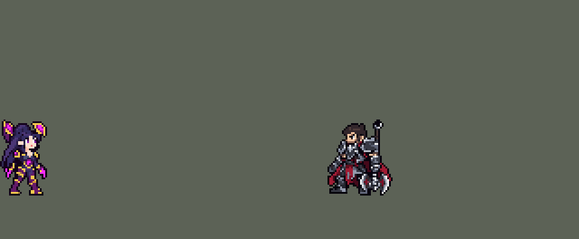

<!-- 本页上半部分由 tools/docs/gen_hero_docs.py 按仓库里现在的数据生成，手改会被覆盖；「开发记录」以下是手写的，生成时原样保留。 -->

# 卡莎 Kai'Sa


| 项目 | 内容 |
|---|---|
| id | `league_kaisa` |
| 所属的包 | 主包（mod_id `league`） |
| 分路 | ADC |
| 分类 / 标签 | 射手（Range） · AD / Range |
| 高清帧 | PPU 1.45 |
| 附加包 | [目标标记附加包](#附加包)（`league_marks`） |



其他预览：[逐帧预览](../preview/league_kaisa_frames.png)、[特效表](../preview/league_kaisa_effects.png)

## 现在的技能

下面是游戏里显示的技能说明（`league/text/champion.i18n` 的简体中文，去掉了颜色和图标），冷却、距离来自 `league/champion/league_kaisa.data_champion`；1 秒 = 60 tick。

### 普攻 / 被动

*攻击间隔 1 秒 · 攻击距离 55000*

普攻造成100% 攻击力物理伤害。体表活肤：普攻命中英雄叠电浆（被控制的英雄2层），每次命中附加18+9×层数魔法伤害；满5层引爆，造成80+60% 攻击力+8%最大生命真实伤害。极限超载：每8秒首次命中英雄时加速，随后4秒攻速+90%，9级起隐身0.5秒。

### 技能1 · 艾卡西亚暴雨

*冷却 8 秒 · 施放距离 60000 · 施放：指定目标 · 敌人（不含防御塔）*

朝周围敌人发射6枚导弹：第一枚射向目标，造成30+50% 攻击力物理伤害，其余每枚10+17% 攻击力。活体武器：攻击力达到200后变为12枚，每枚20+34% 攻击力。

### 技能2 · 虚空索敌

*冷却 12 秒 · 施放距离 150000 · 施放：方向 · 敌方英雄*

锁定后朝敌方英雄射出长距离虚空光束（开火前走开可躲），穿过小兵，命中的第一个英雄受到60+150% 攻击力物理伤害并叠2层电浆。活体武器：12级起叠3层并返还75%冷却。

### 大招 · 猎手本能

*冷却 50 秒 · 施放距离 100000 · 施放：指定目标 · 刚交过手的敌方英雄*

冲向一名近期受伤的敌方英雄，落地获得220+180% 攻击力的护盾，持续2秒。

### 数值

攻击力 100（每级 +20）、生命 900（每级 +90）、护甲 20（每级 +7）、魔抗 15（每级 +3）、移速 900（每级 +9）。

## 附加包

附加包是可选的原生代码 mod（都在附加包合集 `league_addons` 里），**不装主包里的英雄也是完整的**。

### 目标标记附加包

[目标标记附加包](../../addons/league_marks/README.md)：`league_marks` v0.1.1

| 英雄 | 主包（纯数据） | 装了附加包（英雄联盟） |
|---|---|---|
| 卡莎 体表活肤 | 电浆层数记在卡莎身上：打 A 叠的层数会在 B 身上引爆 | 每个英雄各记各的（4 秒）：普攻每次附加 18 + 9 × 层数 + 20% 法强的魔法伤害，同一个人第五层引爆 80 + 60% 攻击力 + 8% 最大生命的真实伤害 |

## 相关脚本和素材

- [`tools/lol/extract_kaisa.py`](../../tools/lol/extract_kaisa.py)
- [`tools/art/preview_kaisa.py`](../../tools/art/preview_kaisa.py)
- [`tools/art/import_kaisa.py`](../../tools/art/import_kaisa.py)
- [`tools/art/design_kaisa.py`](../../tools/art/design_kaisa.py)
- [`assets/source/kaisa/`](../../assets/source/kaisa)

## 开发记录

> 下面是原来 README 里「英雄：卡莎」一节，原样搬过来（只改了相对链接）。

| 部分 | 内容 |
|---|---|
| 定位 | 下路 ADC（远程，分类 Range），第九组的 ADC（同组有魔腾、青钢影、乐芙兰、娑娜）；本包第九个 ADC（艾希、金克丝、厄运小姐、伊泽瑞尔、卢锡安、薇恩、崔丝塔娜、凯特琳之后）。电浆叠满引爆打百分比伤害，Q 一片激光导弹，W 超远距离的虚空光束，大招冲到被打的英雄身边开护盾；技能随攻击力和等级进化 |
| 普攻 | 前臂发射电浆弹，100% 攻击力的物理伤害，射程 55000（英雄联盟 525，本包薇恩、卢锡安、伊泽瑞尔 55000），攻击间隔 60 tick（1 秒），第 8 tick 出手（动作第 3 帧，掌心 9 px 高），电浆弹每 tick 7000，`y_offset` -3000（抬 8 px，见凯特琳的子弹）。同一 tick 还射出两个只对英雄生效的"影子"弹（同速度同高度，所以同一 tick 落地）：一个叠电浆，一个只在目标被控制时多叠一层 |
| 被动 | 「体表活肤」（用户选 A：叠满引爆打百分比最大生命的真实伤害）：普攻打中敌方英雄叠一层电浆（4 秒，每次叠层刷新），这一下额外造成 18 + 9 × 已有层数的魔法伤害（+20% 法术强度）；打中被控制的英雄多叠一层（英雄联盟里队友的定身也给层数）。第 5 层引爆：80 + 60% 攻击力 + 目标 8% 最大生命的真实伤害（英雄联盟是 15% 已损生命，这个游戏读不到；模拟里引爆时目标平均已损 50–57% 的生命，15% 已损约等于 8% 最大。原来是 15% 最大生命，2026-10-15 用户：「卡莎的被动太强可以秒杀任何人」，见数值）。层数记在她自己身上（四个状态标记 `pl_1`–`pl_4`，同薇恩的圣银弩箭），头顶的标记亮几格就是几层（层数格画成 2 × 2，游戏尺寸下看得清）。模拟每局引爆约 2–3 次 |
| E（并入普攻） | 「极限超载」（用户选：E 并入普攻）：E 好了（冷却 8 秒）且 75000 内有敌方英雄时，这一枪触发：先加 60% 移速 1.1 秒，再加 90% 攻速 4 秒，身上每秒冒一次电弧。进化（9 级）后触发时隐身 0.5 秒。攻速和电弧的延迟挂在她自己身上（自己身上的范围效果）：原来挂在 E 检查时选中的敌方英雄身上，他 1.1 秒内死了（比如 R 飞进去打出引爆）攻速就整个没了（SDK 模拟里移速结束后没有攻速） |
| 技能1 | Q「艾卡西亚暴雨」：朝 60000 内的敌人施放（小兵和野怪也算，清线、打野也用），冷却 8 秒。第 9 tick 两个翼舱口闪光，射出 6 发激光导弹（进化后 12 发）：第一发打施法目标，30 + 50% 攻击力的物理伤害，其余每 2 tick 一发，打 60000 内随机一个敌人（伊泽瑞尔的随机投射物），每发 10 + 17%（进化后每发都是 20 + 34%）。英雄联盟里同一个目标挨的第二发起只有 25% 伤害；这个游戏分不清打中的是谁，而模拟里打中英雄的导弹 81%（5v5）、86%（2v2 死斗）落在这一轮已经挨过的英雄身上，所以第一发之后的导弹降到三分之一（2026-10-15，原来每发都是 30 + 50%，见数值）。导弹从三个高度出发（`y_offset` -21000、-12000、-30000：翼舱口和它上下），扇形散开再汇聚到目标，看起来是多道激光（用户：「Q应该是多重激光吧」；引擎里的追踪弹走直线，弯不了）。三个 `AddCasted` 挂在她身上轮流发射，比 12 份延迟小（技能树每 tick 复制一次，节点数影响帧率） |
| 技能2 | W「虚空索敌」：朝 150000 内的敌方英雄施放（方向型），冷却 12 秒，只对英雄放。站着抬起前臂炮蓄力，第 23 tick 开火；瞄准在开火前 6 tick 锁定（凯特琳 Q 的隐形抛物线），锁定后走开就能躲。一发大号虚空光弹（每 tick 14000，半径 5000，`y_offset` -3000）穿过小兵和野怪（不伤它们），打中第一个敌方英雄：60 + 150% 攻击力的物理伤害，叠 2 层电浆。进化（12 级）后叠 3 层并返还 75% 冷却。模拟每局放约 19 次、打中英雄约 3–6 次（AI 的英雄一直在走动） |
| 大招 | R「猎手本能」：对 100000 内近期被己方打过的敌方英雄施放，冷却 50 秒。前 8 tick 起跳（起跳点留下地面爆光），然后以冲刺姿势飞向他（每 tick 6000，身后拖着紫色尾迹），落地获得 220 + 180% 攻击力的护盾，持续 2 秒。英雄联盟要求目标身上有电浆；挂这个条件时 AI 照样施放，分支是空的，每局 4–5 次里浪费 2 次，所以改成"近期被己方打过"（`EnemyChampionRecentlyAttacked`） |
| 附加包 | 可选的附加包 [`addons/league_marks`](../../addons/league_marks/README.md)（在附加包合集里，原生代码，主包不装它也完整）：体表活肤的电浆照英雄联盟按目标记层，同一个人第五层才引爆（主包的层数记在卡莎自己身上） |
| 连招 | 用户要求：「有连招要做连招」「都要帮我补」。英雄联盟里卡莎只能对带电浆的英雄放 R，所以先远处 W 叠两层，再直接 R 过去。这里不再加电浆限制（以前加过：AI 照样放，分支空着，每局浪费 2 次），改成 **W→R**：虚空索敌打中敌方英雄时开 240 tick（4 秒，和电浆一样长）的窗口；窗口里放 R，不再先蹲 7 tick，第 1 tick 就起跳冲过去（同样的冲刺、落地护盾），窗口用掉；R 的目标是近期被己方打过的英雄，刚被 W 打中的那个就算。窗口外的 R 不变。数值、冷却不变。数据由 [`tools/fix/combo_kaisa.py`](../../tools/fix/combo_kaisa.py) 改 |
| 进化 | 「活体武器」（用户选 A：按属性进化）：Q 在攻击力达到 200 时进化，E 在 9 级，W 在 12 级。游戏读不到攻击力和等级，用崔丝塔娜的自测：在 99% 减伤下给自己挂 3 tick 护盾、再用自己的攻击力（或最大生命，对照等级表）打自己一下，护盾被打破就说明到了；打架时要连续两次通过，每条命的第一次施放静默重读（死亡清掉状态）。自测不扣血（2026-10-04，用户：「卡莎的q有点bug 这么q消耗自己的血」：打破护盾后多出来的伤害原来落到血上，每次 4–50 点，带生命装更多，Q 还会冒出 250–340 的自伤数字）：护盾后面紧跟一层 1 tick 的吸收盾，护盾按添加的顺序吸收（SDK 模拟：23 打 39 的盾剩 16，43 打 39 不掉血），吸收盾在同一 tick 结束时就没了，2 tick 后读的还是自测盾；自测的一击缩到攻击力的 5%（护盾 10）、最大生命的 2%（护盾 32 / 37，引擎向下取整），每 15 秒最多一次（原来 5 秒）。两局 18 分钟模拟：自测掉血 0 次（原来 10 次），进化时间不变。进化时身上一道光柱。模拟里 Q 约 4 分钟进化，E 约 7 分钟，W 10 分钟内很少到 |
| 数值 | 攻击 100（+20）、生命 900（+90）、护甲 20（+7）、魔抗 15（+3）、移速 900（+9），和本包其他射手一样。数值是自己设计的，用 SDK 对战模拟调：下路，对 4 个原版射手（`gunner`、`soldier`、`archer`、`gambler`），三套队友阵容、两边各 12 局，一批 288 局。第一版 −0.55：R 冲到目标身上，每局死 2.6 次（同一批薇恩 1.5 次、+2.16）。R 的施放距离 150000 → 100000、护盾 80 + 110% → 150 + 150% 后 +0.68，死 2.1 次（改成冲到他 45000 外停下 +0.76，差别在一批的波动内，保留身体飞过去的冲刺，像英雄联盟）；Q 每发 22 + 40% → 30 + 50%（进化后 15 + 27% → 20 + 34%）+0.93；再把 E 的攻速 70% → 90%、移速 45% → 60%，护盾 → 220 + 180%，被动每次命中 15 + 8 × 层 → 18 + 9 × 层、引爆 60 + 50% + 12% → 80 + 60% + 15%，两批 +2.35 / +2.42（只加 E 和护盾的 +1.96），在本包射手的范围里（+2.1–2.5），定下这版。E 的攻速改挂在她自己身上后同两批种子 +2.18 / +2.78，差别在波动内。每局放 Q 约 36 次（平均每次 9.7 发）、W 约 21 次（打中英雄 3–6 次）、R 约 4.4 次，引爆 2–3 次。2026-10-15（用户：「卡莎就是数值异常伤害莫名其妙的高」）：2v2 死斗（经典 SDK 的 `DeathMatch` 模式、游戏的 2v2 设定，2 分钟；她和盖伦 / 蕾欧娜 / 李青之一对 6 个本包射手配同一个队友，两边，一批 144 局）击杀差 +4.45（两批平均），本包其他射手 −5.1 到 +1.8（金克丝最高）；伤害 23400，其他射手 12000–17000。死斗没有小兵，Q 的导弹全落在一两个英雄身上，被动的引爆一局 4–5 次。同时 5v5 下路 +3.31（同批种子：金克丝 +4.95、伊泽瑞尔 +3.22、薇恩 +2.24、凯特琳 +1.74、烬 +1.16），在范围里。两边一起看（每项两批）：Q 第一发之后的导弹三分之一 + 引爆 8% 最大生命，2v2 +2.14 / 5v5 +1.57，定下这版；进化后的 Q 也降（第一发之后 14 + 24%）2v2 +1.98 / 5v5 +0.97，全部导弹三分之一 + 8% 是 +1.56 / +0.39，5v5 掉得比 2v2 多，没用 |
| 亚索联动 | 卡莎没有控制（被动对被控制的英雄多叠一层，控制来自队友），亚索大招不受影响，不用调 |
| 精灵图 | 10 个动作 51 帧：待机、移动、普攻、Q、W、R 起跳、R 冲刺、R 落地、受击、死亡。造型按用户在 Codex 里挑的原画（B：翼舱张开），由 Codex 画 Q 版（用户选「B44」：44 行）：深紫长发、浅钢蓝紧身衣、深紫甲片、金边、洋红发光纹、淡紫靴、背后一对张开的翼舱。翼舱顶到脚底 44 px，34 色。第二版（2026-10-03，玩家：「身宽体胖 脸大」）：Codex 重画的瘦身稿 A 按它自己的格子读回、整行整列删到 42 行（用户选「42 格」），25 × 42 px，709 格，33 色；两只翼舱往两侧各移 2 格，中间的头顶手描成圆弧 |
| 高清帧（PPU 1.45） | 2026-10-18 用 PPU 重做，还是 Q 版（用户：「接下来可以重做卡莎 还是按赵兴的步骤 让codex生成一下」），按赵信的做法：Codex 只画一张设计图（提示词包 [`tools/art/pack_kaisa_ppu.py`](../../tools/art/pack_kaisa_ppu.py) / [`assets/source/kaisa/PICTURE_PROMPT_PPU.md`](../../assets/source/kaisa/PICTURE_PROMPT_PPU.md)，交付在 `assets/source/kaisa/hd/`）。它自己导出的 44 × 63 是按格子中心取样的（脸和宝石碎成点），不用；原始生成图 `raw/generation-02.png` 按它自己 19.3 px 的格子读回，42 × 61、40 色，眼睛逐格改（[`tools/art/design_kaisa_hd.py`](../../tools/art/design_kaisa_hd.py)），用户：「设计可以，用 PPU 1.45（和现在一样高）」。动作照英雄联盟每帧的骨骼摆（[`tools/art/rig_kaisa_hd.py`](../../tools/art/rig_kaisa_hd.py)，关节是 45° 侧身的 `poses_hd.json`）：手臂只做无损的原样 / 镜像 / 直角转，身体不转；上身最多偏离髋部 1 格（她的髋甲下面是空的，偏多了大腿和髋甲之间露缝）；R 先蹲（上身下沉最多 2 行）、整个人顺时针转 90° 头朝前横飞（拖尾对齐到身体）、落地蹲住再站起；死亡最后整个人躺下。移动：用设计的腿平移、裁行抬脚、逐行斜摆都被用户否了（「走路腿变形啊」「看起来像平移」「没有前后换腿交叉步的感觉」「有点变形啊」），最后让 Codex 只重画腿（[`tools/art/pack_kaisa_walk.py`](../../tools/art/pack_kaisa_walk.py) / [`WALK_PROMPT_PPU.md`](../../assets/source/kaisa/WALK_PROMPT_PPU.md)：模板是摆好的 8 帧，每格 6 px），[`tools/art/import_kaisa_walk.py`](../../tools/art/import_kaisa_walk.py) 按模板的格子读回、颜色归到设计腿上的颜色，只取髋甲以下，上身和手臂用设计原样：弯膝、后脚跟踢起、前后交叉换腿。普攻、Q、W、R 的特效照旧画在帧里（`assets/source/native/kaisa_bake.json`）。头像点 (1, −36) 在头发顶（`tfm2_ase.py face` 把翼舱尖当成头顶），选人卡 −8（`bp_card_audit.py` 的规则）。league.dll 0.7.40，主包 0.147.0 |
| 音效 | 英雄联盟的音效和配音（`tools/lol/extract_kaisa.py`）：电浆弹、命中、引爆、极限超载、进化、Q 发射和每发命中、W 蓄力 / 开火 / 命中、R 起跳 / 冲刺 / 护盾；Q、W、R 带中文配音（E 的台词 4 秒长，不用） |
| 修正（0.124.2） | 玩家：「kaisa doesn't auto for some reason she just spams abilities」。等级探针（Q 在攻击力 200、E 9 级、W 12 级进化前的自测）放在 Q 的技能树里，每个探针给自己套一个 1 tick 的 1000000 护盾吃掉自测伤害（0.50.x「卡莎的q有点bug」那次加的）；游戏 0.6.x 读技能树估值时护盾按全额算（champion-data 第 8 节），Q 在它眼里值一百万。[`tools/fix/hide_probes.py`](../../tools/fix/hide_probes.py) 把探针包进维克托那样的 `unseen`（同一下立标记、读、去掉，两个 tick 之间永远不在），Q 的估值回到 161（只剩伤害）；探针照常工作（模拟里 Q / E / W 照样进化）。经典模拟 96 局：+2.42 → +3.50（误差内），施法次数不变。是不是就是这个原因要看游戏里的观察日志确认；崔丝塔娜、凯尔的探针是同一种写法，没收到反馈，没改 |
| 修正（0.170.2） | 用户让查附加包日志时在芸阿娜身上发现：引擎给大招冷却封顶时，把 `skill_cooldown_mult` 也算进去（技能冷却削减同时压大招）。进化后虚空索敌打中英雄返还 75% 冷却时，大招冷却也被压到四分之一。同一个 buff 加上相同大小的负 `ult_cooldown_mult` 抵掉（[`tools/fix/ult_cooldown_offset.py`](../../tools/fix/ult_cooldown_offset.py) / 生成脚本），只减原本要减的技能。经典模拟（8 个种子，三套阵容两边各打） 不变（+1.63：10 分钟里很少进化） |

重新生成（素材来自本机的英雄联盟客户端，音频不进仓库）：

```bash
python tools/lol/extract_kaisa.py --lol "D:\WeGameApps\lol" --vgmstream "<vgmstream-cli.exe 路径>"
python tools/lol/native_pose.py assets/source/kaisa/poses.json --out <渲染文件夹>   # 动作参考帧
python tools/art/design_kaisa_v2.py      # 造型（第二版）：Codex 的瘦身稿 A 按自己的格子读回，删到 42 行；翼舱各往外移 2 格，头顶手描
python tools/art/fix_kaisa_strips_v2.py  # 动作（第二版）：站着的帧是待机的身体，只有近侧手臂和 Q 张开的翼是 Codex 的；死亡 3–8 帧在待机的身体上画（kaisa_death.py）
python tools/art/import_native.py --hero kaisa
python tools/art/import_kaisa.py      # 特效；--raw <Codex 的特效交付文件夹> 先把生图原稿缩成游戏尺寸的原尺寸条
python tools/art/pack_kaisa_ppu.py --out <文件夹>   # 高清造型（PPU 1.45）：给 Codex 的重画包
python tools/art/design_kaisa_hd.py   # Codex 的原始生成图按 19.3 px 的格子读回、眼睛逐格改；--review <文件夹> 出大小对比
python tools/lol/league_joints.py assets/source/kaisa/poses_hd.json --out <关节文件夹>   # 英雄联盟每帧的关节位置（45° 侧身）
python tools/art/pack_kaisa_walk.py --joints <关节文件夹>/kaisa_joints.json --out <文件夹>   # 移动：给 Codex 的重画腿的包
python tools/art/import_kaisa_walk.py   # Codex 画的腿读回成 assets/source/kaisa/hd/walk_legs.png
python tools/art/rig_kaisa_hd.py --joints <关节文件夹>/kaisa_joints.json   # 高清帧：照骨骼摆，写 assets/source/ppu/orig/；--review <文件夹> 先看
python tools/art/ppu_restyle.py --hero kaisa
python tools/art/ppu_hd.py --hero kaisa
python tools/art/preview_kaisa.py
```

美术（原画的提示词见 [`assets/source/kaisa/PICTURE_PROMPT.md`](../../assets/source/kaisa/PICTURE_PROMPT.md)，造型的见 [`MODEL_PROMPTS.md`](../../assets/source/kaisa/MODEL_PROMPTS.md)，9 条动作的见 [`MODEL_STRIPS.md`](../../assets/source/kaisa/MODEL_STRIPS.md)，移动重画的见 [`RUN_REDO.md`](../../assets/source/kaisa/RUN_REDO.md)，特效的见 [`PROMPTS.md`](../../assets/source/kaisa/PROMPTS.md)；Codex 的交接说明在 [`codex_model/`](../../assets/source/kaisa/codex_model)、[`codex_strips/`](../../assets/source/kaisa/codex_strips)、[`codex_fx/`](../../assets/source/kaisa/codex_fx)）：

- 原画和造型：Codex 画了两张原画，用户选 B（翼舱张开：她跑动、攻击时都张着，每条动作里翼舱是同一个形状，洋红色的光在深色身体上看得清）。造型包让 Codex 按游戏尺寸画，交回的仍是大图（A 79 格高、B 64 格高）。`design_kaisa.py`：`regrid.py` 按画出来的方格取像素，合并到 26 色（两只眼睛的虹膜保住），按删行规划裁到 40 / 42 / 44 行三版，用户选 44 行（「选B44」）；一层描边，放到 128 × 128 的画布上，脚底在第 99 行、两脚中间在第 64 列。
- 动作：Codex 按参考帧画了 9 条，每帧贴定稿的头、用定稿的颜色；交回的摆动的腿全是 2–4 格粗的描边色色块（像一条尾巴），移动一个周期只迈一步。用户：「有问题的地方你进行收尾修正就行了」。`fix_kaisa_strips.py`：R 起跳第 1、2 帧甩起的头发（最暗的发色，像一根黑刺）内部换成中间色、左边提亮。
- 移动：前后改了十三次（之前几版的问题：腿和身体脱节、腿太长、蛙腿、和放技能时的腿不一样、截肢、一粗一细、腿挂在侧面、脚像钉子、大腿不动、整条腿像木板滑、叉得太开）。定下来的这版（用户：「这版走路可以了」）全部用待机自己的像素：切线在腰带，腰带以上和两只手不动、落地两帧低一行；腰带下那两块洋红金边的其实是大腿（之前每版都把它们冻在待机的叉开姿势，只重画膝盖以下，所以脱节、大腿不跟着动），现在每条大腿是待机自己的大腿，斜切让膝盖收到身体下面并跟着步子摆；两条小腿都用待机右腿那段（护膝、小腿、靴子，一样粗），撑地时斜切让脚往后滑，后踢时护膝留在膝盖下、靴子抬起挪到膝盖后面（`RUN_POSE`）。步态照英雄联盟在游戏镜头下的跑步（按游戏尺寸逐关节渲染出来看：两腿在身体下面、以上抬为主，不往前后叉开）：近腿 2–5 帧撑地，远腿 6–8、1 帧撑地。待机的两条小腿原来一粗一细（「待机时候腿一粗一细」），左小腿换成右小腿的镜像，靴子还站在原处；普攻、Q、W、受击的腿和跑步都取自这个待机。之后又统一了其余动作的腿（用户：「你要改全改啊 什么SKILL 大招里面的腿还是不一样」「攻击的腿也不一样」）：Codex 照待机画的帧（普攻、Q、W 的首尾帧，受击第 2 帧，R 落地最后一帧）同样换成一样粗的两条小腿；摆姿势的帧（R 起跳 1–3、冲刺、落地 1–2，死亡 1–6）原来的腿比待机粗、颜色更深，现在每帧都换成待机自己的大腿和小腿，按原来的姿势斜切、转动（`POSED_LEGS`，脚底落在脚底线上）；死亡最后两帧趴在地上，腿几乎看不见，保留原样。之后试过一版更像英雄联盟的跑步（摆动腿的脚跟踢到膝盖高度、身体起伏 2 行、手臂前后摆），用户觉得不如这版，保留这版。
- 第二版（2026-10-03）：玩家说卡莎「身宽体胖 脸大」（第一版 44 行、头占 23 行、932 格）。Codex 照 `MODEL_V2.md` 重画瘦身稿，用户选 A；`design_kaisa_v2.py` 和第一版一样按草稿自己的格子读回、整行整列删到 42 行（脸、眼睛、洋红光纹和金边不删）。删行在近侧翼舱左边留下一个缺口（用户：「卡莎头顶少一块模型」），补成一块后又像鸡冠、像鼓包（「卡莎公鸡头？」「头顶凸出来的那一块 不难看吗」），用户：「你把护翼往两侧扩出去一点不就能改了吗」——两只翼舱连描边各往外移 2 格（`PODS_OUT`），中间的头顶逐格手描成一条圆弧（`CROWN`，用户在对比图里选右图，接缝补好）；远侧眼睛补成和近侧一样大（`EYE_FAR`：「眼睛也是一大一小」）。动作由 Codex 按第二版重画 9 条（`MODEL_STRIPS_V2.md`），`fix_kaisa_strips_v2.py` 收尾（用户：「卡莎的也好了 有奇怪的地方请帮忙给codex擦屁股」，又：「手臂待机和释放技能时尺寸还是不一样」「上半身也是 释放技能上半身衣服变了」「体型也变了」）：站着的帧（普攻、Q、W、受击、R 落地后两帧、死亡前两帧）逐格用待机的身体，只有近侧手臂（沿 Codex 的手臂重画成 3 格宽，材质同待机）、W 的臂炮和 Q 第 3–4 帧张开的翼是 Codex 的（第 2、5 帧半张的翼在外移的翼舱旁成了碎条，改成合着）；直立但不站着的帧（移动、R 起跳、R 落地前两帧）头换成待机的头，移动时背后的长发也用待机的（「卡莎的发型怪异」）；死亡 3–8 帧 Codex 画的是旧模型（「死亡时候的脸也不对 身体还是原版的？」），`kaisa_death.py` 照凯特琳的做法在待机身体上画：单膝跪、双膝跪着瘫下、趴在地上（头竖着、下巴贴地）。
- 特效用 Codex 画的 20 张（生图原稿，`import_kaisa.py --raw` 每格缩到游戏尺寸：每个游戏像素取覆盖的原稿像素里最多的颜色，三分之一以上不透明才画，颜色归到包里的色阶，光效外圈的暗色描边去掉）。电浆层数标记缩小后 4 个层数格连成一条，改成按宝石定位、层数格重画成 2 × 2、间隔 1 格（亮 = 已叠，暗 = 未叠）。用户看了说「Q和w特效和lol不一样」「Q应该是多重激光吧 w应该做大点吧 飞得距离很远啊」：Q 的导弹和 W 的光弹改成照英雄联盟自己的贴图（`Kaisa_Base_W_Bullet`、`W_plasma`、`Q_cas_smoke` 的颜色）画：W 是 45 × 13 的淡紫光弹（#C87FF2，粉白亮芯 #F9D9EF，带洋红电弧 #E66AD7 的波浪拖尾），蓄力、炮口和命中换成同一套紫色、放大（炮口 26 px、命中 30 px）；Q 每发是一道 26 px 的紫红激光（白粉色的头），前两帧从翼舱长出来。位置：掌心闪光在普攻第 3 帧掌心外 (19, −9)、第 4 帧 (23, −10)；W 蓄力在炮口 (22, −10)，开火的爆光在举起的炮口 (−15) 和光弹（8 px 高）之间；Q 的闪光在两个翼舱口 (−13, −30)、(16, −29)；地面上的（E 的光圈、R 起跳和落地、进化光柱）在脚底那一行；电浆标记在头顶上方。

逐帧预览：[`docs/preview/league_kaisa_frames.png`](../preview/league_kaisa_frames.png?v=1023ct)，特效：[`docs/preview/league_kaisa_effects.png`](../preview/league_kaisa_effects.png?v=1018ks)。
