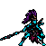
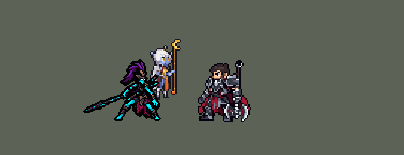

<!-- 本页上半部分由 tools/docs/gen_hero_docs.py 按仓库里现在的数据生成，手改会被覆盖；「开发记录」以下是手写的，生成时原样保留。 -->

# 卡莉丝塔 Kalista



| 项目 | 内容 |
|---|---|
| id | `league_kalista` |
| 所属的包 | 主包（mod_id `league`） |
| 分路 | ADC |
| 分类 / 标签 | 射手（Range） · AD / Range |
| 高清帧 | PPU 1.4 |
| 附加包 | [卡莉丝塔附加包](#附加包)（`league_kalista`）、[游戏 AI 不按的技能替它按](#附加包)（`league_ult_press`） |



其他预览：[逐帧预览](../preview/league_kalista_frames.png)、[特效表](../preview/league_kalista_effects.png)

## 现在的技能

下面是游戏里显示的技能说明（`league/text/champion.i18n` 的简体中文，去掉了颜色和图标），冷却、距离来自 `league/champion/league_kalista.data_champion`；1 秒 = 60 tick。

### 普攻 / 被动

*攻击间隔 0.77 秒 · 攻击距离 52500*

投矛，命中的敌人身上插一支矛（4秒）。武术姿态：每次投矛后向后跳开。哨兵：有队友在目标身边时，额外造成目标14%最大生命值的真实伤害（5秒一次）。

### 技能1 · 穿刺

*冷却 7 秒 · 施放距离 100000 · 施放：指定目标 · 敌人（不含防御塔）*

掷出长矛，对第一个敌人造成120 + 105% 攻击力物理伤害并插上一支矛；若将其击杀，长矛穿过去命中下一个。

### 技能2 · 撕裂

*冷却 1.5 秒 · 施放距离 100000 · 施放：指定目标 · 刚交过手的敌方英雄*

拔出所有敌人身上的矛：每支造成20 + 50% 攻击力物理伤害并减速8%。击杀英雄时刷新冷却。插满3支时自动拔出。

### 大招 · 命运的召唤

*冷却 80 秒 · 施放距离 90000 · 施放：指定目标 · 敌方英雄*

把身边一名队友拉进身体保护0.5秒，然后甩向目标，落地击飞周围敌人1.25秒，造成80 + 60% 攻击力物理伤害。

### 数值

攻击力 116（每级 +20）、生命 1150（每级 +88）、护甲 26（每级 +7）、魔抗 15（每级 +3）、移速 900（每级 +9）。

## 附加包

附加包是可选的原生代码 mod（都在附加包合集 `league_addons` 里），**不装主包里的英雄也是完整的**。

### 卡莉丝塔附加包

[卡莉丝塔附加包](../../addons/league_kalista/README.md)：`league_kalista` v0.2.0

|  | 主包（纯数据） | 装了附加包 |
|---|---|---|
| 武术姿态 | 每次投矛后背离目标往后跳（风筝） | **每次投矛后自己判断往哪跳**：最近的敌方英雄残血（40% 以下），或者它在逃（越跑越远）而且快跑出射程（超过攻击距离 80%），就往前追；贴到射程 60% 以内或正冲过来，就往后拉开；其余（站着对射）绕着它左右交替侧跳，跳完离它一样远；身边没有敌方英雄（打小兵、野怪、塔）时原地前后交替跳 |
| 誓约者 | 没有誓约：大招拉 70000 内随机一个队友 | **开局绑定一名队友**（辅助位优先，没有就最近的队友英雄，每条命出生时重新看），大招对誓约者施放 |
| 命运的召唤 | 对敌方英雄施放：把队友拉进来保护，然后用拉扯区把他甩向施放时的目标位置 | 把誓约者拉进来保护、定身，然后**逐 tick 飞向离她最近的敌方英雄现在的位置**（90000 内，没有就两倍范围），到了就在脚下击飞周围敌人 |
| 撕裂 | 攒到 3 根矛自动拔 | 另外**按护甲算拔矛伤害，够杀就立刻拔**（矛不够 3 根也拔） |

装上附加包后游戏里显示的说明（和主包不同的部分）：

- **普攻 / 被动**：【附加包】投矛，命中的敌人身上插一支矛（4秒）。武术姿态：每次投矛后自己挑方向跳——敌人残血或逃跑就往前追，贴近或冲过来就往后拉开，对射时左右侧跳，打小兵、野怪时原地前后跳。哨兵：有队友在目标身边时，额外造成目标14%最大生命值的真实伤害。
- **大招 · 命运的召唤**：【附加包】开局和一名队友立下誓约（辅助优先）。把誓约者拉进身体保护0.5秒，然后甩到最近的敌方英雄身边，落地击飞周围敌人1.25秒，造成80 + 60% 攻击力物理伤害。

### 游戏 AI 不按的技能替它按

[游戏 AI 不按的技能替它按](../../addons/league_ult_press/README.md)：`league_ult_press` v0.5.7（通用附加包，下面只列和卡莉丝塔有关的部分）

|  | 装了附加包，什么时候按 |
|---|---|
| 卡莉丝塔 E | 主包「矛够了」的标记（`league_kalista_e_ok`）在、撕裂不在冷却（`league_kalista_e_cd`）：按下就是撕裂，不会空按 |

## 相关脚本和素材

- [`tools/kit/build_kalista.py`](../../tools/kit/build_kalista.py)
- [`tools/kit/setup_kalista.py`](../../tools/kit/setup_kalista.py)
- [`tools/lol/extract_kalista.py`](../../tools/lol/extract_kalista.py)
- [`tools/art/preview_kalista.py`](../../tools/art/preview_kalista.py)
- [`tools/art/rig_kalista.py`](../../tools/art/rig_kalista.py)
- [`assets/source/kalista/`](../../assets/source/kalista)

## 开发记录

> 下面是原来 README 里「英雄：卡莉丝塔」一节，原样搬过来（只改了相对链接）。

| 部分 | 内容 |
|---|---|
| 定位 | ADC（Marksman，标签 AD / Range），第 109 位英雄。复仇之矛 卡莉丝塔（官方简中「卡莉丝塔」）：投矛的射手，矛插在敌人身上、撕裂一起拔出，大招把誓约者甩进敌阵。用户的选择（「全按推荐做」）：ADC；W 灵魂绑定做成被动的「哨兵」伤害、灵魂标记并进普攻；武术姿态主包每次投矛后往后跳、附加包自己判断往前还是往后（「这个得做啊 附加包 往前还是往后灵活判断啊」）；职业连招开；原画选 A；大小 85%、高清 PPU 1.4（「模型太大 第二像素太高 需要降低」） |
| 普攻 / 被动 | 投矛（攻击距离 52500，攻击间隔 46 tick，第 7 tick 出手、追踪，90% 攻击力物理）。每支打中的矛（普攻、Q）插在敌人身上 240 tick（塔除外），画面每 12 tick 闪一次。「武术姿态」：照英雄联盟每次投矛后都背离目标往后跳 24 格（12 tick；先做的 18 格在游戏里看不出来，用户：「还是不前后跳」；30 格常把自己跳出射程，模拟掉到 −0.55；第一版只在 40000 内有敌方英雄时跳，用户：「平A 前进后退的动作没了吗？这符合LOL的设定吗？」），出手后 5 tick 才跳，让甩矛那一帧露出来（用户进游戏：「平A动作还是不对啊 不用武器啊」——原来一出手就播跳的动作，甩矛的帧被盖掉）。普攻动作照英雄联盟：把手里的长矛举过肩甩出去，收势时矛回到手里（用户：「怎么平A的时候武器不动啊」，用 Q 那几帧，没有重画） |
| W | 「哨兵」（灵魂绑定，被动）：她的矛打中的敌方英雄身边 45000 内站着另一个己方英雄时，额外造成目标 12% 最大生命的真实伤害，300 tick 一次 |
| 技能1 | Q「穿刺」：冷却 420 tick，对 100000 内的敌人放（小兵、野怪也打），第 7 tick 朝他当时站的地方直线投出（走位能躲），停在第一个打中的单位上：100 + 105% 攻击力物理并插一支矛；这个单位被打死，就由一支看不见的矛沿直线接着打后面的单位。投完也会跳 |
| 技能2 | E「撕裂」：每支矛只拔一次（数据里的矛按「代」记，每次撕裂换一代，拔过的不会再炸）。插在英雄身上的矛攒到 3 支时，带来第 3 支的那一下当场拔（3 级起）；另外每 90 tick 看一次 100000 内被己方打过的英雄，矛够了就拔：每支矛 15 + 40% 攻击力物理、减速 8%（120 tick）；冷却 600 tick，拔死英雄就返还冷却（金克丝的击杀检查） |
| 大招 | 「命运的召唤」：冷却 4800 tick，90000 内有敌方英雄、70000 内有队友时放（没有队友就返还冷却）。把队友拉进身体保护 30 tick（隐身、受到伤害 −90%），甩向目标：落地时周围 26000 内的敌人击飞 75 tick，80 + 60% 攻击力物理；落地后能拔矛就接撕裂（R→E） |
| 附加包 | 可选的附加包 [`addons/league_kalista`](../../addons/league_kalista/README.md)（在附加包合集里，原生代码，主包不装它也完整）：**武术姿态每次投矛后自己挑方向跳**（最近的敌方英雄残血或越跑越远快出射程就往前追，贴近或冲过来就往后拉开，站着对射时绕着它左右交替侧跳，打小兵、野怪、塔时原地前后交替跳）；**开局绑定誓约者**（辅助位优先，没有就最近的队友），大招对誓约者施放；**甩出去的飞行**逐 tick 飞向离她最近的敌方英雄；**撕裂按护甲算伤害，够杀就立刻拔**。0.1.1：游戏把正在播的施法动作也记成一种控制，第一版每跳都以为自己被控、一格没挪（日志 89 跳全是「moved 0」），现在只在硬控时停。0.2.0（用户 11-01：「卡莉斯塔为什么只会往后滑？」）：0.1.x 打英雄除了追残血 / 逃跑都往后跳（11-01 的日志 103 跳里 77 跳往后），打小兵、野怪时附加包不挂标记、数据一律往后跳；现在被贴近（射程 60% 以内）、被冲（对方 15 tick 里自己往她这边挪了 4000；只看对方的位移，她走回射程不算）才往后，站着对射侧跳（沿以对方为圆心的圆走 24 格的弦，跳完离它一样远，往一边会出地图就换边），打小兵照最近的敌方单位先前后后、回到原地，英雄数据没改。Q 打死后矛转到下一个目标那一条原生代码挪不了数据挂的矛，没有做。日志 `league_kalista.log`（`HOP … (Strafe / Wave …)`、`HOP DONE … from … (was …)`）。0.2.0 还没在游戏里看过 |
| 附加包（替 AI 按） | 可选的附加包 [`addons/league_ult_press`](../../addons/league_ult_press/README.md)（在附加包合集里，原生代码，主包不装它也完整）：游戏 0.6.4 的 AI 很少按她每 90 tick 检查一次的 E（只读观察包：每 10 分钟 1.4 次，383 局）。附加包按局面替 AI 按（用户：「有问题的英雄全部改成rust」）：主包「矛够了」的标记在、撕裂不在冷却时就按（按下就是撕裂，不会空按），100000 内由近到远找引擎接受的目标（最近被我方打过的） |
| 数值 | 攻击 116（+20）、生命 1150（+88）、护甲 26（+7）、魔抗 15（+3）、移速 900（+9）；Q 120 + 105% 攻击力，撕裂每支 20 + 50% 攻击力，哨兵 14% |
| 平衡 | 下路对四个基础射手（枪手、士兵、弓箭手、赌徒），三套阵容、两边各打，10 分钟经典引擎模拟 16 个种子：定稿 +1.42（同组射手：韦鲁斯 +1.63、图奇 +1.59）。照英雄联盟比例的草案 −1.83；撕裂改成攒 3 支自动拔、每支 15 + 40% → +0.03；生命 950、哨兵 10% → +0.97；攻击 104、Q 7 秒 → +1.17；按动作重排时间后掉到 −0.41，攻击间隔 46 → +0.95；Q 100、哨兵 12% → +1.19；生命 1000 → +1.42。改成每次投矛都跳之后（0.119.1）：跳 18 格 +0.96、30 格 −0.55，单加攻击 / 攻速 / 坦度 / 技能伤害都在 0 上下，全部一起加、跳 24 格 +1.59（另一批种子见 PR）。亚索大招联动：她在队里时亚索每局对英雄放大招 0.67 次（韦鲁斯 0.67、基础弓箭手 0.58），亚索不用改 |
| 精灵图（高清帧 PPU 1.4） | Codex 第 0 步画了两张原画，用户选 A；Codex 第 2 步照英雄联盟的骨架画了 40 帧就没额度了（用户：「你能画吗？用点工具和技术」），[`tools/art/import_kalista_strips.py`](../../tools/art/import_kalista_strips.py) 补完：按头的大小把画大的帧拉回原尺寸、每帧贴造型的整颗头，跑步用造型的身体 + 英雄联盟 Run1 的腿关节重画（两条腿交叉换步），阵亡从通过的帧和造型 B 转出来。[`tools/art/rig_kalista.py`](../../tools/art/rig_kalista.py) 缩到 85%、降到 PPU 1.4，待机呼吸（矛跟着身体走）、受击闪白 |
| 特效 | Codex 第 3 步的 15 个特效（用户转来的截图，`assets/source/kalista/codex_fx`），[`tools/art/import_kalista_fx.py`](../../tools/art/import_kalista_fx.py) 逐个去底、按游戏尺寸读回（`league_kalista_fx` 小的、`league_kalista_big` 大的）：截图里飞出去的矛身比一个游戏像素还细，单独补回中线的黑矛身；小特效按用户的意思放大约 30%（「有的特效也做大点吧稍微 看起来不太明显」） |
| 音效 | 英雄联盟的音效和配音（[`tools/lol/extract_kalista.py`](../../tools/lol/extract_kalista.py)，16 段） |
| 图标 | 官方技能图标（Q 穿刺 / E 撕裂 / R 命运的召唤，另有 W 哨兵、被动武术姿态），从本地客户端取 |

重新生成（素材来自本机的英雄联盟客户端，音频不进仓库）：

```bash
python tools/lol/extract_kalista.py
python tools/kit/build_kalista.py                  # 技能数据，数字都在脚本的参数表 P 里
python tools/kit/setup_kalista.py                  # 五种语言的文字、音效配置、共享文件里她的键
python tools/art/import_kalista_strips.py          # Codex 的 40 帧补完：大小拉回、贴造型的头、跑步和阵亡
python tools/art/rig_kalista.py                    # 85%、PPU 1.4 的帧和 1 倍图
python tools/art/ppu_restyle.py --hero kalista     # 描边（不要加 --preview）
python tools/art/ppu_hd.py --hero kalista          # hd_ / lo_ 帧
python tools/art/import_kalista_fx.py              # 特效
python tools/art/preview_kalista.py                # 预览和演示 GIF
python addons/league_kalista/make_override.py      # 附加包的副本（主包的卡莉丝塔改了就重跑）
```

美术提示词见 [`assets/source/kalista/`](../../assets/source/kalista) 里的 `PICTURE_PROMPT.md`、`MODEL_STRIPS.md`、`PROMPTS_FX.md`；Codex 的交付在 `codex_picture/`、`codex_strips/`、`codex_fx/`。

逐帧预览：[`docs/preview/league_kalista_frames.png`](../preview/league_kalista_frames.png?v=1016a)，特效：[`docs/preview/league_kalista_effects.png`](../preview/league_kalista_effects.png?v=1016a)。
