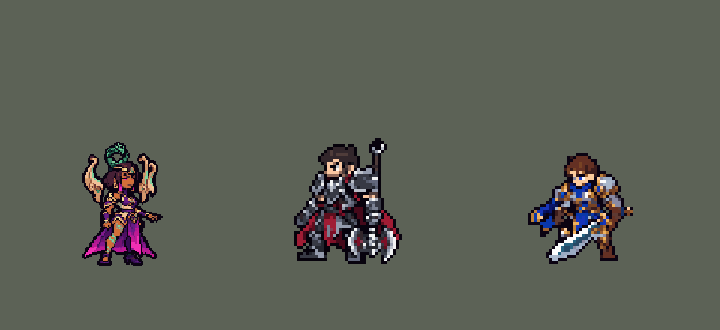

<!-- 本页上半部分由 tools/docs/gen_hero_docs.py 按仓库里现在的数据生成，手改会被覆盖；「开发记录」以下是手写的，生成时原样保留。 -->

# 卡尔玛 Karma


| 项目 | 内容 |
|---|---|
| id | `league_karma` |
| 所属的包 | 主包（mod_id `league`） |
| 分路 | 辅助 |
| 分类 / 标签 | 功能型（Util） · AP / Magic / Range / CC / Shield |
| 高清帧 | PPU 2.2 |
| 附加包 | [游戏 AI 不按的技能替它按](#附加包)（`league_ult_press`） |



其他预览：[逐帧预览](../preview/league_karma_frames.png)、[特效表](../preview/league_karma_effects.png)

## 现在的技能

下面是游戏里显示的技能说明（`league/text/champion.i18n` 的简体中文，去掉了颜色和图标），冷却、距离来自 `league/champion/league_karma.data_champion`；1 秒 = 60 tick。

### 普攻 / 被动

*攻击间隔 1.5 秒 · 攻击距离 55000*

射出灵能飞弹。聚能之炎：技能命中英雄，梵咒冷却最多缩短60%。鼓舞（自动，9秒）：给被控或交战中的队友（或自己）110 + 50% 法强护盾，移速+35%。

### 技能1 · 心灵烈焰

*冷却 6 秒 · 施放距离 62000 · 施放：方向 · 敌人（不含防御塔）*

射出灵火，命中首个敌人爆炸，周围敌人受到100 + 70% 法强魔法伤害并减速35%。灵光闪耀（梵咒）：额外50 + 30% 法强伤害并留下火环，1.5秒后爆发造成70 + 50% 法强伤害、减速50%。

### 技能2 · 坚定不移

*冷却 7 秒 · 施放距离 60000 · 施放：指定目标 · 敌方英雄*

连住敌方英雄，造成60 + 40% 法强魔法伤害；1.33秒未挣脱则再次受伤并禁锢1.67秒。焕发（梵咒，被围攻时）：回复110 + 40% 法强生命，禁锢2.33秒。连招：禁锢时梵咒Q随即跟上。

### 大招 · 梵咒

*冷却 35 秒 · 施放距离 70000 · 施放：无目标 · 敌方英雄*

强化6秒内的下一个技能：队友危险时立即蔑视（附近队友都获得60 + 30% 法强护盾和加速），否则强化Q或被围攻时的W。未使用则返还冷却。

### 数值

攻击力 90（每级 +6）、法强 32（每级 +15）、生命 1000（每级 +92）、护甲 22（每级 +7）、魔抗 24（每级 +4）、移速 1000（每级 +10）。

## 附加包

附加包是可选的原生代码 mod（都在附加包合集 `league_addons` 里），**不装主包里的英雄也是完整的**。

### 游戏 AI 不按的技能替它按

[游戏 AI 不按的技能替它按](../../addons/league_ult_press/README.md)：`league_ult_press` v0.5.6（通用附加包，下面只列和卡尔玛有关的部分）

|  | 装了附加包，什么时候按 |
|---|---|
| 凯尔、卡尔玛、伊芙琳、奥莉安娜的 R（备好式） | 身边有敌方英雄就按（凯尔 50000、卡尔玛 70000、伊芙琳 45000、奥莉安娜 60000）：这几个 R 格只是「备好」，主包在之后几秒里自己判断时机放出，没用上退还冷却，按下去不会白费 |

## 相关脚本和素材

- [`tools/kit/build_karma.py`](../../tools/kit/build_karma.py)
- [`tools/kit/setup_karma.py`](../../tools/kit/setup_karma.py)
- [`tools/lol/extract_karma.py`](../../tools/lol/extract_karma.py)
- [`tools/art/preview_karma.py`](../../tools/art/preview_karma.py)
- [`tools/art/rig_karma.py`](../../tools/art/rig_karma.py)
- [`tools/art/import_karma.py`](../../tools/art/import_karma.py)
- [`tools/art/design_karma.py`](../../tools/art/design_karma.py)
- [`assets/source/karma/`](../../assets/source/karma)

## 开发记录

> 下面是原来 README 里「英雄：卡尔玛」一节，原样搬过来（只改了相对链接）。

| 部分 | 内容 |
|---|---|
| 定位 | 辅助（功能型，分类 Util），第 80 位英雄。天启者 卡尔玛：灵火、连线定身、护盾，梵咒强化下一个技能。用户选辅助、完整还原 + 高手连招 |
| 普攻 / 被动 | 掌心射出追踪的灵能飞弹，射程 55000，攻击间隔 90 tick，第 11 tick 出手。被动「聚能之炎」：英雄联盟里技能命中英雄缩短梵咒冷却；数据只能给冷却设上限（`ult_cooldown_mult`），所以命中英雄一次爬一级（最多 5 级），每级把梵咒剩余冷却压到冷却的 88% / 76% / … / 40% |
| 鼓舞（自动） | E「鼓舞」没有技能位，冷却 540 tick（9 秒）：每次普攻、Q、W、R 后检查——先给 50000 内被控制的友方英雄，再依次探测最多 4 名队友、给第一个身边 90000 内有敌方英雄的（璐璐大招的探测写法），都没有才给被敌方英雄贴身（40000）的自己（玩家反馈「Karma's passive shield seems to only be used on herself when fighting rather than a teammate」：原来只随机探测一名队友、范围 55000，前排的她几乎总是给自己——12 局 124 次给自己、44 次给队友；改后 96 次给自己、140 次给队友，击杀差 −0.29 → +0.57；检查本身挂在普攻放出的周期效果里，Q、W 只发请求，两棵每 tick 复制的技能树变小）：110 + 50% 法强护盾 2.5 秒、移速 +35% 1.5 秒 |
| 技能1 | Q「心灵烈焰」：冷却 360 tick（6 秒），射程 62000，也对小兵和野怪放（`Direction`，出手时锁定方向，躲得开）。灵火速度 5500、长 70000，碰到第一个敌人或飞到尽头时爆开：半径 14000 内 100 + 70% 法强魔法伤害、减速 35% 1.5 秒。**梵咒 → 灵光闪耀**：爆开多 50 + 30%，地上留下半径 20000 的火环，90 tick 后爆发 70 + 50%、减速 50% 1 秒 |
| 技能2 | W「坚定不移」：冷却 420 tick（7 秒），射程 60000，只对敌方英雄放（英雄联盟的 W 不能连小兵：改前 22 次里 16 次连在小兵上）。60 + 40% 法强，连线 80 tick 内她留在 80000 内就再造成一次伤害并禁锢 100 tick（乐芙兰 E 的连线写法：连线是一节节从目标飞回她的光段）。**梵咒 → 焕发**：她身边 35000 内有两名敌方英雄时，立刻回复 110 + 40% 法强生命，禁锢延长到 140 tick |
| 大招 | R「梵咒」：冷却 2100 tick（35 秒），交战时放，强化 6 秒内的下一个技能：队友危险（被控或被贴身）时立即 **蔑视**（被保护的队友周围 30000 内的友方英雄都加 60 + 30% 法强护盾和加速），否则下一个 Q 变灵光闪耀、被围攻时的 W 变焕发；6 秒内没用掉就返还冷却（璐璐大招的写法） |
| 附加包（替 AI 按） | 可选的附加包 [`addons/league_ult_press`](../../addons/league_ult_press/README.md)（在附加包合集里，原生代码，主包不装它也完整）：游戏 0.6.4 的 AI 很少按她的 R「梵咒」（只读观察包：每 10 分钟 1.2 次，310 局）。附加包按局面替 AI 按（用户：「有问题的英雄全部改成rust」）：70000 内有敌方英雄就按；强化哪个技能由主包判断，没用上退还冷却 |
| 高手连招 | **连线护体（W → E）**：连线连上英雄且鼓舞就绪时立刻给自己套盾加速（保留梵咒给下一个技能）；**定身接灵光闪耀（W → RQ）**：禁锢落下时梵咒和 Q 都就绪，就朝被定住的英雄扔灵光闪耀（抛物线落点锁定，必中）；**梵咒救人（RE）**：队友被控或被贴身时梵咒直接变蔑视 |
| 数值 | 攻击 90（+6）、法强 32（+15）、生命 1000（+92）、护甲 22（+7）、魔抗 24（+4）、移速 1000（+10）。数值是自己设计的，用 SDK 对战模拟调：辅助，对 5 个原版辅助（`priest`、`bard`、`enchanter`、`monk`、`taoist`），3 套阵容、两边各打，10 分钟。初稿 −3.38：鼓舞从没放出来（检查距离太短，ADC 站得比 30000 远）、W 多半连在小兵上；鼓舞检查放宽、W 只连英雄 7 秒一次、射程 60000、禁锢 1 → 1.67 秒、攻击 76 → 90、生命 900 → 1000 后：种子 1–12 +0.71、25–36 +0.08（同期璐璐 +1.00、娜美 +0.96、迦娜 +0.62） |
| 亚索联动 | 卡尔玛只有减速和禁锢，没有击飞，亚索大招不受影响，不用调 |
| 精灵图 | 9 个动作 52 帧：待机 6（玉环和骨翅上下浮动）、移动 8（英雄联盟原版 1 秒一圈）、普攻 6、Q（`skill`）6、W（`skill2`）6、E（`skill_e`）5、R（`ult`）5、受击 2、死亡 8。高 38 px（含玉环），24 色：用户「卡尔玛体型可以变小一点」选了 90%；第一版只在成品帧上删行列、脸不删，4 行全删在下巴以下（靴子、腰、肩，每个动作删的地方还不一样），头没缩、身体矮了快两成（用户：「缩小模型后有点奇怪了啊整体」）。现在头在定稿上固定删 2 行 1 列（玉环下半圈一行、额头一行、左边发帘一列，`fix_karma_strips.py` 的 HEAD_CUT，每帧同一个头），身体只删 2 行（`import_native.py` 的 SHRINK 0.95，头和靴子不删），头和身体都约 90%。待机：删的行按额头宝石的绿色跟着身体走，浮在头顶的玉环上也有一格这种绿，第 3、4 帧玉环升高被当成身体上移，腿和裙摆删错了一行、一跳一跳（用户：「待机动画效果的时候腿部变形啊」）；待机身体本来不动，现在每帧删同一行（`import_native.py` 的 SHRINK_STILL），6 帧的腿一样，别的动作一格没变。之后用户：「卡尔玛的腿部也给我修一下」「我没让你改变卡尔玛的尺寸和其他部位 只改腿」——待机从裙摆开衩伸出的近侧腿越往下越宽，到靴子成了 4–5 格的一块，两个暗格并排像两只眼睛；现在这条腿 3 格宽一直到脚踝（后侧一格暗，两边是裙子里面的暗色），一圈金色脚环再接靴子，远侧的靴子也加了脚环（`design_karma.py` 的 POLISH 4），尺寸、裙子和别的动作一格没变。头像截取点 (1, −32)，画风统一后 (1, −34)（发顶，不是浮着的玉环），选人卡片 −10 |
| 高清帧（PPU 3，2026-10-13 画风统一后 PPU 2.2（见开头）） | Codex 照高清造型（`assets/source/ppu/karma_codex.png`，连玉环 139 行）逐帧重画，`import_ppu_strips.py` 读回。待机就是造型（静止）；每个站着的帧换上造型的头和玉环（照 1 倍帧里头的位置乘 3 放好，再挪到 Codex 画的身体上；Codex 自己画的头、玉环和环上的碎轮廓清掉），扇子用 Codex 画的。死亡：踉跄、倒下（玉环和扇子飞出去）、趴地一张图到底——Codex 的跪起来、忽大忽小的帧不用，落地的玉环和扇子不再动。动作里头比待机低约 8 个高清像素（Codex 照 1 倍骨架画身体，造型比骨架高一点） |
| 特效 | Codex 生图的 24 张，按游戏尺寸交付（`import_karma.py` 按锚点摆放、按技能时长定帧）：`league_karma_fx` 灵弹和命中、灵火 / 灵光闪耀火球（带粉色火舌）、Q 命中和减速、W 光束头、连线光段、命中、腰间灵光、锁扣、定身光环、焕发治疗光、鼓舞护盾罩上 / 护盾 / 加速、梵咒开启和准备中的光环；`league_karma_big` Q 和灵光闪耀的爆开、地上火环和整圈爆发、蔑视扩散的灵光圈。配色照英雄联盟的技能图标：翡翠青绿灵光 + 白芯，Q 带洋红粉色火舌。飞行的上下对称，其余左右对称 |
| 音效 | 英雄联盟的音效和配音（`tools/lol/extract_karma.py`）：灵弹出手和命中、Q 出手 / 爆开、灵光闪耀爆开 / 火环、W 出手 / 禁锢、E 出手、蔑视、R；Q、W、E、R 的中文配音。版权属于 Riot Games，**不提交到仓库**，按下面的命令在本地生成 |
| 图标 | 官方技能图标（Q / W / R），从本地客户端提取，缩到 64×64；E 自动，没有技能位 |

重新生成（素材来自本机的英雄联盟客户端，音频不进仓库）：

```bash
python tools/lol/extract_karma.py --lol "D:\WeGameApps\lol" --vgmstream "<vgmstream-cli.exe 路径>"
python tools/kit/build_karma.py         # 技能数据，数字都在脚本的参数表 P 里；--nodes 看每棵技能树的节点数
python tools/kit/setup_karma.py --face 1,-32 --banpick -10   # 五种语言的文字、音效配置、共享文件里她的键
python tools/art/design_karma.py --rebuild --final   # 造型：Codex 原稿按格读回、删到 42 行，加上脸和眼睛的修改
python tools/art/fix_karma_strips.py    # 动作：Codex 照英雄联盟原版整人重画的动作条 + 定稿的头（头先缩小一圈）
python tools/art/import_native.py --hero karma   # 身体再删 2 行：整体约 90%
python tools/art/import_karma.py        # 特效
python tools/art/import_ppu_strips.py --hero karma --delivery <Codex 交付的 karma-ppu-strips> --same dead:2=7 --same dead:3=7 --same dead:4=7 --same dead:5=7 --same dead:6=7 --paste-head 59 --head-search 16 --no-head dead:1,2,3,4,5,6,7   # 高清帧
python tools/art/ppu_hd.py --hero karma
```

美术（动作的提示词见 [`assets/source/karma/MODEL_STRIPS_v2.md`](../../assets/source/karma/MODEL_STRIPS_v2.md)，特效的见 [`PROMPTS_FX.md`](../../assets/source/karma/PROMPTS_FX.md)；Codex 的交付在 [`codex_model/`](../../assets/source/karma/codex_model)、[`codex_strips_v2/`](../../assets/source/karma/codex_strips_v2)、[`codex_fx/`](../../assets/source/karma/codex_fx)）：

- 原画：Codex 画了待机（A）和 Q 推掌（B）两版，用户：「选A」。
- 造型：Codex 的生图原稿按格读回，给了几档尺寸，用户：「那就2-42吧」；眼睛先换成 A，后来又照莎弥拉的眼睛做得更有特色（睫毛、眼线上挑、高光、泪痕），腿上的翡翠点按用户的话删掉。
- 动作：第一版是 Codex 把头贴在身体上、身体另画，跑步时头不动身体晃（用户：「头和身体移动时还是脱节的啊」）；改成用造型零件重摆后只有手臂在动（用户：「你好好修吧 这像英雄联盟里面的吗」）。最后让 Codex 照英雄联盟原版每帧的姿势把整个人一起画（第二版提示词按原版骨骼量了每帧的腿、胯、身体、手：Q 大弓步双掌前推、W 前俯身再伸掌、E 单手直举、R 交叉站合十、跑步原版 1 秒一圈），`fix_karma_strips.py` 再在 Codex 画头的位置换上定稿的头（新眼睛）、把举过头的手臂放回头前、把 Q 前腿的深蓝长袜改回光腿、把跑步按原版头的轨迹稳住（Codex 让身体绕着脚左右晃了 12 格）、固定死亡时掉在地上的玉环。用户：「完美」。
- 特效：Codex 第 3 步的 24 张，已是游戏尺寸，不再缩放。

逐帧预览：[`docs/preview/league_karma_frames.png`](../preview/league_karma_frames.png?v=1014g)，特效：[`docs/preview/league_karma_effects.png`](../preview/league_karma_effects.png?v=1014g)。
