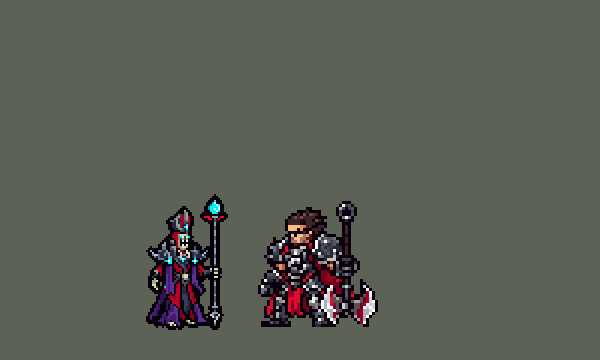

<!-- 本页上半部分由 tools/docs/gen_hero_docs.py 按仓库里现在的数据生成，手改会被覆盖；「开发记录」以下是手写的，生成时原样保留。 -->

# 卡尔萨斯 Karthus


| 项目 | 内容 |
|---|---|
| id | `league_karthus` |
| 所属的包 | 主包（mod_id `league`） |
| 分路 | 中单 |
| 分类 / 标签 | 法师（Magician） · AP / Magic / Range |
| 高清帧 | PPU 1.5 |
| 附加包 | [卡尔萨斯附加包](#附加包)（`league_karthus`） |



其他预览：[逐帧预览](../preview/league_karthus_frames.png)、[特效表](../preview/league_karthus_effects.png)

## 现在的技能

下面是游戏里显示的技能说明（`league/text/champion.i18n` 的简体中文，去掉了颜色和图标），冷却、距离来自 `league/champion/league_karthus.data_champion`；1 秒 = 60 tick。

### 普攻 / 被动

*攻击间隔 1.53 秒 · 攻击距离 50000*

痛苦之墙：每12秒，身边有敌方英雄时，攻击在那名英雄脚下立起一道墙（5秒），墙里的敌人减速40%，魔抗-20%（4秒）。

### 技能1 · 荒芜

*冷却 2.5 秒 · 施放距离 80000 · 施放：指定目标 · 敌人（不含防御塔）*

目标处0.53秒后爆炸，造成45 + 30% 法强魔法伤害；只炸到一个敌人时伤害翻倍。

### 技能2 · 亵渎

*冷却 10 秒 · 施放距离 55000 · 施放：指定目标 · 敌人（不含防御塔）*

5秒内灵魂环绕自身，每0.25秒对身边敌人造成10 + 5% 法强魔法伤害。

### 大招 · 安魂曲

*冷却 70 秒 · 施放距离 960000 · 施放：指定目标 · 刚交过手的敌方英雄*

引导3秒（被控制会打断），然后对全图所有敌方英雄造成200 + 75% 法强魔法伤害。

### 数值

攻击力 76（每级 +6）、法强 40（每级 +20）、生命 880（每级 +95）、护甲 18（每级 +7）、魔抗 22（每级 +4）、移速 900（每级 +9）。

## 附加包

附加包是可选的原生代码 mod（都在附加包合集 `league_addons` 里），**不装主包里的英雄也是完整的**。

### 卡尔萨斯附加包

[卡尔萨斯附加包](../../addons/league_karthus/README.md)：`league_karthus` v0.5.7

主包 `league` 保持纯数据。用户选了「被动做附加包」。这个附加包用原生代码做主包数据做不到的**死亡契约**：

- 英雄联盟里卡尔萨斯死后化成灵体，7 秒内免费放技能，然后才倒下；灵体**选不中、不受伤害、免控，不能走动、不能普攻**。
  数据读不到血量，主包做不了。
  附加包的被动 `league_karthus:death_defied` 每 10 tick 给他挂一个 30 tick 的不死 buff `league_karthus_p_guard`，
  这样致命伤害只会把他打到 1 血。他到 1 血（并且身上没有别人给的不死，比如基兰的大招）时就**化成灵体** `p_t` tick（420 = 7 秒）：
  - 先放逐自己 `FLUSH_T`（12）tick：游戏里只有放逐让单位选不中，正在打他、追他的英雄、小兵、塔都丢了目标；
  - 英雄的普攻、技能点向灵体时（敌方的，队友的治疗、护盾也一样），挂在每个英雄上的钩子 `league_karthus:shun` 把它改到
    别的目标上（见下）；
  - 不再受伤（`damaged_reduce` 100%）、放逐结束后免控（`league_karthus_p_ward`）、不能走动（移速 -100%）、不能回城；
  - 身上挂 `league_karthus_p_spirit`（附加包的副本里绑了灵体的画面），播灵体音效和台词。

## 相关脚本和素材

- [`tools/kit/build_karthus.py`](../../tools/kit/build_karthus.py)
- [`tools/kit/setup_karthus.py`](../../tools/kit/setup_karthus.py)
- [`tools/lol/extract_karthus.py`](../../tools/lol/extract_karthus.py)
- [`tools/art/preview_karthus.py`](../../tools/art/preview_karthus.py)
- [`tools/art/rig_karthus.py`](../../tools/art/rig_karthus.py)
- [`assets/source/karthus/`](../../assets/source/karthus)

## 开发记录

> 下面是原来 README 里「英雄：卡尔萨斯」一节，原样搬过来（只改了相对链接）。

| 部分 | 内容 |
|---|---|
| 定位 | 中单（Magician，标签 AP / Magic / Range），第 137 位英雄。死亡颂唱者 卡尔萨斯：又高又瘦的巫妖，深钢色主教冠和大肩甲上镶着青色宝石，深红长袍外披撕成条的深紫破布，骷髅脸、发光的青色眼睛，手握比他还高的法杖（10-17 的分组计划 D 组；计划里是打野，用户选了中单）。用户的选择：「技能方案 A（Q / E / R，W 进普攻）」「中单」「被动做附加包」。团战经理只有三个主动技能位：技能 1 = Q 荒芜，技能 2 = E 亵渎，大招 = R 安魂曲；W 痛苦之墙在普攻里，被动死亡契约在附加包里。技能名照英雄联盟 16.20 的 Data Dragon（五种语言） |
| 普攻 / W | 法杖射出一团幽绿的灵魂弹（射程 50000，100% 攻击）。**痛苦之墙**：每 12 秒，身边 60000 内有敌方英雄时，这一下攻击换成 `attack_w`（举杖横扫、张开双臂），在那名英雄的位置立起一道竖墙（宽 6000、长 60000，5 秒）：墙里的敌人减速 40%（离开后 0.75 秒）、魔抗 -20%（4 秒） |
| 技能1 | **Q 荒芜**（对小兵、野怪也放，射程 80000，冷却 2.5 秒）：目标点先出预警圈，0.53 秒后炸开（半径 15000）：45 + 30% 法强 魔法伤害；**只炸到一个敌人时伤害翻倍**（每个被炸到的单位记一次，一 tick 后只有一个时补一次同样的伤害）。爆炸和预警挂在一颗隐形的抛物线弹上（布兰德 W、卡西奥佩娅 Q 的写法：直接从动作里放的范围弹落不到地上，什么都打不中） |
| 技能2 | **E 亵渎**（对小兵、野怪也放，55000 内有敌人时，冷却 10 秒）：5 秒内脚下转起灵魂漩涡，每 0.25 秒对身边 55000 内的敌人造成 10 + 5% 法强 魔法伤害（英雄联盟是耗蓝开关，团战经理没有蓝）。圈原来是 30000（Codex 画的漩涡宽 60 格），11-02 用户：「还有E的范围要做大点啊 现在太小了吧 死歌的圈」——改成英雄联盟的 550 码（`e_r` 55000，`e_cast` 跟着 55000），漩涡由 `import_karthus_fx.py` 的 `grown()` 按 `e_r` 重画（主包 0.297.0） |
| 大招 | **R 安魂曲**（对己方正在打的敌方英雄放，全图，冷却 70 秒）：浮空引导 3 秒（被控制会打断，每 0.25 秒检查一次），然后**全图每个敌方英雄**受到 200 + 75% 法强 魔法伤害 |
| 附加包 | 可选的附加包 [`addons/league_karthus`](../../addons/league_karthus/README.md)（在附加包合集里，原生代码，主包不装它也完整），照英雄联盟的**死亡契约**：受到致命伤害时停在 1 血、化成灵体 7 秒——敌人选不中、不再受伤、免控，站着不动、不普攻，只放技能和痛苦之墙，时间到才倒下（击杀算最后打他的人），每条命都有。灵体身上挂 `league_karthus_p_spirit`（附加包的副本里绑了灵体的光）。0.4.0（11-02 用户：「现在死歌死了后别人还在攻击灵体 英雄联盟里不是灵体吧」）：原来的灵体只是隐身，贴身的敌人照样看得见、打得到，1 血的灵体又是 AI 最想补的目标；现在化成灵体时先放逐自己 12 tick（正在打他的单位都丢了目标），之后敌方英雄点向灵体的普攻和技能由钩子 `shun` 改到别人身上，没人可打就退出亵渎的圈。0.4.1（11-03 用户：「灵体死了还能回城的？？？」「灵体出现就代表已经是死亡了 懂吗」「有时候 死了又没灵体」）：灵体当成已经死了的人——不再隐身（隐身加上敌人被引开，敌方那一边就看不见灵体，像死了没灵体），不能回城（回城命令换成站着，回城到一半也打断），队友的治疗、护盾也改给别人，倒下后复活倒计时扣掉灵体的 7 秒（照阿克尚附加包的动态寻址改游戏的剩余复活 tick）。0.5.1（11-03 晚上）：倒下那一下改在摘掉不死后的下一 tick 补、没倒下就再补，确保灵体时间到他就真的死了（不会 1 血回城）；灵体用自己的眼睛挑目标，也立痛苦之墙；复活时间由别的英雄的钩子在他登记阵亡后扣。日志 `league_karthus.log`（SPAWN、SPIRIT、REBANISH、SHUN、SPIRIT RECALL STOPPED、SPIRIT REQUIEM、SPIRIT HIT、SPIRIT KILL、FALL、FALL RETRY、RESPAWN） |
| 数值 | 攻击 76（+6）、法强 40（+20）、生命 880（+95）、护甲 18（+7）、魔抗 22（+4）、移速 900（+9）、射程 50000，攻击间隔 92 tick |
| 平衡 | 10 分钟经典引擎模拟，中单位对原版五个中单（火法师、冰法师、雷法师、风法师、白魔法师），三套阵容两边各打：初稿 -4.72（Q 的爆炸和 W 的墙直接从动作里放，打不中任何人）；改成隐形抛物线弹后 +2.89（太强）；Q 45 + 30%、R 200 + 75% 冷却 70 秒 +1.46；按动作帧的时间点（普攻第 3 帧射出、W 第 4 帧立墙、Q 第 3 帧甩手）两批种子（1–8、9–16）**+1.27 / +2.05**（平均 +1.66；同期科加斯 +1.92、沃利贝尔 +1.39、佐伊 +1.30），不再调 |
| 精灵图（高清帧 PPU 1.5） | Codex 第 0 步画了四张原画（[`tools/art/pack_karthus_picture.py`](../../tools/art/pack_karthus_picture.py)：A 长杖 / B 短杖的 3/4 正面，SA / SB 正侧面；读回 [`design_karthus_hd.py`](../../tools/art/design_karthus_hd.py)，大小对比 [`review_karthus_size.py`](../../tools/art/review_karthus_size.py)），用户：「A 长杖」「40 像素，PPU 1.5」（冠尖到脚底 60 行，杖尖再高 6 行）。第 1 步 Codex 在游戏格子上画 3/4 正面和侧面各两稿（[`pack_karthus_model.py`](../../tools/art/pack_karthus_model.py) / [`design_karthus_model.py`](../../tools/art/design_karthus_model.py)），用户选 A-1 和 side-1；读回后脸在格子上重画（骷髅脸、两只一样高的青色眼睛、上下两排牙），侧面换上正面的头（一张脸用在所有帧）、正面换上侧面的杖（一根杖），侧面的杖缩到和正面一样长。动作帧（[`rig_karthus.py`](../../tools/art/rig_karthus.py)，用户：「动作帧你参考其他英雄怎么做的 不太需要依赖codex」「对照英雄联盟的动作帧来做」）全部从造型自己的格子无损摆出来（整格平移、四分之一转、镜像），逐帧对照英雄联盟的动画：普攻法杖平指前方、往前下方一戳再竖回来（attack1）；W 法杖横向后扫、再张开双臂（Spell2）；Q 爪子往后下方甩、再往前一甩（Spell1a）；E 张开双臂（英雄联盟的亵渎没有施法动作）；R 拿出书、浮空 14 行唱 3 秒、书举到头后 / 放到胸前（Spell4_In + spell4_loop，书是照英雄联盟画的一本小红书）；跑步是身体前倾的飘行、袍尾往后飘（run，前倾时头和握杖的手整块移、法杖不歪）；死亡时法杖落地、他举起双臂（英雄联盟里他之后化成灵体消失），然后塌进袍子里。近侧手臂抬起后露出的地方补成袍子的暗紫色。对比 GIF：[`review_karthus_actions.py`](../../tools/art/review_karthus_actions.py)。头像点 `face` (1, -30) 在骷髅脸上（9×9 的头像框里是眼睛、牙和冠上的宝石），`banpick_center` -10（按冠尖，杖尖被卡片上沿裁掉，[`bp_card_audit.py`](../../tools/art/bp_card_audit.py) 标 CLIPPED 是这个） |
| 特效 | 第 3 步 14 张特效（[`tools/art/pack_karthus_fx.py`](../../tools/art/pack_karthus_fx.py)，颜色照英雄联盟：幽绿 / 青绿色的灵魂光，光环和星芒带蓝边，暗处是深色的灵魂烟，安魂曲的光柱边缘带一点深红）：普攻的灵魂弹和打中、Q 的预警圈 / 爆炸 / 打中 / 单体翻倍、E 脚下的灵魂漩涡和烧到、W 的痛苦之墙 / 减速的鬼手 / 削魔抗的裂盾、R 引导时身边的灵魂和每个敌方英雄身上落下的光柱、附加包的灵体光。Codex 一轮画完（按格子取色、逐格对称），[`tools/art/import_karthus_fx.py`](../../tools/art/import_karthus_fx.py) 按清单切格、再查对称、照技能播放的位置和时长摆好：Q 的预警圈放满抛物线弹的 32 tick，痛苦之墙放满 5 秒（第 3–6 帧循环），安魂曲的灵魂放满引导的 3 秒；得到 `league_karthus_fx` 和 `league_karthus_big`。E 的漩涡（11-02）按 `e_r` 重画成宽 110 格：每一格取原图同一角度、离外沿同样深的那一格，圈的粗细和 Codex 画的烟、灵魂不变，两头的火苗跟着两头往外挪；原图第 3、4 帧比 1、2 帧高 3 行（漩涡上下跳），重画时每帧都对准自己的圈心 |
| 音效 | 英雄联盟的音效和配音（[`tools/lol/extract_karthus.py`](../../tools/lol/extract_karthus.py)，20 段）：普攻出手 / 打中、W 施放 / 立墙、Q 施放 / 预警 / 爆炸 / 单体爆炸、E 开启 / 持续、R 施放 / 引导 / 落下 / 打中、死亡契约，配音是 W、E、R 的技能台词和普通攻击台词（Q）、死亡台词（死亡契约） |
| 图标 | 官方技能图标（荒芜、亵渎、安魂曲，另有痛苦之墙和死亡契约），从本地客户端取 |
| 11 月 3 日（下午） | 用户看比赛时：「等等死歌灵体还是有bug」「死了灵体还能移动 还能有残血？」「这能和英雄联盟一样吗」「还有死了后为什么AI还攻击灵体 很奇怪啊」。0.4.x 的灵体是 1 血、活着的他：只在开头放逐 12 tick，之后小兵、塔、英雄照打（1 血的英雄正是 AI 最想补的），头上一条残血，移速 −100% 挡不住位移；复活时间也从没扣过（`on_dead` 时游戏还没把他记成阵亡，日志 44 次全是 `RESPAWN NOT CUT (alive)`）。附加包 0.5.0：整个灵体放逐着（谁都选不中、打不到，没有血条，不能走、不能回城，钉在倒下的地方），放逐的锁定画面是他的灵体图（`tools/art/draw_karthus_ghost.py`，主包 0.305.0、league.dll 0.9.5 登记），灵体的亵渎、荒芜、安魂曲由附加包照主包的数字和画面放，击杀算他的；复活时间改在阵亡后第一 tick 由 AI 钩子扣 |
| 11 月 3 日（晚上） | 用户看比赛时：「不行死歌还是不对 灵体结束后还能回城 你修不好了？」「被人击杀后显示灵体就已经是死亡了啊」「灵体状态下会放其他技能吗 也检查下 我怎么感觉不会放」。查日志：倒下那一下和摘掉灵体的不死、减伤在同一 tick，伤害到这一 tick 结算时才扣，刚摘掉的 buff 还算数，只打出 1 点，他 1 血活下来、放逐一完就回城（回城日志：3:55 倒下、3:56 0% 血回城；0.4.2 也一样）；复活时间 0.5.0 一次都没扣成（阵亡后他自己的钩子都不跑）；放逐的单位不给队伍视野，灵体只挑队伍看得见的敌人，身边没队友时荒芜、亵渎打不到人，痛苦之墙挂在普攻上、灵体从没立过。附加包 0.5.1：灵体最后一 tick 换下不死（`p_fall`），放逐正好在 7 秒到时结束，下一 tick 才补致命一击、没倒下就再补，倒下前他什么命令都不下（回城换成站着），韧性缩短了放逐就重新放逐；复活时间由任何还活着的英雄的钩子在他登记阵亡后扣；灵体用自己的眼睛挑目标，W 好了就在 60000 内最近的敌方英雄身上立痛苦之墙（减速 40%、魔抗 −20%，照主包）。日志 `FALL` 记这个灵体放了几次 Q、W、E、R |
| 11 月 4 日 | 11-03 晚两次启动的日志（0.5.1）：倒下都是真死了（放下不死后 3 tick 第一下就倒，偶尔补第二下），灵体放了 Q、W、E、R，想让他回城的 AI 命令全拦下；可复活时间 120 次全没扣成：0.5.1 由每个英雄的 AI 钩子扣、按模拟状态指针配对，AI 钩子拿到的指针和被动的不一样。附加包 0.5.2：改由本包的比赛钩子（每局每 tick）扣，按「哪一局」（种类、比赛、小局）、玩家、阵亡 tick 配对，第一次看到他阵亡时定下复活的 tick，每份模拟都扣到不晚于它（同一局并排的两份预演共用一条，扣不了两遍）；日志 `MATCH HOOK`、`RESPAWN` |
| 动作补帧（2026-11-14） | 用户：「还有有的动画感觉只有一帧 不如oppi的地方都要补 参考联盟的动画」，又说「动画你觉得少的地方就想办法补」「能改就想办法改 全都要改」。对照表里 R「安魂曲」：16 帧里只有 7 个姿势，悬空吟唱的 2.5 秒里书举在头后、举在身前各 4 张，袍子下摆只在往后拖 2、3 格之间换，其中两张是同一张画——每个举书的姿势看起来就是一张停 0.84 秒。没有新画，也没交给 Codex：还是 [`tools/art/rig_karthus.py`](../../tools/art/rig_karthus.py) 用造型自己的格子摆的姿势，只把悬空那 12 张下摆往后拖的格数改成随着举书一来一回地 1、2、3、4 格（`hover`，用的还是它原来的 `sway_rows`），手臂、书、浮动、毫秒都照旧。下面写的是「几帧，其中几个不同的姿势」。**R 安魂曲** 16 帧（7 个姿势）→ 16 帧，其中 11 个；悬空 12 张每张都不一样（以前有两张一样）。起势 110×3、悬空 210×12、落下 150，一共还是 3000 毫秒，开始悬空（330）和落下（2850）的毫秒没变。技能数据没改；跑（f7aa50652 那版：下摆和脚不动、只有浮动和两根飘带）、待机、普攻、W、Q、E、受击、阵亡逐帧没变。每帧 3 倍、下摆 5 倍看过。待机剪的还是 E（`hero_reels.json` 不用改），选人卡片还是普攻、Q、E、R，逐帧换的只有 R 那几张（53 帧、一圈 18160 毫秒没变）。图集 2048×762 没变大，选人格子用的那张 1.39 → 1.41 MiB。游戏里还没看过 |

重新生成（素材来自本机的英雄联盟客户端，音频不进仓库）：

```bash
python tools/lol/extract_karthus.py --lol "D:\WeGameApps\lol" --vgmstream <vgmstream-cli.exe>
python tools/kit/build_karthus.py                   # 技能数据，数字都在脚本的参数表 P 里
python tools/kit/setup_karthus.py                   # 五种语言的文字、音效配置、共享文件里他的键
python tools/art/design_karthus_model.py            # Codex 第 1 步的造型读回（A-1 / side-1，重画的脸、同一个头和杖）
python tools/art/rig_karthus.py                     # 1.5 的原帧和 1 倍帧
python tools/art/ppu_restyle.py --hero karthus      # 外描边（不要加 --preview）
python tools/art/ppu_hd.py --hero karthus           # hd_ / lo_ 帧
python tools/art/import_karthus_fx.py               # Codex 的特效（assets/source/karthus/codex_fx）
python tools/art/preview_karthus.py                 # 预览和演示 GIF
python addons/league_karthus/make_override.py       # 附加包的副本（主包的卡尔萨斯改了就重跑）
```

美术提示词见 [`assets/source/karthus/`](../../assets/source/karthus) 里的 `PICTURE_PROMPT.md`、`MODEL_PROMPTS.md`、`PROMPTS_FX.md`；Codex 的交付在 `codex_picture/`、`codex_model/`、`codex_fx/`。

逐帧预览：[`docs/preview/league_karthus_frames.png`](../preview/league_karthus_frames.png?v=1020a)，特效：[`docs/preview/league_karthus_effects.png`](../preview/league_karthus_effects.png?v=1020a)。
