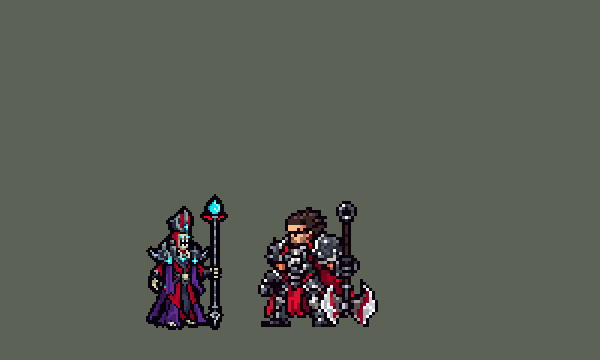

<!-- 本页上半部分由 tools/docs/gen_hero_docs.py 按仓库里现在的数据生成，手改会被覆盖；「开发记录」以下是手写的，生成时原样保留。 -->

# 卡尔萨斯 Karthus


| 项目 | 内容 |
|---|---|
| id | `league_karthus` |
| 所属的包 | 主包（mod_id `league`） |
| 分路 | 中单 |
| 分类 / 标签 | 法师（Magician） · AP / Magic / Range |
| 高清帧 | PPU 1.5 |
| 附加包 | [卡尔萨斯附加包](#附加包)（`league_karthus`） |



其他预览：[逐帧预览](../preview/league_karthus_frames.png)、[特效表](../preview/league_karthus_effects.png)

## 现在的技能

下面是游戏里显示的技能说明（`league/text/champion.i18n` 的简体中文，去掉了颜色和图标），冷却、距离来自 `league/champion/league_karthus.data_champion`；1 秒 = 60 tick。

### 普攻 / 被动

*攻击间隔 1.53 秒 · 攻击距离 50000*

痛苦之墙：每12秒，身边有敌方英雄时，攻击在那名英雄脚下立起一道墙（5秒），墙里的敌人减速40%，魔抗-20%（4秒）。

### 技能1 · 荒芜

*冷却 2.5 秒 · 施放距离 80000 · 施放：指定目标 · 敌人（不含防御塔）*

目标处0.53秒后爆炸，造成45 + 30% 法强魔法伤害；只炸到一个敌人时伤害翻倍。

### 技能2 · 亵渎

*冷却 10 秒 · 施放距离 40000 · 施放：指定目标 · 敌人（不含防御塔）*

5秒内灵魂环绕自身，每0.25秒对身边敌人造成10 + 5% 法强魔法伤害。

### 大招 · 安魂曲

*冷却 70 秒 · 施放距离 960000 · 施放：指定目标 · 刚交过手的敌方英雄*

引导3秒（被控制会打断），然后对全图所有敌方英雄造成200 + 75% 法强魔法伤害。

### 数值

攻击力 76（每级 +6）、法强 40（每级 +20）、生命 880（每级 +95）、护甲 18（每级 +7）、魔抗 22（每级 +4）、移速 900（每级 +9）。

## 附加包

附加包是可选的原生代码 mod（都在附加包合集 `league_addons` 里），**不装主包里的英雄也是完整的**。

### 卡尔萨斯附加包

[卡尔萨斯附加包](../../addons/league_karthus/README.md)：`league_karthus` v0.2.0

主包 `league` 保持纯数据。用户选了「被动做附加包」。这个附加包用原生代码做主包数据做不到的**死亡契约**：

- 英雄联盟里卡尔萨斯死后化成灵体，7 秒内照样放技能，然后才倒下。数据读不到血量，主包做不了。
  附加包的被动 `league_karthus:death_defied` 每 10 tick 给他挂一个 30 tick 的不死 buff `league_karthus_p_guard`，
  这样致命伤害只会把他打到 1 血。他到 1 血（并且身上没有别人给的不死，比如基兰的大招）时就**化成灵体** `p_t` tick（420 = 7 秒）：
  - 隐身：敌人选不中他（`entity_set_invisible`，每 30 tick 续一次）；
  - 不再受伤（`damaged_reduce` 100%）、免疫控制；
  - 照常走动、放技能、攻击；
  - 身上挂 `league_karthus_p_spirit`（附加包的副本里绑了灵体的画面），播灵体音效和台词。

## 相关脚本和素材

- [`tools/kit/build_karthus.py`](../../tools/kit/build_karthus.py)
- [`tools/kit/setup_karthus.py`](../../tools/kit/setup_karthus.py)
- [`tools/lol/extract_karthus.py`](../../tools/lol/extract_karthus.py)
- [`tools/art/preview_karthus.py`](../../tools/art/preview_karthus.py)
- [`tools/art/rig_karthus.py`](../../tools/art/rig_karthus.py)
- [`assets/source/karthus/`](../../assets/source/karthus)

## 开发记录

> 下面是原来 README 里「英雄：卡尔萨斯」一节，原样搬过来（只改了相对链接）。

| 部分 | 内容 |
|---|---|
| 定位 | 中单（Magician，标签 AP / Magic / Range），第 137 位英雄。死亡颂唱者 卡尔萨斯：又高又瘦的巫妖，深钢色主教冠和大肩甲上镶着青色宝石，深红长袍外披撕成条的深紫破布，骷髅脸、发光的青色眼睛，手握比他还高的法杖（10-17 的分组计划 D 组；计划里是打野，用户选了中单）。用户的选择：「技能方案 A（Q / E / R，W 进普攻）」「中单」「被动做附加包」。团战经理只有三个主动技能位：技能 1 = Q 荒芜，技能 2 = E 亵渎，大招 = R 安魂曲；W 痛苦之墙在普攻里，被动死亡契约在附加包里。技能名照英雄联盟 16.20 的 Data Dragon（五种语言） |
| 普攻 / W | 法杖射出一团幽绿的灵魂弹（射程 50000，100% 攻击）。**痛苦之墙**：每 12 秒，身边 60000 内有敌方英雄时，这一下攻击换成 `attack_w`（举杖横扫、张开双臂），在那名英雄的位置立起一道竖墙（宽 6000、长 60000，5 秒）：墙里的敌人减速 40%（离开后 0.75 秒）、魔抗 -20%（4 秒） |
| 技能1 | **Q 荒芜**（对小兵、野怪也放，射程 80000，冷却 2.5 秒）：目标点先出预警圈，0.53 秒后炸开（半径 15000）：45 + 30% 法强 魔法伤害；**只炸到一个敌人时伤害翻倍**（每个被炸到的单位记一次，一 tick 后只有一个时补一次同样的伤害）。爆炸和预警挂在一颗隐形的抛物线弹上（布兰德 W、卡西奥佩娅 Q 的写法：直接从动作里放的范围弹落不到地上，什么都打不中） |
| 技能2 | **E 亵渎**（对小兵、野怪也放，40000 内有敌人时，冷却 10 秒）：5 秒内脚下转起灵魂漩涡，每 0.25 秒对身边 30000 内的敌人造成 10 + 5% 法强 魔法伤害（英雄联盟是耗蓝开关，团战经理没有蓝） |
| 大招 | **R 安魂曲**（对己方正在打的敌方英雄放，全图，冷却 70 秒）：浮空引导 3 秒（被控制会打断，每 0.25 秒检查一次），然后**全图每个敌方英雄**受到 200 + 75% 法强 魔法伤害 |
| 附加包 | 可选的附加包 [`addons/league_karthus`](../../addons/league_karthus/README.md)（在附加包合集里，原生代码，主包不装它也完整），照英雄联盟的**死亡契约**：受到致命伤害时停在 1 血、化成灵体 7 秒——敌人选不中（隐身）、不再受伤、免控，照常走动、放技能，时间到才倒下（击杀算最后打他的人），每条命都有。灵体身上挂 `league_karthus_p_spirit`（附加包的副本里绑了灵体的光）。日志 `league_karthus.log`（SPAWN、SPIRIT、SPIRIT KILL、FALL） |
| 数值 | 攻击 76（+6）、法强 40（+20）、生命 880（+95）、护甲 18（+7）、魔抗 22（+4）、移速 900（+9）、射程 50000，攻击间隔 92 tick |
| 平衡 | 10 分钟经典引擎模拟，中单位对原版五个中单（火法师、冰法师、雷法师、风法师、白魔法师），三套阵容两边各打：初稿 -4.72（Q 的爆炸和 W 的墙直接从动作里放，打不中任何人）；改成隐形抛物线弹后 +2.89（太强）；Q 45 + 30%、R 200 + 75% 冷却 70 秒 +1.46；按动作帧的时间点（普攻第 3 帧射出、W 第 4 帧立墙、Q 第 3 帧甩手）两批种子（1–8、9–16）**+1.27 / +2.05**（平均 +1.66；同期科加斯 +1.92、沃利贝尔 +1.39、佐伊 +1.30），不再调 |
| 精灵图（高清帧 PPU 1.5） | Codex 第 0 步画了四张原画（[`tools/art/pack_karthus_picture.py`](../../tools/art/pack_karthus_picture.py)：A 长杖 / B 短杖的 3/4 正面，SA / SB 正侧面；读回 [`design_karthus_hd.py`](../../tools/art/design_karthus_hd.py)，大小对比 [`review_karthus_size.py`](../../tools/art/review_karthus_size.py)），用户：「A 长杖」「40 像素，PPU 1.5」（冠尖到脚底 60 行，杖尖再高 6 行）。第 1 步 Codex 在游戏格子上画 3/4 正面和侧面各两稿（[`pack_karthus_model.py`](../../tools/art/pack_karthus_model.py) / [`design_karthus_model.py`](../../tools/art/design_karthus_model.py)），用户选 A-1 和 side-1；读回后脸在格子上重画（骷髅脸、两只一样高的青色眼睛、上下两排牙），侧面换上正面的头（一张脸用在所有帧）、正面换上侧面的杖（一根杖），侧面的杖缩到和正面一样长。动作帧（[`rig_karthus.py`](../../tools/art/rig_karthus.py)，用户：「动作帧你参考其他英雄怎么做的 不太需要依赖codex」「对照英雄联盟的动作帧来做」）全部从造型自己的格子无损摆出来（整格平移、四分之一转、镜像），逐帧对照英雄联盟的动画：普攻法杖平指前方、往前下方一戳再竖回来（attack1）；W 法杖横向后扫、再张开双臂（Spell2）；Q 爪子往后下方甩、再往前一甩（Spell1a）；E 张开双臂（英雄联盟的亵渎没有施法动作）；R 拿出书、浮空 14 行唱 3 秒、书举到头后 / 放到胸前（Spell4_In + spell4_loop，书是照英雄联盟画的一本小红书）；跑步是身体前倾的飘行、袍尾往后飘（run，前倾时头和握杖的手整块移、法杖不歪）；死亡时法杖落地、他举起双臂（英雄联盟里他之后化成灵体消失），然后塌进袍子里。近侧手臂抬起后露出的地方补成袍子的暗紫色。对比 GIF：[`review_karthus_actions.py`](../../tools/art/review_karthus_actions.py)。头像点 `face` (1, -30) 在骷髅脸上（9×9 的头像框里是眼睛、牙和冠上的宝石），`banpick_center` -10（按冠尖，杖尖被卡片上沿裁掉，[`bp_card_audit.py`](../../tools/art/bp_card_audit.py) 标 CLIPPED 是这个） |
| 特效 | 第 3 步 14 张特效（[`tools/art/pack_karthus_fx.py`](../../tools/art/pack_karthus_fx.py)，颜色照英雄联盟：幽绿 / 青绿色的灵魂光，光环和星芒带蓝边，暗处是深色的灵魂烟，安魂曲的光柱边缘带一点深红）：普攻的灵魂弹和打中、Q 的预警圈 / 爆炸 / 打中 / 单体翻倍、E 脚下的灵魂漩涡和烧到、W 的痛苦之墙 / 减速的鬼手 / 削魔抗的裂盾、R 引导时身边的灵魂和每个敌方英雄身上落下的光柱、附加包的灵体光。Codex 一轮画完（按格子取色、逐格对称），[`tools/art/import_karthus_fx.py`](../../tools/art/import_karthus_fx.py) 按清单切格、再查对称、照技能播放的位置和时长摆好：Q 的预警圈放满抛物线弹的 32 tick，痛苦之墙放满 5 秒（第 3–6 帧循环），安魂曲的灵魂放满引导的 3 秒；得到 `league_karthus_fx` 和 `league_karthus_big` |
| 音效 | 英雄联盟的音效和配音（[`tools/lol/extract_karthus.py`](../../tools/lol/extract_karthus.py)，20 段）：普攻出手 / 打中、W 施放 / 立墙、Q 施放 / 预警 / 爆炸 / 单体爆炸、E 开启 / 持续、R 施放 / 引导 / 落下 / 打中、死亡契约，配音是 W、E、R 的技能台词和普通攻击台词（Q）、死亡台词（死亡契约） |
| 图标 | 官方技能图标（荒芜、亵渎、安魂曲，另有痛苦之墙和死亡契约），从本地客户端取 |

重新生成（素材来自本机的英雄联盟客户端，音频不进仓库）：

```bash
python tools/lol/extract_karthus.py --lol "D:\WeGameApps\lol" --vgmstream <vgmstream-cli.exe>
python tools/kit/build_karthus.py                   # 技能数据，数字都在脚本的参数表 P 里
python tools/kit/setup_karthus.py                   # 五种语言的文字、音效配置、共享文件里他的键
python tools/art/design_karthus_model.py            # Codex 第 1 步的造型读回（A-1 / side-1，重画的脸、同一个头和杖）
python tools/art/rig_karthus.py                     # 1.5 的原帧和 1 倍帧
python tools/art/ppu_restyle.py --hero karthus      # 外描边（不要加 --preview）
python tools/art/ppu_hd.py --hero karthus           # hd_ / lo_ 帧
python tools/art/import_karthus_fx.py               # Codex 的特效（assets/source/karthus/codex_fx）
python tools/art/preview_karthus.py                 # 预览和演示 GIF
python addons/league_karthus/make_override.py       # 附加包的副本（主包的卡尔萨斯改了就重跑）
```

美术提示词见 [`assets/source/karthus/`](../../assets/source/karthus) 里的 `PICTURE_PROMPT.md`、`MODEL_PROMPTS.md`、`PROMPTS_FX.md`；Codex 的交付在 `codex_picture/`、`codex_model/`、`codex_fx/`。

逐帧预览：[`docs/preview/league_karthus_frames.png`](../preview/league_karthus_frames.png?v=1020a)，特效：[`docs/preview/league_karthus_effects.png`](../preview/league_karthus_effects.png?v=1020a)。
