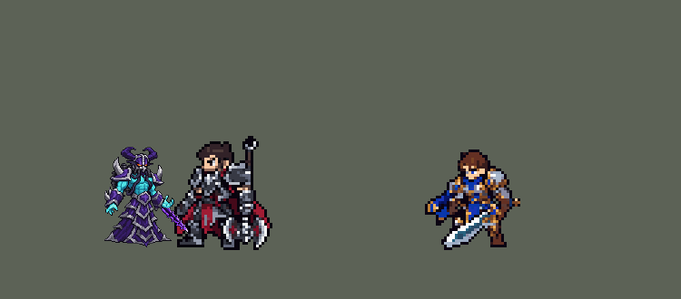

<!-- 本页上半部分由 tools/docs/gen_hero_docs.py 按仓库里现在的数据生成，手改会被覆盖；「开发记录」以下是手写的，生成时原样保留。 -->

# 卡萨丁 Kassadin


| 项目 | 内容 |
|---|---|
| id | `league_kassadin` |
| 所属的包 | 主包（mod_id `league`） |
| 分路 | 中单 |
| 分类 / 标签 | 刺客（Assassin） · AP / Magic / Melee / CC / Shield |
| 高清帧 | PPU 2.42（画成 100%） |
| 附加包 | [卡萨丁附加包](#附加包)（`league_kassadin`） |



其他预览：[before_after](../preview/league_kassadin_before_after.gif)、[逐帧预览](../preview/league_kassadin_frames.png)、[特效表](../preview/league_kassadin_effects.png)

## 现在的技能

下面是游戏里显示的技能说明（`league/text/champion.i18n` 的简体中文，去掉了颜色和图标），冷却、距离来自 `league/champion/league_kassadin.data_champion`；1 秒 = 60 tick。

### 普攻 / 被动

*攻击间隔 0.92 秒 · 攻击距离 24000*

虚空之石：受到的魔法伤害降低约10%。虚空之刃：普攻附带15 + 10% 法强魔法伤害；每7秒强化一次普攻，额外造成70 + 70% 法强魔法伤害。

### 技能1 · 虚无法球

*冷却 6 秒 · 施放距离 50000 · 施放：指定目标 · 敌人（不含防御塔）*

向目标发射虚无法球，造成90 + 70% 法强魔法伤害，打断英雄的动作。自身获得50 + 40% 法强护盾1.5秒。

### 技能2 · 能量脉冲

*冷却 15 秒 · 施放距离 40000 · 施放：指定目标 · 敌人（不含防御塔）*

向前方锥形释放能量脉冲，造成90 + 70% 法强魔法伤害并减速50%1秒。每次施放虚无法球或虚空行走都会缩短它的冷却。

### 大招 · 虚空行走

*冷却 8 秒 · 施放距离 48000 · 施放：指定目标 · 敌方英雄*

闪现到附近一名敌方英雄身边，对周围敌人造成100 + 50% 法强魔法伤害。15秒内再次施放叠加一层（最多3层），每层额外40 + 10% 法强魔法伤害。

### 数值

攻击力 80（每级 +10）、法强 50（每级 +20）、生命 940（每级 +92）、护甲 26（每级 +8）、魔抗 22（每级 +4）、移速 1100（每级 +10）。

## 附加包

附加包是可选的原生代码 mod（都在附加包合集 `league_addons` 里），**不装主包里的英雄也是完整的**。

### 卡萨丁附加包

[卡萨丁附加包](../../addons/league_kassadin/README.md)：`league_kassadin` v0.1.2

主包 `league` 保持纯数据。用户问被动「看看rust能做吗」，附加包做哪几项「你看着办吧」——这个附加包用原生代码做主包数据做不到的三件事：

- **虚空之石正好减 10% 魔法伤害**：主包用一个固定的魔抗 buff 近似（他自己的魔抗下约 10–11%）。附加包的被动
  `league_kassadin:void_stone` 每 15 tick 读他现在的魔抗（装备、别人的减魔抗都算上），按 魔法伤害 x 100 / (100 + 魔抗)
  算出还要补多少魔抗，用一个永久 buff 补上，让魔法伤害始终正好少 10%。英雄联盟里「无视单位碰撞」游戏没有开关（数据和原生接口都没有），不做。
- **能量脉冲真实充能**：主包只有他自己放 Q 和 R 给 E 减冷却。附加包每 tick 读所有英雄的冷却，冷却跳高了就是放了技能：
  他身边（`reach` 32000）每有一个英雄放技能（敌我都算，他自己的 E 不算），E 的剩余冷却少 90 tick（英雄联盟 1.5 秒）。
  减冷却用 2 tick 的 `skill_cooldown_mult`；它也会压 Q，所以只压到不碰 Q 的程度（Q 剩余冷却占比更大时这一下不减）。
- **虚空行走挑落点**：主包随机闪到射程里的一个敌方英雄。附加包的 `league_kassadin:rift` 在 R 出手那一 tick 试射程里每个敌方英雄：
  这一下（算上叠层、对方魔抗）能打死的优先，其次爆炸里英雄多、离他远（后排）的；敌方塔 75000 以内的不去，都不行就落在大招目标身上。
- **虚空行走清兵**（0.1.2，用户 2026-10-23：「卡萨丁的R能不能对小兵造成伤害」）：爆炸本来就炸小兵，但游戏的 AI 只在打架时放大招、
  只对英雄放。副本的 R 改成对敌人放，AI 钩子 `league_kassadin:farm`：AI 在打小兵 / 野怪、R 好了、80000 内没有敌方英雄时，
  挑射程里爆炸炸到最多小兵（至少 3 个、不在敌方塔下）的那个按 R，落点就是它；AI 自己对小兵放 R 而射程里有敌方英雄时改对英雄放。
  主包不改：主包对敌人放时 AI 放大招的次数不变、打架时有几次放在小兵身上（模拟 +1.49 -> +0.33）。日志 `FARM` / `RETARGET`。
  落在目标身前 6000，之后数据里的爆炸照常。

## 相关脚本和素材

- [`tools/kit/build_kassadin.py`](../../tools/kit/build_kassadin.py)
- [`tools/kit/setup_kassadin.py`](../../tools/kit/setup_kassadin.py)
- [`tools/lol/extract_kassadin.py`](../../tools/lol/extract_kassadin.py)
- [`tools/art/preview_kassadin.py`](../../tools/art/preview_kassadin.py)
- [`tools/art/rig_kassadin.py`](../../tools/art/rig_kassadin.py)
- [`tools/art/import_kassadin.py`](../../tools/art/import_kassadin.py)
- [`assets/source/kassadin/`](../../assets/source/kassadin)

## 开发记录

> 下面是原来 README 里「英雄：卡萨丁」一节，原样搬过来（只改了相对链接）。

| 部分 | 内容 |
|---|---|
| 定位 | 中路（Assassin，标签 AP / Magic / Melee / CC / Shield），第 93 位英雄。虚空行者 卡萨丁：近战 AP 刺客，法球打断加护盾、扇形冲击波减速、普攻带虚空之刃，大招连续闪进敌阵、越闪越痛。用户的选择：中路、近战 AP 刺客；技能1 = Q，技能2 = E（W 的主动做在普攻上）；大招闪到后排、15 秒内叠层；被动「看看rust能做吗」；加入高手连招；附加包「你看着办吧」（三项都做了）；不用 PPU（1 倍） |
| 普攻 | 一记爪击，攻击距离 24000，攻击间隔 55 tick，第 8 tick 打中。W「虚空之刃」的被动：每次普攻多 15 + 10% 法强魔法伤害。W 的主动按自己的冷却 420 tick（7 秒）搭在普攻上（贾克斯强化普攻的做法）：冷却好了的下一次普攻换成虚空刃那一下，多 70 + 70% 法强魔法伤害。用户选的是「E 冷却时贴身放 W」：放进技能 2 的分支会让 AI 空放、站着不动（空分支照样占技能位），所以做在普攻上，效果一样是贴身打出的强化普攻 |
| 被动 | 「虚空之石」：受到的魔法伤害少约 10%（主包：一个永久的 +12 魔抗、+11% 魔抗 buff，魔法伤害按 ×100 /（100 + 魔抗）算，在他的魔抗下是 10–11%；任何动作发现它不在就补上，死了重来）。英雄联盟的「无视单位碰撞」游戏里没有对应的开关（数据和原生接口都没有），没做 |
| 技能1 | Q「虚无法球」：冷却 360 tick（6 秒），对 50000 内的敌人放（小兵野怪也算），第 8 tick 发出法球（每 tick 3000）：90 + 70% 法强魔法伤害；打中英雄打断它的动作（6 tick 眩晕）。出手时自己得到 50 + 40% 法强的护盾 90 tick（英雄联盟只挡魔法伤害；数据里的护盾什么伤害都挡，所以小一点）。**高手连招 E 接 Q**：被能量脉冲打中的英雄 2 秒内再被法球打中，沉默 1 秒 |
| 技能2 | E「能量脉冲」：冷却 900 tick（15 秒），对 40000 内的敌人放（小兵野怪也算），第 8 tick 向目标方向推出扇形冲击波（半径 42000，两边各约 40 度）：90 + 70% 法强魔法伤害，减速 50% 持续 1 秒。英雄联盟里身边每有人放技能就给 E 充能；数据读不到别人放技能，所以主包是他自己每放一次 Q 或 R 返还一点冷却（`skill_cooldown_mult` +20，Q 也会被压一点）；真实充能在附加包里 |
| 大招 | R「虚空行走」：冷却 480 tick（8 秒，英雄联盟 5 / 3.5 / 2 秒），对 48000 内的敌方英雄放，第 6 tick 原地消失（虚空裂缝），出现在 56000 内随机一个敌方英雄身上（后排和前排差不多一样常见），下一 tick 半径 20000 内的敌人受到 100 + 50% 法强魔法伤害。15 秒内再放叠一层（最多 3 层，英雄联盟 4 段），每层多 40 + 10% 法强，每放一次所有层的计时都重来。**高手连招 R 接 E**：落地后 2 秒内放的 E 第 1 tick 就推出去（不等抬手） |
| 附加包 | 可选的附加包 [`addons/league_kassadin`](../../addons/league_kassadin/README.md)（在附加包合集里，原生代码，主包不装它也完整）：① 虚空之石正好减 10%——每 15 tick 读他现在的魔抗（装备、减魔抗都算），补一个魔抗 buff 让魔法伤害始终 ×0.9；② 能量脉冲真实充能——每 tick 读所有英雄的冷却，冷却跳高了就是放了技能，他身边 32000 内每有一个英雄放技能（敌我都算），E 少 90 tick（1.5 秒），只压到不碰 Q 的程度；③ 虚空行走挑落点——这一下能打死的英雄优先，其次爆炸里英雄多、离他远的（后排），敌方塔 75000 内不去。附加包里的卡萨丁是 `make_override.py` 从主包生成的副本，普攻、E、R 的说明以「【附加包】」开头。还没在游戏里看过日志 |
| 数值 | 攻击 80（+10）、法术强度 50（+20）、生命 940（+92）、护甲 26（+8）、魔抗 22（+4）、移速 1100（+10），和本包的菲兹、黛安娜、艾克同类（近战 AP 刺客）。SDK 对战模拟：中路，对 5 个原版法师（`pyromancer`、`ice_mage`、`lightning_mage`、`wind_mage`、`white_mage`），两边、三套队友阵容各 24 局，一批 720 局。团队击杀差：种子 1–24 +1.22、25–48 +1.55（同两批菲兹 +2.06 / +1.78、黛安娜 +1.56 / +0.80、艾克 +0.52 / −0.23）；初版（R 80、W 60）是 +0.96，再加 Q、E 伤害和生命的一版 +1.64 / +1.87 比同类都强，没用。一局放 R 约 8 次。动作帧就是按这些出手时机画的（普攻、Q、E 第 8 tick，R 第 6 tick），模拟用的时机和游戏里一样 |
| 精灵图 | 用户：「卡萨丁换方案用PPU」，选正面 A、37 格高；「动作帧你可以照着画吧？」——动作全部照定稿造型自己摆（`tools/art/rig_kassadin.py`），**全部用正面（3/4）造型**（用户：「感觉卡萨丁侧身可以不做吧」「切来切去变扭」，和古拉加斯一样）。造型拆成两块：长袍（腰带护片以下、一直连到下摆的那一块）和上半身（头、躯干、两只手臂连垂下来的手、腰带护片），都只整块移动。待机 8（呼吸：上半身在长袍上整块起伏 0–3 个细像素，空出的一行用长袍顶上那行补，刃光在高处变亮；用户：「可能卡萨丁像个僵尸？」——原来完全不动）、移动 8（照英雄联盟飘着走：整个人上下浮动，上半身整块往前探 2 个细像素，长袍最下面 16 行往后飘）、普攻 5 和 W 强化普攻 5（照英雄联盟整条手臂挥：前臂、手和刃当一个整块，以肘部为轴只做 90° 整转，先举到斜上方、打中时劈下来并前冲 3 格；W 的刃更长、整圈亮边）、Q 5、E 5（整体前后移动，刃按 45° 的整倍数转向）、R 5（整个人变成虚空紫色剪影闪走再变回来）、受击 2、死亡 5（照英雄联盟瘫坐下去：上半身整块沉到长袍上）。面具在每一帧都和定稿逐格相同；刃每帧按方向逐格重画，始终是直的。普攻、Q、E 第 8 tick 出手，R 第 6 tick 闪走。**整体 110%**（用户：「在游戏太小了吧」，先选了 115%，看过后「感觉太大了点？调到110%差不多吧」，41 格高）：主包 DLL 的 `hd.rs` SIZES 按比例画，像素一格不改，卡牌、图鉴、头像也一样大；按站位点放大，所以每帧高清帧往上挪 4 个细像素，脚底还在地上。**外描边加粗**（用户：「和原本游戏有点违和感」；查了所有 PPU 英雄：他的外描边只有 0.28 格，是最细的，原版英雄和 1 倍英雄是 1 格）：每帧外轮廓往外加 3 个细像素，里面的细节一格不动。头像截取点 (1, −34)；选人卡片不用 `banpick_center` |
| 高清帧（PPU 3.622，2026-10-13 画风统一后 PPU 2.42（见开头）） | 游戏 0.6.4 时「卡萨丁脸部太糊」：画风统一的 16 色那一步把他的橙色眼睛并掉了、头盔脊和面罩被抹平描乱——现在脸（按眼睛找到，眼睛上 9 格到下 5 格、左右各 4 格，头盔的紫色除外）照缩小后的样子留下（[`tools/art/pixel_down.py`](../../tools/art/pixel_down.py) KEEP `mask_face`），身体每一格都和之前一样。主包 `league.dll` 登记的第 8 位高清英雄（`hd.rs` HEROES、`ppu_hd.py` PPU，小数 PPU 和艾希一样）：造型是 Codex 第 1 步的原稿按它自己约 10 px 的格子逐格读回（正面 113×134、侧身 111×133，统一成 36 色），近侧手上的虚空之刃照英雄联盟的 voidblade_glow 手描（黑紫刃身、紫色亮边、每 8 格一对小尖齿；用户：「另外手上的武器呢？」「我在读回图上手描刃」）（`tools/art/design_kassadin_hd.py` → `assets/source/kassadin/ppu/`）。动作的高清帧就是画出来的那一套（`assets/source/ppu/kassadin_<动作>.png`），1 倍帧是它们按 3.622 缩下来的（每个游戏像素取它下面最常见的颜色），只在没有 DLL（不是游戏 0.6.4）时用 |
| 特效 | Codex 只交了两张缩小拼在一起的总览图（`assets/source/kassadin/codex_fx/`，webp），用户：「直接用这两张图」「有问题的地方你修复」「还有别少特效 少的话你补」「然后蓝色红色方技能不要颠倒」——`tools/art/import_kassadin.py` 把 12 张逐帧切出来，每张一个比例缩到游戏格子（小特效比提示词稍大：太小时细光线和法球的环会断），每格对齐提示词色板、保留白芯；红色方：法球和 E 的扇形（跟着施法方向转）上下对称，其余逐格左右对称（只画了半边的 R 落地第 5、6 帧用完整的那半边镜像补齐），去掉孤立的暗色杂点；E 的六组波纹按提示词铺成一张从他身前到 42 格外的图。`league_kassadin_fx` 普攻星光、W 虚空刃 X 刀光、Q 法球 / 打中 / 自身护盾 / 沉默符印、E 打中 / 脚下虚空涟漪、R 打中；`league_kassadin_big` E 扇形冲击波、R 消失的裂缝和落地的裂缝 + 冲击环。颜色照英雄联盟：虚空紫光（白芯）、品红火星、深紫近黑的虚空 |
| 音效 | 英雄联盟的音效和配音（`tools/lol/extract_kassadin.py`）：爪击 / 打中、Q 发出 / 打中、W 虚空刃出鞘 / 砍中、E 推出 / 打中、R 消失 / 出现；他的技能没有专门的配音，Q、W、E、R 各用一句战斗台词（片段名 `league_kassadin_sfx_vo_*`，和声音名不同）。版权属于 Riot Games，**不提交到仓库**，按下面的命令在本地生成 |
| 图标 | 官方技能图标（Q 虚无法球 / E 能量脉冲 / R 虚空行走；W 和被动的也一起提取），从本地客户端提取，缩到 64×64 |
| 修正（0.170.2） | 用户让查附加包日志时在芸阿娜身上发现：引擎给大招冷却封顶时，把 `skill_cooldown_mult` 也算进去（技能冷却削减同时压大招）。放 Q、R 给能量脉冲充能时（Q 也跟着，原本就写明），大招自己的冷却也被压到 83%。同一个 buff 加上相同大小的负 `ult_cooldown_mult` 抵掉（[`tools/fix/ult_cooldown_offset.py`](../../tools/fix/ult_cooldown_offset.py) / 生成脚本），只减原本要减的技能。经典模拟（8 个种子，三套阵容两边各打） +1.18 → +1.51（误差），每局开大 7.6 → 7.3 次 |

重新生成（素材来自本机的英雄联盟客户端，音频不进仓库）：

```bash
python tools/lol/extract_kassadin.py --lol "D:\WeGameApps\lol" --vgmstream "<vgmstream-cli.exe 路径>"
python tools/kit/build_kassadin.py           # 技能数据，数字都在脚本的参数表 P 里；--nodes 看每棵技能树的节点数
python tools/kit/setup_kassadin.py           # 五种语言的文字、音效配置、共享文件里他的键
python tools/art/design_kassadin_hd.py      # 高清造型：Codex 原稿读回 + 手描虚空之刃（assets/source/kassadin/ppu/）
python tools/art/rig_kassadin.py            # 全部动作：1 倍图表 + 高清条带（assets/source/ppu/kassadin_*.png）
python tools/art/ppu_hd.py --hero kassadin  # 图表里加 hd_ 标签
python tools/art/import_kassadin.py         # 特效：从 Codex 的两张总览图切、缩、对称，拼成特效表
python tools/art/preview_kassadin.py        # 预览和演示 GIF
python addons/league_kassadin/make_override.py   # 附加包的副本（主包的卡萨丁改了就重跑）
```

美术（提示词见 [`assets/source/kassadin/`](../../assets/source/kassadin) 里的 `PICTURE_PROMPT.md`、`MODEL_PROMPTS.md`、`PROMPTS_FX.md`）：

- 原图：Codex 画的两张（`codex_picture/`），用户选 A（两手张开垂在两侧）；B 没画出虚空刃（Codex 自己的说明），刃做成 W 的特效。
- 造型：第 1 步请 Codex 在 13 px 的格子上画（正面 + 侧身，侧身用同一张 3/4 面具）。它自己缩的 13 px 版很粗糙，原稿（约 10 px 一格）很清楚；用户改用 PPU，原稿按它自己的格子逐格读回就是高清造型（正面 A 重画版 + 侧身 A），手上的虚空之刃手描补上。
- 动作：照定稿造型自己摆（没有再让 Codex 画），见上面「精灵图」一行。侧身造型（`codex_model` 的侧身 A）最后没有用上。
- 特效：见上面「特效」一行；提示词在 `PROMPTS_FX.md`。

逐帧预览：[`docs/preview/league_kassadin_frames.png`](../preview/league_kassadin_frames.png?v=1014k)（游戏里用的 hd_ 高清帧），特效：[`docs/preview/league_kassadin_effects.png`](../preview/league_kassadin_effects.png?v=1014g)。改大小、加粗描边、全部改正面之前和之后（游戏里的大小，旁边是德莱厄斯）：[`docs/preview/league_kassadin_before_after.gif`](../preview/league_kassadin_before_after.gif?v=1014g)。
