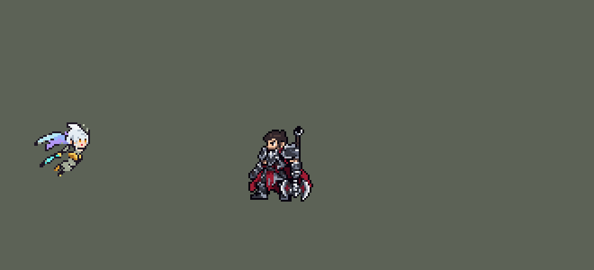

<!-- 本页上半部分由 tools/docs/gen_hero_docs.py 按仓库里现在的数据生成，手改会被覆盖；「开发记录」以下是手写的，生成时原样保留。 -->

# 凯尔 Kayle


| 项目 | 内容 |
|---|---|
| id | `league_kayle` |
| 所属的包 | 主包（mod_id `league`） |
| 分路 | 上单 |
| 分类 / 标签 | 法师（Magician） · AP / Magic / Range / Heal |
| 高清帧 | 1 倍像素（无高清帧） |
| 附加包 | [凯尔升阶附加包：按真实等级升阶、死后不掉](#附加包)（`league_kayle`）、[游戏 AI 不按的技能替它按](#附加包)（`league_ult_press`） |



其他预览：[ascend](../preview/league_kayle_ascend.gif)、[逐帧预览](../preview/league_kayle_frames.png)、[特效表](../preview/league_kayle_effects.png)

## 现在的技能

下面是游戏里显示的技能说明（`league/text/champion.i18n` 的简体中文，去掉了颜色和图标），冷却、距离来自 `league/champion/league_kayle.data_champion`；1 秒 = 60 tick。

### 普攻 / 被动

*攻击间隔 1.08 秒 · 攻击距离 25000*

普攻造成100% 攻击力的物理伤害，附带15 + 20% 法术强度的魔法伤害。狂热：每次攻击攻速+6%（5层），满层昂扬移速+10%。5级升腾：远程；8级炽诚：昂扬攻击射出焰浪，造成20 + 25% 法术强度魔法伤害；12级超然：永久昂扬，射程更远。

### 技能1 · 耀焰冲击

*冷却 7 秒 · 施放距离 60000 · 施放：方向 · 敌人（不含防御塔）*

发射星界之剑，停在第一个敌人处爆开，造成60 + 60% 法术强度的魔法伤害，减速30%持续2秒，并降低护甲和魔抗15%，持续4秒。

### 技能2 · 星火符刃

*冷却 6 秒 · 施放距离 55000 · 施放：指定目标 · 敌人（不含防御塔）*

射出星火，造成40 + 50% 法术强度的魔法伤害，对英雄另造成其3%最大生命值的真实伤害；8级起命中后爆炸。每12秒附带星界恩典：为自己和身边一名友方英雄回复60 + 30% 法术强度生命值，移速+25%持续2秒。

### 大招 · 圣裁之刻

*冷却 60 秒 · 施放距离 50000 · 施放：指定目标 · 敌方英雄*

交战时：身边有被控制的友方英雄时立即使其免疫伤害和控制2.5秒；没有则在自己被两名以上敌方英雄包围时给自己。随后在其周围降下圣剑，造成200 + 80% 法术强度的魔法伤害。

### 数值

攻击力 70（每级 +6）、法强 40（每级 +20）、生命 900（每级 +95）、护甲 25（每级 +7）、魔抗 25（每级 +3）、移速 1000（每级 +9）。

## 附加包

附加包是可选的原生代码 mod（都在附加包合集 `league_addons` 里），**不装主包里的英雄也是完整的**。

### 凯尔升阶附加包：按真实等级升阶、死后不掉

[凯尔升阶附加包：按真实等级升阶、死后不掉](../../addons/league_kayle/README.md)：`league_kayle` v0.2.0

这个附加包把主包的凯尔换成 `override/` 里的副本（`make_override.py` 生成），和主包有两处不同：

### 游戏 AI 不按的技能替它按

[游戏 AI 不按的技能替它按](../../addons/league_ult_press/README.md)：`league_ult_press` v0.5.5（通用附加包，下面只列和凯尔有关的部分）

|  | 装了附加包，什么时候按 |
|---|---|
| 凯尔、卡尔玛、伊芙琳、奥莉安娜的 R（备好式） | 身边有敌方英雄就按（凯尔 50000、卡尔玛 70000、伊芙琳 45000、奥莉安娜 60000）：这几个 R 格只是「备好」，主包在之后几秒里自己判断时机放出，没用上退还冷却，按下去不会白费 |

## 相关脚本和素材

- [`tools/lol/extract_kayle.py`](../../tools/lol/extract_kayle.py)
- [`tools/art/preview_kayle.py`](../../tools/art/preview_kayle.py)
- [`tools/art/import_kayle.py`](../../tools/art/import_kayle.py)
- [`assets/source/kayle/`](../../assets/source/kayle)

## 开发记录

> 下面是原来 README 里「英雄：凯尔」一节，原样搬过来（只改了相对链接）。

| 部分 | 内容 |
|---|---|
| 定位 | 法师（Magician），第五组的上单，用户点名的"天使"；本包第三个吃法术强度的上单（提莫、墨菲特之后） |
| 普攻 | 1–4 级挥剑近战，100% 攻击力的物理伤害，附带 15 + 20% 法术强度的魔法伤害，攻击间隔约 1.08 秒 |
| 被动 | 「登神长阶」：「狂热」每次攻击攻速 +6%（5 层），满层「昂扬」移速 +10%，身上燃起圣火。英雄联盟的 6 / 11 / 16 级按用户的要求改成 TFM2 的 5 / 8 / 12 级，每次升阶有一段金翼仪式和语音：5 级「升腾」变远程（射程 +27500，射出火焰弹），8 级「炽诚」昂扬时的普攻多射一道穿透的焰浪（20 + 25% 法术强度），12 级「超然」永久昂扬、射程再 +10000、攻速 +30%。引擎的效果读不到英雄等级（`SwitchByLevel3` 只判断是否满 3 级），所以拿最大生命值当等级表：出手时给自己一个 3 tick 的护盾，再打自己一下 10% 最大生命的固定伤害，护盾是否被打破（`WithShield`）就说明最大生命值过没过这一级的门槛（生命 900 + 95/级：5 级 123、8 级 151、12 级 189 点护盾）；伤害被护盾吸收，不掉血（2026-10-05 起护盾后面紧跟一层 1 tick 的吸收盾，打破护盾时多出来的伤害由它吃掉——之前会漏到血上，用户：「小炮和天使一起修」；`tools/fix/fix_kayle_probe.py`，两局模拟自测掉血从 10 次、9 次降到 0）。先检查身上没有别人给的护盾，再用 100 护盾对 99 伤害验证增减伤没有干扰。每条命的第一次出手静默补读（复活后身上的效果都没了），之后每 2 秒检查下一级。12 局模拟里从不提前，中位数晚 2–4 秒。游戏里不准：10-24 的日志里 `rank5` 有 9 / 23 次在 3 级就来、`rank12` 23 次全在 6–10 级（等级表以外的生命，多半是装备；经典 SDK 模拟里几乎准时），数据分不出来。只认大招也不行：大招 5 级才解锁，但游戏的 AI 自己从不按她备好的 R（只读观察包：AI 选了 0 次，都是附加包替它按的），只装主包就永远到不了 5 级阶，所以主包仍用生命探测；附加包 [`addons/league_kayle`](../../addons/league_kayle/README.md) 按真实等级给（见下） |
| 技能1 | Q「耀焰冲击」：射出星体之剑（速度 9000，半径 6000，最远 70000），停在第一个敌人处爆开（半径 20000）：60 + 60% 法术强度的魔法伤害，减速 30% 2 秒，护甲和魔抗降低 15% 4 秒。射程 60000，冷却 7 秒，也对小兵和野怪放。英雄联盟里剑会穿过敌人 |
| 技能2 | E「星火符刃」，合并 W「星界恩典」（用户选的 3A）：射出星火，40 + 50% 法术强度的魔法伤害，对英雄另造成 3% 最大生命的真实伤害（用户选的 2A；英雄联盟是按已损生命的魔法伤害），8 级起命中后在目标周围爆炸（半径 20000）。每 12 秒附带星界恩典：给自己和身边（50000 内）一名其他友方英雄回复 60 + 30% 法术强度的生命，移速 +25% 2 秒。射程 55000，冷却 6 秒 |
| 大招 | R「圣裁之刻」（用户选的 4A，游戏内反馈后改了规则）：身边（50000 内）有被控制（眩晕、击飞、禁锢、拉拽、恐惧、魅惑）的友方英雄时立即给他；没有就在自己被两名以上敌方英雄围住（30000 内）时给自己：2.5 秒免疫伤害和控制，结束时圣剑落在他周围（半径 40000），造成 200 + 80% 法术强度的魔法伤害。英雄联盟里是谁危险给谁，但模组数据读不到任何单位的当前血量，游戏 AI 给队友放技能也不看血量（实测：原来的"交战就放、没有被控的队友就给自己"71 次里 68 次给了自己，当时平均 93% 血，用户："队友残血时不给打 自己满血时开大"），所以用能检测到的危险信号近似，规则是用户选的"被控救人 + 被围自保"。AI 只在接近敌方英雄时（60000–100000）才用大招槽，贴身交战后几乎不再选它，所以大招槽只是"上膛"15 秒，这期间她的每次普攻、Q、E 都检查一遍；15 秒没用上就退还冷却，1 秒后可以再上膛。对本包英雄（有控制）的对局里每局救 1–3 次，给的人当时平均剩 66% 血 |
| 附加包（站桩） | 可选的附加包 [`addons/league_ult_press`](../../addons/league_ult_press/README.md)（在附加包合集里，原生代码，主包不装它也完整）：游戏 0.6.4 的 AI 常让这位英雄在敌方英雄跟前站着不打——只读观察包里身边 50000 内有敌方英雄时站着不动 15.6%，其中 7.3% 是 AI 下令「走到自己脚下」（盖伦 2.7% / 0.7%）。照卡蜜尔、瑟提、奥拉夫的办法（用户：「站桩的按照之前卡密尔那样改 然后合并」）：原地站了 15 tick、普攻好了、AI 还让他原地站时，35000 内最近的敌方英雄——他生命不低于一半、目标离敌方塔 75000 以外、目标身边 60000 内的敌方英雄不多于他身边的我方英雄（含他）——就普攻他，打出一下或 1.5 秒后重新算 |
| 附加包（替 AI 按） | 可选的附加包 [`addons/league_ult_press`](../../addons/league_ult_press/README.md)（在附加包合集里，原生代码，主包不装它也完整）：游戏 0.6.4 的 AI 很少按她「备好」的 R（只读观察包：每 10 分钟 0.9 次，295 局）。附加包按局面替 AI 按（用户：「有问题的英雄全部改成rust」）：50000 内有敌方英雄就按；之后给谁、什么时候给由主包判断，没用上退还冷却 |
| 数值 | 攻击 70（+6）、法术强度 40（+20）、生命 900（+95）、护甲 25（+7）、魔抗 25（+3）、移速 1000（+9），攻击间隔 65 tick。数值是自己设计的，用 SDK 对战模拟调：打上路，对 6 个原版上单（`fighter`、`executioner`、`lancer`、`pole_warrior`、`knight`、`berserker`），两边、三套队友阵容各 24 局，一批 864 局。团队击杀差：初版（出手时刻还是估的，各 8 局，共 288 局）+0.94，同一批原版格斗家 +0.98、提莫 +1.05；按美术定下的出手帧重跑（普攻第 10 tick、Q 第 12 tick、E 第 10 tick、R 第 20 tick，R 的动作 44 tick），两批种子 +0.61 / +0.73，低于本包上单。两个候选：Q 70 + 60%、E 50 + 50% 是 +0.84 / +1.12；生命 950、法术强度 45 是 +1.07 / +1.17。先用了前一个。游戏内反馈后大招改成“被控救人 + 被围自保”（见上），同样的数值两批 +1.03 / +1.78：原来的大招开团时就用在满血的自己身上，现在留给真正危险的时刻，反而更强；Q、E 改回 60 / 40 是 +0.89 / +1.30（65 / 45 是 +0.78 / +0.84，一批的噪声约 ±0.25），就用这一版，原版格斗家同样两批是 +0.93 / +1.08，墨菲特 +0.91 / +1.02。凯尔每局放 Q 约 50 次（清线、打野也放）、E 约 50 次（对英雄约 22 次），大招槽上膛约 5.6 次 |
| 亚索联动 | 她没有硬控（Q 只是减速），亚索不用调 |
| 精灵图 | 9 个动作 63 帧：待机、移动（英雄联盟的滑翔）、远程普攻、近战普攻、Q、E、R、受击、死亡。Codex 按通过的造型重画（见下）：头顶到脚底 40 px，连翅膀 48 px，离地 3 px，21 色，动作照英雄联盟原版动画的每一帧 |
| 特效 | 近战刀光、火焰弹和命中、炽诚焰浪、昂扬圣火、升阶金翼（5 / 8 / 12 级各一次）、Q 星体之剑和爆开、E 星火、命中和爆炸、星界恩典的治疗光、R 无敌金罩、天降圣剑 |
| 图标 | 官方技能图标（Q / E / R），64×64 |
| 音频 | 从本地客户端提取的 17 条技能音效和 7 条中文语音（Q、W、E、R、三次升阶）。不提交到仓库，按下面的命令在本地生成 |

```bash
python tools/lol/extract_kayle.py --lol "D:\WeGameApps\lol" --vgmstream "<vgmstream-cli.exe 路径>"
python tools/lol/native_pose.py assets/source/kayle/poses.json --out <渲染文件夹> --alpha --parts
python tools/art/restyle_native.py assets/source/kayle/poses.json --renders <渲染文件夹>   # 角色图
python tools/art/tidy_kayle.py <Codex 的交付文件夹> --out <文件夹>                        # Codex 重画：整理成游戏像素
python tools/art/native_frames.py join --hero kayle --src <上一步的文件夹>              # 代替上面两步
python tools/art/import_native.py --hero kayle
python tools/art/import_kayle.py      # 特效；--raw <Codex 的交付文件夹> 先把原始图转成原尺寸条
python tools/art/preview_kayle.py
```

美术（提示词见 [`assets/source/kayle/PROMPTS.md`](../../assets/source/kayle/PROMPTS.md)）：
- 分工：角色图原本由 Claude 画、Codex 只画特效；玩家反映模型太抽象后，用户让 Codex 按原尺寸重画角色图（见最后两条），下面几条是原来那版的做法，动作和帧位置都沿用。
- 比例和镜头：镜头 yaw 45、pitch 25，不镜像，头 3.0、腿 0.7、头发 0.5，翅膀 0.9 倍、剑 0.65 倍，高度 32，离地 3 px（`"hover"`）。英雄联盟的凯尔有好几套子模型（1 级的头盔、11 级的白发、三对翅膀、两套剑），用户选了 C：11 级的脸和白发、只留最上面一对翅膀、合体的剑；`"submesh_textures"` 给头部、翅膀和剑指定各自的贴图。翅膀是单独描边的部件（`"parts"`，丁香紫、蓝、冰蓝三类颜色）。
- 头部：第一版三张脸用户判不及格（"头部细节做的太差"），改成逐格手绘：照原版英雄的头部结构，白发三个色阶加阴影、眉毛藏在刘海里、眼睛三行；用户选了 K5：浅肤色、英雄联盟那样发光的琥珀色眼睛、红唇。头贴在每一帧英雄联盟头部关节的位置。
- `restyle_native.py` 新增 `"fill_holes"`：她待机时近侧的手臂离腰有一道缝，游戏尺寸下成了盔甲中间一个被描边围住的黑洞。这个选项把画面边缘碰不到的小块空白（最多 12 格）连同它的描边用旁边的身体颜色补上；不开时其他英雄的输出不变（迦娜、亚索、墨菲特、艾克重跑后逐字节相同）。
- 移动：用户要求"和英雄联盟里一模一样"。英雄联盟的 `Run` 在正常移速下播 `Kayle_Run1` 和 `Kayle_Run2`（各半）：前倾滑翔、拍翅膀，一圈 4.27 秒（前后两半的手臂和脚差 5–7 px，不是重复的两圈），上下浮动约 16 px。三种浮动幅度做成循环动图和原版并排，用户选了 A：原版动作、原版节奏（`Kayle_Run1` 16 帧 × 267 ms，完整一圈）、原版浮动，只整体抬高到最低时脚刚好在地面上（`"sink": -8`）。
- 移动时的剑：英雄联盟里她把剑握在身侧、斜着拖向身后下方，我们的镜头斜 45° 看过去剑几乎正对镜头，20 px 长的剑在画面上只剩 5–9 px（用户："走路的时候剑缩小了 几乎看不到了"）。`native_pose.py` 新增 `"weapon_yaw"`：只把武器绕握柄的竖轴转 45°，像从正侧面看那样拖在身后，身体动作不变；不写这个键时其他英雄的渲染不变（迦娜、亚索重跑后逐字节相同）。
- 死亡：英雄联盟里她先向后翻倒、腿朝天（贴上大头后像头上长了腿），再跪地、起身、向前扑倒。用原版后半段：受击、被击飞、跪地、起身、前扑、趴下；剑飞出后隐藏（插在地上的剑会穿过她的脸和地面）；趴下时头转 90°（`"forward": true`）。大招最后一帧改成和待机混合 40%（原来的混合让腿断开了）。
- 特效用 Codex 画的 14 张（生图原稿，透明底，共 84 帧）：`import_kayle.py --raw` 按交付清单切帧，每张 16 色以内、硬透明，按技能范围定大小：刀光 14 px、火焰弹 14 px 长、命中 14 px、焰浪 20 px 高（半径 10000）、Q 圣剑连尾迹 26 px、Q / E 的爆炸圈 40 px（半径 20000）、星火 18 px、星火命中 20 px、天降圣剑的圈 80 px（半径 40000），套在英雄身上的按高度：治疗光 42 px、无敌金罩连光柱 54 px、昂扬圣火 40 px，升阶金翼 46 px 宽。飞行的画面上下镜像成严格对称。
- 出手时刻和动画对齐：普攻第 10 tick、Q 第 12 tick、E 第 10 tick；R 在救人的那一刻生效，同时强制播放 44 tick 的大招动画（和 733 ms 的动画一样长），上膛本身是一个 3 tick、看不出来的动作。
- 原来那版的结果：42 色，和右边像素同色的比例 31%（原版英雄 18%–46%），头像截取点 (1, −36)。
- 重画：玩家反映模型"太抽象"，用户让 Codex 按游戏原尺寸重画全部 63 帧，做法和提示词见 [`assets/source/kayle/MODEL_REDRAW.md`](../../assets/source/kayle/MODEL_REDRAW.md)。凯尔的格子是 112×112，16 帧的移动整张图 3584×3584，所以每帧单独一张 64×112 格的画布（`tools/art/native_frames.py split`，锚点都在 (32, 86)，拆开再合回逐字节不变）；参考图包含英雄联盟模型渲染，只在本地。交回后 `native_frames.py join` 把每帧按锚点放回格子，再 `import_native.py` 导入。
- 重画的整理（用户："Codex不合格的地方学稻草人会话的处理方式 麻烦你兜底处理"）：Codex 先交造型图（生图原稿 948×1659、像素块宽 14–16 px 不等），Claude 按它自己的像素边缘逐格取色、整理成 21 色，用户通过（[`kayle_model_design.png`](../../assets/source/kayle/kayle_model_design.png)）。63 帧里待机 6 帧就是造型图，另外 57 帧仍是生图原稿：半透明边缘、每张两三万种颜色、像素块 11–16 px 宽且各帧不同，头的细节、人的位置也每帧不一样（Codex 的交接说明见 [`codex_model/`](../../assets/source/kayle/codex_model)）。`tools/art/tidy_kayle.py` 在游戏像素上整理：每个像素取原稿里它中心的颜色（整格合并会在块宽对不上时重复出一列描边，移动第 11 帧中间多了一条黑线），映射到 21 色；受击和倒地以外的 48 帧擦掉画的头、贴上造型图的头（两只眼睛对上画的眼睛，找不到时按头顶和脸的位置），每帧同一张脸，循环时头不"沸腾"；琥珀色只留在眼睛上；竖直方向按身体最低一行对齐原来那一帧，移动恢复了原版的上下浮动（原稿里低了 3–13 行）；横向保持 Codex 画的位置，待机和移动按眼睛对齐（`import_native.py` 的 `EYES`，和费德提克一样，凯尔从 `PASTED` 移过去）。
- 重画后的结果：21 色，和右边像素同色的比例 37%，头像截取点 (−2, −40)（去掉翅膀量的头顶）。选人卡片：她从翅膀尖到脚 50 px，不设 `banpick_center` 时翅膀冒出卡片上沿（用户在游戏里看到），设 −9 时翅膀尖被卡片上沿切掉；照原版高个英雄的做法设 (0, 0)：翅膀完整，小腿以下藏在名字栏后面（见「选人卡片位置」一节）。Q 第 4 帧 Codex 画得小一圈，没有改。

- 升阶变身（2026-10-08，用户：「天使可不可以在到达特定的等级变身呢？还有特效强化」，选了只改数据的做法）：待机、移动、受击、死亡的动画由引擎挑，换不了，所以变身画成跟着她的翅膀（`view_buffs`，z −1 画在她身后），每升一阶多一对，三对叠起来：5 级（`rank5`）腰下一对金色光翼，8 级（`rank8`）肩旁一对圣火翼，12 级（新加的 `form3`，和 `rank12` 一起加，`rank12` 本身还是圣火 `exalted`）头顶两侧一对白金火焰大翼加光环。12 级起普攻火焰弹、焰浪、Q 圣剑、E 星火和它们的命中、爆炸都换成更大更亮的超凡版（每个弹道和画面外包一层 `SwitchByBuff rank12`，换成 `*_x`，四个技能树各多 2–30 个节点）。Codex 画的 11 张（提示词 [`assets/source/kayle/PROMPTS_ASCEND.md`](../../assets/source/kayle/PROMPTS_ASCEND.md)，交付 [`codex_ascend/`](../../assets/source/kayle/codex_ascend)）按 `pixel_1x` 原尺寸切格、断言对称（翅膀和命中左右对称，飞行的上下对称，Q 地面爆炸两个方向都对称，红色方不镜像特效），`python tools/art/import_kayle_ascend.py` 导入、`python tools/fix/kayle_ascend.py` 改数据（只跑一次）。25 分钟模拟里 12 级后八种超凡特效都出现了。预览：[`league_kayle_ascend.gif`](../preview/league_kayle_ascend.gif?v=1014g)（1 / 5 / 8 / 12 级并排）、[`league_kayle_ascend.png`](../preview/league_kayle_ascend.png?v=1014g)（左原版、右 12 级）。
- 升阶死后不掉（用户：「能一直保持吗 死后不掉」）：引擎在她死亡时清掉身上全部 buff，数据也没有「复活时」这个时机，主包里从倒下到复活后第一次出手之间没有翅膀（射程也回到近战）。附加包 [`addons/league_kayle`](../../addons/league_kayle/README.md)（在附加包合集里）用原生代码记下她升过的阶，死着、复活时缺了就原样补上（数值和主包一样），并挂上这条命的补读标记，主包不再补读（补读不看已有的阶，同名 buff 会叠两层）。新的一阶仍由主包认出、照旧播仪式。主包不装附加包也完整可玩；附加包只做了单元测试，倒下时翅膀在不在要在游戏里看。
 0.2.0 起也按真实等级升阶（用户要修的日志：升阶比等级早）：副本里的生命探测全换成读附加包按她真实等级（原生代码读得到）挂的 `lv5` / `lv8` / `lv12` 标记，仪式、语音和数值照旧，阶到 5 / 8 / 12 级才来。

逐帧预览：[`docs/preview/league_kayle_frames.png`](../preview/league_kayle_frames.png?v=1014g)，特效：[`docs/preview/league_kayle_effects.png`](../preview/league_kayle_effects.png?v=1014g)。
