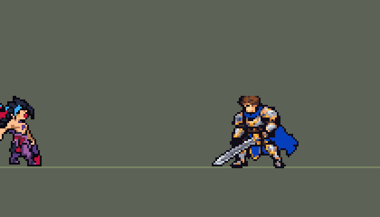

<!-- 本页上半部分由 tools/docs/gen_hero_docs.py 按仓库里现在的数据生成，手改会被覆盖；「开发记录」以下是手写的，生成时原样保留。 -->

# 凯隐 Kayn


| 项目 | 内容 |
|---|---|
| id | `league_kayn` |
| 所属的包 | 主包（mod_id `league`） |
| 分路 | 打野 |
| 分类 / 标签 | 刺客（Assassin） · AD / Melee / CC |
| 高清帧 | 1 倍像素（无高清帧） |
| 附加包 | [凯隐「暗裔魔镰」附加包](#附加包)（`league_kayn_form`） |



其他预览：[forms](../preview/league_kayn_forms.gif)

## 现在的技能

下面是游戏里显示的技能说明（`league/text/champion.i18n` 的简体中文，去掉了颜色和图标），冷却、距离来自 `league/champion/league_kayn.data_champion`；1 秒 = 60 tick。

### 普攻 / 被动

*攻击间隔 0.83 秒 · 攻击距离 24000*

普攻造成100% 攻击力物理伤害。暗裔魔镰：技能打中身边英雄攒暗裔（2次），W只打中远处英雄攒影流（1次），先满的变身（死亡重攒）。暗裔杀手：对英雄的伤害回复20%；影流刺客：开战3秒内每次命中英雄额外8+15% 攻击力真实伤害。

### 技能1 · 巨镰横扫

*冷却 6 秒 · 施放距离 42000 · 施放：指定目标 · 敌人（不含防御塔）*

冲向目标并旋转镰刀，冲刺和旋转各造成40+55% 攻击力物理伤害（暗裔：对英雄再加4%最大生命）。掠影步：之后2秒移速+35%（影流+55%），回复20+20% 攻击力生命。

### 技能2 · 利刃纵贯

*冷却 8 秒 · 施放距离 50000 · 施放：方向 · 敌人（不含防御塔）*

举镰0.55秒（举起时锁定方向）后向前斩出一道镰刃，造成55+100% 攻击力物理伤害和逐渐衰减的50%减速。暗裔：击飞0.75秒；影流：距离更远。

### 大招 · 裂舍影

*冷却 50 秒 · 施放距离 55000 · 施放：指定目标 · 刚交过手的敌方英雄*

钻进最近被己方打过的敌方英雄体内，2秒不可选取，随后破体而出造成110+150% 攻击力物理伤害。暗裔：再加10%最大生命伤害并回复其中70%；影流：重新开启开战额外伤害。

### 数值

攻击力 105（每级 +24）、生命 940（每级 +92）、护甲 28（每级 +8）、魔抗 18（每级 +4）、移速 1100（每级 +13）。

## 附加包

附加包是可选的原生代码 mod（都在附加包合集 `league_addons` 里），**不装主包里的英雄也是完整的**。

### 凯隐「暗裔魔镰」附加包

[凯隐「暗裔魔镰」附加包](../../addons/league_kayn_form/README.md)：`league_kayn_form` v0.3.6

|  | 主包（纯数据） | 装了附加包（照英雄联盟） |
|---|---|---|
| 攒哪种形态 | 技能打中**身边**的英雄攒暗裔（2 次），W 只打中**远处**的英雄攒影流（1 次）——数据读不到目标是近战还是远程，按距离近似 | 打中**近战英雄**攒暗裔、打中**远程英雄**攒影流（普攻和技能都算，各 14 次），按英雄的攻击距离分 |
| 形态能留多久 | 这条命（数据的 buff 阵亡就清掉，复活后重攒） | **整局**：阵亡复活后光环和形态效果直接回来 |
| 变身后的样子 | 只有出招（普攻、Q、W、R 破体）是形态的动作，待机、跑步、受击、阵亡还是本体（游戏按名字自动播这几个，数据换不了） | **整个身体**都是形态的（只在游戏 0.6.4 上，别的版本退回左边那样） |
| 掠影步穿墙 | 无视地形的 buff 在，但寻路是预先算好、绕开墙的，实际不穿 | Q 转完的 2 秒里隔着墙有敌方英雄就**笔直穿过去**，人在墙里时是一团暗影（进墙、出墙各溅开一下） |

## 相关脚本和素材

- [`tools/lol/extract_kayn.py`](../../tools/lol/extract_kayn.py)
- [`tools/art/preview_kayn.py`](../../tools/art/preview_kayn.py)
- [`tools/art/rig_kayn.py`](../../tools/art/rig_kayn.py)
- [`tools/art/import_kayn.py`](../../tools/art/import_kayn.py)
- [`tools/art/design_kayn.py`](../../tools/art/design_kayn.py)
- [`assets/source/kayn/`](../../assets/source/kayn)

## 开发记录

> 下面是原来 README 里「英雄：凯隐」一节，原样搬过来（只改了相对链接）。

| 部分 | 内容 |
|---|---|
| 定位 | 打野（近战刺客，分类 Assassin），用户 10 月 2 日排的第十一组的打野。暗影刺客凯隐和镰刀拉亚斯特：打中英雄攒两种印记，先攒满的那种变身——暗裔杀手（拉亚斯特）吸血、按最大生命值打，影流刺客进入战斗后追加真实伤害、W 更远 |
| 普攻 | 镰刀挥砍，100% 攻击力的物理伤害，射程 24000，攻击间隔 50 tick，第 10 tick 打中（动作第 4 帧） |
| 被动 | 「暗裔魔镰」（用户选：主包近似 + 扩展包照搬）。英雄联盟按被打的英雄近战还是远程分，数据读不到对方的攻击距离：主包里技能打中身边的英雄攒暗裔（2 次），W 只打中远处的英雄攒影流（1 次），先满的变身；数据 buff 阵亡就没了，所以每条命重攒（门槛这么低是因为「你也要考虑不安装扩展包的人」：模拟里 81% 的命会变身，中位 33 秒）。暗裔杀手：对英雄的伤害回复 20%；影流刺客：进入战斗 3 秒内打英雄追加 8 + 15% 攻击力的真实伤害（8 秒冷却）。变身时播变身动作、0.6 秒减伤 50%，之后身上一直有形态光环，普攻、Q、W、R 破体换成那个形态的出招动作（待机、跑步、受击、死亡引擎按名字自动播，数据换不了，还是本体，`form-switch` 的研究见 `tools/art/rig_kayn.py` 的说明；装了附加包整个身体都换，见下一行） |
| 扩展包 | `addons/league_kayn_form`（原生代码，可选，v0.3.0，在附加包合集里）：照英雄联盟分近战 / 远程（本包英雄按各自的攻击距离，35000 以上算远程，别的 mod 的英雄按挂标记时的距离猜），各 14 次攒满；形态记在被动里，阵亡不丢、复活自动补回。**完整变身**（游戏 0.6.4）：变身后待机、跑步、受击、阵亡也是形态的样子（用户：要像创意工坊的佛耶戈那样整个变身），按画面上凯隐身上的形态 buff 换正在播的动画名，像原版恶魔那样（挂在游戏的显示处理槽上，和变身前置 tfm2_transform_core 同一处：前置先装好时两边一起生效，本包先装时前置会拒绝安装）。**掠影步穿墙**：Q 后 2 秒里隔着地图的墙追最近的敌方英雄，人在墙里是一团暗影（Codex 画的暗影雾和进出墙的溅开）。不装也能玩，主包是完整的近似版；详见 [附加包说明](../../addons/league_kayn_form/README.md) |
| 技能1 | Q「巨镰横扫」+ E「掠影步」（用户选：并进 Q）：对 42000 内的敌人施放（清线、打野也用），冷却 6 秒。8 tick 冲过去，第 12 tick 原地转一圈（半径 24000），冲刺和旋转都造成 40 + 55% 攻击力的物理伤害（每个敌人各一次），暗裔额外 4% 最大生命值。转完 2 秒掠影步：移速 +35%（影流 +55%）、能穿墙、回复 20 + 20% 攻击力 |
| 技能2 | W「利刃纵贯」：朝方向施放（50000），冷却 8 秒。镰刀上拉亚斯特的眼睛蓄力 0.55 秒（敌人看得到、躲得掉），然后一长条斩击：长 62000（影流 80000）、宽 7000，55 + 100% 攻击力的物理伤害，减速 50% 0.5 秒再 25% 1 秒；暗裔把英雄击飞 0.75 秒。瞄着的英雄被打中约 65% |
| 大招 | R「裂舍影」：对 55000 内、队伍最近打过的敌方英雄施放，冷却 50 秒。0.2 秒扑过去钻进他体内 2 秒（隐身、无法选中、免控，跟着他走，他头上有标记），然后破体而出：110 + 150% 攻击力的物理伤害；暗裔额外 10% 最大生命值并吸血 70%，影流刷新被动 |
| 数值 | 攻击 105（+24）、生命 940（+92）、护甲 28（+8）、魔抗 18（+4）、移速 1100（+13）。数值是自己设计的，用 SDK 对战模拟调：打野位，对 5 个原版打野（`demon`、`circus_blade`、`hunter`、`inquisitor`、`ninja`），两组种子各 600 局。第一版 +2.0 左右（回血太多）；门槛降到 2 / 1 后变身多了、又强到 +2.3；削形态（暗裔回血 20%、Q / R 的最大生命值 4% / 10%、影流追加 8 + 15%）、掠影步回血、Q、W、R 后 +1.70 / +0.88，和包里的打野差不多 |
| 亚索联动 | 只有暗裔的 W 击飞：凯隐打野、亚索同队时亚索每局 R 到被控英雄 1.00 次（同一批原版忍者 0.50、李青 1.67、蔚 2.98、阿木木 2.83），亚索不用调 |
| 精灵图 | 9 个本体动作 + 两种形态各 4 个出招（普攻、Q、W、R 破体）+ R 体内的空白帧，105 帧。造型是 Codex 画的三张（用户按截图选「40 44 40」：本体和暗裔是生图草稿按自己的格子读回、按众数缩到 40 / 44 行，影流用 Codex 自己的 40 行）：黑色刺头蓝挑染、长辫子、镰刀拉亚斯特；暗裔是红色恶魔、大角头盔；影流是苍白皮肤、长发、银柄青刃的镰刀。40 × 40 px，24 色；待机最高点 −28，不设 `banpick_center`；头像截取点 (−1, −37) |
| 音效 | 英雄联盟的音效和配音（`tools/lol/extract_kayn.py`）：普攻命中、Q 出手 / 旋转 / 命中、掠影步、W 出手（暗裔另一个）/ 命中、R 出手 / 钻入（扑入声叠在宿主身上的低鸣上：用户觉得只有低鸣时「音效不明显」）/ 破体 / 命中、两种变身；Q、W、R、变身带中文配音 |

重新生成（素材来自本机的英雄联盟客户端，音频不进仓库）：

```bash
python tools/lol/extract_kayn.py --lol "D:\WeGameApps\lol" --vgmstream "<vgmstream-cli.exe 路径>"
python tools/lol/native_pose.py assets/source/kayn/poses.json --out <渲染文件夹>   # 动作参考帧
python tools/art/design_kayn.py           # 三张造型
python tools/art/rig_kayn_forms.py        # 两种形态的待机、跑步、受击、阵亡（附加包的完整变身用）
python tools/art/import_native.py --hero kayn   # 也写变身图集 league_kayn_darkin / _shadow 和墙里的 *_wall
python tools/art/import_kayn.py           # 特效；--raw <Codex 的特效交付文件夹> 先把生图原稿缩成游戏尺寸；--wall <文件夹> 读穿墙特效
python tools/art/preview_kayn.py
python tools/art/preview_kayn_forms.py    # 完整变身的演示
```

美术（原画的提示词见 [`assets/source/kayn/PICTURE_PROMPT.md`](../../assets/source/kayn/PICTURE_PROMPT.md)，造型的见 [`MODEL_PROMPTS.md`](../../assets/source/kayn/MODEL_PROMPTS.md)，动作的见 [`MODEL_STRIPS.md`](../../assets/source/kayn/MODEL_STRIPS.md)，特效的见 [`PROMPTS_FX.md`](../../assets/source/kayn/PROMPTS_FX.md)；Codex 的交接说明在 [`codex_picture/`](../../assets/source/kayn/codex_picture)、[`codex_model/`](../../assets/source/kayn/codex_model)、[`codex_fx/`](../../assets/source/kayn/codex_fx)）：

- 动作：Codex 画了 17 条（本体 9 条 + 两种形态各 4 条），但人和镰刀比定稿大一圈、不少帧镰刀断开、贴的头留着旧头的边。用户：「每个都修到完美吧」。先逐帧修到定稿的体型（镰刀接上、碎块清掉、头换成定稿的头），有些动作因此变成了站姿；用户选「保留修复版，把动作找回来」：三张定稿切成部件（头、辫子 / 头发、躯干、两臂、两腿、镰刀，被挡住的像素补齐，`assets/source/kayn/rig/`）加五种腿（下蹲、弓步、收腿、垂腿、跪地），变僵的帧照英雄联盟的帧和 Codex 的原稿用部件重新摆（`tools/art/rig_kayn.py`，同魔腾的做法）。跑步：腿用修复版的交叉步（用户看过重新手画的腿「有点怪」，Codex 重画的腿也不如这版），上身用定稿的部件直立摆上去，腰带和腿之间垫定稿的大腿根，空着的手用定稿的手臂前后摆，镰刀转到背后扛着（前一版把上身整体斜切前倾，用户：「腿和身体严重脱节和歪的」、后摆的手「形状有点奇怪」）。精修（用户：「走路少一块」）：修复版的腿整体比定稿的胯偏左约 3.5 格，胯右边悬空，所以 8 帧整双腿统一右移 3 格（第 2 帧 4 格）落到胯正下方；腿上 Codex 自己画的红腰带垂穗挪开后成了第二块红斑，改成裤子的颜色；刀刃、辫子、手、靴尖旁孤立的黑点删掉；前腿和刀柄之间时有时无的窄缝用描边合上。
- 导入：待机 6 帧都用定稿，第 3–5 帧从脚底上一行的接缝往下沉一格呼吸（`BOB`）；按近处那只金色眼睛定头的位置（`EYES`）；描边补齐（`COMPLETE`）；R 体内的 `r_hidden` 是一帧全透明。
- 特效用 Codex 画的 23 种（生图原稿，`import_kayn.py --raw` 同烬：每个游戏像素取覆盖的原稿像素里最多的颜色，归到本体（暗紫转深红、青色刃光）、暗裔（血红到淡金）、影流（靛蓝到淡青）三套色阶），另 8 种是本体那张按色阶换成两种形态的颜色（普攻命中、Q 旋转、W 蓄力、R 标记）。变身的火柱和触手按 46 × 60 缩（原稿太窄，按高缩会盖在人身上）；W 的蓄力在各形态镰刀的眼睛上（本体 (31, −2)、暗裔 (41, −7)、影流 (36, −2)）；W 的斩击是范围投射物的画面，以线段中点为中心、长 62 / 80。

- 完整变身（附加包）：两种形态的待机、跑步、受击、阵亡用定稿的部件摆（`tools/art/rig_kayn_forms.py`，用户选「用造型像素摆」）。待机是定稿本身；跑步是定稿自己的两条腿各绕胯转 ±36°，两胯往中间并 3 格，脚能交叉（「走路没有交叉步」），上身整体前移一格，不斜切（斜切会把镰刀切歪：「武器看起来有点歪」）；受击后退两格再一格；阵亡是后仰、下蹲、跪下、伏身，最后按 4 × 4 的抖动网格分三步消散（两种形态比人宽，像本体那样转 90° 躺下会竖起来）。出招沿用两种形态的出招动作；R 扑进去和变身那一下用形态自己的画（R 出场倒放、待机），不然会闪回本体。墙里的样子是各自待机按亮度换成暗影紫，中间棋盘格透出地面，饱和的亮色换成深红（`import_native.py` 的 `shadow_frame`）；暗影雾和溅开是 Codex 画的（提示词 [`PROMPTS_WALL.md`](../../assets/source/kayn/PROMPTS_WALL.md)，`tools/art/pack_kayn_wall.py` 打包参考图）。


逐帧预览：[`docs/preview/league_kayn_showcase_key.png`](../preview/league_kayn_showcase_key.png?v=1014g)、[`league_kayn_forms_key.png`](../preview/league_kayn_forms_key.png?v=1014g)。
