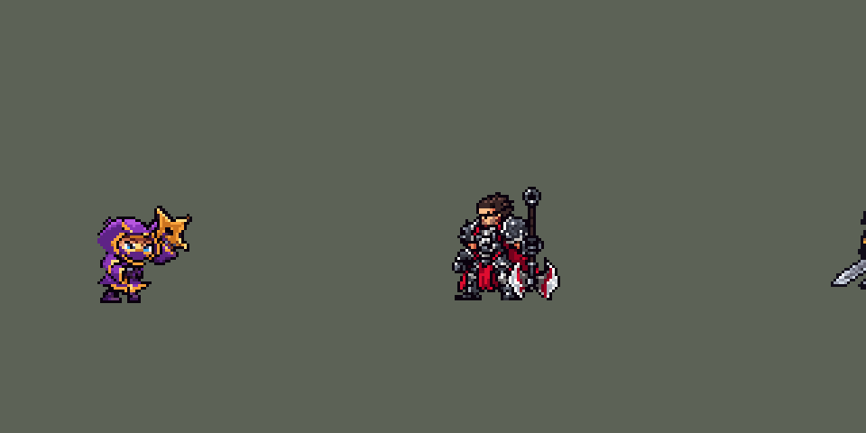

<!-- 本页上半部分由 tools/docs/gen_hero_docs.py 按仓库里现在的数据生成，手改会被覆盖；「开发记录」以下是手写的，生成时原样保留。 -->

# 凯南 Kennen


| 项目 | 内容 |
|---|---|
| id | `league_kennen` |
| 所属的包 | 主包（mod_id `league`） |
| 分路 | 上单 |
| 分类 / 标签 | 法师（Magician） · AP / Magic / Range / CC |
| 高清帧 | 1 倍像素（无高清帧） |
| 附加包 | [目标标记附加包](#附加包)（`league_marks`） |



其他预览：[逐帧预览](../preview/league_kennen_frames.png)、[特效表](../preview/league_kennen_effects.png)

## 现在的技能

下面是游戏里显示的技能说明（`league/text/champion.i18n` 的简体中文，去掉了颜色和图标），冷却、距离来自 `league/champion/league_kennen.data_champion`；1 秒 = 60 tick。

### 普攻 / 被动（被动「雷缚印」）

*攻击间隔 1.17 秒 · 攻击距离 55000*

投掷手里剑。被动 雷缚印：技能命中英雄留下标记，第三层眩晕1.25秒（7秒内再次眩晕0.5秒）。电刃：每第5次普攻额外造成48 + 70% 法强魔法伤害并留下标记。

### 技能1 · 奥义！千鸟

*冷却 5 秒 · 施放距离 80000 · 施放：方向 · 敌人（不含防御塔）*

掷出千鸟手里剑（出手前锁定方向，可躲开），命中第一个敌人造成95 + 90% 法强的魔法伤害。命中英雄时若电刃就绪，立刻放电（连招）。

### 技能2 · 奥义！雷铠

*冷却 8 秒 · 施放距离 50000 · 施放：指定目标 · 敌人（不含防御塔）*

化作闪电冲过敌群，对经过的敌人造成70 + 70% 法强；冲完放出电刃（80 + 80% 法强）并在4秒内攻速+50%。大招就绪时直接接大招（连招）。

### 大招 · 秘奥义！万雷天牢引

*冷却 50 秒 · 施放距离 55000 · 施放：无目标 · 敌方英雄*

召唤跟随自己的风暴3秒，每0.5秒雷击范围内的敌方英雄，造成52 + 30% 法强的魔法伤害并留下标记；期间护甲和魔抗+25。

### 数值

攻击力 80（每级 +6）、法强 40（每级 +20）、生命 920（每级 +100）、护甲 22（每级 +7）、魔抗 22（每级 +3）、移速 1000（每级 +9）。

## 附加包

附加包是可选的原生代码 mod（都在附加包合集 `league_addons` 里），**不装主包里的英雄也是完整的**。

### 目标标记附加包

[目标标记附加包](../../addons/league_marks/README.md)：`league_marks` v0.1.0

| 英雄 | 主包（纯数据） | 装了附加包（英雄联盟） |
|---|---|---|
| 凯南 雷缚印 | 层数记在凯南身上：打 A 一次、打 B 两次，B 就被眩晕 | 每个英雄各记各的（6 秒），同一个人第三层眩晕 1.25 秒，7 秒内再次只有 0.5 秒 |

## 相关脚本和素材

- [`tools/lol/extract_kennen.py`](../../tools/lol/extract_kennen.py)
- [`tools/art/preview_kennen.py`](../../tools/art/preview_kennen.py)
- [`tools/art/rig_kennen.py`](../../tools/art/rig_kennen.py)
- [`tools/art/import_kennen.py`](../../tools/art/import_kennen.py)
- [`tools/art/design_kennen.py`](../../tools/art/design_kennen.py)
- [`assets/source/kennen/`](../../assets/source/kennen)

## 开发记录

> 下面是原来 README 里「英雄：凯南」一节，原样搬过来（只改了相对链接）。

| 部分 | 内容 |
|---|---|
| 定位 | 上单（远程法师，分类 Magician），用户 10 月 2 日排的第十组的上单；本包第十个上单（盖伦、德莱厄斯、提莫、墨菲特、凯尔、锐雯、贾克斯、菲奥娜、卡蜜尔之后）。约德尔忍者：技能给敌方英雄叠雷缚印，第三层眩晕；Q 雷电手里剑，E 化作闪电冲进人群，R 跟着他走的雷暴 |
| 普攻 | 掷出手里剑，100% 攻击力的物理伤害，射程 55000，攻击间隔 70 tick，第 11 tick 出手（动作第 4 帧，手里剑刚离手 (24, −5)），手里剑每 tick 5000，`y_offset` 1500（抬 3.5 px），前 5 tick 不画（还在他身上，引擎第一 tick 也会把画面转朝上）。W 的被动「电刃」：每第 5 下普攻额外造成 48 + 70% 法术强度的魔法伤害（紫色的出手闪光和电击），打中英雄时叠一层雷缚印（只对英雄生效的影子手里剑） |
| 被动 | 「忍法！雷缚印」（用户选：只算英雄）：技能（和每第 5 下普攻）打中敌方英雄叠一层，第三层眩晕 1.25 秒（7 秒内眩晕过人则 0.5 秒，同英雄联盟的第二次眩晕变短）。游戏读不到目标身上的层数，层数记在凯南自己身上（两个状态标记 `k_1`、`k_2`，6 秒，每叠一层刷新），每个技能各一把 2 tick 的锁：一次施放不管打中几个英雄只计一层，第三层时这次施放打中的英雄全部眩晕。被打中的英雄头顶亮一格或两格闪电符号。和英雄联盟的差别：层数是凯南一个人的，打 A 一层、打 B 两层，B 就被眩晕 |
| 技能1 | Q「奥义！千鸟」：朝 80000 内的敌人施放（小兵和野怪也算，清线、打野也用），冷却 5 秒。第 10 tick 出手（动作第 4 帧，手里剑离手的地方 (24, −5) 闪光）。射程内有敌方英雄时，出手前 8 tick 锁定他所在的位置（凯特琳 Q 的隐形抛物线），手里剑飞过小兵、打中这条线上第一个敌方英雄（锁定后走开就能躲）：95 + 90% 法术强度的魔法伤害，叠一层雷缚印；没有英雄时朝施放方向飞，打中第一个敌人。每 tick 8000，半径 7000：原来会被小兵挡住（每局瞄准英雄的 45–61 发只有 3–7 发打到英雄），改成穿过小兵后 42% 打中。连招 Q → W（用户选加连招）：打中的英雄在凯南 50000 内、电刃好了，4 tick 后接电刃 |
| W（并入） | 「奥义！电刃」：没有自己的技能位（Q、E 占了两个技能位）。被动在普攻里（见上）；主动在 Q 打中身边的英雄后、E 冲刺结束时施放，冷却 9 秒（谁先用谁占）：先摆姿势，第 6 tick 放电（半径 50000，脚下一圈电弧）：周围敌人 80 + 80% 法术强度的魔法伤害，英雄叠一层雷缚印 |
| 技能2 | E「奥义！雷铠」：对 50000 内的敌人施放（小兵和野怪也算），冷却 8 秒。化作闪电球冲向目标并穿过（每 tick 2500、16 tick，40 px），经过的敌人受到 70 + 70% 法术强度的魔法伤害，碰到的英雄叠一层雷缚印。冲完：攻速 +50% 持续 4 秒，电刃好了就放电刃；连招 E → R（用户：「E 冲进人群时如果大招好了就直接接 R」）：大招已解锁、还没用、55000 内有敌方英雄时直接开雷暴。冲刺结束的效果挂在凯南自己身上：原来挂在目标身上，目标被冲死后攻速、电刃冷却、大招冷却都没了，下一次冲刺又开了一次雷暴 |
| 大招 | R「秘奥义！万雷天牢引」：55000 内有敌方英雄时施放，冷却 50 秒。凯南身边雷暴 3 秒，跟着他走，每 0.5 秒对 55000 内所有敌方英雄造成 52 + 30% 法术强度的魔法伤害并叠一层雷缚印（第三下圈里的英雄一起眩晕），期间 +25 护甲和魔抗，他照常攻击。半径同英雄联盟（等于普攻射程）：45000 时打不到他贴身打的英雄（中心距 73000）。雷击是挂在他自己身上的一个 `AddCasted`（技能树里只有一份，E 的连招也用它：技能树每 tick 复制一次，节点数影响帧率） |
| 附加包 | 可选的附加包 [`addons/league_marks`](../../addons/league_marks/README.md)（在附加包合集里，原生代码，主包不装它也完整）：雷缚印照英雄联盟按目标记层，同一个人第三层才眩晕（主包的层数记在凯南自己身上） |
| 数值 | 攻击 80（+6）、法强 40（+20）、生命 920（+100）、护甲 22（+7）、魔抗 22（+3）、移速 1000（+9）。数值是自己设计的，用 SDK 对战模拟调：上路，对 6 个原版上单（`fighter`、`executioner`、`lancer`、`pole_warrior`、`knight`、`berserker`），三套队友阵容、两边各 8 局，一批 288 局。第一版 −0.18（同一批提莫 +1.05）：大招半径 45000 时很少打到英雄，Q 被小兵挡住。大招半径 → 55000、Q 穿过小兵打英雄后各版 +1.4–2.2；伤害再调高一档 +2.64 / +2.25，回调到 Q 95 + 90%、W 80 + 80%、E 70 + 70%、R 52 + 30%、被动 48 + 70%：两批 +1.18 / +2.29，定下这版 |
| 亚索联动 | 第三层雷缚印的眩晕是亚索大招要的控制：凯南打上路、亚索打中路同队时，亚索每局 R 到被控英雄 1.48 次（同一批原版战士 2.33），在之前控制英雄的范围内，亚索不用调 |
| 精灵图 | 9 个动作 51 帧：待机、移动、普攻、Q、E 冲刺、W 电刃、R、受击、死亡。造型按用户在 Codex 里挑的原画 A（英雄联盟的待机），由 Codex 按游戏尺寸画，整行整列删到 37 行（用户：「约德尔人体型不能太大」），眼睛和手保持 Codex 原稿；进游戏后用户换成原画 B 的姿势（「姿势能换成这个吗 A版游戏里太丑了」）：手里剑从背上拿下来，远侧手臂把它举在头旁边（这条手臂由 Codex 画），袍子瘦两列（「凯南体型有点胖 稍微调瘦点」）。紫色忍者兜帽（两个耳尖、金色闪电纹）、蓝色大眼、紫色面罩和长袍、金色四角大手里剑。36 × 35 px，21 色；待机最高点 −24（举起的手里剑尖，兜帽顶 −20），不设 `banpick_center` |
| 音效 | 英雄联盟的音效和配音（`tools/lol/extract_kennen.py`）：普攻手里剑和命中、第 5 下强化出手和命中、Q 出手和命中、W 放电、E 冲刺 / 命中 / 结束、眩晕、R 开启和每下雷击；Q、W、E、R 带中文配音 |

重新生成（素材来自本机的英雄联盟客户端，音频不进仓库）：

```bash
python tools/lol/extract_kennen.py --lol "D:\WeGameApps\lol" --vgmstream "<vgmstream-cli.exe 路径>"
python tools/lol/native_pose.py assets/source/kennen/poses.json --out <渲染文件夹>   # 动作参考帧
python tools/art/design_kennen.py         # 造型：Codex 的 A 版删到 37 行，再换成 B 姿势（背上的手里剑拿掉、袍子瘦两列、贴 Codex 画的举手里剑的手臂）
python tools/art/rig_kennen.py            # 动作：9 个动作都用造型的部件摆，扔手里剑的 4 个手臂姿势是 Codex 画的
python tools/art/import_native.py --hero kennen
python tools/art/import_kennen.py         # 特效；--raw <Codex 的特效交付文件夹> 先把生图原稿缩成游戏尺寸的原尺寸条
python tools/art/preview_kennen.py
```

美术（原画的提示词见 [`assets/source/kennen/PICTURE_PROMPT.md`](../../assets/source/kennen/PICTURE_PROMPT.md)，造型的见 [`MODEL_PROMPTS.md`](../../assets/source/kennen/MODEL_PROMPTS.md)，B 姿势的手臂见 [`ARM_PROMPT.md`](../../assets/source/kennen/ARM_PROMPT.md)，扔手里剑的手臂见 [`THROW_PROMPT.md`](../../assets/source/kennen/THROW_PROMPT.md)，特效的见 [`PROMPTS_FX.md`](../../assets/source/kennen/PROMPTS_FX.md)；Codex 的交接说明在 [`codex_picture/`](../../assets/source/kennen/codex_picture)、[`codex_model/`](../../assets/source/kennen/codex_model)、[`codex_arm/`](../../assets/source/kennen/codex_arm)、[`codex_throw/`](../../assets/source/kennen/codex_throw)、[`codex_fx/`](../../assets/source/kennen/codex_fx)）：

- 原画和造型：Codex 画了 A、B 两张原画，用户选 A（待机，手里剑背在背上）。造型 Codex 画了 A 48 行、B 43 行；`design_kennen.py` 只删整行整列（脸保住），给用户看了 A44 / 41 / 38、B40 / 38 / 36，用户选 A38，再要求「缩小到 37 左右，可以牺牲点别的地方的像素」，定 37 行（「就37吧 OK了」）。眼睛用 Codex 原稿（「凯南眼睛用codex原稿」，重画成两只一样高的眼睛被否了），手也用 Codex 原稿（「凯南的手就用调整前codex的」）。一层描边，128 × 128 画布上脚底在第 99 行、两脚中间在第 64 列。
- B 姿势：A37 进游戏后用户：「姿势能换成这个吗 A版游戏里太丑了」（原画 B：手里剑举在头旁边，另一只爪子向前）、「凯南体型有点胖 稍微调瘦点」。Codex 按 B 重画的造型头是方的（「都不满意 质量太差了」「换回现在的头」），所以 B 就是 A37 改出来的（`design_kennen.py` 第 5–9 步）：背上的手里剑拿掉，兜帽后面原来被它挡住的地方补画（圆的后沿，左上亮）；胸前的远侧爪子拿掉（远侧手臂是举起来的那条）；下巴以下的袍子整列删两列；再补一次描边——这张是给 Codex 的底图（`codex_arm/base_unchanged_1x.png`）。举手里剑的手臂我画了四版，用户都觉得「奇怪」（一根柱子、手肘鼓包、袖子贴着脸、「90度角」），改成只让 Codex 画手臂这一层、底图一格不改（`ARM_PROMPT.md`），三版里用户选 B。现在 36 行（手里剑尖在第 64 行）、35 列、21 色。
- 动作：Codex 先按 A 姿势画了 8 条（手里剑背在背上），我修过移动的交叉步（「凯南走路没有交叉步」）、死亡缺的半个身子（「死亡后模型缺失右半身」）和普攻第 3 帧一根细长的手臂（「中间有一帧手臂突然伸的很长 有点诡异」）。换成 B 姿势后这些条都不能用了，`rig_kennen.py` 用造型的部件摆全部 9 个动作，自己不画手臂：待机是造型 6 次（导入时 `BOB` 呼吸）；移动是造型的上半身（头、举着的手臂和手里剑、袍子、近侧爪子是一整块）在袍子下面两条两格宽的小腿上，近处的鞋（画在前面，小腿的描边压住远处那条腿）先在前、再落到远处那只后面，每半个周期换一次领先的脚，摆动的脚抬 1–2 行，摆腿时身体高一行；E 冲刺是同一块压低 2–3 行、大步交替（闪电球是特效）；W 蹲 1、2 行，放电时起身；R 蹲下、跳起 3、4 行（鞋收起一行）、落地再蹲；受击后退一列、低一行；死亡先受击，再整个造型后仰 30 度，然后不带举着的手臂的身体在空中仰 60 度、仰面躺倒（90 度，先离地一行），手里剑飞出去、落在他头边。普攻和 Q 是扔手里剑：造型 → Codex 画的 4 个手臂姿势（后摆、前甩、出手、收手；`codex_throw/`，`THROW_PROMPT.md`：只画手臂和手里剑，底图一格不改，出手那张手里剑中心在 (24, −5)）→ 造型。用户：「凯南做的很好」。之后用户：「凯南平A时手的长度有点怪啊」——Codex 画的出手、收手两帧手臂伸出身体 13–15 格，和他身体一样宽（英雄联盟里爪子只伸出 4–6 格）；`rig_kennen.py` 的 `SHORTEN` 把这两帧的袖子删掉 6、4 列（手和手里剑跟着往里收），截短 4 / 6 / 8 格三个版本里用户选了 6 格。
- 特效用 Codex 画的 19 张（96 帧，生图原稿，`import_kennen.py --raw` 每格缩到游戏尺寸：每个游戏像素取覆盖的原稿像素里最多的颜色，四分之一以上不透明才画，颜色归到包里各自的色阶——闪电的白到紫、青色的电边、手里剑的金色、雷暴的暗紫云，光效外圈的暗紫去掉）。眩晕原稿两道闪电柱画得只有高度的三分之一宽，按 24 × 38 拉开到英雄身体两边；Q 的手里剑上下对称（游戏按飞行方向转）。位置：普攻和 Q 出手都在第 4 帧手里剑离手的地方 (24, −5)，命中在上半身 (0, −8)，雷缚印在头顶上方 (0, −35)，眩晕、W 的电刃圈、R 的雷暴和雷击落在脚底那一行，E 的闪电球包住蹲低的他 (0, −5)，起点和终点的闪光留在原地。时长：印记 0.8 秒，眩晕 1.25 秒，闪电球 0.28 秒（到冲刺结束），雷暴 2.9 秒（成形、第 3–10 帧循环 4 次、消散；雷击 2.5 秒内打完，护甲 3 秒）。

逐帧预览：[`docs/preview/league_kennen_frames.png`](../preview/league_kennen_frames.png?v=1023ct)，特效：[`docs/preview/league_kennen_effects.png`](../preview/league_kennen_effects.png?v=1014g)。
