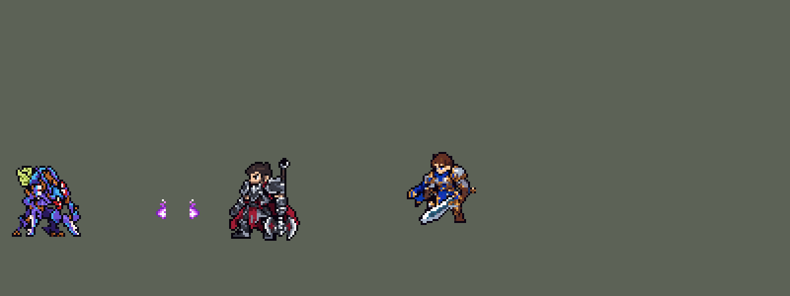

<!-- 本页上半部分由 tools/docs/gen_hero_docs.py 按仓库里现在的数据生成，手改会被覆盖；「开发记录」以下是手写的，生成时原样保留。 -->

# 卡兹克 Kha'Zix


| 项目 | 内容 |
|---|---|
| id | `league_khazix` |
| 所属的包 | 主包（mod_id `league`） |
| 分路 | 打野 |
| 分类 / 标签 | 刺客（Assassin） · AD / Melee |
| 高清帧 | 1 倍像素（无高清帧） |
| 附加包 | [卡兹克视野与进化附加包](#附加包)（`league_khazix`） |



其他预览：[逐帧预览](../preview/league_khazix_frames.png)、[特效表](../preview/league_khazix_effects.png)

## 现在的技能

下面是游戏里显示的技能说明（`league/text/champion.i18n` 的简体中文，去掉了颜色和图标），冷却、距离来自 `league/champion/league_khazix.data_champion`；1 秒 = 60 tick。

### 普攻 / 被动（被动「无形威胁」）

*攻击间隔 0.83 秒 · 攻击距离 23000*

利爪攻击。被动无形威胁：隐身或4秒没出手后，下次攻击英雄附加15 + 25% 攻击力伤害并减速25%。5/8/11级依次进化Q、E、R。

### 技能1 · 品尝恐惧

*冷却 4 秒 · 施放距离 26000 · 施放：指定目标 · 敌人（不含防御塔）*

爪击：30 + 70% 攻击力物理伤害；目标身边没有友军（孤立无援）时改为45 + 125% 攻击力。进化收割利爪：攻击距离变长，对孤立目标返还冷却。

### 技能2 · 跃击

*冷却 12 秒 · 施放距离 80000 · 施放：指定目标 · 敌方英雄*

跃向敌方英雄，落地造成25 + 35% 攻击力物理伤害，再射出虚空突刺：30 + 50% 攻击力并减速40%，身在爆炸中回复30 + 15% 攻击力生命。进化虫翼：跳得更远，击杀英雄刷新。

### 大招 · 虚空来袭

*冷却 50 秒 · 施放距离 70000 · 施放：指定目标 · 敌方英雄*

隐身1.25秒并加速40%，无形威胁就绪，可再用1次。进化动态遮蔽：隐身2秒，共可用3次。

### 数值

攻击力 88（每级 +16）、法强 0（每级 +1）、生命 880（每级 +84）、护甲 26（每级 +8）、魔抗 18（每级 +4）、移速 1100（每级 +13）。

## 附加包

附加包是可选的原生代码 mod（都在附加包合集 `league_addons` 里），**不装主包里的英雄也是完整的**。

### 卡兹克视野与进化附加包

[卡兹克视野与进化附加包](../../addons/league_khazix/README.md)：`league_khazix` v0.1.0

主包 `league` 保持纯数据。数据读不到视野和等级，主包里卡兹克的被动「无形威胁」在 R 隐身、复活和约 4 秒没出手后就绪；
进化靠「法强探测」（每级 +1 法强，自伤打护盾）在 5/8/11 级后一两秒内认出等级（用户：「数据读不到就用rust 改写源码」）。
这个附加包用原生代码读视野和等级，做成英雄联盟的样子：

- **无形威胁看真视野**：原生被动 `league_khazix:void` 每 tick 看——他活着、敌方队伍看不见他（草丛、战争迷雾、R 的隐身都算），
  就给他加上 `league_khazix_ut`（永久，下一次攻击英雄时由数据打出伤害和减速并去掉）。「没出手就绪」去掉，R 隐身照样就绪。
- **进化读等级**：等级到 5/8/11 级就给 `league_khazix_s1`（攻击距离 +6000）/ `s2` / `s3`，播进化画面、音效和台词；
  复活后补回已有进化时不播。主包副本里的探测去掉（普攻的效果树从 587 个节点减到 40 个）。
- 孤立无援仍用主包的数据判定（命中时在目标身边数人头，已经是英雄联盟的意思）。
- 数字从英雄数据的 `passive.params` 来（`make_override.py` 从 `tools/kit/build_khazix.py` 的参数表 `P` 写进去）。

装上附加包后游戏里显示的说明（和主包不同的部分）：

- **普攻 / 被动（被动「无形威胁」）**：【视野测试版】利爪攻击。被动无形威胁：不在敌方视野里时，下次攻击英雄附加15 + 25% 攻击力伤害并减速25%。5/8/11级依次进化Q、E、R。

## 相关脚本和素材

- [`tools/kit/build_khazix.py`](../../tools/kit/build_khazix.py)
- [`tools/kit/setup_khazix.py`](../../tools/kit/setup_khazix.py)
- [`tools/lol/extract_khazix.py`](../../tools/lol/extract_khazix.py)
- [`tools/art/preview_khazix.py`](../../tools/art/preview_khazix.py)
- [`tools/art/import_khazix.py`](../../tools/art/import_khazix.py)
- [`assets/source/khazix/`](../../assets/source/khazix)

## 开发记录

> 下面是原来 README 里「英雄：卡兹克」一节，原样搬过来（只改了相对链接）。

| 部分 | 内容 |
|---|---|
| 定位 | 打野（刺客，分类 Assassin），用户排的第十四组的打野（同组：上单格温已做，中单布兰德、ADC 图奇、辅助萨勒芬妮后来做了），第 67 位英雄。虚空掠夺者 卡兹克：扑向落单的猎物，爪击孤立无援的目标伤害更高，跳上去补一根虚空尖刺，隐身后再出手；5/8/11 级依次进化爪子、虫翼、隐身。四个选择都按推荐的来（用户选的）：技能位「Q / E→W 连招」，孤立判定「目标身边没有它的友军」，进化「按等级三次 Q→E→R」，R「可再次使用 + 脱战就绪」；另外「加入高手的连招」。数据读不到视野和等级，用户：「数据读不到就用rust 改写源码」——主包用下面的近似办法，自己完整能玩；真视野和直接读等级在原生附加包里 |
| 普攻 / 被动 | 利爪近战，射程 23000，攻击间隔 50 tick，第 11 tick 抓中。被动「无形威胁」：R 隐身时、每条命开始时、约 4 秒没出手后（伊芙琳脱战的做法）就绪，腰间两团洋红火光（原来在胸前，游戏里挡住了面甲，用户：「螳螂这个特效挡住脸部了」）；下一次攻击英雄附加 15 魔法 + 25% 攻击力的伤害并减速 25% 2 秒 |
| 技能1 | Q「品尝恐惧」：冷却 240 tick（4 秒），射程 26000，也对小兵和野怪放。第 1 tick 一颗看不见的弹落在目标脚下，在那里半径 30000 数目标那边的单位（英雄、小兵、野怪都算，目标自己是第一个）；第 12 tick 爪中：有第二个单位就是 30 + 70% 攻击力，没有就是孤立无援，45 + 125% 攻击力，画面换成更重的一击。进化收割利爪（5 级）：攻击距离 +6000，打孤立目标返还 45% 冷却 |
| 技能2 | E「跃击」→ W「虚空突刺」：冷却 720 tick（12 秒），只对敌方英雄放。60000 内有英雄就跳到目标身上（进化虫翼后 80000），远了就朝他跳一段；第 14 tick 落地，半径 22000 内 25 + 35% 攻击力；落地 6 tick 后朝目标甩出尖刺：30 + 50% 攻击力，减速 40% 2 秒，他站在爆炸半径 30000 里就回复 30 + 15% 攻击力的生命。进化虫翼（8 级）：参与击杀英雄后 E 刷新（金克丝的击杀检测） |
| 大招 | R「虚空来袭」：冷却 3000 tick（50 秒），射程 70000。隐身 1.25 秒、移速 +40%，被动就绪；第一次放完 2 秒后能再放一次，第二次放完才进完整冷却。进化动态遮蔽（11 级）：隐身 2 秒，共 3 次。隐身只让远处的敌人看不见、选不中，贴身的照样能打他（游戏的规则） |
| 进化 | 数据只读得到「是否到 3 级」。他每级 +1 法强（他不出法强装，技能也不吃法强），普攻时用凯尔的探测量法强：2 tick 减伤 99%、无视魔抗，按 100 倍法强打自己一下，打一层设在两级之间的护盾，打碎了就是到级了，隔 30 tick 再测一次确认。踩过的两个坑：探测自伤放在普攻里会吃暴击（出了暴击装后翻倍、提前进化）；拿最大生命当等级尺会被装备的生命带偏（模拟里 8 级时装备生命 0–800 不等，E、R 最多提前 3 级进化）。模拟里每次都在升级后 1–5 秒进化；死了以后复活第一次普攻静默补回，不再重播进化的光效和台词 |
| 连招 | 用户：「另外加入高手的连招」。照盲僧的做法，每个连招都是后一个技能自己打出来的，不占别的技能冷却：**E→Q→A**：跳到英雄身边后 2.5 秒内放 Q，爪完直接接一刀普攻；**Q→R→A**：Q 打中英雄后 2.5 秒内放 R，隐身的同时出一刀（吃到被动）；**R→E→W→A**：隐身中放 E，甩完尖刺再补一刀 |
| 雷恩加尔彩蛋 | 和雷恩加尔（第 77 位）的双向彩蛋：他的命中给对方挂 `league_khazix_rival_hit`，出手时看到自己身上有雷恩加尔的标记就给身边敌方英雄挂 `league_khazix_seen`；带着雷恩加尔回的 `league_rengar_seen` 击杀英雄就是杀了雷恩加尔：额外进化（马上得到下一阶段，攻击 +10%，直到死亡，W 进化的台词）。为此击杀判定不再等进化虫翼，一直开着（击杀刷新 E 仍要虫翼）。第一次碰面时笑一声、头顶冒出怒气符号（雷恩加尔的特效表 `league_rengar_fx`）。详见雷恩加尔一节 |
| 视野与进化附加包 | 附加包 [`addons/league_khazix`](../../addons/league_khazix/README.md)（在附加包合集里）用原生代码：被动每 tick 看敌方队伍看不看得见他（草丛、战争迷雾、R 的隐身都算），看不见就就绪；进化直接读等级，到 5/8/11 级就进化。主包不装附加包也完整可玩；附加包只做了单元测试，要在游戏里看日志确认 |
| 数值 | 攻击 88（+16）、生命 880（+84）、护甲 26（+8）、魔抗 18（+4）、移速 1100（+13）。数值是自己设计的，用 SDK 对战模拟调：打野，对 5 个原版打野（`demon`、`circus_blade`、`hunter`、`inquisitor`、`ninja`），3 套阵容、两边各打，10 分钟。初稿 +6.96（一局 15788 伤害，是凯隐的两倍：Q 打英雄 12 次、打野怪 46 次，大多是孤立无援）；攻击 106 +25 → 85 +16、Q 40 + 100%（孤立 84 + 200%）→ 25 + 65%（40 + 115%）、E 40 + 50% → 25 + 35%、W 50 + 80% → 30 + 50%（回血 40 + 25% → 30 + 15%）、被动 30 + 40% → 15 + 25%、生命 920 → 880 后 +1.18 / +1.11。配上动作条的出手时间（Q 第 12 tick 才爪中）后掉到 +0.62 / +0.57，再把攻击 85 → 88、Q 25 + 65% → 30 + 70%（孤立 40 + 115% → 45 + 125%），+0.98 / +1.48（同批种子凯隐 +1.38 / +1.33、赵信 +1.02 / +1.54） |
| 亚索联动 | 卡兹克的技能只有减速，没有击飞和眩晕，亚索大招不受影响，不用调 |
| 精灵图 | 8 个动作 46 帧：待机、移动、普攻、Q（`skill`）、E→W（`skill2`）、R（`ult`）、受击、死亡。造型 42 × 45 px 画、缩到 37 行（触角尖到脚底），23 色，是英雄联盟的最终形态（收割利爪、虫翼、背甲，没有 W 的背刺）。待机 6 帧同一张，呼吸的缝在小腿；头像截取点 (8, −26)（面甲顶；工具量的是触角尖），缩小后选人卡片装得下，不设 `banpick_center` |
| 特效 | Codex 画的 16 张，按游戏尺寸交付，两张表 `league_khazix_fx` / `league_khazix_big`：普攻的爪痕、被动打出的洋红爆裂、Q 普通一击和孤立无援的重击、E 落地的冲击波和命中、W 飞出的虚空尖刺（朝目标飞，严格上下对称）和命中、回血、被动就绪的光、胸前的无形威胁火光、击杀刷新 E、R 隐身的虚空爆发和隐身时脚下的闪烁、减速、进化 |
| 音效 | 英雄联盟的音效和配音（`tools/lol/extract_khazix.py`）：挥爪、命中，被动就绪和打出，Q 出手、普通命中、孤立命中，E 起跳、落地，W 甩出、命中，R 隐身，进化，击杀刷新 E；Q、E、R 和三次进化的中文配音。版权属于 Riot Games，**不提交到仓库**，按下面的命令在本地生成 |
| 图标 | 官方技能图标（Q / E / R），从本地客户端提取，缩到 64×64 |

重新生成（素材来自本机的英雄联盟客户端，音频不进仓库）：

```bash
python tools/lol/extract_khazix.py --lol "D:\WeGameApps\lol" --vgmstream "<vgmstream-cli.exe 路径>"
python tools/kit/build_khazix.py          # 技能数据，数字都在脚本的参数表 P 里；--nodes 看每棵技能树的节点数
python tools/kit/setup_khazix.py          # 五种语言的文字、音效配置、共享文件里他的键（头像点在脚本的 VIEW 里）
python tools/lol/native_pose.py assets/source/khazix/poses.json --out <渲染文件夹>   # 动作参考帧（进化形态的关节层叠在每帧上）
python tools/art/fix_khazix_strips.py     # 动作：Codex 的动作条，跑步和死亡按造型重做
python tools/art/import_native.py --hero khazix
python addons/league_khazix/make_override.py   # 附加包的英雄数据和文字（主包的卡兹克改了以后重跑）
```

美术（原画的提示词见 [`assets/source/khazix/PICTURE_PROMPT.md`](../../assets/source/khazix/PICTURE_PROMPT.md)，造型的见 [`MODEL_PROMPTS.md`](../../assets/source/khazix/MODEL_PROMPTS.md)，动作的见 [`MODEL_STRIPS.md`](../../assets/source/khazix/MODEL_STRIPS.md)，特效的见 [`PROMPTS_FX.md`](../../assets/source/khazix/PROMPTS_FX.md)；Codex 的交付在 [`codex_picture/`](../../assets/source/khazix/codex_picture)、[`codex_model/`](../../assets/source/khazix/codex_model)、[`codex_strips/`](../../assets/source/khazix/codex_strips)；附图包由 `tools/art/pack_khazix_*.py` 在本地生成，英雄联盟的渲染不进仓库）：

- 原画：卡兹克的进化部件（大爪、背刺、翅膀、背甲）和身体是同一个模型，靠关节缩放显示，英雄联盟每个动作都叠一层 `Khazix_evo_overrides`。`pose_ref.py` 加了 `--layer`（`native_pose.py` 的 `layer`）照样叠，渲染出未进化（A）和本包的最终形态（B：Q 爪 + E 翅膀 + R 背甲，W 不进化所以没有背刺）。用户选 B。
- 造型：Codex 第 1 步交了 40 行（A）和 44 行（B）两版（它自己从生图原稿整列删窄）；我按原稿格子读回、只删两边几列的版本也一起给用户看，用户选了 Codex 的 A（42 × 45）：「用这个吧」。
- 动作：Codex 第 2 步用造型自己的零件摆（手臂连镰爪整块按 45° 转，头每帧贴回），普攻、Q、E→W、R、受击照用。死亡第 3–8 帧身体斜了头还竖着、躺倒时一条腿撑着，照希维尔重做：受击、后退、整个人转 45° 往后倒、再转 90° 仰躺。跑步：Codex 只是把腿一行行错开、脚在原地滑，用户：「走路时腿有点奇怪啊 这是交叉步？」——造型里两条斜撑到地上的长条其实是镰爪，真腿是左边那条斜腿和身体下那条；重做成两腿从胯部错开交叉迈步、脚掌整块平移、经过身体下方时抬起，远侧腿暗一档，镰爪随步伐轮流离地，身体起伏 1 行。之后用户指出腿上缺像素（「腿部移动时缺失模型看不到？」「眼睛是瞎的吗」）：抬脚把行压掉了、中间腿的框带走了一截右爪手臂、爪刃和描边碎块留在原地——改成整条腿抬起、上下行接上、按 Codex 精确描的部件切；中间那条腿只动膝盖以下（「腿有变形」：从胯部一起动时膝盖被拉斜）。两腿之间的缝按用户选的「保持露出地面」。
- 缩小：用户：「螳螂可以整体缩小一点」。照派克的缩法（`fix_khazix_strips.py` 的 `SHRINK`）：脚底往上每 6 行删 1 行、站位点两边每 6 列删 1 列，所有帧删同样的行列（每段里删和相邻最像的那一行/列，待机和跑步算三倍），不重采样；Codex 每帧贴的头先拿出来，缩一次后整块贴回落到的位置，所以每帧脸都是同样的格子。45 行 → 37 行（宽 42 → 37），和德莱厄斯（36 行）、盖伦差不多；挂在他身上的特效点、头像点、尖刺的高度跟着挪。跑步改在缩小后的造型上重新摆（整张缩时移动的腿每帧被删的格子不同，形状一帧一个样），步子也加大：原来两只脚只是在身下碰头又分开，游戏里看不出交叉（用户：「你在游戏里走路有点怪 没有交叉步的感觉」），现在每半个周期两只脚交换前后位置，抬起的脚高 3 格从另一只旁边越过，腿根也跟着挪一点，腿不会被拉平。
- 特效：Codex 第 3 步把 16 张都按游戏尺寸画了一份（[`codex_fx/pixel_1x/`](../../assets/source/khazix/codex_fx/pixel_1x)，一格一个游戏像素，只用包里的颜色），不用再缩放：`tools/art/import_khazix.py` 每格切出、按锚点（中心、尖刺的尖、脚底）放到他身上或目标身上，导入时逐格检查对称
- 红色方：游戏只会按朝向镜像英雄自己的动作帧、不镜像特效图。飞出去的尖刺做成严格上下对称；晚于动作第一 tick 播放的（回血、被动就绪、击杀刷新、进化）不跟随、严格左右对称；挂在他身上的被动火光、隐身闪烁、脚下的减速、地上的落地冲击也左右对称。挂在他身上的画面（被动火光、就绪、刷新 E）都放在站位点那一列：原来按朝右量的胸口、头顶、身体中间在站位点前 2–6 px，朝左时会落到他身后（用户：「查一下红色蓝色方技能有没有歪的问题」），现在全部 x = 0。演示 GIF 后半段他转身朝左打，就是红色方的样子。

逐帧预览：[`docs/preview/league_khazix_frames.png`](../preview/league_khazix_frames.png?v=1014g)，特效：[`docs/preview/league_khazix_effects.png`](../preview/league_khazix_effects.png?v=1014g)。
