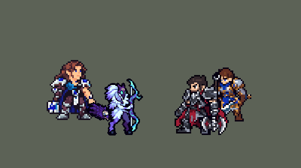

<!-- 本页上半部分由 tools/docs/gen_hero_docs.py 按仓库里现在的数据生成，手改会被覆盖；「开发记录」以下是手写的，生成时原样保留。 -->

# 千珏 Kindred


| 项目 | 内容 |
|---|---|
| id | `league_kindred` |
| 所属的包 | 主包（mod_id `league`） |
| 分路 | 打野 |
| 分类 / 标签 | 射手（Range） · AD / Range / Heal |
| 高清帧 | PPU 2.2 |
| 附加包 | [千珏附加包](#附加包)（`league_kindred`） |



其他预览：[逐帧预览](../preview/league_kindred_frames.png)、[特效表](../preview/league_kindred_effects.png)

## 现在的技能

下面是游戏里显示的技能说明（`league/text/champion.i18n` 的简体中文，去掉了颜色和图标），冷却、距离来自 `league/champion/league_kindred.data_champion`；1 秒 = 60 tick。

### 普攻 / 被动

*攻击间隔 0.93 秒 · 攻击距离 55000*

千珏之印：羊灵射箭。参与击杀被她攻击过的敌方英雄获得一层印记（阵亡清空）：射程+15、攻速+4%、横生惧意+8魔法伤害。

### 技能1 · 乱箭之舞

*冷却 8 秒 · 施放距离 60000 · 施放：指定目标 · 敌人（不含防御塔）*

跃动一小段（被近身时向后），向附近最多3名敌人各射一箭，造成45+65% 攻击力物理伤害，攻速+35%持续4秒。在狼灵狂热内冷却4秒。

### 技能2 · 横生惧意 / 狼灵狂热

*冷却 1.5 秒 · 施放距离 55000 · 施放：指定目标 · 敌人（不含防御塔）*

横生惧意：标记敌人并减速30%，此后第3次攻击命中时狼灵扑咬被标记者，造成60+90% 攻击力物理伤害（英雄额外4%最大生命）。冷却时放狼灵狂热：8.5秒领域，狼灵每秒撕咬其中一个敌人，造成25+25% 攻击力物理伤害。

### 大招 · 羊灵生息

*冷却 50 秒 · 施放距离 70000 · 施放：无目标 · 敌方英雄*

友方英雄被控制且身边有敌方英雄，或持续交战中友方英雄（含自己）身边有2名以上敌方英雄时，祝福身边区域：4秒内其中的友方英雄不会阵亡，结束时回复150+40% 攻击力生命。

### 数值

攻击力 90（每级 +19）、生命 940（每级 +92）、护甲 24（每级 +7）、魔抗 18（每级 +3）、移速 1020（每级 +11）。

## 附加包

附加包是可选的原生代码 mod（都在附加包合集 `league_addons` 里），**不装主包里的英雄也是完整的**。

### 千珏附加包

[千珏附加包](../../addons/league_kindred/README.md)：`league_kindred` v0.1.0

|  | 主包（纯数据） | 装了附加包 |
|---|---|---|
| 羊灵生息什么时候放 | AI 放出后待命 15 秒，她每射一箭查一次：被控制的友方英雄身边有敌方英雄，或交战中某个友方英雄被两名以上敌方英雄围住——常常大家血还多就交了 | 法阵范围内（她身边 42000）有友方英雄（**队友或她自己**）**快要阵亡**才放：身边有敌方英雄，而且生命低于 **30%**，或 **1 秒内被打掉三成以上、只剩六成以下**；几个人都危险时看最危险的那个。没人危险时 AI 想放 R，改成普攻，R 留着 |
| 别人的「不死」 | — | 身上已经有别人给的「不死」（基兰的符文、凯尔的大招等）的人不算危险 |

## 相关脚本和素材

- [`tools/kit/build_kindred.py`](../../tools/kit/build_kindred.py)
- [`tools/kit/setup_kindred.py`](../../tools/kit/setup_kindred.py)
- [`tools/lol/extract_kindred.py`](../../tools/lol/extract_kindred.py)
- [`tools/art/preview_kindred.py`](../../tools/art/preview_kindred.py)
- [`tools/art/rig_kindred.py`](../../tools/art/rig_kindred.py)
- [`assets/source/kindred/`](../../assets/source/kindred)

## 开发记录

> 下面是原来 README 里「英雄：千珏」一节，原样搬过来（只改了相对链接）。

| 部分 | 内容 |
|---|---|
| 定位 | 打野（Range，标签 AD / Range / Heal），第 102 位英雄。永猎双子 千珏：羊灵拉弓射箭，狼灵飘在她身后（画进她自己的帧里）。用户的选择（全是推荐项）：打野射手；技能 1 = Q 乱箭之舞，技能 2 = E 横生惧意、E 冷却时放 W 狼灵狂热，大招 = R 羊灵生息；被动做在主包里，另做附加包；高清帧；加入高手连招 |
| 普攻 / 被动 | 灵箭（攻击距离 55000，攻击间隔 56 tick，弦伸直的第 15 tick 出箭，100% 攻击物理，箭从弓把的高度飞出）。「千珏之印」：她打过的敌方英雄 3 秒内阵亡（参与击杀）或被她的箭射死，得到一层印记（阵亡清空）：每层射程 +1500、攻速 +4%、横生惧意 +8 魔法伤害 |
| 技能1 | Q「乱箭之舞」：冷却 480 tick，对 60000 内的敌人放（兵线、野怪也打）。第 4 tick 起跳 10 tick：被敌方英雄贴身时向后跳远，目标太近时后跳，否则向前跳；第 19 tick 弦伸直时向身边最多 3 个敌人各射一箭（45 + 65% 攻击物理），之后攻速 +35% 持续 4 秒。在自己的狼灵狂热里冷却减半 |
| 技能2 | E「横生惧意」（冷却 600）：第 15 tick 射出带狼烟的箭（优先队伍刚打过的敌方英雄），减速 30% 1 秒、打上狼的印记 4 秒；之后她第 3 支箭命中，狼灵扑上去咬被标记的人（60 + 90% 攻击，英雄额外 4% 最大生命 + 印记层数的魔法伤害）。E 冷却时放 W「狼灵狂热」（冷却 960，打起来时 W 先放）：脚下 8.5 秒、半径 60000 的狼灵领域，狼灵每秒咬领域里的一个敌人（25 + 25% 攻击） |
| 大招 | R「羊灵生息」：冷却 3000 tick，第 20 tick 在脚下展开 4 秒、半径 50000 的法阵，里面的友方英雄不会阵亡，结束时回复 150 + 40% 攻击。数据读不到当前生命，主包里 R 在敌方英雄靠近时待命 15 秒，只在两种情况放（用户：「千珏r大招逻辑不要乱放」）：被控制的友方英雄身边有敌方英雄，或交战中某个友方英雄被两名以上敌方英雄围住；没用上就退还冷却。每局约 0.23 次 |
| 附加包 | 可选的附加包 [`addons/league_kindred`](../../addons/league_kindred/README.md)（在附加包合集里，原生代码，主包不装它也完整）：**R 读真实生命**——法阵范围内有友方英雄（队友或她自己，用户：「救队友可以放啊」）快要阵亡（身边有敌方英雄，生命低于 30% 或 1 秒内被打掉三成）才放，AI 自己想放时改成普攻。救得准了她会偏强，所以附加包的副本里 R 冷却 120 秒、结束回血 40 + 10% 攻击、攻击 88（用户选「保留 4 秒法阵」）。日志 `league_kindred.log`。还没在游戏里看过日志 |
| 数值 | 攻击 90（+19）、生命 940（+92）、护甲 24（+7）、魔抗 18（+3）、移速 1020（+11） |
| 平衡 | 打野位对恶魔、马戏团刀客、猎人、审判官、忍者，两批种子：主包 +1.18 / +1.18，装附加包（钩子模拟）+1.29 / +1.16；同组打野（伊芙琳、莉莉娅、卡兹克、奈德丽）平均 +1.31 / +1.30 |
| 精灵图（高清帧 PPU 2.2） | Codex 画了两张原画，用户选 B（两只蹄子着地、狼灵在她胯后），狼灵缩到原稿的 55%，从面具耳尖到蹄子 34 个游戏像素（「模型还得缩小 太大了」）；侧面造型用 A（完全侧身）。动作由 Codex 照英雄联盟的骨架逐帧画（侧面朝右），[`tools/art/import_kindred_strips.py`](../../tools/art/import_kindred_strips.py) 按造型的格子读回：一张脸用在所有帧（倒地的帧除外）、弓是同一把（只平移，弦画到拉弦的手）、手接在弓把上（「手还断了？」）；Codex 的跑步一直是同一条腿在前，三帧把两条腿的深浅对调，两腿轮流向前。[`tools/art/rig_kindred.py`](../../tools/art/rig_kindred.py)：待机是正面造型呼吸，受击是侧面后退加闪白；狼灵用侧面造型，跑步时跟在她脚后，其余动作浮在尾巴下方、她背后（每帧至少露出 55%，Q 跳起时跟着升高），死亡时缩小消散。起初按泽丽的密度做（每个游戏像素 2.86 格），用户：「有点太高清了？降点像素」，从对比图里选了 2.2 |
| 特效 | Codex 第 3 步的 14 个特效和 12 张画进她帧里的图（`assets/source/kindred/codex_fx`）。[`tools/art/import_kindred_fx.py`](../../tools/art/import_kindred_fx.py)：Codex 自己按小尺寸读回的箭成了胶囊、狼头成了杂点，箭、打中、印记、狼咬从原稿重新读回（灵箭 22–26 像素，狼扑咬是完整的狼头），被动印记下面那根「棒棒糖棍」去掉；地上的狼灵领域、羊灵法阵和治疗用 Codex 的读回（领域 8.5 秒、法阵 4 秒按时长循环）。有方向的东西画进她的帧：拉弓时弦上的灵箭（Q 是三支扇开）、松弦的闪光、Q 跳跃的拖影（原来拖到地面以下，压扁到地面线上）、R 举弓时的星光、W 举手召出的狼烟，在 restyle 之后叠上（`rig_kindred.py --pinholes`），降到 2.2 时按同一个中心一起缩 |
| 音效 | 英雄联盟的音效和配音（`tools/lol/extract_kindred.py`）：射箭 / 打中、Q、E 射出 / 打中 / 狼扑咬、W / 狼咬、R / 回血、印记，配音 Q / W / E / R |
| 图标 | 官方技能图标（Q 乱箭之舞 / E 横生惧意 / R 羊灵生息，另有 W 狼灵狂热、被动千珏之印），从本地客户端取 |

重新生成（素材来自本机的英雄联盟客户端，音频不进仓库）：

```bash
python tools/lol/extract_kindred.py
python tools/kit/build_kindred.py               # 技能数据，数字都在脚本的参数表 P 里
python tools/kit/setup_kindred.py               # 五种语言的文字、音效配置、共享文件里她的键
python tools/art/design_kindred_hd.py           # Codex 的原画读回成正面、侧面造型和狼灵
python tools/art/import_kindred_strips.py       # Codex 的动作细稿读回
python tools/art/import_kindred_fx.py           # 特效和画进帧的图
python tools/art/rig_kindred.py                 # 1 倍帧和原密度的高清帧（狼灵合进去）
python tools/art/ppu_restyle.py --hero kindred  # 降到 2.2
python tools/art/rig_kindred.py --pinholes      # 补小洞、叠上画进帧的特效
python tools/art/ppu_hd.py --hero kindred       # hd_ / lo_ 帧
python tools/art/preview_kindred.py             # 预览和演示 GIF
python addons/league_kindred/make_override.py   # 附加包的副本（主包的千珏改了就重跑）
```

美术提示词见 [`assets/source/kindred/`](../../assets/source/kindred) 里的 `PICTURE_PROMPT.md`、`MODEL_PROMPTS.md`、`MODEL_STRIPS.md`、`PROMPTS_FX.md`；Codex 的交付在 `codex_picture/`、`codex_model/`、`codex_strips/`、`codex_fx/`。

逐帧预览：[`docs/preview/league_kindred_frames.png`](../preview/league_kindred_frames.png?v=1014h)，特效：[`docs/preview/league_kindred_effects.png`](../preview/league_kindred_effects.png?v=1014h)。
