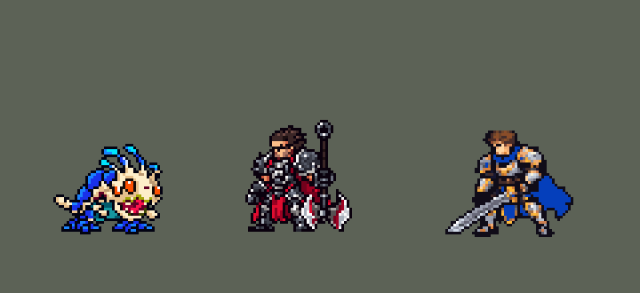

<!-- 本页上半部分由 tools/docs/gen_hero_docs.py 按仓库里现在的数据生成，手改会被覆盖；「开发记录」以下是手写的，生成时原样保留。 -->

# 克格莫 Kog'Maw


| 项目 | 内容 |
|---|---|
| id | `league_kogmaw` |
| 所属的包 | 主包（mod_id `league`） |
| 分路 | ADC |
| 分类 / 标签 | 射手（Range） · AD / Range / Dot |
| 高清帧 | 1 倍像素（无高清帧） |
| 附加包 | [游戏 AI 不按的技能替它按](#附加包)（`league_ult_press`） |



其他预览：[逐帧预览](../preview/league_kogmaw_frames.png)、[特效表](../preview/league_kogmaw_effects.png)

## 现在的技能

下面是游戏里显示的技能说明（`league/text/champion.i18n` 的简体中文，去掉了颜色和图标），冷却、距离来自 `league/champion/league_kogmaw.data_champion`；1 秒 = 60 tick。

### 普攻 / 被动

*攻击间隔 0.9 秒 · 攻击距离 55000*

生化弹幕（自动，12秒）：攻击时开启8秒，射程+180，攻击附带目标5%最大生命值伤害。来自艾卡西亚的惊喜：死后虚空之力化身追向附近敌方英雄，爆炸造成80 + 100% 攻击力真实伤害。

### 技能1 · 腐蚀唾液

*冷却 8 秒 · 施放距离 95000 · 施放：指定目标 · 敌人（不含防御塔）*

吐出腐蚀唾液，命中首个敌人造成80 + 70% 攻击力伤害，护甲和魔抗-20%4秒。被动：攻速+35%。连招：生化弹幕开启时自动补一发Q。

### 技能2 · 虚空淤泥

*冷却 12 秒 · 施放距离 100000 · 施放：方向 · 敌人（不含防御塔）*

吐出贯穿的虚空淤泥，造成70 + 60% 攻击力伤害并减速35%，留下4秒的减速淤泥带。连招：淤泥命中英雄后补一发活体大炮。

### 大招 · 活体大炮

*冷却 20 秒 · 施放距离 130000 · 施放：指定目标 · 刚交过手的敌方英雄*

炮击远处交战中的英雄，0.67秒后落地造成90 + 65% 攻击力伤害；被炸后剩余生命不足50 + 35% 攻击力的英雄直接被击杀。一轮最多3发，冷却20秒。

### 数值

攻击力 106（每级 +18）、生命 950（每级 +88）、护甲 20（每级 +7）、魔抗 15（每级 +3）、移速 870（每级 +9）。

## 附加包

附加包是可选的原生代码 mod（都在附加包合集 `league_addons` 里），**不装主包里的英雄也是完整的**。

### 游戏 AI 不按的技能替它按

[游戏 AI 不按的技能替它按](../../addons/league_ult_press/README.md)：`league_ult_press` v0.5.6（通用附加包，下面只列和克格莫有关的部分）

|  | 装了附加包，什么时候按 |
|---|---|
| 克格莫 R | R 好了、**射程（130000）内有引擎接受的敌方英雄**（主包 R 只打最近被我方打过的）就按，**先挑生命比例最低的**（大招打残血更痛）。一轮三发、之后锁 20 秒都是主包的数据。不限时游戏里每 10 分钟打 31.7 发，经典模拟的设计是每局 16.9 发（用户：「大嘴 R 限一限，接近经典模拟设计的频率」），所以开一轮要用一次配额（每 100 秒攒一次、最多攒 2 次），而且要好时机：目标被控住、生命不到一半、射程内能打的敌方英雄有两个以上，或者配额攒满了；一轮开着就接着打完三发 |

## 相关脚本和素材

- [`tools/kit/build_kogmaw.py`](../../tools/kit/build_kogmaw.py)
- [`tools/kit/setup_kogmaw.py`](../../tools/kit/setup_kogmaw.py)
- [`tools/lol/extract_kogmaw.py`](../../tools/lol/extract_kogmaw.py)
- [`tools/art/preview_kogmaw.py`](../../tools/art/preview_kogmaw.py)
- [`tools/art/rig_kogmaw.py`](../../tools/art/rig_kogmaw.py)
- [`tools/art/import_kogmaw.py`](../../tools/art/import_kogmaw.py)
- [`tools/art/design_kogmaw.py`](../../tools/art/design_kogmaw.py)
- [`assets/source/kogmaw/`](../../assets/source/kogmaw)

## 开发记录

> 下面是原来 README 里「英雄：克格莫」一节，原样搬过来（只改了相对链接）。

| 部分 | 内容 |
|---|---|
| 定位 | ADC（射手，分类 Range），第 79 位英雄。深渊巨口 克格莫：短腿的虚空小怪兽，嘴管里吐酸液，开了生化弹幕打得又远又痛，死了还会化成虚空分身追人自爆。用户选 ADC、射手、方案 A（完整还原）、「加入高手连招」 |
| 普攻 | 嘴管吐一团绿色酸液（追踪，100% 攻击力），射程 55000，攻击间隔 54 tick，第 7 tick 吐出 |
| W（自动） | 「生化弹幕」没有技能位（英雄联盟的 W 没有施法动作）：冷却 720 tick（12 秒），攻击时自动开启 480 tick（8 秒）：射程 +18000，普攻附带目标 5% 最大生命值伤害（`base_attack_enemy_max_hp_damage`）。开启时身上一圈绿光，开着时脚下一圈绿色电弧 |
| 技能1 | Q「腐蚀唾液」：冷却 480 tick（8 秒），射程 95000，也对小兵和野怪放。第 16 tick 朝目标当时的位置吐出（直线，打中第一个单位，躲得开），80 + 70% 攻击力，护甲和魔抗 −20% 4 秒。被动：攻速 +35%（每条命开始时加上） |
| 技能2 | E「虚空淤泥」：冷却 720 tick（12 秒），射程 100000，朝目标方向（`Direction`）吐出穿透的淤泥，70 + 60% 攻击力，减速 35% 1 秒；地上留下 4 秒的淤泥带（魔腾 Q 的做法：几段隐藏的直线停在路上各开一个减速区，画面是一条 `LineRangeProjectile`） |
| 大招 | R「活体大炮」：只对正在交战的敌方英雄放（`EnemyChampionRecentlyAttacked`，130000 内）。第 17 tick 嘴管朝天开炮，目标脚下出现警告圈，40 tick 后炮弹落下炸开（半径 15000，躲得开）：90 + 65% 攻击力；对英雄另加斩杀：50 + 35% 攻击力真实伤害，一 tick 后没死的回血回来（派克 R 的做法，只在能击杀时生效）。英雄联盟的 R 冷却很短、越放越贵；这里一轮最多连发三炮：第一炮锁住大招 1200 tick（20 秒），技能位自己的冷却只有 50 tick，三炮打完或窗口过去就空转（空分支 AI 不放） |
| 附加包 | 可选的附加包 [`addons/league_ult_press`](../../addons/league_ult_press/README.md)（在附加包合集里，原生代码，主包不装它也完整）：游戏 0.6.4 的 AI 几乎不按他的 R（每 10 分钟 0.6–0.9 次，其他 ADC 5–8 次；R 格里加 200 的护盾、把施放目标放宽到任何敌方英雄都试过，没用），伤害因此偏低（用户：「大嘴也不放吧 伤害这么低这把」）。附加包替 AI 按：R 好了、射程（130000）内有引擎接受的敌方英雄（最近被我方打过的）就按，先挑生命比例最低的（大招打残血更痛）；一轮三发、之后锁 20 秒照旧。不限时游戏里每 10 分钟打 31.7 发，经典模拟的设计是每局 16.9 发（用户：「大嘴 R 限一限，接近经典模拟设计的频率」），所以开一轮要用一次配额（每 100 秒攒一次、最多攒 2 次），而且要好时机：目标被控住、生命不到一半、射程内能打的敌方英雄有两个以上，或者配额攒满了；一轮开着就接着打完三发 |
。玩家：「大嘴五级后就不会普通攻击了」——大招位原来冷却只有 50 tick、锁定的 20 秒里是空分支，游戏的 AI 照样每秒放一次空大招，就一直不普攻（经典 SDK 的 AI 不这样，模拟没复现）；现在大招位的冷却就是 20 秒，第 1、2 发后用 2 tick 的 `ult_cooldown_mult` 把冷却压到 50 tick，每次放都打出一发，一轮仍是 3 发；E 接大炮改成只在一轮还开着时多补一发（不算进 3 发） |
| 被动 | 「来自艾卡西亚的惊喜」：数据里没有"死亡时"的触发。每条命第一次出手时在他身上挂一个整局的 `AddCasted`，每 6 tick 往自己身上抛一个隐藏的抛物物，飞 7 tick（比间隔多 1，死在落地那一 tick 也不漏）；落地时问 `RandomTarget {range: 1, AllyOnlySelf}`（找不到死掉的施法者）他还活着吗。他一死 `AddCasted` 就停了，所以正好有一个抛物物发现他死了：尸体上冲起紫色虚空光，虚空分身（追踪弹，速度 1800）飞向 70000 内随机一个敌方英雄，追上后爆炸，12000 内的敌人受到 80 + 100% 攻击力真实伤害。原地爆炸试过：他死的时候敌人一般在 20000–150000 外，一个都炸不到；追人版 14 次死亡 12 次炸到人。被守护灵（原版 `guardian_spirit` 的圣域）救下时他没有真正死掉，躺着的那几秒选不中，监视还在跑，每个抛物物都"找不到他"，原来每 6 tick 放一个虚空分身（「死后被守护天使复活的时候 在无敌状态下还在一直攻击」）；现在放过一次就挂上 `league_kogmaw_p_done`，下一个抛物物找到他还活着才清掉，所以一次倒下只放一个 |
| 高手连招 | 用户：「加入高手连招」。**开 W 接 Q**：生化弹幕开启时，Q 好了就在这一下普攻后对弹幕射程内的英雄补一发腐蚀唾液（先减甲再打 %生命伤害）；**减速接大炮**：淤泥命中英雄 10 tick 后补一发活体大炮（按 R 的连发规则算一发）；**大炮收割**：R 的斩杀线。连招只用自己那个技能的冷却，不占别的技能 |
| 数值 | 攻击 106（+18）、生命 950（+88）、护甲 20（+7）、魔抗 15（+3）、移速 870（+9）。数值是自己设计的，用 SDK 对战模拟调：ADC，对 5 个原版射手（`archer`、`gunner`、`boomerang_hunter`、`poison_dart_hunter`、`bomber`），3 套阵容、两边各打，10 分钟。初稿 −1.01（输出 7274，同一批图奇 +1.79、韦鲁斯 +1.51、金克丝 +4.46）；攻击 90 → 106、Q 攻速 15% → 35%、W 冷却 17 → 12 秒、%生命 4 → 5、Q / E / R 基础 +20、生命 950、射程 55000：种子 1–12 +1.67、25–36 +1.69（同一批图奇 +1.18）。再加 W 6% 和 R 110 那组 +2.23，偏强 |
| 精灵图 | 8 个动作 56 帧：待机 8、移动 8、普攻 6、Q（`skill`）8、E（`skill2`）8、R（`ult`）8、受击 2、死亡 8。高 34 px，41 px 宽，20 色。头像截取点 (8, −23)（眼睛在骨板中下部，比头顶低 4 行）；待机最高到 −23.5，不用 `banpick_center` |
| 特效 | Codex 生图的 18 张（`import_kogmaw.py` 缩成游戏像素）：`league_kogmaw_fx` 酸液弹和命中、W 开启和脚下电弧、腐蚀唾液和命中、减甲酸泡、淤泥弹和命中、减速淤泥、炮弹命中、虚空分身命中；`league_kogmaw_big` 淤泥带、虚空分身、警告圈、落下的炮弹、尸体上的虚空爆发、分身爆炸。飞行的和淤泥带朝飞行方向转（上下对称），其余左右对称 |
| 音效 | 英雄联盟的音效和配音（`tools/lol/extract_kogmaw.py`）：吐酸和命中、W 开启、Q 出手 / 发射 / 命中、E 出手 / 发射 / 命中、R 发射 / 下落哨声（警告圈出现时就开始，最响处正好在落地前后）/ 爆炸、被动爆发和爆炸；Q、W、E、R 和死亡的配音。版权属于 Riot Games，**不提交到仓库**，按下面的命令在本地生成 |
| 图标 | 官方技能图标（Q / E / R），从本地客户端提取，缩到 64×64；W 自动，没有技能位 |

重新生成（素材来自本机的英雄联盟客户端，音频不进仓库）：

```bash
python tools/lol/extract_kogmaw.py --lol "D:\WeGameApps\lol" --vgmstream "<vgmstream-cli.exe 路径>"
python tools/kit/build_kogmaw.py        # 技能数据，数字都在脚本的参数表 P 里；--nodes 看每棵技能树的节点数
python tools/kit/setup_kogmaw.py --face 8,-23   # 五种语言的文字、音效配置、共享文件里他的键
python tools/art/design_kogmaw.py --rebuild   # 造型：从生图原稿读回 44 行再均匀删到 34 行，和定稿的字母格子比对
python tools/art/design_kogmaw.py --final     # 字母格子 -> 8 倍原尺寸图
python tools/art/rig_kogmaw.py          # 动作：造型自己的零件无损摆姿势（整格平移、90° 旋转、整行移动、叠放）
python tools/art/import_native.py --hero kogmaw
python tools/art/import_kogmaw.py       # 特效；--raw assets/source/kogmaw/codex_fx 先把生图原稿缩成游戏尺寸的原尺寸条
```

美术（动作的提示词见 [`assets/source/kogmaw/MODEL_STRIPS.md`](../../assets/source/kogmaw/MODEL_STRIPS.md)，特效的见 [`PROMPTS_FX.md`](../../assets/source/kogmaw/PROMPTS_FX.md)；Codex 的交付在 [`codex_model/`](../../assets/source/kogmaw/codex_model)、[`codex_strips/`](../../assets/source/kogmaw/codex_strips)、[`codex_fx/`](../../assets/source/kogmaw/codex_fx)）：

- 原画：Codex 画了待机（A）和普攻嘴管（B）两版，用户：「选A」。
- 造型：Codex 第 1 步的生图原稿按自己的格子读回是 44 行 × 47 列（Codex 自己按中心取样的 38 行把脚和描边弄碎了，没用），脸（第 19–35 行、第 26–46 列）不动，只在触角、腿和背甲尾巴的列里均匀删整行整列，给了 44 / 40 / 38 / 34 四个尺寸，用户：「38 行 × 43 列」。动作和特效都做完后用户：「大嘴的模型可以缩小一点」——再给 36 和 34 两档（嘴巴下半和骨板右侧也各让一点，眼睛的行列不动），用户：「34 行 × 41 列」；动作工具的部件坐标跟着换算，所有动作按新造型重摆。缩小后嘴变矮了，原来 8 行的嘴管把整张嘴盖住（上嘴唇和獠牙都没了），用户：「缩小后伸舌头的时候模型有点变形了吧」——嘴管细一档（7 行），往下半格对准嘴中间。
- 动作：Codex 第 2 步的动作条（背甲画成一片鳍、R 换了画风、嘴管是碎点）用户让我修（「有问题的地方帮我修复」），全部用造型自己的零件重摆（`rig_kogmaw.py`）：两只脚、尾巴、头（触角 + 骨板 + 眼睛）按格子切出；嘴管是唯一新画的东西（嘴里一样的深红色，亮边、暗边、骨刺环、末端獠牙开口），普攻伸出 16 格、Q 22 格；R 把伸着嘴管的整个身体转 90°（嘴管朝天、触角甩到身后）站在定稿的脚上，尾巴拖在地上。第一版用"身体沉到脚上"表示蹲和跑步落地，用户：「攻击和放技能的时候模型有点变形 身体压到腿了」「移动的时候也是」——改成只有整体平移、小跳（连脚一起离地 1 行）、嘴管、触角和尾巴摆动；待机去掉呼吸下沉，触角和尾巴错开一拍摆动。死亡是瘫倒闭眼（虚空分身离体是特效）。
- 特效：Codex 第 3 步的 18 张（`import_kogmaw.py --raw`：按交付的 `manifest.json` 切帧，颜色归到包里给每张的色阶：绿色酸液、黄绿唾液、紫色虚空、黄绿警告；Codex 是按 4 像素一格画在 16 像素一格的画布上的，按每张的游戏尺寸缩放，不按格子取色；炮弹和虚空爆发用交付标好的落地点对齐）。
- 红色方：飞行的酸液弹、唾液、淤泥、虚空分身和淤泥带上下对称；其余命中、地面圈、身上的光、炮弹和光柱左右对称，不需要画进动作帧。

逐帧预览：[`docs/preview/league_kogmaw_frames.png`](../preview/league_kogmaw_frames.png?v=1014g)，特效：[`docs/preview/league_kogmaw_effects.png`](../preview/league_kogmaw_effects.png?v=1014g)。
