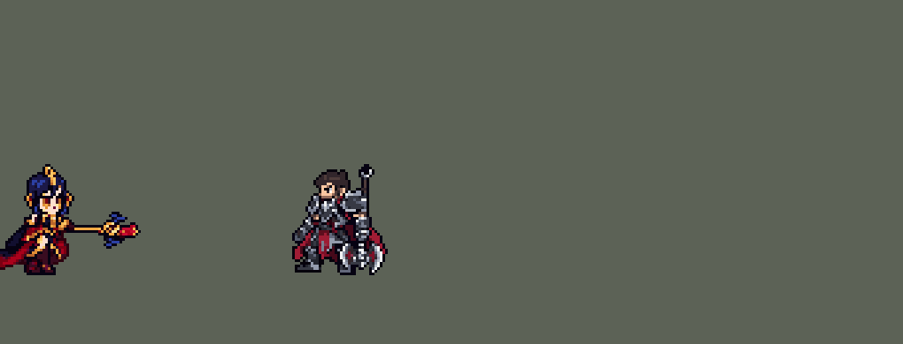

<!-- 本页上半部分由 tools/docs/gen_hero_docs.py 按仓库里现在的数据生成，手改会被覆盖；「开发记录」以下是手写的，生成时原样保留。 -->

# 乐芙兰 LeBlanc


| 项目 | 内容 |
|---|---|
| id | `league_leblanc` |
| 所属的包 | 主包（mod_id `league`） |
| 分路 | 中单 |
| 分类 / 标签 | 法师（Magician） · AP / Magic / Range / CC |
| 高清帧 | PPU 2 |
| 附加包 | [低血量附加包：布里茨、乐芙兰、丽桑卓](#附加包)（`league_lowhp`） |



其他预览：[逐帧预览](../preview/league_leblanc_frames.png)、[特效表](../preview/league_leblanc_effects.png)

## 现在的技能

下面是游戏里显示的技能说明（`league/text/champion.i18n` 的简体中文，去掉了颜色和图标），冷却、距离来自 `league/champion/league_leblanc.data_champion`；1 秒 = 60 tick。

### 普攻 / 被动（被动「镜花水月」）

*攻击间隔 1.5 秒 · 攻击距离 52500*

魔法飞弹。被动 镜花水月：两名以上敌方英雄贴近时隐身1秒并后闪，原地留下幻像（40秒一次）。幻影锁链：每10秒对英雄的下一击改为甩出锁链，造成80 + 50% 法强魔法伤害，1.5秒内都在附近则禁锢1.5秒并再受110 + 100% 法强。

### 技能1 · 恶意魔印

*冷却 5 秒 · 施放距离 70000 · 施放：指定目标 · 敌人（不含防御塔）*

投出魔印，造成90 + 70% 法强的魔法伤害并标记3.5秒；她的下一个技能命中时魔印引爆，再造成90 + 70% 法强。命中英雄时若魔影迷踪就绪，立刻接上（连招）。

### 技能2 · 魔影迷踪

*冷却 8 秒 · 施放距离 60000 · 施放：指定目标 · 敌人（不含防御塔）*

冲到一名敌人（英雄、小兵或野怪）身边，对周围敌人造成120 + 100% 法强的魔法伤害，0.93秒后闪回出发点（被控制时留在原地）。

### 大招 · 故技重施

*冷却 45 秒 · 施放距离 70000 · 施放：指定目标 · 敌方英雄*

重放上一个施放的技能，伤害更高：魔印160 + 110% 法强（引爆同样）；迷踪220 + 150% 法强；锁链130 + 90% 法强，禁锢时再200 + 150% 法强。

### 数值

攻击力 80（每级 +6）、法强 40（每级 +20）、生命 880（每级 +95）、护甲 20（每级 +7）、魔抗 20（每级 +3）、移速 920（每级 +10）。

## 附加包

附加包是可选的原生代码 mod（都在附加包合集 `league_addons` 里），**不装主包里的英雄也是完整的**。

### 低血量附加包：布里茨、乐芙兰、丽桑卓

[低血量附加包：布里茨、乐芙兰、丽桑卓](../../addons/league_lowhp/README.md)：`league_lowhp` v0.2.0

| 英雄 | 主包（纯数据） | 装了附加包（英雄联盟） |
|---|---|---|
| 乐芙兰 镜花水月 | 两名以上敌方英雄贴近 | 生命不高于 40% |

## 相关脚本和素材

- [`tools/lol/extract_leblanc.py`](../../tools/lol/extract_leblanc.py)
- [`tools/art/preview_leblanc.py`](../../tools/art/preview_leblanc.py)
- [`tools/art/import_leblanc.py`](../../tools/art/import_leblanc.py)
- [`tools/art/design_leblanc.py`](../../tools/art/design_leblanc.py)
- [`assets/source/leblanc/`](../../assets/source/leblanc)

## 开发记录

> 下面是原来 README 里「英雄：乐芙兰」一节，原样搬过来（只改了相对链接）。

| 部分 | 内容 |
|---|---|
| 定位 | 中单（远程法师，分类 Magician），第九组的中单（按用户 10 月 2 日排的顺序，同组有魔腾、青钢影、卡莎、娑娜）。打法和英雄联盟一样：Q 标记，W 冲进去打一套再闪回，E 拴住定身，R 重放上一个技能 |
| 普攻 | 法杖射出的魔法球，100% 攻击力的物理伤害，射程 52500（英雄联盟 525），攻击间隔 90 tick（1.5 秒），第 12 tick 法球离开法杖（动作第 4 帧），每 tick 4.5 px |
| 被动 | 「镜花水月」（用户选的「被围攻时」）：游戏读不到当前生命，用"危险"代替"生命低于 40%"：每次普攻前数 40000 内的敌方英雄，有两个以上时这一下不打，改成隐身 1 秒、往后跳开 24 px，原地留一个分身（她的待机画面，然后化成光柱），冷却 40 秒 |
| 技能1 | Q「恶意魔印」：对 70000 内的敌人施放（小兵和野怪也算，清线、打野也用），冷却 5 秒。第 12 tick 掷出眼形魔印（每 tick 3.5 px）：90 + 70% 法术强度的魔法伤害，留下 3.5 秒的印记；她之后任何一个技能打中（W 的爆炸、E 的锁链和定身、R 的各个版本）就引爆印记，再造成 90 + 70% 的魔法伤害。连招（用户：「另外可以加入连招逻辑 像盲僧那样」）：魔印打中英雄 24 tick 后，W 好了就接着冲向他，落地的爆炸正好引爆魔印 |
| 技能2 | W「魔影迷踪」：对 60000 内的敌人施放（英雄、小兵、野怪；2026-10-23 前只对英雄，AI 清兵不用——用户：「妖姬的w……能不能对小兵造成伤害」），冷却 8 秒。冲向目标（每 tick 4 px），落地在 26000 内爆炸：120 + 100% 法术强度的魔法伤害，引爆魔印。起点留下魔法阵，施放 75 tick（1.25 秒）后闪回起点（用户选的「约 1 秒后回来」）；那一刻被控就不回，死了也不回 |
| 普攻里的 E | E「幻影锁链」：每 10 秒，80000 内有敌方英雄时，她下一次普攻改成甩锁链（E 的动作）。出手前 8 tick 锁定瞄准（站着会被打中，走开能躲），锁链穿过小兵飞向英雄：80 + 50% 法术强度的魔法伤害，拴住 1.5 秒（光链环一节节飞回她身边）；拴着时她一跑出 95000（比如 W 冲走或闪回到远处）锁链就断：链环停下、不再定身；拴满 1.5 秒还在范围内就定身 1.5 秒，再造成 110 + 100% 的魔法伤害（用户：「W回本体有时候没链到特效还在」） |
| 大招 | R「故技重施」：对 70000 内的敌方英雄施放，冷却 45 秒。重放她上一次用的技能（Q、W 或 E；还没用过技能或死后重生时是 Q），伤害约两倍：RQ 160 + 110%（它的印记同样会被引爆），RW 220 + 150%（爆炸半径 30000，同样闪回），RE 130 + 90%、定身时 200 + 150%；特效是对应技能的亮色版 |
| 附加包 | 可选的附加包 [`addons/league_lowhp`](../../addons/league_lowhp/README.md)（在附加包合集里，原生代码，主包不装它也完整）：镜花水月照英雄联盟在生命不高于 40% 时触发（主包是两名以上敌方英雄贴近） |
| 数值 | 攻击 80（+6）、法术强度 40（+20）、生命 880（+95）、护甲 20（+7）、魔抗 20（+3）、移速 920（+10）。数值是自己设计的，用 SDK 对战模拟调：中单位，对 5 个原版法师（火、冰、雷、风、白），三套队友阵容、两边各 8 局，一批 240 局。第一版伤害（Q 55 + 45% 等）−3.16：她死得不比阿狸多，但打出的伤害只有 8000（阿狸 12600）；W 回得更快、W 也打小兵、去掉连招都不行（−2.5 到 −3.1，连招约值 0.6 分）；伤害 ×1.4 −0.42，×1.6 +1.33，最后两批 +1.50 / +0.77 |
| 亚索联动 | E 的定身是亚索大招要的控制，但锁链要拴满 1.5 秒才定：乐芙兰打中单、亚索打上路同队时，亚索每局 R 到被控英雄 0.58 次（同一批原版火法师 0.65、雷法师 3.19），亚索不用调 |
| 精灵图 | 9 个动作 56 帧：待机、移动、普攻、Q、W 冲刺、W 闪回、E 甩锁链、受击、死亡（R 用 Q 的帧）。造型按用户在 Codex 里选的原画（A：待机站姿），由 Codex 按游戏尺寸画，用户选版本 B：靛蓝头发、金色头冠和尖角、琥珀色的眼睛、金领甲、午夜蓝和深红的长裙、身后的披风、金杆红水晶加两只蝙蝠翼的法杖。头冠尖到脚底 43 px，32 px 宽，18 色 |
| 高清帧（PPU 2.0，0.172.0） | 2026-10-19 用 PPU 重做（用户：「利用PPU我们重做一下妖姬」），看了 Codex 10-02 画的造型 A 后：「其实这个就挺好的 你只要把法杖做好 利用PPU就行了」「另外法杖别做歪啊」「腿部有缺失像素的地方补上就行」，PPU 选「PPU 2.0 原样」。造型（[`tools/art/design_leblanc_hd.py`](../../tools/art/design_leblanc_hd.py)，`assets/source/leblanc/hd/design.png`）就是 A 版的 51 × 86 格（86 行画在她 43 个游戏行上 = PPU 2.0，26 色），不删不缩，只改三处：法杖的杆原来在三列之间来回歪，重画成水晶正下方的一条直线（手套照原样盖在上面）；腿和裙摆上缺的 12 格取周围最多的颜色补上；透明格不带颜色。动作照英雄联盟每帧的骨骼摆（[`tools/art/rig_leblanc_hd.py`](../../tools/art/rig_leblanc_hd.py)，剑姬的做法；骨骼由 [`tools/lol/league_joints.py`](../../tools/lol/league_joints.py) 读出，`assets/source/leblanc/hd/leblanc_joints.json`）：身体跟着骨盆走、不陷进地里；法杖只按整 90° 转，竖在身前或横在身后，不歪；横着时手套下面藏着的那段杆补画出来，不断开（用户：「这里法杖断了？」「其他地方也有断开的情况」），蝙蝠翼最下面的尖和杆颈跟着法杖走，不留在头边；拿法杖的手臂照原样不转（转上去手套会贴到嘴上）；死亡时法杖立在原地，她倒在法杖左边。移动的腿（用户：「走路腿部不动的？」）由 Codex 按每帧的骨架画（[`tools/art/pack_leblanc_legs.py`](../../tools/art/pack_leblanc_legs.py)：大腿 12 格、小腿 11 格，剪刀步）：第 1 轮画成了棕色丝袜配高跟鞋，又细又长（「腿有点变形啊 待机的腿和走路的腿不一样？」），第 2 轮（[`LEG_PROMPTS_2.md`](../../assets/source/leblanc/LEG_PROMPTS_2.md)）照待机的腿画：浅肤色光腿加一道绑带、深蓝金边长靴，长裙只在前面开衩；[`tools/art/import_leblanc_legs.py`](../../tools/art/import_leblanc_legs.py) 读回时上半身逐格对齐，只取腰带以下，颜色只用定稿的，上半身、手臂和身后的披风还是定稿的格子，脚底踩不到地的帧最多下沉 2 行。每帧检查：一整块、没有封闭的洞、腿长和粗细帧帧一样。动作、帧数和每帧时间都和原来一样（技能时间不变），`hd_` / `lo_` 各 16 个；头像截取点 (−1, −37)。审核用一张 GIF，每个动作左边英雄联盟、右边我们的（[`tools/art/review_leblanc_actions.py`](../../tools/art/review_leblanc_actions.py)） |
| 特效 | 普攻的法球（19 px）、法杖上的闪光和命中，Q 的眼形魔印（飞行、成形、命中、目标胸口的印记、碎成玻璃的引爆），E 的锁链（链头、一节节飞回的光链环、甩出的弧光、命中、从地上缠住脚的锁链 30 × 31 px），W 的魔法阵（28 px）、冲刺残影（47 × 23 px）、落地爆炸（58 px，半径 26000）、命中、闪出和闪回的光柱（22 × 54 px）；大招的亮色版，被动的分身 |
| 图标 | 官方技能图标（Q / W / R），64×64 |
| 音频 | 从本地客户端提取的 13 条技能音效和 7 条中文语音（Q、W、E、被动和 R 的三个版本），合成 15 个游戏音效。不提交到仓库，按下面的命令在本地生成 |

```bash
python tools/lol/extract_leblanc.py --lol "D:\WeGameApps\lol" --vgmstream "<vgmstream-cli.exe 路径>"
python tools/lol/native_pose.py assets/source/leblanc/poses.json --out <渲染文件夹>   # 动作参考帧
python tools/art/design_leblanc.py         # 造型：Codex 的 B 版按整行整列删到 43 行，脸和法杖保住，两只耳饰一样
python tools/art/fix_leblanc_strips.py     # 动作：清理 Codex 的动作条；移动用重画的那版，8 帧共用一个上半身；裙摆按 tidy_leblanc.py 修
python tools/art/import_native.py --hero leblanc
python tools/art/import_leblanc.py         # 特效：按整数比例缩放、挂点；大招亮色版和被动分身
# 0.172.0 起英雄本身的帧是下面的高清重做（上面的 design_leblanc / fix_leblanc_strips / import_native 是原来的 1 倍造型）
python tools/art/design_leblanc_hd.py      # 高清造型（PPU 2.0）：Codex 的 A 版原样，法杖拉直，腿上缺的 12 格补上
python tools/lol/league_joints.py assets/source/leblanc/poses.json --out <关节文件夹>   # 英雄联盟每帧的关节位置（已存成 hd/leblanc_joints.json）
python tools/art/pack_leblanc_legs.py --prompts LEG_PROMPTS_2.md   # 移动的腿：给 Codex 的骨架包
python tools/art/import_leblanc_legs.py --sheet <leblanc-legs2-run.png>   # 读回 Codex 画的腿和裙摆，写 hd/run_lower_*.png
python tools/art/rig_leblanc_hd.py --joints assets/source/leblanc/hd/leblanc_joints.json   # 高清帧，写 assets/source/ppu/orig/ 和 1 倍图；--review <文件夹> 先看
python tools/art/ppu_restyle.py --hero leblanc
python tools/art/ppu_hd.py --hero leblanc
python tools/art/review_leblanc_actions.py --joints assets/source/leblanc/hd/leblanc_joints.json --out <文件夹>   # 和英雄联盟并排的审核 GIF
python tools/art/preview_leblanc.py
```

美术（原画的提示词见 [`assets/source/leblanc/`](../../assets/source/leblanc) 里的原画包，动作的见 [`MODEL_STRIPS.md`](../../assets/source/leblanc/MODEL_STRIPS.md)、移动重画的见 [`RUN_REDO.md`](../../assets/source/leblanc/RUN_REDO.md)，特效的见 [`PROMPTS_FX.md`](../../assets/source/leblanc/PROMPTS_FX.md)；Codex 的交接说明在 [`codex_model/`](../../assets/source/leblanc/codex_model)、[`codex_strips/`](../../assets/source/leblanc/codex_strips)、[`codex_run_redo/`](../../assets/source/leblanc/codex_run_redo)、[`codex_fx/`](../../assets/source/leblanc/codex_fx)）：
- 分工：模型和特效都由 Codex 画，Claude 写提示词包、整理和导入，按"原画 → 造型 → 动作 → 特效"分四步。
- 原画和造型：先写原画提示词包，Codex 画了 A、B 两张，用户选 A（待机站姿）。造型第一轮 Codex 画得太大（86 行），第二轮按游戏尺寸画了 A、B 两版，用户：「这两版我挺喜欢的……脸部 法杖做好点」，选 B 并定 43 行。`design_leblanc.py` 只删整行整列（脸、眼睛、法杖的杆不删），再按用户逐处指出的修：法杖拉直、补回右边的蝙蝠翼和水晶描边，披风上的洞补上，清掉零散的黑格（「清理黑边保持干净」「法杖旁边多了一块黑色素」），耳饰下移 3 行到眼睛高度，再把远侧的耳饰镜像到近侧（「最好左右耳朵做成一样的」）；近侧眼的两格瞳孔换成只有眼睛用的暗红（导入时按它定头的位置）。
- 动作参考（`poses.json`）：镜头 yaw 45、pitch 20，不镜像；头 2.3 倍、腿 0.8 倍、法杖 0.75 倍；高度 38，96 × 80 的格子。英雄联盟的披风是特效材质，渲染不出来，参考图里藏掉了，提示词要 Codex 照造型画披风。待机 6 帧 × 180 ms，移动 `run1` 8 帧 × 142 ms（动画图里播放一圈 1.133 秒），普攻 6 帧，Q 5 帧，W 冲刺 `spell2` 5 帧 × 60 ms，W 闪回 `spell2_recast` 5 帧 × 80 ms，E `spell3` 6 帧，受击 2 帧，死亡 8 帧。
- 动作：Codex 画了 8 条，每帧贴定稿的头。`fix_leblanc_strips.py` 清理（用户：「有奇怪的地方你再调一下吧 codex太笨了」）：头旁边残留的 Codex 自己的头的描边和耳饰、普攻第 4–5 帧格子顶上的一抹，用造型的规则清掉不描边任何东西的黑格（披风边上的第二圈黑边、黑尾巴）；普攻第 3 帧举过头的法杖接成一条直线从头后面穿过，第 4–5 帧悬在脸旁的一根两格细黑棍（往后甩的手臂）去掉。移动第一版 8 帧一直是左腿在后、右腿在前（「走路没有交叉步 平行走路？」），前 4 帧脚离地 1–3 格，耳边一闪一闪（「走路的时候左右耳会冒出来什么东西？」）；Claude 自己按关节重画的腿用户说「做的不行 让codex帮忙重做吧」，于是写了移动重画包，Codex 重画了交叉步（第 3、7 帧两腿交叉经过，鞋距 10 格内，每帧踩地）。它每帧都重画了贴好的头下面的身体，领甲每帧离下巴偏 1–3 格，用户：「移动时候头和身体不协调 像脱节了一样」——现在 8 帧共用第 3 帧的上半身（头、领甲、躯干、披风、法杖一整块），整块随步子起伏（第 1、5 帧低 1 行），每帧只换裙摆下面自己的腿。
- 裙摆（用户：「乐芙兰有多余的像素没清理干净啊 看起来还有很多不干净的地方」，指着待机的裙摆下缘）：Codex 75 行的原稿删到 43 行时裙子差不多隔行删，下缘散开了——深红裙片最后一格挂在裙摆下面、自带一圈描边，近处的鞋是金色鞋带和一条藏青隔着描边，长裙的金边在膝盖处断开，红色里剩下单个的黑格。`tidy_leblanc.py` 手工改 11 格（挂着的那格并进裙摆描边、鞋子补成 2×2 的藏青鞋、金边接上、红里的黑格换成红），凡是带定稿下半身的帧（逐格找到：待机、普攻 / Q / E / R 的首尾帧）都改同样的格子，造型图也一样。给用户看了 A（只修下缘）和 B（再把裙子里零散的杂色格并入周围），用户选 A。移动 8 帧共用的上半身去掉披风上沿翘起的 1 个黑点。其他动作逐帧查过：规则能找到的只有高跟鞋的鞋跟和鞋尖、法杖蝙蝠翼的尖爪，都是画出来的，保留（第一版规则把 W 的鞋跟削掉了）。
- 导入：待机 6 帧都用定稿，第 3–5 帧从裙摆（脚底上方 2 行）往上下沉一格呼吸（`BOB`；长裙的斜纹每行都不一样，选在高跟鞋上面）；按近侧眼的暗红定头的位置（`EYES`）；描边补齐（`COMPLETE`）。头像截取点 (4, −38)（`tfm2_ase.py face`），选人卡 −8（见下）。
- 特效用 Codex 画的 19 张（99 帧），交的是 1 倍的成品，但比提示词写的大 2–3 倍；它自己缩到游戏尺寸的预览条丢了魔印的眼睛、魔法阵的圈和法球的尾巴，没用。用户：「有问题的地方你帮忙善后一下吧」——`import_leblanc.py` 按整数比例缩放（缩一半、缩三分之一时每块取最亮的像素，白色的芯和一像素的光丝都留得住），W 的落地爆炸放大 2 倍对上 26000 的范围，魔法阵和魔印的引爆用原尺寸。挂点：出手的闪光在当帧法杖水晶的位置（普攻第 4 帧 (37, −13)、Q 出手 (21, −25)、E 出手 (32, −17)；挂在她身上的画面会跟着她转身镜像），命中、印记和引爆在上半身 (0, −8)，定身、魔法阵、爆炸和光柱落在脚底，冲刺残影在她身后。大招的画面是基础特效每种颜色往白色靠三分之一；被动的分身是她的待机 6 帧，然后沉进闪出的光柱。
- 出手时刻和动画对齐：普攻第 4 帧（第 12 tick），Q 第 3–4 帧（第 12 tick），E 第 4 帧，W 冲刺 18 tick、闪回 24 tick 和动作条一样长；印记每 12 tick 重播一次（4 帧 × 50 ms），定身 12 帧共 1.5 秒，魔法阵 10 帧撑到 1.25 秒后闪回。

逐帧预览：[`docs/preview/league_leblanc_frames.png`](../preview/league_leblanc_frames.png?v=1019lb)，特效：[`docs/preview/league_leblanc_effects.png`](../preview/league_leblanc_effects.png?v=1014g)。
