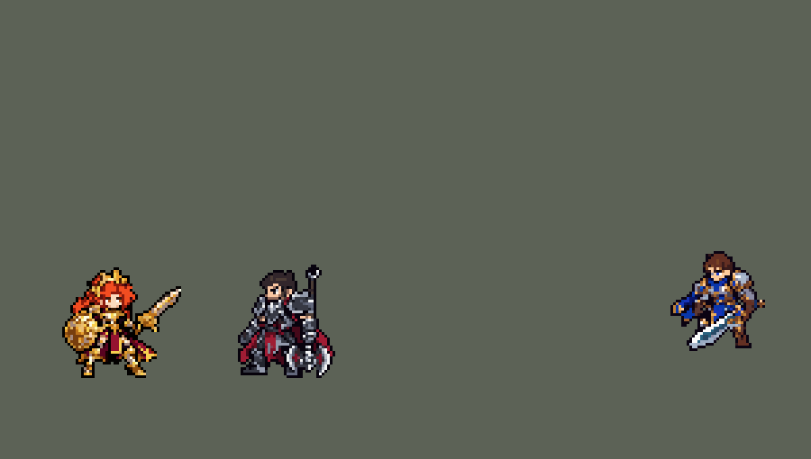

<!-- 本页上半部分由 tools/docs/gen_hero_docs.py 按仓库里现在的数据生成，手改会被覆盖；「开发记录」以下是手写的，生成时原样保留。 -->

# 蕾欧娜 Leona


| 项目 | 内容 |
|---|---|
| id | `league_leona` |
| 所属的包 | 主包（mod_id `league`） |
| 分路 | 辅助 |
| 分类 / 标签 | 功能型（Util） · AP / Magic / Melee / Tank / CC |
| 高清帧 | PPU 1.76 |
| 附加包 | 无 |



其他预览：[逐帧预览](../preview/league_leona_frames.png)、[特效表](../preview/league_leona_effects.png)

## 现在的技能

下面是游戏里显示的技能说明（`league/text/champion.i18n` 的简体中文，去掉了颜色和图标），冷却、距离来自 `league/champion/league_leona.data_champion`；1 秒 = 60 tick。

### 普攻 / 被动（被动「日光」）

*攻击间隔 1.33 秒 · 攻击距离 25000*

普攻造成100% 攻击力的物理伤害。被动 日光：被蕾欧娜技能命中的敌人1.5秒内受到的伤害提高10%，每个技能各挂一层。

### 技能1 · 破晓之盾

*冷却 5 秒 · 施放距离 26000 · 施放：指定目标 · 敌人（不含防御塔）*

用盾猛击身边的一个敌人，造成100% 攻击力的物理伤害和40 + 40% 法术强度的魔法伤害，眩晕1秒。

### 技能2 · 天顶之刃

*冷却 8 秒 · 施放距离 60000 · 施放：方向 · 敌方英雄*

掷出剑光，对直线上的敌人造成60 + 40% 法术强度的魔法伤害，禁锢命中的第一个敌方英雄0.5秒并冲到它身边。日蚀：出手时举盾，3秒内受到的伤害降低25%，随后盾牌爆发，对周围敌人造成60 + 40% 法术强度的魔法伤害；命中敌人则减伤再持续3秒。

### 大招 · 日炎耀斑

*冷却 60 秒 · 施放距离 80000 · 施放：地点 · 敌方英雄*

召唤一道阳光，0.6秒后落在敌方英雄所在处，对范围内的敌人造成150 + 80% 法术强度的魔法伤害并减速80%，中心的敌人改为眩晕，持续1.75秒。

### 数值

攻击力 80（每级 +6）、法强 20（每级 +10）、生命 1100（每级 +120）、护甲 40（每级 +8）、魔抗 30（每级 +5）、移速 1000（每级 +10）。

## 相关脚本和素材

- [`tools/lol/extract_leona.py`](../../tools/lol/extract_leona.py)
- [`tools/art/preview_leona.py`](../../tools/art/preview_leona.py)
- [`tools/art/import_leona.py`](../../tools/art/import_leona.py)
- [`assets/source/leona/`](../../assets/source/leona)

## 开发记录

> 下面是原来 README 里「英雄：蕾欧娜」一节，原样搬过来（只改了相对链接）。

| 部分 | 内容 |
|---|---|
| 定位 | 辅助（Util），第二组的辅助，近战坦克和控制 |
| 普攻 | 剑击，100% 攻击力的物理伤害。被动「日光」：被蕾欧娜技能命中的敌人 1.5 秒内受到的伤害提高 10%。英雄联盟里是队友的下一次攻击引爆额外魔法伤害；数据只能给目标挂增伤，做成所有伤害都加 |
| 技能1 | Q「破晓之盾」：用盾猛击身边的一个敌人（射程 26000），100% 攻击力的物理伤害加 40 + 40% 法术强度的魔法伤害，眩晕 1 秒。英雄联盟里是强化下一次普攻，这里直接出手。冷却 5 秒 |
| 技能2 | E「天顶之刃」：掷出剑光，飞 65 px（每 tick 6 px，宽 7000），对直线上的敌人造成 60 + 40% 法术强度的魔法伤害；另一道只打英雄、不穿透的隐形剑光停在第一个敌方英雄身上，禁锢 0.5 秒，蕾欧娜冲到它身边。合并 W「日蚀」：出手时举盾，3 秒内受到的伤害降低 25%，随后盾牌爆发，对半径 35000 内的敌人造成 60 + 40% 法术强度的魔法伤害；打中敌人则减伤再持续 3 秒。蕾欧娜死了就不会爆发。只对英雄放，射程 60000，冷却 8 秒 |
| 大招 | R「日炎耀斑」：在敌方英雄所在处召唤一道阳光（射程 80000），0.62 秒后落下（英雄联盟 0.625 秒）：半径 36000 内的敌人受到 150 + 80% 法术强度的魔法伤害并减速 80%，中心半径 16000 内的敌人同时眩晕，都持续 1.75 秒。冷却 60 秒 |
| 连招 | 用户要求：「有连招要做连招」「都要帮我补」。英雄联盟的 **E→Q**：天顶之刃禁锢并冲到敌方英雄身边，破晓之盾（射程 26000）随即就能放，AI 一贴脸就接 Q 眩晕——这条连招靠距离自然接上。试过让 E 落地后 1.5 秒内的 Q 不等前摇立刻砸（Q 的出手点改到第 1 tick），模拟两批都变差（+0.33 / +0.70 → −0.07 / −0.44，打到英雄的 Q 每局 12.3 → 9.6 次），没有保留 |
| 数值 | 攻击 80（+6）、法术强度 20（+10）、生命 1100（+120）、护甲 40（+8）、魔抗 30（+5）、移速 1000（+10），和原版近战辅助 `monk` 相近。SDK 对战模拟（分别替换原版辅助 `monk`、`priest`、`bard`、`enchanter`、`taoist`，两边各 36 局）团队击杀差平均 +0.5，和原版辅助持平。亚索的大招只对被控制的英雄放，蕾欧娜的眩晕和禁锢都算：队友里有蕾欧娜时，亚索每 10 分钟放 3.7–4.0 次 R（辅助是原版 `priest` 时 2.7 次，本包阵容里是索拉卡时 2.9 次），没有改亚索 |
| 精灵图 | 9 个动作 51 帧：待机、跑步、普攻、Q 盾击、E 掷剑、E 冲刺、R、受击、死亡。头发到脚底 33 px，加上王冠 42 px，20 色，动作全部取自英雄联盟原版动画 |
| 特效 | 剑击、盾击和眩晕星、天顶之刃剑光、剑光命中、禁锢日印、日光印记、日蚀护罩、日蚀爆发、日炎耀斑（聚光、光柱、火环）、大招眩晕星 |
| 图标 | 官方技能图标（Q / E / R），64×64 |
| 音频 | 从本地客户端提取的 11 条技能音效和 3 条中文语音（Q、E、R）。不提交到仓库，按下面的命令在本地生成 |
| 高清帧（PPU 1.76） | 2026-10-30 用 PPU 重做（用户：「接下来重做曙光女神」「通过，用 1.76」「动作通过」）。设计图：Codex 照她的旧精灵描密的原图（两版，用 A 版：按布局缩小重画的那张），按原图约 12 像素一格读回（69 × 72 格；冠顶到脚底 72 行 / 1.76 = 原来的 41 像素；调色板 64 色，眼睛那几行按均匀格子读，贴色边的读法会把琥珀色眼睛读成深棕，`design_leona_hd.py`）。英雄联盟 3D 模型的盾是深红长盾，提示词写明照精灵画圆形金色太阳盾。动作：Codex 照旧版同一帧用设计图整帧重画（`pack_leona_actions.py`，45 帧，没有和别的帧重复的；Q 第 4–5 帧把盾推到右前方，死亡第 3 帧起盾和剑掉在地上）。读回（`casts_leona_hd.py`）：每张的缩放按整个人的面积量，再乘头的大小（橙红头发和脸，和设计图比）定下来，45 帧的头平均是设计图的 1.015 倍；对齐点按设计图和旧待机剪影重叠最多的那列（第 25 列）；死亡里的盾和剑是单独的块，保留。待机不上下起伏（待机和选人卡是从动作里剪的随机片段）；没有烤进动作的特效（`rig_leona_hd.py`）。高 41 像素和原来一样，没有 SIZES 行；头像点不变；选人卡片 −10 不变（审查标出的只是 W 第 1 帧高举的剑尖，头完整） |

```bash
python tools/lol/extract_leona.py --lol "D:\WeGameApps\lol" --vgmstream "<vgmstream-cli.exe 路径>"
python tools/lol/native_pose.py assets/source/leona/poses.json --out <渲染文件夹> --alpha --parts
python tools/art/restyle_native.py assets/source/leona/poses.json --renders <渲染文件夹>   # 角色图
python tools/art/import_native.py --hero leona
python tools/art/import_leona.py      # 特效；--raw <Codex 的交付文件夹> 先把原始图转成原尺寸条
python tools/art/preview_leona.py
# PPU 1.76 重做（2026-10-30）：
python tools/art/pack_leona_ppu.py --out <文件夹>          # 给 Codex 的设计图包（照她的旧精灵描密）
python tools/art/design_leona_hd.py                      # Codex 的原图（hd/raw/leona-A.png）按自己的格子读回 -> hd/design.png
python tools/art/pack_leona_actions.py --out <文件夹>      # 给 Codex 的动作包（照旧版同一帧整帧重画）
python tools/art/casts_leona_hd.py --area                # 每张按面积的缩放；--heads 每帧头的大小（定 ZOOM）
python tools/art/rig_leona_hd.py                         # 读回 -> 原始条和 1 倍图
python tools/art/ppu_restyle.py --hero leona && python tools/art/ppu_hd.py --hero leona
python tools/art/ppu_one.py --hero leona && python tools/art/rig_leona_hd.py --one-ground && python tools/art/hero_reels.py --hero leona
python tools/art/preview_leona.py
python tools/art/review_leona_actions.py --out <文件夹>    # 旧版 / 新版对照动图
```

美术（提示词见 [`assets/source/leona/PROMPTS.md`](../../assets/source/leona/PROMPTS.md)）：
- 分工：角色图由 Claude 画，Codex 只画特效。
- 比例和镜头：镜头 yaw 20、pitch 25，头 2.6、腿 0.8、头发 0.385，盾缩到 0.8 倍。王冠的尖角比头发高出 12 个单位，算进头顶会把其他部分都压小，所以按头发量头顶（`crown` 165），王冠像帽子一样立在上面。和原版骑士并排比时她头发到脚底只有 29 px，`height` 调到 39：头发到脚底 33 px，加上王冠 42 px。
- 造型图：待机第 1 帧按材质投色后画上脸。脸在三个方案里用户选了 C：原版画法的三行眼睛、上扬的眼线、一格暗红小嘴。20 色。
- 动作图：`restyle_native.py` 按造型图的颜色给英雄联盟动画逐帧投色。盾和布料单独成部件（`parts`），各按自己的材质投色，碰到盾的地方描边，不然盾会和盔甲糊成一片金色。她的脸小，被厚头发和王冠挡着，自动贴脸时投出的皮肤太少，加了三个选项：`profile`（朝向低于这个值时只贴脸块前四列）、`chin`（眼睛以下这么多行的脸块也可以盖住衣领）、`fallback`（皮肤太少时直接用跟踪到的远眼位置）。跑步时原版低头、脸藏到盾后面，用 `head_like` 保持待机时的头部朝向。待机 6 帧都用第 1 帧，第 3–5 帧上半身下移 1 格呼吸，分界在盾尖。
- 特效用 Codex 画的 10 张（生图原稿，和金克丝一样）：`import_leona.py --raw` 按画面之间最宽的空列切帧（日蚀爆发的火环几乎连在一起，写死切点），再按技能范围定大小：剑击 20 px，剑光 28 px 长（宽 7000），禁锢日印 26 px，日光印记 12 px，日蚀护罩从地面圈到顶 45 px（高过王冠），日蚀爆发的火环 70 px（半径 35000），日炎耀斑外圈 72 px（半径 36000，这两个画一半大再放大 2 倍），眩晕星 16 px。地面上的圈对准脚下；盾击的三帧星星从胸口移到头顶；大招的眩晕星播两遍，盖满 1.75 秒；日光印记在头顶上方，眩晕星在头顶，分开放，不会糊成一团。
- 出手时刻和动画对齐：普攻第 8 tick 命中，Q 第 11 tick，E 第 9 tick 掷出，R 第 12 tick 召唤；耀斑出现后第 37 tick（光柱那一帧）结算，1 秒的画面播完。
- 结果：20 色，和右边像素同色的比例 30%（原版英雄 18%–46%）。头像截取点 (3, −35)。

逐帧预览：[`docs/preview/league_leona_frames.png`](../preview/league_leona_frames.png?v=1030hd)，特效：[`docs/preview/league_leona_effects.png`](../preview/league_leona_effects.png?v=1014g)。
