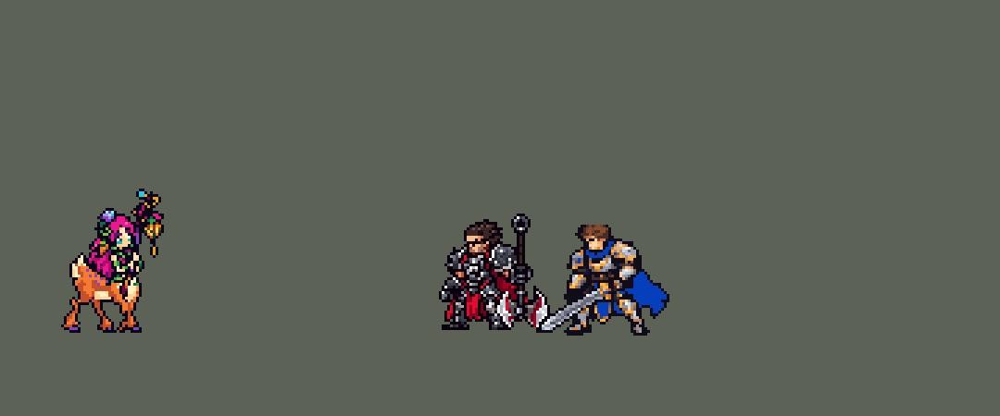

<!-- 本页上半部分由 tools/docs/gen_hero_docs.py 按仓库里现在的数据生成，手改会被覆盖；「开发记录」以下是手写的，生成时原样保留。 -->

# 莉莉娅 Lillia


| 项目 | 内容 |
|---|---|
| id | `league_lillia` |
| 所属的包 | 主包（mod_id `league`） |
| 分路 | 打野 |
| 分类 / 标签 | 近战（Melee） · AP / Magic / Melee / CC / Heal / Dot |
| 高清帧 | 1 倍像素（无高清帧） |
| 附加包 | [莉莉娅梦尘与昏睡附加包](#附加包)（`league_lillia`） |



其他预览：[逐帧预览](../preview/league_lillia_frames.png)、[特效表](../preview/league_lillia_effects.png)

## 现在的技能

下面是游戏里显示的技能说明（`league/text/champion.i18n` 的简体中文，去掉了颜色和图标），冷却、距离来自 `league/champion/league_lillia.data_champion`；1 秒 = 60 tick。

### 普攻 / 被动（被动「梦满枝」）

*攻击间隔 1 秒 · 攻击距离 25000*

被动梦满枝：技能命中时附上梦尘，3秒内造成5次4 + 3% 法强魔法伤害，对英雄另造成共5%最大生命值真实伤害并回复她12 + 8% 法强生命。施法叠腾跃，每层移速+5%（最多4层）。

### 技能1 · 飞花挞

*冷却 5 秒 · 施放距离 24000 · 施放：指定目标 · 敌人（不含防御塔）*

挥舞枝条，对周围敌人造成35 + 30% 法强魔法伤害并附上梦尘；外圈的敌人再受到同等的真实伤害。

### 技能2 · 流涡种

*冷却 10 秒 · 施放距离 70000 · 施放：指定目标 · 敌人（不含防御塔）*

抛出种子，对落点敌人造成45 + 40% 法强魔法伤害并减速40%。接着惊惶木：蓄力重击目标所在处，造成40 + 30% 法强魔法伤害，正中心受到3倍。

### 大招 · 夜阑谣

*冷却 70 秒 · 施放距离 80000 · 施放：指定目标 · 敌方英雄*

所有带梦尘的敌方英雄困倦1.5秒（减速40%），随后昏睡1.5秒；她的技能叫醒昏睡者时额外造成80 + 40% 法强魔法伤害。

### 数值

攻击力 65（每级 +8）、法强 45（每级 +20）、生命 960（每级 +95）、护甲 28（每级 +8）、魔抗 22（每级 +4）、移速 1050（每级 +11）。

## 附加包

附加包是可选的原生代码 mod（都在附加包合集 `league_addons` 里），**不装主包里的英雄也是完整的**。

### 莉莉娅梦尘与昏睡附加包

[莉莉娅梦尘与昏睡附加包](../../addons/league_lillia/README.md)：`league_lillia` v0.1.3

主包 `league` 保持纯数据。数据里能读最大生命值的只有真实伤害，也没有「受到伤害就醒」的效果，所以主包莉莉娅：
被动「梦满枝」的梦尘对英雄每 0.75 秒造成 1% 最大生命值的**真实伤害**；大招「夜阑谣」让带梦尘的敌方英雄困倦 1.5 秒后
**眩晕** 1.5 秒（打不醒），她的 Q / W 打到眩晕中的英雄时多造成一段惊醒伤害。英雄联盟里梦尘是**魔法伤害**，昏睡 2 秒、
**受到任何伤害就醒**并吃惊醒伤害，这两条放在这个附加包里（用户：「这个需要做附加包的」）：

- 副本（`tools/kit/build_lillia.py` 的 `build(p, native=True)`）里，技能打中敌方英雄时给他挂 buff `league_lillia_dust`
  （3 秒，再中一下刷新），取代主包的真实伤害梦尘；数据里「Q / W 打到昏睡者加伤」那两段拿掉；加上本包的被动
  `league_lillia:dream`。其他技能一字不改。
- `league_lillia:dream` 每 tick 看一次：带梦尘的敌方英雄从挂上的下一 tick 起每 0.75 秒受到 1% + 每 100 法强 0.3% 最大生命值的
  **魔法伤害**（会被魔抗减免）；
- 莉莉娅身上出现大招的标记 `league_lillia_r_go`（主包的 R 照旧加它）时，所有带梦尘的敌方英雄**困倦**（减速 40%，1.5 秒，
  `league_lillia_drowsy` 的画面），之后**昏睡** 2 秒（原生眩晕 + `league_lillia_sleep` 的画面）；昏睡中生命 + 护盾少了
  （梦尘自己那一下、主包数据里梦尘那一跳 `d_dmg` + `d_ratio`% 法强的魔法伤害除外）就**醒来**：眩晕解除，受到 80 + 40% 法强的魔法伤害（`league_lillia_wake` 的画面和声音）。
- **梦尘自己落下不算被打**（0.1.2，2026-10-17 反汇编游戏 0.6.4 查的）：`deal_damage_typed` 只把伤害排进效果队列，打出去以后
  马上读生命还是原来的，下一次 on_update 之前才扣血。0.1.1 在打出去的那一 tick 前后各读一次生命，把差值当成「梦尘自己打了多少」，
  结果永远是 0：下一 tick 梦尘落下，掉的血超过只给主包数据那一跳留的余量，睡着的人就被叫醒，还吃一下惊醒伤害。现在被动记下每次
  打给每个目标的梦尘（减免前），下一次看昏睡者掉血时先扣掉：按减免前的伤害再加一半扣，`damaged_amplify` 放大了也扣得住；
  主包数据那一跳的余量照旧。
- 数字从参数表 `P`（`d_period`、`d_hp`、`d_ap_bp`、`r_drowsy`、`r_slow`、`n_sleep`、`r_wake`、`r_wake_ratio`）写进副本的
  `passive.params`。

装上附加包后游戏里显示的说明（和主包不同的部分）：

- **普攻 / 被动（被动「梦满枝」）**：【梦尘测试版】被动梦满枝：技能命中英雄时附上梦尘，每0.75秒造成1% + 0.3% 法强最大生命值的魔法伤害，并回复她12 + 8% 法强生命；对其他敌人造成4 + 3% 法强。施法叠腾跃，每层移速+5%。
- **大招 · 夜阑谣**：【昏睡测试版】所有带梦尘的敌方英雄困倦1.5秒（减速40%），随后昏睡2秒；受到任何伤害就会醒来，并额外受到80 + 40% 法强魔法伤害。

## 相关脚本和素材

- [`tools/kit/build_lillia.py`](../../tools/kit/build_lillia.py)
- [`tools/kit/setup_lillia.py`](../../tools/kit/setup_lillia.py)
- [`tools/lol/extract_lillia.py`](../../tools/lol/extract_lillia.py)
- [`tools/art/preview_lillia.py`](../../tools/art/preview_lillia.py)
- [`tools/art/rig_lillia.py`](../../tools/art/rig_lillia.py)
- [`tools/art/import_lillia.py`](../../tools/art/import_lillia.py)
- [`tools/art/design_lillia.py`](../../tools/art/design_lillia.py)
- [`assets/source/lillia/`](../../assets/source/lillia)

## 开发记录

> 下面是原来 README 里「英雄：莉莉娅」一节，原样搬过来（只改了相对链接）。

| 部分 | 内容 |
|---|---|
| 定位 | 打野（法师，分类 Melee），用户排的第十五组的打野（同组：上单雷克顿已做，其他英雄以后做），第 72 位英雄。含羞蓓蕾 莉莉娅：小鹿身子的梦之精灵，技能打中的敌人沾上梦尘持续掉血、她回血，Q 抡枝条转一圈（外圈多一下真实伤害），E 抛出种子减速，接着 W 人立起来往前方一个圈砸下去（正中甜点三倍），R 唱催眠曲让带梦尘的敌方英雄先困倦再昏睡。用户选的：技能位「Q 单独 + E→W 连招」，被动「这个需要做附加包的」（主包近似、附加包做真的百分比魔法伤害），R「主包眩晕 + 附加包真睡」，另外「加入高手的连招」 |
| 普攻 / 被动 | 近战挥枝条，100% 攻击力，射程 25000，攻击间隔 60 tick（第 7 tick 打中）。被动「梦满枝」：技能每打中一个敌人就挂上梦尘（3 秒，每 0.75 秒一次：4 + 3% 法强的魔法伤害；对英雄每次再加 1% 最大生命值的**真实伤害**——数据里读最大生命值的只有真实伤害，英雄联盟是魔法伤害，在附加包里），每打中一个英雄她回 12 + 8% 法强。每放一个技能「腾跃」加一阶移速（最多 4 阶，每阶 +5%，6.5 秒） |
| 技能1 | Q「飞花挞」：冷却 300 tick（5 秒），也对小兵和野怪放。第 7 tick 抡枝条转一圈：半径 26000 内 35 + 30% 法强的魔法伤害并挂梦尘；内圈 12000 以外的外圈再吃同样数值的真实伤害（内圈先挂 1 tick 的 99% 减伤，再打一遍真实伤害，只有外圈吃到） |
| 技能2 | E「流涡种」→ W「惊惶木」：冷却 600 tick（10 秒），也对小兵和野怪放，射程 70000。E 把种子抛到目标身上（20 tick 飞行）：45 + 40% 法强的魔法伤害，减速 40% 3 秒，挂梦尘；扔完接 W：人立蓄力，0.5 秒后砸在扔种子时目标站的地方（地上先亮预警圈），半径 22000 内 40 + 30% 法强的魔法伤害并挂梦尘，正中甜点（4000）三倍——被 E 减速的目标通常还在圈心（高手连招）。英雄联盟里种子没打中会往前滚，数据里从落点发出的弹道会从她身上重新飞，没做 |
| 大招 | R「夜阑谣」：冷却 4200 tick（70 秒）。上膛（萨勒芬妮 R 的做法）：70000 内有两个敌方英雄、而且最近有英雄沾了梦尘就立刻放，否则待命 10 秒，期间梦尘每打中英雄一次再判一次，等 3 秒后一个也放，没用上退还冷却。放出后她身上挂 0.75 秒的标记，每个英雄身上的梦尘下一次跳的时候读到它：困倦 1.5 秒（减速 40%），然后昏睡 1.5 秒（眩晕）；她的 Q / W 打到昏睡的英雄多一段 80 + 40% 法强的惊醒伤害。高手连招：英雄睡着后 W 冷却好了就砸睡着的人（甜点 + 惊醒）；R 待命时 E 单独扔、W 留给睡着的人 |
| 梦尘与昏睡附加包 | 附加包 [`addons/league_lillia`](../../addons/league_lillia/README.md)（在附加包合集里）用原生代码做英雄联盟的规则：梦尘对英雄每 0.75 秒造成 1% + 每 100 法强 0.3% 最大生命值的**魔法伤害**；大招让带梦尘的敌方英雄困倦 1.5 秒后**昏睡** 2 秒，**受到任何伤害就醒**并吃 80 + 40% 法强的惊醒伤害（0.1.2 起她自己的梦尘落下不再把人叫醒——引擎下一 tick 才结算它，0.1.1 把它当成别人打的，睡着后不到一跳梦尘就被叫醒、吃惊醒伤害）。副本和主包只差梦尘的写法和这个被动，主包不装附加包也完整可玩；10-17 的游戏日志里查出了上面梦尘叫醒的毛病（0.1.1） |
| 数值 | 攻击 65（+8）、法强 45（+20）、生命 960（+95）、护甲 28（+8）、魔抗 22（+4）、移速 1050（+11）。数值是自己设计的，用 SDK 对战模拟调：打野，对 5 个原版打野（`demon`、`circus_blade`、`hunter`、`inquisitor`、`ninja`），3 套阵容、两边各打，10 分钟。初稿 +2.20（同批凯隐 +1.76、赵信 +1.12）；R 的昏睡 2 → 1.5 秒、冷却 → 70 秒、R→W 由大招自己接后 +1.30 / +1.16（同批种子凯隐 +1.33、伊芙琳 +1.30）；按动作帧定下出手时机（普攻、Q、E 都提前到第 7 tick，R 第 10 tick）后到 +1.78 / +1.95，攻击 70 → 65：两批种子 +1.33 / +1.77（另试过 Q 35 → 31：+1.75 / +1.84；攻击 65 + 生命 930：+1.52 / +1.92） |
| 亚索联动 | R 的昏睡（数据里是眩晕）算控制：莉莉娅在亚索队里打野时，亚索每局对英雄放 R 1.27 次（原版忍者 0.58，李青以前测的 1.67、凯隐 1.00），不用调 |
| 精灵图 | 9 个动作 52 帧：待机、移动、普攻、Q（`skill`）、E 抛种子（`skill2`）、W 人立砸地（`skill2_w`）、R（`ult`）、受击、死亡。造型 32 × 46 px（连枝头到蹄子，小鹿身子四条腿），26 色。待机 6 帧同一张，腰以上轻轻呼吸；头像截取点 (3, −41)，选人卡片中心 −5（待机最高处是枝头，站位点上方 34 格；先设的 0 让卡片退回小图的默认画法，用户：「BP界面莉莉娅的位置要调一下」） |
| 特效 | Codex 画的 17 张，按游戏尺寸交付，两张表 `league_lillia_fx` / `league_lillia_big`：普攻的花光，Q 脚下绽开的粉紫花环、命中的金色闪刺，E 飞行的橙色种子（严格上下对称）、落地炸开、命中、脚下减速的梦雾，W 地上的预警圈（甜点和往里收的倒计时圈）、砸地的冲击波、命中、甜点的金色暴击，R 身边升起的蓝色梦境光带、头顶的困倦梦雾和昏睡泡泡、被打醒破泡，腾跃时蹄下飘起的花瓣，附加包里敌人身上的梦尘 |
| 音效 | 英雄联盟的音效和配音（`tools/lol/extract_lillia.py`）：挥枝、命中，Q 施放、命中、外圈，W 施放、甜点、命中，E 施放、命中，R 施放、困倦、昏睡、惊醒；Q、W、E、R 的中文配音（片段名 `league_lillia_sfx_vo_*`，和声音名不同）。版权属于 Riot Games，**不提交到仓库**，按下面的命令在本地生成 |
| 图标 | 官方技能图标（Q / E / R），从本地客户端提取，缩到 64×64 |

重新生成（素材来自本机的英雄联盟客户端，音频不进仓库）：

```bash
python tools/lol/extract_lillia.py --lol "D:\WeGameApps\lol" --vgmstream "<vgmstream-cli.exe 路径>"
python tools/kit/build_lillia.py            # 技能数据，数字都在脚本的参数表 P 里；--nodes 看每棵技能树的节点数
python tools/kit/setup_lillia.py --face 3,-41 --banpick -5  # 五种语言的文字、音效配置、共享文件里她的键
python tools/art/design_lillia.py --pick B46_body  # 造型：Codex 原稿 07 按自己的格子读回，删到 46 行再逐格修，补上抬高的鹿臀和叶子裙
python tools/lol/native_pose.py assets/source/lillia/poses.json --out <渲染文件夹>   # 动作参考帧（英雄联盟原动作）
python tools/art/rig_lillia.py              # 动作：定稿整体（手臂不拆）旋转、跃起、人立，枝条绕双手转，腿按髋重画
python tools/art/import_lillia.py           # 特效
python tools/art/import_native.py --hero lillia   # 精灵
python tools/art/preview_lillia.py          # 逐帧预览、特效预览、演示 GIF
python addons/league_lillia/make_override.py   # 附加包的英雄数据和文字（主包的莉莉娅改了以后重跑）
```

美术（原画的提示词见 [`assets/source/lillia/PICTURE_PROMPT.md`](../../assets/source/lillia/PICTURE_PROMPT.md)，造型的见 [`MODEL_PROMPTS.md`](../../assets/source/lillia/MODEL_PROMPTS.md)，动作的见 [`MODEL_STRIPS.md`](../../assets/source/lillia/MODEL_STRIPS.md)，特效的见 [`PROMPTS_FX.md`](../../assets/source/lillia/PROMPTS_FX.md)；Codex 的交付在 [`codex_picture/`](../../assets/source/lillia/codex_picture)、[`codex_model/`](../../assets/source/lillia/codex_model)、[`codex_strips/`](../../assets/source/lillia/codex_strips)、[`codex_fx/`](../../assets/source/lillia/codex_fx)；附图包由 `tools/art/pack_lillia_*.py` 在本地生成，英雄联盟的渲染不进仓库）：

- 原画：A 是英雄联盟的待机（枝条竖着抱在身前），B 是枝条低低地往前伸。用户选「A 竖抱枝条」。
- 造型：Codex 自己删到 42 行的两版都碎了。用户：「你选一个吧 但的确不满意 需要调用工具修复」，选了原稿 07（按它自己的格子读回 65 行），再「用这个慢慢调不就行了吗」：轻轻删到 46 行，照字符表逐格修（脸、枝条的金钩和圆灯笼、两格宽的腿和后腿的跗关节、蹄子）。之后按用户说的一处处改：「有点胖」（删两行两列、腿重画直）、「身体和小鹿的腿连接的那里有点歪」「武器也是歪的」（枝条改成竖直一列，人和鹿身的接缝重画成一圈叶子裙）、「这里黑色一块是什么啊」（手肘旁的黑洞补成皮肤）；做动作时又修了「手臂这里不改吗 空这么大」（腰前横过的前臂原来是一圈肤色夹一条绿护腕，改成两行前臂 + 一圈护腕 + 下面一道描边）、枝条上一格描边色、裙摆的缺格、枝条挪开后往外凸的胸口。
- 上下半身（10 月 9 日，用户：「莉莉娅上半身和下半身做的更自然点」，三个方案里选了 C）：`design_lillia.py` 第 11 步（`--pick B46_body`），`rig_lillia.py` 照着重新生成所有动作。
- 重画（10 月 9 日，用户：「眼睛做的像英雄联盟一点」「把形状也换了」「人形和身体连接也不像英雄联盟」）：原版女孩的上身从鹿的肩胛长出、鹿胸在她身前下方、鹿身横着往后，之前的精灵是女孩坐在平顶桶上。照格温的办法让 Codex 把它自己的原画 A **直接画在游戏格子上**（26 px 固定格、花苞顶到蹄底 46 格，交付 [`codex_grid/`](../../assets/source/lillia/codex_grid)），人鹿连接照英雄联盟模型、眼睛改成冰蓝虹膜 + 白高光 + 深睫毛线。`design_lillia.py --pick grid12` 把 1x 放到画布上（蹄底第 99 行、蹄中点第 64 列）。动作由新脚本 `rig_lillia2.py` 重摆：枝条的杖身从双手间的握点画成直线、顶端（花 + 金钩）和灯笼各为一块随角度转、灯笼始终竖挂；四条腿是造型自己的、整条平移（用户：「腿部有点失去像素和变形」——按行渐进错位会把带描边的鹿腿打碎），步幅拆成髋部一格 + 关节（后腿跗关节、前腿膝盖）一格的两个小错位（「还是有点断腿的感觉」：大腿根 3 行过渡读成断口），身体抬起或前倾时腿顶重复一行接到身上；身体不再旋转（用户先指出大招帧「眼睛位置对吗」、再指出人立帧「这还是不对啊」——RotSprite 一转鹿身就不像了）：所有动作只用整体上下/前后移动、腿的收放和枝条的角度表达，人立 = 整个人跳起、前腿收到胸下、枝条高举；跑步小跑、死亡整个人侧倒、枝条落地；每帧检查都是一整块（转角打碎的细线——灯笼链、金钩——用描边格接回）。头像点 (2, −41)。模组版本 0.84.6。
  - 原因：10 月 8 日换上的鹿身（臀部、小尾巴、奶油色的胸和肚子）把定稿的叶子裙去掉了，女孩光着的腰直接压在平顶的长方形鹿身上，接缝是一条横线；原画里鹿臀比她的腰高 6–7 行，她像是从鹿胸前长出来的。那次给 26 个站立的动作帧贴的又是待机那只平放的鹿：施法时只有女孩前倾、后仰，鹿身不动，看着不像连体。
  - 鹿身：她身后的鹿臀抬高，顶部比腰高约 6 行，左上角圆一点，尾巴的白毛翘在臀顶，加两个紫色斑点。
  - 腰：一圈叶子裙盖住接缝，浅绿、中绿、深绿的叶子左上受光，叶尖垂在鹿背上。
  - 动作：所有动作都由 `rig_lillia.py` 从新造型生成，女孩和鹿身一起前倾、后仰、人立、倒地；跑步也换成和待机同一只鹿（原来是另一只小一号的旧鹿身）。枝条往后拉时（E 第 0 帧，Q 第 0、4 帧），枝条和顶端的金钩、蓝花画在鹿臀前面（她在身体近侧握着枝条），灯笼仍挂在鹿身后面。
  - 和 main 逐帧比：只有 Q 第 4 帧在后腿和灯笼流苏之间多了 1 格孤立描边，其余每帧的碎块、透明小洞和孤立描边都不多于 main。
- 动作：Codex 第 2 步把造型的零件重新摆了，用户：「像素缺失 还有走路不掉很奇怪」「这里露出来一大截啊」。`tools/art/rig_lillia.py` 重做：先试过拆掉手臂按姿势重画，用户：「我觉得还是奇怪 这个身体」「腰部大规模像素消失啊 而且这个莉莉娅没有英雄联盟那种自然的感觉」「感觉不像是连体的」——于是手臂、手、腰一律保留定稿原样，枝条绕两手之间的握点转动、上下滑；动作照英雄联盟的原动作用整个身体做：普攻先后仰再跃起前扑、Q 小跳转一圈、E 蹲下再上抛、W 人立约 28° 再前倾砸地、R 起身举枝摇晃（腿上的部分整体按 RotSprite 旋转，四条腿从转过的髋重新画，收腿或踏地，画法和定稿的腿一样：两格宽、跗关节、蹄子）；跑步是小跑，对角两条腿一起迈，每次落地身子下沉一行，女孩的上半身晚一帧再跟着沉一行（用户：「莉莉娅移动时上半身有点僵硬」），灯笼轻轻晃；死亡照英雄联盟：后仰、人立、侧翻倒地，腿蜷着，枝条掉在身前。
- 特效：Codex 第 3 步把 17 张都按游戏尺寸画了一份（[`codex_fx/lillia-fx/pixel_1x/`](../../assets/source/lillia/codex_fx/lillia-fx/pixel_1x)），`tools/art/import_lillia.py` 每格切出、按锚点（中心、脚底）放好，导入时逐格检查对称。
- 红色方：飞行的种子严格上下对称；命中、她身上的花环和梦境光带、挂着循环的减速 / 困倦 / 昏睡 / 梦尘 / 腾跃都严格左右对称；地上的花环、种子落地、预警圈、砸地上下左右都对称。没有特效画进动作帧。

逐帧预览：[`docs/preview/league_lillia_frames.png`](../preview/league_lillia_frames.png?v=1014g)，特效：[`docs/preview/league_lillia_effects.png`](../preview/league_lillia_effects.png?v=1014g)。
