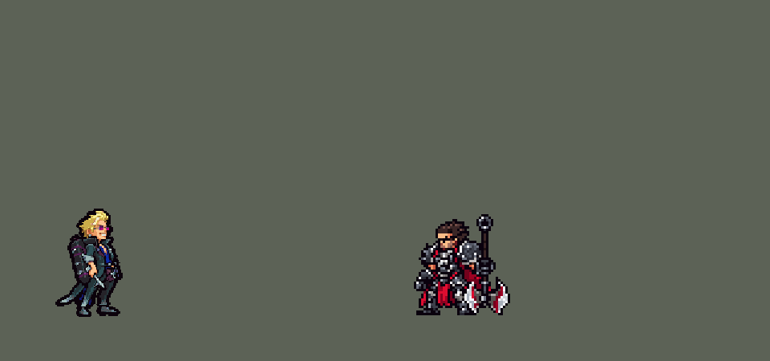

<!-- 本页上半部分由 tools/docs/gen_hero_docs.py 按仓库里现在的数据生成，手改会被覆盖；「开发记录」以下是手写的，生成时原样保留。 -->

# 洛克 Locke


| 项目 | 内容 |
|---|---|
| id | `league_locke` |
| 所属的包 | 主包（mod_id `league`） |
| 分路 | 中单 |
| 分类 / 标签 | 刺客（Assassin） · AP / Magic / Melee |
| 高清帧 | PPU 2 |
| 附加包 | [洛克附加包](#附加包)（`league_locke`） |



其他预览：[skills](../preview/league_locke_skills.gif)、[逐帧预览](../preview/league_locke_frames.png)、[特效表](../preview/league_locke_effects.png)

## 现在的技能

下面是游戏里显示的技能说明（`league/text/champion.i18n` 的简体中文，去掉了颜色和图标），冷却、距离来自 `league/champion/league_locke.data_champion`；1 秒 = 60 tick。

### 普攻 / 被动

*攻击间隔 0.92 秒 · 攻击距离 23000*

圣银穿心：攻击附带15 + 15% 法强魔法伤害。灵焰仪式：灰猎无影落到敌方英雄身边时点燃（每16秒一次）：4秒内攻速+35%、移速+40%（递减），每秒受到最大生命2%真实伤害，结束时回复20 + 10% 法强生命。

### 技能1 · 伏魔三钉

*冷却 1 秒 · 施放距离 50000 · 施放：指定目标 · 敌人（不含防御塔）*

接连掷出三枚咒钉，每枚造成35 + 20% 法强魔法伤害并减速15%1.5秒（可叠加）。钉中英雄后4秒内，他的攻击引爆钉子：每枚25 + 12% 法强魔法伤害，两枚+25%，三枚+50%。

### 技能2 · 灰猎无影

*冷却 1 秒 · 施放距离 45000 · 施放：指定目标 · 刚交过手的敌方英雄*

瞬移到敌方英雄身边，对周围敌人造成50 + 25% 法强魔法伤害；3秒内下一次攻击冲穿目标，造成55 + 30% 法强魔法伤害。被他打过的英雄3秒内阵亡时冷却刷新。

### 大招 · 万魔狱

*冷却 60 秒 · 施放距离 50000 · 施放：指定目标 · 刚交过手的敌方英雄*

法器箱砸向敌方英雄：周围敌人受到200 + 80% 法强魔法伤害并减速50%（递减）；英雄被标记4秒，生命低于100 + 40% 法强即被处决。标记期间参与击杀得一层封印（最多3层，阵亡清空）：处决线+40，大招冷却最多剩50%。

### 数值

攻击力 92（每级 +12）、法强 40（每级 +24）、生命 900（每级 +92）、护甲 30（每级 +8）、魔抗 24（每级 +4）、移速 1100（每级 +13）。

## 附加包

附加包是可选的原生代码 mod（都在附加包合集 `league_addons` 里），**不装主包里的英雄也是完整的**。

### 洛克附加包

[洛克附加包](../../addons/league_locke/README.md)：`league_locke` v0.1.0

| 机制 | 主包（纯数据） | 附加包 |
|---|---|---|
| 圣银穿心（被动） | 普攻附带固定的魔法伤害（`p_dmg` + `p_ap`% 法强） | 再加目标**已损失生命 `p_miss`%** 的魔法伤害 |
| 灵焰仪式（W，并入被动） | 每秒烧**最大生命** `w_cost`%，结束时回固定的数（`w_heal` + `w_heal_ap`% 法强） | 每秒烧**当前生命** `w_cost`%（不会把自己烧死），结束时补回烧掉的 `w_back`% |
| 万魔狱（R）的处决 | 每 `r_p` 拍打一下阈值那么多的真实伤害、下一拍补回去（低于阈值的就死了） | 被标记的英雄**当前生命低于最大生命 `r_exec`%**（每层封印 +`r_exec_step`%）就处决 |
| 封印和法器 | 标记期间参与击杀 = 一层封印（最多 3 层，死了就没），大招冷却压到 `r_cap`% | 处决的地方**掉下法器**（`r_drop` 拍），洛克走到 `pick_r` 以内捡起来：封印 +1（最多 3 层，**整局都在**），大招剩下的冷却少 `r_cap`% |
| 参与击杀刷新 E | 击杀窗口：被他打过的英雄的记号断了就算 | 被他打过（`p_win` 拍内）的敌方英雄倒下，谁打死的都算，E 立刻好 |
| W 的样子 | 和平常一样 | 灵焰仪式期间整身换成 W 的配色（第 0 步 B：深蓝 / 靛紫皮肤、白西装、发白光的眼镜、蓝水晶法器箱；用户：「洛克会变成蓝色吧？」） |

装上附加包后游戏里显示的说明（和主包不同的部分）：

- **普攻 / 被动**：【附加包】圣银穿心：攻击附带15 + 15% 法强魔法伤害，外加目标已损失生命8%。灵焰仪式：灰猎无影落到敌方英雄身边时点燃（每16秒一次）：4秒内攻速+35%、移速+40%（递减），每秒受到当前生命2%真实伤害，结束时回复其中70%。
- **技能1 · 伏魔三钉**：【附加包】接连掷出三枚咒钉，每枚造成35 + 20% 法强魔法伤害并减速15%1.5秒（可叠加）。钉中英雄后4秒内，他的攻击引爆钉子：每枚25 + 12% 法强魔法伤害，两枚+25%，三枚+50%。
- **技能2 · 灰猎无影**：【附加包】瞬移到敌方英雄身边，对周围敌人造成50 + 25% 法强魔法伤害；3秒内下一次攻击冲穿目标，造成55 + 30% 法强魔法伤害。被他打过的英雄3秒内阵亡时冷却刷新。
- **大招 · 万魔狱**：【附加包】法器箱砸向敌方英雄：周围敌人受到200 + 80% 法强魔法伤害并减速50%（递减）；英雄被标记4秒，生命低于最大生命15%即被处决，倒下处留下法器，捡起得一层封印（最多3层，整局保留）：处决线+3%，大招剩余冷却-50%。

## 相关脚本和素材

- [`tools/kit/build_locke.py`](../../tools/kit/build_locke.py)
- [`tools/kit/setup_locke.py`](../../tools/kit/setup_locke.py)
- [`tools/lol/extract_locke.py`](../../tools/lol/extract_locke.py)
- [`tools/art/preview_locke.py`](../../tools/art/preview_locke.py)
- [`tools/art/rig_locke.py`](../../tools/art/rig_locke.py)
- [`assets/source/locke/`](../../assets/source/locke)

## 开发记录

| 部分 | 内容 |
|---|---|
| 定位 | 中单（Assassin，标签 AP / Magic / Melee）。不在原来的分组计划里：用户指着英雄联盟 2026 年的新英雄说「英雄联盟的新英雄啊 你没做啊」，排在斯卡纳前面先做。灰烬驱魔人 洛克：金色乱发、洋红色的圆眼镜，深青色长外套拖着一缕缕银色飘带，宝蓝衬衫，背上用皮带挂着一只黑色的法器箱，手里是驱魔的银钉 |
| 普攻 / 被动 | 银钉刺击（射程 23000，普攻冷却 55 tick，92 攻击 +12/级）。**圣银穿心**：每次攻击附带 15 + 15% 法强 魔法伤害。**灵焰仪式**（W 并入被动）：灰猎无影落在敌方英雄身边时点燃灵魂（每 16 秒一次）：4 秒内攻速 +35%、移速 +40%（分三段递减），每秒受到最大生命 2% 的真实伤害，结束时回复 20 + 10% 法强 生命；点燃期间整个人换成 W 的样子（附加包） |
| 技能1 | **伏魔三钉**（冷却 8 秒，射程 50000）：接连掷出三枚追踪咒钉（间隔 6 tick），每枚 35 + 20% 法强 魔法伤害、减速 15% 1.5 秒（可叠加）；钉中英雄的钉子记在他身上（1 → 3 枚，4 秒），他打中英雄的普攻把钉子引爆：每枚 25 + 12% 法强，两枚 +25%，三枚 +50%；钉子还在时英雄头上一直有咒印 |
| 技能2 | **灰猎无影**（冷却 10 秒，射程 45000，对最近被攻击的敌方英雄）：化成灰瞬移到英雄身边，周围 20000 内敌人 50 + 25% 法强 魔法伤害；3 秒内下一次普攻变成追击——冲穿目标（`dash` 动作），55 + 30% 法强 魔法伤害。被他打过的英雄 3 秒内阵亡时冷却刷新（英雄联盟的 E 本来就这样） |
| 大招 | **万魔狱**（冷却 60 秒，射程 50000，对最近被攻击的敌方英雄）：甩下背上的法器箱砸过去（飞 18 tick），落点 25000 内敌人 200 + 80% 法强 魔法伤害、减速 50%（1.5 秒内递减）；英雄被标记 4 秒，每 0.5 秒查一次处决线 100 + 40% 法强（每层封印 +40）：打出那么多真实伤害、下一拍补回去（派克大招的办法），低于处决线就死。标记期间参与击杀得一层封印（最多 3 层，阵亡清空），大招冷却最多剩 50% |
| 连招 | 「有连招要做连招」，四个都做（用户选的）：**伏魔三钉 → 灰猎无影**：第一枚钉子钉中英雄时 E 冷却清零，控制器马上瞬移到那个英雄身边；**灰猎无影 → 灵焰仪式**：落到英雄身边、W 好着时立刻点燃；**击杀 → 灰猎无影刷新**（封印期间顺带让大招冷却减半）；**万魔狱 → 伏魔三钉**：大招标记英雄时 Q 冷却清零，控制器马上朝那个英雄掷钉子 |
| 数值 | 攻击 92（+12）、法强 40（+24）、生命 900（+92）、护甲 30（+8）、魔抗 24（+4）、移速 1100（+13）、射程 23000 |
| 平衡 | 经典引擎模拟（中路，对五个基础法师，两边三套阵容；卡特琳娜同一批对局 +1.73 / +1.64）：草稿（生命 980、攻击 100、每 20 tick 查一次 150 + 50% 法强 的处决线）+3.36——处决「打出去再补回来」的那一下也被算成了他的治疗；改成每 30 tick 查 100 + 40% 法强 +3.27；削 Q / E 伤害 +3.04；生命 940、W 回血 40 + 20% +2.08（完全去掉处决 +0.74：处决值大约 1.3 个人头）；**定稿：生命 900、攻击 92、W 回血 20 + 10%、攻速 35%** +1.60 / +1.62（1–8 / 9–16 组种子）。大招削到 160 + 60% 会掉到 +0.75，没削。接入时的成品（加了追击的冲刺动作、钉子的咒印）再跑一遍 +1.11 / +1.76，和定稿差在一个标准误以内。附加包的规则在这个引擎里跑不了（原生效果被丢掉） |
| 附加包 | `league_locke`（在 `league_addons` 合集里，[`addons/league_locke/README.md`](../../addons/league_locke/README.md)）：用户「还有和英雄联盟不一样的地方要做附加包」——**圣银穿心按已损失生命**（再加目标已损失生命 8% 的魔法伤害）；**灵焰仪式按当前生命自伤**（每秒当前生命 2%，结束时补回烧掉的 70%）；**万魔狱真正处决**（生命低于最大生命 15%，每层封印 +3%），在倒下的地方留下法器，洛克走过去捡起：封印 +1（最多 3 层，**整局都在，死了也不掉**——用户问「大招永久加成做了吧」），大招剩下的冷却 −50%；**参与击杀刷新灰猎无影**；**W 期间换成 W 的样子**（第 0 步 B 的配色：蓝紫皮肤、白西装、发白光的眼镜、蓝水晶法器箱；用户问「洛克会变成蓝色吧？」）：游戏按名字播的待机、跑、受击和数据播的普攻、技能、大招、追击都换成 `w_` 那一套 |
| 精灵图（高清帧 PPU 2.0） | Codex 第 0 步画了 A（待机）和 B（W 的样子），各一稿精细一稿粗格（[`tools/art/pack_locke_picture.py`](../../tools/art/pack_locke_picture.py)，英雄联盟模型的渲染要藏掉几块特效网格、头发 / 箱子 / 银钉用各自的贴图），[`tools/art/design_locke_hd.py`](../../tools/art/design_locke_hd.py) 按原图自己的格子读回；用户定 **A-1，头发到脚底 44 游戏像素，PPU 2.0**（[`tools/art/design_locke_model.py`](../../tools/art/design_locke_model.py)：54×88，远处的镜片补成洋红）。姿势包照英雄联盟原版的帧摆骨架（[`tools/art/pack_locke_poses.py`](../../tools/art/pack_locke_poses.py)，11 px 的格子，箱子背着 / 甩在皮带上 / 脱手三种），Codex 画 16 个姿势，[`tools/art/design_locke_poses.py`](../../tools/art/design_locke_poses.py) 读回、贴回定稿的头、把身子按整行整列缩回定稿的大小（Codex 画大了约 14%），[`tools/art/rig_locke.py`](../../tools/art/rig_locke.py) 拼成待机、跑、普攻、Q、E 的落地、追击的冲刺（`dash`）、点燃（`w`：弓身握钉 → 张开双臂换成 W 的样子）、R、受击、阵亡，另有 W 样子的 `w_` 一套（按材质逐色换的配色表 `W_LOOK`） |
| 特效 | 20 张（[`tools/art/pack_locke_fx.py`](../../tools/art/pack_locke_fx.py) 的提示词，参考是英雄联盟里洛克自己的贴图，[`tools/lol/fx_ref_locke.py`](../../tools/lol/fx_ref_locke.py)），Codex 画回来，[`tools/art/import_locke_fx.py`](../../tools/art/import_locke_fx.py) 切成 `league_locke_fx` / `league_locke_big`：飞行的魂钉和法器箱、刺中、钉中、头上的咒印、钉子引爆、减速、E 离开和出现的灰、落地冲击、追击的斩痕、刷新印记、W 腾起的火、身上的魂火、W 收回、大招落地的封印法阵、爆炸、标记、处决判定、封印收回 |
| 音效 | 英雄联盟的音效和配音（[`tools/lol/extract_locke.py`](../../tools/lol/extract_locke.py)，18 段）：普攻的出手和刺中，每枚钉子的出手、钉中和引爆，E 化灰、追击冲刺、击杀后刷新，W 点燃，大招的出手、甩出、落地、标记和捡起；配音：Q、W、E、R |
| 图标 | 官方技能图标（伏魔三钉、灰猎无影、万魔狱，另有灵焰仪式、圣银穿心），从本地客户端取 |
| 选人卡片 | 头发到脚底 44 游戏像素：界面缩到 0.85（`league.dll` 的 UI_SIZES），脸 (4, −37)、`banpick_center` −11（`tools/art/bp_card_audit.py`：头发离卡片顶 0.7 像素、脚底在卡片底上 0.8 像素，只有待机里举起钉子那一下钉尖出框，同约里克的铲尖）。待机按 `tools/art/hero_reels.py` 剪进点燃的弓身和举钉各一帧（W 样子的待机剪举钉），卡片轮流播普攻、Q、R |
| 俄洛伊的灵魂 | `tools/art/illaoi_souls.py` 加上洛克，`league_illaoi` 0.2.10 |

重新生成（素材来自本机的英雄联盟客户端，音频不进仓库）：

```bash
python tools/lol/extract_locke.py --lol "D:\WeGameApps\lol" --vgmstream <vgmstream-cli.exe>
python tools/kit/build_locke.py                  # 技能数据，数字都在脚本的参数表 P 里
python tools/kit/setup_locke.py                  # 五种语言的文字、音效配置、共享文件里他的键（脸 4,-37，卡片 -11）
python tools/art/design_locke_hd.py              # Codex 第 0 步的原图读回（A-1 / A-2 / B-2）
python tools/art/design_locke_model.py           # 定稿 A-1（54×88，远处的镜片补成洋红）
python tools/art/design_locke_poses.py           # Codex 的姿势读回（贴回定稿的头，身子缩回定稿大小）
python tools/art/import_locke_fx.py              # 特效 -> league_locke_fx / league_locke_big
python tools/art/rig_locke.py                    # 1 倍帧和 2.0 的原帧（含 W 样子的 w_ 一套）
python tools/art/ppu_restyle.py --hero locke     # 外描边、脸的位置
python tools/art/ppu_hd.py --hero locke          # hd_ / lo_ 帧（要在 hero_reels 之前）
python tools/art/hero_reels.py --hero locke      # 待机和选人卡片的小动作
python tools/art/preview_locke.py                # 预览、演示 GIF 和每个技能单独的 GIF
python tools/art/illaoi_souls.py                 # 俄洛伊的灵魂（加了英雄或改了待机都要重跑），再跑 addons/league_illaoi/make_override.py
python addons/league_locke/make_override.py      # 附加包的洛克副本（主包的洛克改了以后要重跑）
```
