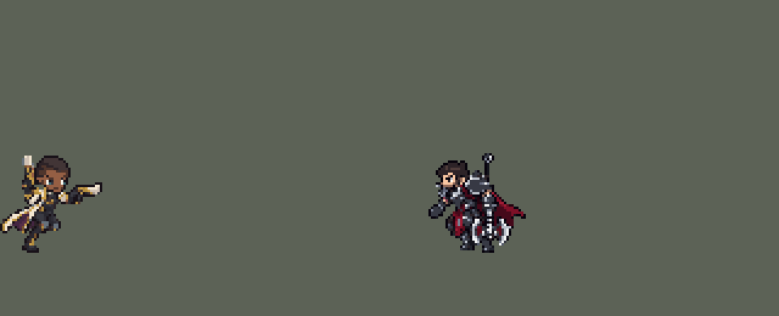

<!-- 本页上半部分由 tools/docs/gen_hero_docs.py 按仓库里现在的数据生成，手改会被覆盖；「开发记录」以下是手写的，生成时原样保留。 -->

# 卢锡安 Lucian


| 项目 | 内容 |
|---|---|
| id | `league_lucian` |
| 所属的包 | 主包（mod_id `league`） |
| 分路 | ADC |
| 分类 / 标签 | 射手（Range） · AD / Range |
| 高清帧 | 1 倍像素（无高清帧） |
| 附加包 | 无 |



其他预览：[逐帧预览](../preview/league_lucian_frames.png)、[特效表](../preview/league_lucian_effects.png)

## 现在的技能

下面是游戏里显示的技能说明（`league/text/champion.i18n` 的简体中文，去掉了颜色和图标），冷却、距离来自 `league/champion/league_lucian.data_champion`；1 秒 = 60 tick。

### 普攻 / 被动（被动「圣光银弹」）

*攻击间隔 1 秒 · 攻击距离 55000*

普攻造成100% 攻击力的物理伤害。被动圣光银弹：每放一个技能，下次普攻连开两枪，第二枪50% 攻击力（对小兵、野怪100%）。警惕：附近敌方英雄被定身后，接下来两次普攻额外造成20 + 25% 攻击力的真实伤害。

### 技能1 · 透体圣光

*冷却 6 秒 · 施放距离 70000 · 施放：指定目标 · 敌人（不含防御塔）*

射出穿透目标的光束，对直线上的敌人造成65 + 130% 攻击力的物理伤害。

### 技能2 · 冷酷追击

*冷却 9 秒 · 施放距离 80000 · 施放：指定目标 · 敌人（不含防御塔）*

冲刺：敌方英雄贴近时后撤，射程内有敌人时后跳，否则追到射程内。接着射出热诚烈弹，爆炸造成60 + 60% 攻击力的真实伤害并标记6秒，期间每次命中移动速度+25%，持续1秒。之后两次普攻都连开两枪。

### 大招 · 圣枪洗礼

*冷却 60 秒 · 施放距离 90000 · 施放：指定目标 · 敌方英雄*

原地引导3秒，连射20发子弹，每发射向最近的敌方英雄（穿过小兵），造成12 + 30% 攻击力的物理伤害。受到眩晕、禁锢、击飞等控制或阵亡时中断。

### 数值

攻击力 100（每级 +20）、生命 900（每级 +90）、护甲 20（每级 +7）、魔抗 15（每级 +3）、移速 900（每级 +9）。

## 相关脚本和素材

- [`tools/lol/extract_lucian.py`](../../tools/lol/extract_lucian.py)
- [`tools/art/preview_lucian.py`](../../tools/art/preview_lucian.py)
- [`tools/art/import_lucian.py`](../../tools/art/import_lucian.py)
- [`assets/source/lucian/`](../../assets/source/lucian)

## 开发记录

> 下面是原来 README 里「英雄：卢锡安」一节，原样搬过来（只改了相对链接）。

| 部分 | 内容 |
|---|---|
| 定位 | ADC（Range），第五组的下路，本包第五个射手（艾希、金克丝、厄运小姐、伊泽瑞尔之后） |
| 普攻 | 双枪射出子弹，100% 攻击力的物理伤害，射程 55000，攻击间隔 1 秒 |
| 被动 | 「圣光银弹」：每放一个技能，下一次普攻连开两枪（第 6、13 tick；两发都是比普通子弹粗的曳光弹，第一发蓝色从上面那把枪、第二发金色从下面那把枪射出），第二枪对英雄 50% 攻击力，对小兵和野怪 100%，和英雄联盟一样；Q、R 各给一次，E+W 是两个技能，给两次，3 秒内有效。第二枪旁边同时飞一发只打英雄、看不见的影子子弹（同速同路，同一 tick 打到），打中英雄就给自己挂 2 tick 的标记；真子弹先打 50%，1 tick 后没有标记（打的不是英雄）再补另外 50%。「警惕」：普攻时 60000 内有正被控制的敌方英雄，这一次和下一次普攻各多一发 20 + 25% 攻击力的真实伤害（英雄联盟是魔法伤害，他没有法术强度），手上亮起电光，之后 1.5 秒内不再触发。英雄联盟里由盟友的定身触发；引擎看不到是谁控制的，这里任何控制都算 |
| 技能1 | Q「透体圣光」：对一个敌人施放（指定目标），双枪平举在肩膀高度，朝他射出长 100000、宽 12000 的光束，第 12 tick 出现，6 tick 后（完整光束亮完时）打中线上所有敌人，65 + 130% 攻击力的物理伤害。施放距离 70000，冷却 6 秒，也对小兵和野怪放。光束的画面从枪口水平画出（见美术） |
| 技能2 | E「冷酷追击」，合并 W「热诚烈弹」：80000 内有敌人时放，冷却 9 秒。先按情况冲刺：敌方英雄贴身（30000 内）时朝远离他的方向后撤 30000；普攻射程内有敌人时往后跳 15000 拉开距离；都没有（目标在射程外）时朝目标往前冲，停在射程内。往前冲和伊泽瑞尔的 E 一样：引擎里对着单位往前的效果都会一直冲到他身上，所以是朝目标射一发看不见、半径 40000 的投射物（速度 6000，最远 30000），碰到第一个敌人就停下，卢锡安传送到停下的地方，离那个敌人约 40000（普攻够得着）。第 14 tick 射出烈弹（速度 7000，射程 90000），碰到第一个敌人或飞到尽头时爆炸，半径 20000 内的敌人受到 60 + 60% 攻击力的真实伤害（英雄联盟是魔法伤害）并被标记 6 秒；这 6 秒里他每次命中（普攻、Q）移动速度 +25%，持续 1 秒，再次命中刷新。英雄联盟里是打中被标记的敌人才加速；引擎不能在目标身上挂能读的标记，这里记在卢锡安身上。之后两次普攻都连开两枪 |
| 大招 | R「圣枪洗礼」：90000 内有敌方英雄时施放，原地引导 3 秒，从第 10 tick 起每 9 tick 开一枪，共 20 枪。每一枪射向当时最近的敌方英雄（先找 40000 内，再 75000、110000，都没有就不开枪），速度 12000、半径 5000，只打英雄（穿过小兵），每枪 12 + 30% 攻击力的物理伤害（全中共 240 + 600%）。英雄联盟是朝一个方向扫射、会被小兵挡住，这里按用户选的改成每枪找最近的英雄。被眩晕、禁锢、击飞等控制或阵亡时中断（每枪前检查），正常结束给一次圣光银弹。冷却 60 秒 |
| 数值 | 攻击 100（+20）、生命 900（+90）、护甲 20（+7）、魔抗 15（+3）、移速 900（+9），攻击间隔 1 秒，和原版射手一样。数值是自己设计的，用 SDK 对战模拟调：打下路，对 4 个原版射手（`gunner`、`soldier`、`archer`、`gambler`），两边、三套队友阵容各 24 局。初版（射程 50000，Q 60 + 120%、W 50 + 50%、R 每枪 10 + 25%）+0.01；射程 55000、Q 施放距离 70000、各技能伤害提高约 25% 后两批种子 +2.67 / +2.77；R 的子弹从 8000 提到 12000（打中的比例从 58% 升到 85%）+2.66 / +2.40；按美术定下的出手帧和动作长度（普攻第 7 tick，连开两枪第 6、13 tick，Q 第 12 tick，烈弹第 14 tick；普攻和连开两枪 26 tick、Q 30 tick、E 后撤 31 tick）重跑 +2.60 / +2.15，在本包射手之间（艾希 +2.40 / +1.58、伊泽瑞尔 +2.96 / +2.47、厄运小姐 +2.77 / +3.09、金克丝 +2.99 / +2.92）。之后为了让 Q 的光束从枪口水平射出，Q 改成对目标施放（见美术），AI 对英雄放 Q 多了（每局约 16 次），75 + 150% 两批 +3.14 / +3.16，高于本包射手；Q 降到 65 + 130%：+2.89 / +1.97，和改之前一样强，就用这一版。之后被动两发子弹改从各自的枪射出（追踪投射物的 `y_offset` 在模拟里会让子弹早 1 tick 命中，整局走向跟着变），重跑 +2.15 / +2.12；模型按新立绘重做后，子弹和光束的画面跟着新枪口抬高（26 / 12 / 13 px），重跑 +2.37 / +2.14，仍在本包射手之间。卢锡安每局放 Q 约 42 次（对英雄约 16 次）、E 约 22 次（往前追约 8 次、后跳约 13 次、贴身后撤不到 1 次）、R 约 5 次 |
| 亚索联动 | 他没有控制（警惕只读控制，不施加），亚索不用调 |
| 精灵图 | 10 个动作 64 帧：待机、移动、普攻、连开两枪、Q、E 往前冲 + 烈弹、E 后撤 + 烈弹、R、受击、死亡。按用户给的新立绘重做：白色高领长外套（金边、紫色内衬）、深色背心和护甲、两把白色圣物手枪，一把举在头边、一把平指向前；头顶到鞋底约 41 px（举起的枪再高约 5 px），19 色。Codex 画造型和动作，每帧的时机和站位照英雄联盟原版动画渲染的参考帧 |
| 特效 | 普攻子弹和命中、连开两枪的蓝色和金色曳光弹、警惕的手上电光和命中、Q 光束和命中、E 冲刺的尘土、烈弹、星形十字爆炸、标记、加速线、R 的曳光弹和命中 |
| 图标 | 官方技能图标（Q / E / R），64×64 |
| 音频 | 从本地客户端提取的 11 条技能音效和 2 条中文语音（E、R）。不提交到仓库，按下面的命令在本地生成 |

```bash
python tools/lol/extract_lucian.py --lol "D:\WeGameApps\lol" --vgmstream "<vgmstream-cli.exe 路径>"
python tools/lol/native_pose.py assets/source/lucian/poses.json --out <渲染文件夹> --alpha --parts   # 动作参考帧
python tools/art/tidy_lucian.py <Codex 的动作交付文件夹>   # 角色图：检查 Codex 按新造型画的动作条，写进 assets/source/native/
python tools/art/lucian_shoulder.py <Codex 的补肩交付文件夹>   # Q、R、被动 13 帧补上后肩
python tools/art/fix_lucian_collar.py                       # 后肩和下巴之间补上衣领 → lucian_retouch.json（动作条变了才要重跑）
python tools/art/import_native.py --hero lucian    # 角色图（套用 lucian_retouch.json）
python tools/art/import_lucian.py      # 特效；--raw <Codex 的交付文件夹> 先把原始图转成原尺寸条
python tools/art/preview_lucian.py
```

美术（重做的造型的提示词见 [`assets/source/lucian/MODEL_REDESIGN.md`](../../assets/source/lucian/MODEL_REDESIGN.md)，10 条动作的见 [`MODEL_REDESIGN_STRIPS.md`](../../assets/source/lucian/MODEL_REDESIGN_STRIPS.md)，第一版模型的见 [`MODEL_PROMPTS.md`](../../assets/source/lucian/MODEL_PROMPTS.md)，特效的见 [`PROMPTS.md`](../../assets/source/lucian/PROMPTS.md)）：
- 分工：从卢锡安起模型和特效都由 Codex 画，Claude 写提示词包、整理和导入。第一版一个包分两轮（三个造型和 14 张特效，然后 10 条动作）；之后用户给了一张新立绘，模型重做，分两步：Codex 先画游戏尺寸的造型，用户确认后再画动作，特效照旧。参考全部取自英雄联盟原版：同一镜头的动作渲染、游戏尺寸的参考条、标好站位点和脚底线的对位图、原版英雄风格对照（渲染和对照图只在本地）。Codex 的交接说明在 [`codex_model/`](../../assets/source/lucian/codex_model)（`redesign_*` 是重做的两步）。
- 参考帧（`poses.json`）：镜头 yaw 45、pitch 25，不镜像，头 2.3、腿 0.75、头发 0.45，高度 41（新造型头顶到鞋底的格数，第一版 34），两把枪是武器部件（`^(LightGun|DarkGun)$`）。待机是双枪举在头两边的战斗待机 `Lucian_idle_ready`；普攻 `Attack1`，连开两枪 `Passive`，Q `Spell1`，E 往前 `Spell2`、后撤 `Spell2_180`，都接 `Spell3` 射出烈弹，R `Spell4_Idle_0`。移动照英雄联盟里的 `Lucian_Run1`（8 帧 × 117 ms，一圈 0.94 秒），头保持待机时的朝向。每帧的站位点和帧时长在 `native/lucian_cells.json`。
- 造型：第一版是 Codex 的方案 B 加上 Claude 照原版逐格描的头（U3），34 px、26 色。之后用户给了一张 ChatGPT 画的新立绘，约 140 格高，直接缩到游戏尺寸会把外套的白边、金线和脸切碎，所以先让 Codex 在游戏尺寸重画（生图原稿约 10 px 一格）。Claude 按颜色变化找出格子、取每格中心的中位色，还原成 47×46 的游戏像素；几乎一样的颜色合并成 19 种（三种近黑并成描边色、三种金并成两种、膝盖上的青色改成护甲的灰）；两只眼睛重画成一样高，眼白 `#F4F2EA`、虹膜 `#3F6A74` 只用在眼睛上；只留一圈描边。脸改了三轮：Codex 原稿的眉毛是压在眼睛上的一条平黑杠、瞳孔上方拱起一格，像挑眉（用户：眉毛画的不对）；Claude 改成细的斜眉，用户问眉毛对不对、嘴怎么翘起来（下巴两角的暗色和下巴线连起来像嘴角上翘）；最后在用户的 Codex 会话里改了 10 格，用户认可：眉毛换成头发的深棕，远侧脸边补上描边，下巴上方画两格闭着的嘴，去掉连到下巴线的那格暗色（`codex_model/redesign_strips_face_edit_record.json`）。定稿的造型图是 [`lucian_native.png`](../../assets/source/native/lucian_native.png)。
- 动作：Codex 按定稿造型画了 10 条（64 帧），严格 8×8 方块、19 色、透明度只有 0 和 255，头照造型图逐格复制到每一帧，脚底都在线上。`tidy_lucian.py` 检查网格、颜色、透明度、每帧的两个虹膜和脚底线；头的位置和英雄联盟原版逐帧对比过：普攻往后仰 4–6 px（原版约 3 px），连开两枪 3–4 px，Q 第 4 帧 11 px（原版也是 11 px），移动时头比待机靠前 5 px（原版 5–6 px，跑步前倾），都照原样用。Q 第 4 帧双枪平举在肩膀高度开枪，是 Codex 直接画的。
- Q 的光束：伤害仍是长 100000 的直线判定（`LineRangeProjectile`，不带画面，否则画在腰的高度）。引擎里会跟着方向转的画面，方向都取自站位点高度的两个点，所以起点抬高就会斜：第一版把画面挂在抬高 12000 的直线投射物上，它飞向判定末端，光束往下斜约 7°，用户看出是歪的；射程加大，目标点又会被地图边界截断。现在 Q 改成指定目标施放，画面挂在追踪投射物 `q_ray` 上：它在逻辑上从卢锡安的站位点出发、每 tick 1000 慢慢飞向目标，方向和判定线完全一致，`y_offset` −8000 只把画面抬高 13 px，到第 4 帧两把枪的枪口之间（第一版 12 px）。光束每 tick 一帧、每帧往回画 1 px 抵消移动，所以从枪口水平射出、不动，穿过目标的胸口（锤石 Q 锁链用过的办法）。追踪投射物在目标死时会跟着消失，Q 常打死小兵，所以去掉了 Codex 光束动画开头的火花和渐亮两帧（角色第 4 帧已有枪口闪光），完整光束一出现就亮 5 tick，伤害在光束出现后 6 tick 结算，打死目标时只少了最后的余光。模拟里测到的这些引擎行为写进了 skill 文档。
- 后肩（2026-10-01，用户：「卢锡安怎么释放技能的释放模型变形了」「肩膀那里失去一块」）：双枪朝前的 13 帧（Q 第 2–5 帧、R 第 1–4 帧、被动第 2–6 帧）脖子左边的后肩没有画：待机里那里是举起的手臂，动作里手臂放下去握第二把枪，那块就空了，躯干像被咬掉一块。Codex 只在这些空格上补了肩头（白外套、金边，每帧 36–49 格，其余像素一格不动；提示词见 [`SHOULDER_FIX.md`](../../assets/source/lucian/SHOULDER_FIX.md)）。`lucian_shoulder.py` 按虹膜对位，只取原来是空、又在肩膀范围里的格子，只给新格子补描边；原来缺口边上的那条描边现在在肩膀里面，改成周围米白或金色暗一级的颜色，肩头和高领之间不再有黑缝。
- 衣领（2026-10-01，用户：「卢锡安开大时左边脸旁边有像素缺失」）：补上的后肩只填在肩膀上，肩膀和下巴之间还空着一道缝——下巴下面一行、肩膀金边和脸颊之间两三格、胸口一两格，背景从脸左边透出来。待机里那块是外套的衣领（轮廓、深色内衬、白领子、顺着胸口往下的金边）。`fix_lucian_collar.py` 在这 13 帧里按虹膜对位，把衣领范围内（虹膜下第 1–4 行、往左 2–9 格，不含待机里更左边举起的手臂）帧里是空、待机里有颜色的格子补成待机的颜色，每帧 6–10 格，共 111 格，写进 [`native/lucian_retouch.json`](../../assets/source/native/lucian_retouch.json)，导入时套用；其他像素一格不动。
- 大招的子弹从枪口出（2026-10-01，用户：「卢锡安开大时子弹不是从枪口里射出去的」）：大招每枪是一个直线投射物，引擎让它从站位点上方 5 px、站位点的横坐标出发，子弹画面的头在投射物上、28 px 的尾巴拖在后面，所以前两三 tick 子弹是从他背后齐腰高横穿身体画出来的；两个枪口在站位点前约 20 px、上方 11 和 14 px。直线投射物抬高会改变路线、让画面变斜（见 Q 的光束），所以伤害还留在它身上，改名 `league_lucian_r_line`，不带画面；旁边同一 tick 再放一个只带画面的追踪投射物 `league_lucian_r_bullet`（同速度、同目标、不带效果），`y_offset` 抬 8 px（−3000）。追踪投射物总是飞向目标的站位点（腰的高度），抬得越高越往下斜：凯特琳的子弹抬 16.5 px、斜 12°，用户说「子弹看起来是歪的」；这里抬到枪管正中（11、14 px）时，打 40 px 外的英雄要斜 15–19°。抬 8 px 时曳光的上沿正好从下面那把枪的枪管出来，打 70 px 外斜 6.5°、40 px 外 11°（原来从 5 px 出发是 4° 和 7°）。要子弹正对枪管又是平的，得让 Codex 把大招 4 帧的枪往下放。追踪投射物出生那一 tick 会朝正上方（Q 的光束同样的问题），所以子弹画面第 1 tick 不画，接下来两 tick 只画已经出了枪管的那一截（4 px、16 px，`import_lucian.py` 的 `R_IN`），之后才是整条曳光；画面只播一遍（`repeat: false`），不再循环。数据改动由 `work/sc/lucian_r_muzzle.py` 生成（不在仓库里）。模拟里同一局对比：命中率不变（改前 39 发中 33、改后 48 发中 41，都是 85%），画面比伤害晚 2 tick 到达目标，正好在 120 ms 的命中火花里。
- Q 头顶的闪光（2026-10-01，用户在中路单挑测试时看到「一道射在固定角度，再向目标射一道」）：追踪投射物出生时没有方向，同一 tick 的第一次移动先把 `y_offset` 的抬高一次跳上去（再朝目标走一步），游戏按相邻两个位置的差转画面，所以那一 tick 整条光束朝正上方闪一下，下一 tick 才转向目标（模拟里 436 次 Q 每次都有）。现在 `q_ray` 开头空 1 tick（`import_lucian.py` 的 `RAY_SKIP`），光束帧整体往后挪一格，仍停在枪口，晚 17 ms 出现；判定和伤害不变。
- 圣光银弹看得见：用户在游戏里没看出被动（逻辑是好的：模拟一局 10 分钟 45 次连开两枪）。原因是两发子弹从同一个点、同一高度、隔 0.1 秒沿同一条线飞，第二发只是颜色偏金，也没有就绪提示。现在每发子弹从开火的那把枪出发（追踪投射物的 `y_offset` 只抬画面：普攻和第一枪从上面的枪口，站位点上方 26 px；第二枪从下面那把枪，12 px；第一版 20 px 和 9 px），连开的两发画成和大招一样的曳光弹，22 px 长、弹头 5 px 粗，第一发蓝色、第二发金色（`import_lucian.py` 的 `tracer()`，Claude 画的；普通普攻还是小子弹）。中间试过放完技能时双枪亮金光，用户说丑、只要两发子弹明显，去掉了。
- 导入：待机 6 帧是同一张，第 3–5 帧从小腿往上下沉一格呼吸（接缝在站位点下方 4 行，那里上下两行的轮廓只差 2 格）。举起的枪是待机每一帧的最高处，所以按眼睛定头的位置（`import_native.py` 的 `EYES`，虹膜 `#3F6A74` 只用在眼睛上）。警惕的电光挂在两手之间（站位点上方 16 px）。
- 特效用 Codex 画的 14 张（生图原稿，64 帧）：`import_lucian.py --raw` 按交付清单切帧，每张 16 色以内、硬透明，按技能范围定大小：普攻子弹 12 px 长、第二枪 14 px，命中 14 px，警惕的电光 26 px（在手上）、命中 18 px，Q 光束 80 px（从枪口到直线末端）、命中 24 px 高，冲刺的尘土 32 px，烈弹 14 px，星形十字 52 px 宽（爆炸半径 20000 加上十字的长臂），标记 22 px，加速线 24 px（脚下），R 命中 16 px。子弹、光束和烈弹上下镜像成严格对称（游戏按飞行方向转动）。R 的子弹：Codex 画的是 2 格高的细条，放大后仍是一根细棍，用户嫌小；改用 Q 光束的五种蓝色画成 28 px 长、弹头 7 px 粗、往后收细的曳光弹，3 帧闪烁（`import_lucian.py` 的 `tracer()`，这张是 Claude 画的）。
- 出手时刻和动画对齐：普攻第 3 帧开枪（第 7 tick），连开两枪第 3、5 帧（第 6、13 tick），Q 第 4 帧放光束（第 12 tick），烈弹第 6 帧射出（第 14 tick），R 每两帧开一枪（每 9 tick）。E 的两种后撤由 `CasterAnimation` 播 31 tick 的 `skill2_back`，往前冲播技能本身的 `skill2`。
- 结果：19 色，和右边像素同色的比例 36%（原版英雄 18%–46%）。头像截取点 (−3, −41)，在头顶。待机每帧 983 个不透明像素，比第一版（460–566）和原版英雄（剑士 472）大，是新立绘的比例。

逐帧预览：[`docs/preview/league_lucian_frames.png`](../preview/league_lucian_frames.png?v=1014g)，特效：[`docs/preview/league_lucian_effects.png`](../preview/league_lucian_effects.png?v=1014g)。
