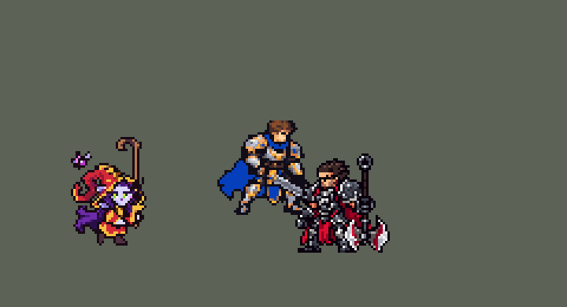

<!-- 本页上半部分由 tools/docs/gen_hero_docs.py 按仓库里现在的数据生成，手改会被覆盖；「开发记录」以下是手写的，生成时原样保留。 -->

# 璐璐 Lulu


| 项目 | 内容 |
|---|---|
| id | `league_lulu` |
| 所属的包 | 主包（mod_id `league`） |
| 分路 | 辅助 |
| 分类 / 标签 | 功能型（Util） · AP / Magic / Range / CC / Shield |
| 高清帧 | 1 倍像素（无高清帧） |
| 附加包 | [辅助挑人附加包：迦娜、娑娜、璐璐](#附加包)（`league_support_pick`） |



其他预览：[逐帧预览](../preview/league_lulu_frames.png)、[特效表](../preview/league_lulu_effects.png)

## 现在的技能

下面是游戏里显示的技能说明（`league/text/champion.i18n` 的简体中文，去掉了颜色和图标），冷却、距离来自 `league/champion/league_lulu.data_champion`；1 秒 = 60 tick。

### 普攻 / 被动

*攻击间隔 1.5 秒 · 攻击距离 55000*

射出魔弹。被动皮克斯，仙灵伙伴：皮克斯朝同一目标射出3颗飞弹，每颗造成12 + 8% 法强魔法伤害。

### 技能1 · 闪耀长枪

*冷却 6 秒 · 施放距离 60000 · 施放：方向 · 敌人（不含防御塔）*

璐璐和皮克斯各射出一道贯穿魔弹，直线上的敌人受到80 + 60% 法强魔法伤害并减速80%，1.5秒内逐渐减弱。

### 技能2 · 奇思妙想

*冷却 9 秒 · 施放距离 55000 · 施放：指定目标 · 敌方英雄*

把敌方英雄变形1.75秒（无法攻击和施法、减速），造成70 + 40% 法强魔法伤害；帮忙，皮克斯！：附近友方英雄获得110 + 50% 法强护盾和25%移速、攻速（3.5秒）。

### 大招 · 狂野生长

*冷却 60 秒 · 施放距离 70000 · 施放：无目标 · 敌方英雄*

交战时让被控制或被敌人贴身的友方英雄（或自己）变大：生命+350，周围敌人击飞1秒，7秒内身边敌人减速30%。

### 数值

攻击力 75（每级 +6）、法强 30（每级 +15）、生命 880（每级 +90）、护甲 22（每级 +7）、魔抗 24（每级 +4）、移速 1000（每级 +10）。

## 附加包

附加包是可选的原生代码 mod（都在附加包合集 `league_addons` 里），**不装主包里的英雄也是完整的**。

### 辅助挑人附加包：迦娜、娑娜、璐璐

[辅助挑人附加包：迦娜、娑娜、璐璐](../../addons/league_support_pick/README.md)：`league_support_pick` v0.1.0

| 英雄 | 主包（纯数据） | 装了附加包 |
|---|---|---|
| 璐璐 E 帮忙，皮克斯！（先 30000，再 60000 内） | 随机一名队友 | 同迦娜 |

## 相关脚本和素材

- [`tools/kit/build_lulu.py`](../../tools/kit/build_lulu.py)
- [`tools/kit/setup_lulu.py`](../../tools/kit/setup_lulu.py)
- [`tools/lol/extract_lulu.py`](../../tools/lol/extract_lulu.py)
- [`tools/art/preview_lulu.py`](../../tools/art/preview_lulu.py)
- [`tools/art/import_lulu.py`](../../tools/art/import_lulu.py)
- [`assets/source/lulu/`](../../assets/source/lulu)

## 开发记录

> 下面是原来 README 里「英雄：璐璐」一节，原样搬过来（只改了相对链接）。

| 部分 | 内容 |
|---|---|
| 定位 | 辅助（远程，分类 Util），用户排的第十五组的辅助（同组：上单雷克顿、打野莉莉娅、中单维克托、ADC 霞），第 75 位英雄。仙灵女巫 璐璐：约德尔人，带着仙灵皮克斯。用户选的方案 A（全是推荐项） |
| 普攻 / 被动 | 普攻是追踪的魔法弹，100% 攻击力，射程 55000，攻击间隔 90 tick（第 11 tick 出手）。被动「皮克斯，仙灵伙伴」：每次普攻皮克斯朝同一目标再射 3 发追踪小弹（间隔 4 tick），每发 12 + 8% 法强的魔法伤害 |
| 技能1 | Q「闪耀长枪」：冷却 360 tick（6 秒），对 60000 内的敌人放（小兵、野怪也算），出手那一刻锁定方向，可以躲。她和皮克斯各射一道长枪（穿透，飞 70000）；她那道对路上所有敌人造成 80 + 60% 法强的魔法伤害，减速 30%（30 tick）叠加 50%（90 tick），模拟英雄联盟 80% 逐渐减弱；皮克斯那道只是画面（英雄联盟里一个敌人只吃一道的伤害） |
| 技能2 | W「奇思妙想」+ E「帮忙，皮克斯！」一起放：冷却 540 tick（9 秒），对 55000 内的敌方英雄放。魔法弹把他变身 105 tick（1.75 秒）：不能普攻、不能放技能、减速 30%，并受到 70 + 40% 法强的魔法伤害；引擎换不了他的贴图，所以在他身上盖一团烟雾和英雄联盟的变形小动物（`LuluPolymorphCritter`，淡紫色、大耳朵、两条白尖大尾巴；0.213.0 起换成 Codex 照它重画的，用户在 A / B / C 三种设计里选了 C：小动物坐在一大团烟前面，`tools/art/pack_squill_windwall.py` → `import_lulu.py --raw ... --only w_poly_in,w_poly,w_poly_out`）。同时皮克斯飞到附近的友方英雄身上（先找 30000 内，再找 60000 内，都没有就给自己）：护盾 110 + 50% 法强（150 tick），移速 +25%、攻速 +25%（210 tick） |
| 大招 | R「狂野生长」：冷却 3600 tick（60 秒），先「上膛」15 秒，之后她每次普攻、Q、W 都检查一次：射程 50000 内被控住的友方英雄优先，否则随机挑一个身边 25000 内有敌方英雄的友方英雄（她自己也算）。被选中的英雄生命 +350（同时回 350 + 50% 法强），碰撞半径变大，身边 22000 内的敌人被击飞 1 秒，之后 7 秒光环每 15 tick 让附近敌人减速 30%。效果在大招动作第 3 帧（举杖那一刻，7 tick 后）生效；15 秒都没用上就退还冷却 |
| 附加包 | 可选的附加包 [`addons/league_support_pick`](../../addons/league_support_pick/README.md)（在附加包合集里，原生代码，主包不装它也完整）：E 帮忙，皮克斯！照英雄联盟给最需要的队友（有危险的里生命比例最低的，否则正在打的那个；主包随机一名） |
| 连招 | 用户要求：「有连招要做连招」「都要帮我补」。英雄联盟里璐璐把人变成小动物后马上补一发闪耀长枪。**W→Q**：变身的魔法弹打中敌方英雄时开 105 tick（1.75 秒，和变身一样长）的窗口；窗口里放 Q，两道长枪第 1 tick 就射出（平时第 10 tick），窗口用掉，趁他不能动手把减速接上。窗口外的 Q 不变；大招上膛的检查照旧在第 10 tick。伤害、冷却不变。由 `build_lulu.py` 生成（参数 `wq_t`） |
| 数值 | 攻击 75（+6）、法强 30（+15）、生命 880（+90）、护甲 22（+7）、魔抗 24（+4）、移速 1000（+10）。数值是自己设计的，用 SDK 对战模拟调：辅助位，对 5 个原版辅助（`priest`、`bard`、`enchanter`、`monk`、`taoist`），3 套阵容、两边各打，10 分钟。初稿 +0.13；Q、护盾、变身时间、皮克斯伤害、大招生命上调后，种子 13–36 上 +0.48（同一批迦娜 −0.24） |
| 亚索联动 | R 的击飞算控制：璐璐在亚索队里打辅助时，亚索每局对英雄放 R 0.65 次（原版 `priest` 0.58、迦娜 1.27、蕾欧娜 2.12），不用调 |
| 精灵图 | 8 个动作 49 帧：待机 8、移动 7、普攻 6、Q（`skill`）6、W+E（`skill2`）6、R（`ult`）6、受击 2、死亡 8（她消失，帽子落在法杖上）。约德尔人，按用户要求整体缩到 90%：待机 39 行（原来 44 行）。头像截取点 (2, −22) |
| 特效 | Codex 画的 21 张（`import_lulu.py` 缩成游戏像素），两张表：`league_lulu_fx` 普攻魔法弹和命中、皮克斯的小弹和命中，Q 的两道长枪、命中、减速光圈，W 的魔法球、变身烟雾和小松鼠（出现 / 循环 / 散开三段），E 皮克斯的光球、落到队友身上的闪光、护盾光环（皮克斯在上面）、金色加速；`league_lulu_big` R 的绿色光柱和地面生长光环（三段） |
| 音效 | 英雄联盟的音效和配音（`tools/lol/extract_lulu.py`）：普攻、Q、W、E、R 和变身、护盾、变大的声音，W、R 各一句中文配音。版权属于 Riot Games，**不提交到仓库**，本机用脚本重新生成 |
| 图标 | 官方技能图标（Q / W / R），从本地客户端提取，缩到 64×64 |

重新生成（素材来自本机的英雄联盟客户端，音频不进仓库）：

```bash
python tools/lol/extract_lulu.py --lol "D:\WeGameApps\lol" --vgmstream "<vgmstream-cli.exe 路径>"
python tools/kit/build_lulu.py           # 技能数据，数字都在脚本的参数表 P 里；--nodes 看每棵技能树的节点数
python tools/kit/setup_lulu.py           # 五种语言的文字、音效配置、共享文件里她的键
python tools/art/slim_lulu.py            # 瘦身和五官（已经做过，再跑不改东西）
python tools/art/import_native.py --hero lulu
python tools/art/import_lulu.py          # 特效；--raw <Codex 交付目录> 先把生图原稿缩成游戏尺寸的原尺寸条
python tools/art/preview_lulu.py
```

美术（动作的提示词见 [`assets/source/lulu/MODEL_STRIPS.md`](../../assets/source/lulu/MODEL_STRIPS.md)，特效的见 [`PROMPTS_FX.md`](../../assets/source/lulu/PROMPTS_FX.md)；Codex 的动作交付说明在 [`codex_strips/`](../../assets/source/lulu/codex_strips)）：

- 原画：用户选 A；造型：用户觉得脸太方，照原画描出圆脸，选了 v2 + C3。
- 动作：Codex 第 2 步的动作条贴了造型的头，但多擦了几行（胸口一道透明缝）、旧靴子留在旁边（「第三条腿」）、法杖每帧画得歪。按用户的反馈逐条修：缝用 Codex 自己的原稿补回，法杖全部换成造型自己的法杖（只平移或转 90°，不变形），靴子换成造型的两只，皮克斯换成造型的，帽子残线、断腿、黑线逐个清掉。
- 缩小：用户「露露是约德尔人」，整体缩到 90%（以脚底为基准，描边优先）；缩小时每帧丢的行列不同、五官每帧都变，所以每帧贴回同一张造型原样的脸。
- 瘦身和五官（10 月 9 日，用户：「露露瘦身并且调整脸部五官」，从方案图里选了「删 5 列」和「B 英雄联盟眼」，`slim_lulu.py`）：
  - 五官照英雄联盟的脸改：上面一行是黄绿色瞳孔和深色瞳仁，下面一行是绿色和白色高光；眼线各往外延一格；暗红色的嘴改成紫色嘴唇。每一帧都是造型的同一张脸，所以按远处那只眼睛的位置逐格改，造型图也一起改。
  - 瘦身：每帧整列删掉 5 列，不重采样。以眼睛为准删同样的 5 列：2 列在帽子卷边，3 列在头发、帽檐和裙子左边。脸、法杖和站位点不动，宽 40 → 35。
  - 皮克斯、法杖、脸左边的皮肤（远处的手、耳朵）、远处的靴子（连同鞋底两头）先整块拿开，删完列再放回，所以都不会被切。皮克斯和离它最近的帽子挪一样多，距离不变。
  - 挑列时排除了会把卷边和帽檐之间的缝封成小透明洞的列，和 main 比没有一帧多出洞或断开。死亡第 4–8 帧只剩地上的帽子，没改。
- 特效：Codex 第 3 步的 21 张（`import_lulu.py --raw`：按交付清单切帧，颜色归到每张的色阶）；原地播放的特效整条用一个锚点（不然每帧会滑），小松鼠单独按 18 px 宽取样、描边优先，脸才看得清。魔法弹按出手帧法杖的高度抬起，在她身前出现、沿着法杖飞出去。

逐帧预览：[`docs/preview/league_lulu_frames.png`](../preview/league_lulu_frames.png?v=1014g)，特效：[`docs/preview/league_lulu_effects.png`](../preview/league_lulu_effects.png?v=1014g)。
