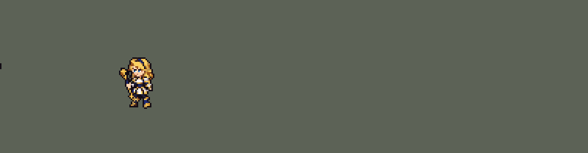

<!-- 本页上半部分由 tools/docs/gen_hero_docs.py 按仓库里现在的数据生成，手改会被覆盖；「开发记录」以下是手写的，生成时原样保留。 -->

# 拉克丝 Lux


| 项目 | 内容 |
|---|---|
| id | `league_lux` |
| 所属的包 | 主包（mod_id `league`） |
| 分路 | 中单 |
| 分类 / 标签 | 法师（Magician） · AP / Magic / CC / Shield |
| 高清帧 | PPU 2.2 |
| 附加包 | [目标标记附加包](#附加包)（`league_marks`） |



其他预览：[staff](../preview/league_lux_staff.gif)、[逐帧预览](../preview/league_lux_frames.png)、[特效表](../preview/league_lux_effects.png)

## 现在的技能

下面是游戏里显示的技能说明（`league/text/champion.i18n` 的简体中文，去掉了颜色和图标），冷却、距离来自 `league/champion/league_lux.data_champion`；1 秒 = 60 tick。

### 普攻 / 被动（被动「光芒四射」）

*攻击间隔 1.5 秒 · 攻击距离 55000*

普攻从法杖射出光弹，造成100% 攻击力的物理伤害。被动 光芒四射：技能命中敌人后5秒内，下一次普攻引爆光芒，额外造成50 + 35% 法术强度的魔法伤害。

### 技能1 · 光之束缚

*冷却 6 秒 · 施放距离 130000 · 施放：方向 · 敌人（不含防御塔）*

向前方射出一颗光球，对路径上的每个敌人造成80 + 75% 法术强度的魔法伤害并禁锢1.5秒。同时施放 曲光屏障：拉克丝和身边的友方英雄获得55 + 40% 法术强度的护盾，持续2.5秒。

### 技能2 · 透光奇点

*冷却 8 秒 · 施放距离 110000 · 施放：地点 · 敌人（不含防御塔）*

向目标位置抛出光球，落地后形成光圈，使圈内敌人减速20%。1秒后光圈引爆，对圈内敌人造成70 + 80% 法术强度的魔法伤害。

### 大招 · 终极闪光

*冷却 60 秒 · 施放距离 120000 · 施放：方向 · 敌方英雄*

拉克丝跃起蓄力，0.5秒后向目标方向发射一道极长的激光，对直线上所有敌人造成250 + 115% 法术强度的魔法伤害。

### 数值

攻击力 68（每级 +6）、法强 28（每级 +16）、生命 770（每级 +100）、护甲 20（每级 +7）、魔抗 20（每级 +3）、移速 900（每级 +9）。

## 附加包

附加包是可选的原生代码 mod（都在附加包合集 `league_addons` 里），**不装主包里的英雄也是完整的**。

### 目标标记附加包

[目标标记附加包](../../addons/league_marks/README.md)：`league_marks` v0.1.0

| 英雄 | 主包（纯数据） | 装了附加包（英雄联盟） |
|---|---|---|
| 拉克丝 光芒四射 | 技能打中过敌人，下一次普攻打谁都引爆 | 光芒留在被技能打中的敌人身上（5 秒），普攻打中带光芒的人才引爆 50 + 35% 法强的魔法伤害 |

## 相关脚本和素材

- [`tools/lol/extract_lux.py`](../../tools/lol/extract_lux.py)
- [`tools/art/preview_lux.py`](../../tools/art/preview_lux.py)
- [`tools/art/import_lux.py`](../../tools/art/import_lux.py)
- [`assets/source/lux/`](../../assets/source/lux)

## 开发记录

> 下面是原来 README 里「英雄：拉克丝」一节，原样搬过来（只改了相对链接）。

| 部分 | 内容 |
|---|---|
| 数值 | 照搬创意工坊 *League of Legends Reborn* 的拉克丝：属性、伤害、射程、冷却、光球和光圈的大小、激光的长宽。技能效果一样，数值就不另调了，由玩家自己选。只有大招仍然只对英雄放 |
| 普攻 | 法杖射出光弹。被动「光芒四射」：技能命中敌人后 5 秒内，下一次普攻引爆光芒，追加魔法伤害。团战经理2 只能判断施法者自己身上的状态，所以引爆的是下一个被普攻的敌人；敌人身上的光芒标记是命中时播放的特效 |
| 技能1 | Q「光之束缚」：直线光球，路径上的敌人受到魔法伤害并被禁锢 1.5 秒（英雄联盟里最多命中 2 个，数据里的直线投射物只有「穿透 / 不穿透」，没有命中数量）。合并 W「曲光屏障」：施放时拉克丝和身边的友方英雄获得护盾 |
| 技能2 | E「透光奇点」：抛出光球，落地后形成光圈，圈内敌人减速 20%，1 秒后自动引爆（AI 不会手动二次引爆） |
| 大招 | R「终极闪光」：跃起悬空，法杖浮在身前蓄力，约 0.5 秒后发射长 340、宽 40 的激光，直线上所有敌人受到魔法伤害 |
| 附加包 | 可选的附加包 [`addons/league_marks`](../../addons/league_marks/README.md)（在附加包合集里，原生代码，主包不装它也完整）：光芒四射照英雄联盟留在被技能打中的敌人身上，普攻打中他才引爆（主包是技能打中过任何人，下一次普攻打谁都引爆） |
| 连招 | 用户要求：「有连招要做连招」「都要帮我补」。英雄联盟的 **E → Q → R**：E 减速，Q 束缚被减速的人，R 打在被束缚的人身上并引爆光芒。原来三个技能各放各的，R 也不引爆光芒。**E→Q**：敌方英雄站在透光奇点的光圈里时（一个只对英雄的隐形光圈，和减速同样大小、同样 1 秒、每 10 tick 一次），拉克丝身上的连招窗口一直开着（离开光圈后再留 20 tick）；窗口里放 Q，光球第 1 tick 就飞出去（平时第 13 tick），护盾同时给出，趁减速把人捆住。**Q→R**：光球打中敌方英雄时（一个只对英雄的隐形光球，和光球同速同大小）开 90 tick（1.5 秒，束缚的长度）的窗口；窗口里放 R，激光照常在第 29 tick 打到（还在束缚里），打中的每个英雄再吃一次光芒引爆（就是普攻引爆的 50 + 35% 法强和火花），窗口用掉。R 之后照旧挂上光芒，下一次普攻还能引爆。伤害只在连招里多出引爆这一下（每次 R 每个英雄最多一次，R 冷却 60 秒），冷却不变。数据由 [`tools/fix/combo_lux.py`](../../tools/fix/combo_lux.py) 改 |
| 修正（0.10.0） | R 的伤害之前比激光早 0.43 秒结算（光束还没出现就扣血），现在在激光出现、放出光束音效的第 28 tick 结算。SDK 对战模拟（对原版中单，两边各 36 局）团队击杀差 +1.44 → +2.28 |
| 精灵图 | 8 个动作 51 帧：待机、跑步、普攻、Q、E、R、受击、死亡。身高 34 px，Q 版大头（头约占身高 1/3），蓝眼睛在游戏里看得清。全部正面 3/4 朝右；除受击外，每个动作都按英雄联盟原版动画的时间点渲染大头姿势参考后生成：R 里法杖离手悬在身前、发射后空中蜷身再落地，死亡被击飞后仰面倒地。之后按游戏原尺寸重画了一次（19 色，见[下文](../dev-notes.md#按游戏原尺寸重画拉克丝艾希)） |
| 特效 | 光弹、命中、Q 光球和定身光环、W 彩虹护盾、E 光球和地面光圈（引爆）、R 激光（预警线、蓄力、光束、消散）、光芒标记和引爆 |
| 图标 | 官方技能图标（Q / E / R），从本地客户端提取，64×64 |
| 音频 | 从本地客户端提取的 11 条技能音效和 3 条中文语音（Q、E、R）。不提交到仓库，按下面的命令在本地生成 |
| 高清帧（PPU 2.2） | 2026-10-23 用 PPU 重做（用户：「下一个英雄重做拉克丝」）。Codex 按设计图包（[`tools/art/pack_lux_ppu.py`](../../tools/art/pack_lux_ppu.py) / [`PICTURE_PROMPT_PPU.md`](../../assets/source/lux/PICTURE_PROMPT_PPU.md)）画了英雄联盟待机姿势（法杖斜握在身前，杖头在左下）的大图，它自己的导出按大格子采样，脸都没了，改成按原图自己的格子、每 1.5 格合成一格读回：64 × 81、37 色，PPU 2.2 时 36.8 px（旧版 35 px），法杖按一条直线重画（[`tools/art/design_lux_hd.py`](../../tools/art/design_lux_hd.py)；第一条线压掉了远侧前臂，用户：「脱节了吧」，改成穿过手套）。待机、跑步、受击、死亡用设计图自己的格子摆（[`tools/art/rig_lux_hd.py`](../../tools/art/rig_lux_hd.py)：跑步的腿按大腿、小腿两节骨头铺设计图的腿行，死亡时法杖脱手落在身后）。施法先也这样摆（法杖绕手转半圈），用户：「手和法杖一点动作都没有的 不奇怪？」，改让 Codex 整帧重画平 A、Q、E、R（[`tools/art/pack_lux_actions.py`](../../tools/art/pack_lux_actions.py)，按英雄联盟每帧的骨架出模板），交付后（「codex已经交付 有问题的地方你帮忙修复吧」）由 [`tools/art/casts_lux_hd.py`](../../tools/art/casts_lux_hd.py) 修：Codex 每张图单独缩放、身体比设计图长约 10%，按同一张图里站直那帧把眼睛到地面的高度对上设计图；头换成设计图的头（对准近侧眼睛，手臂挡在脸前的地方保留 Codex 的手臂）；它画的法杖会弯、每帧长短不一，去掉后换成设计图的法杖（[`tools/art/staff_lux.py`](../../tools/art/staff_lux.py)：设计图法杖转 90° 和镜像得到 8 个方向，水平和竖直 4 个方向的两端饰件转一次后逐格修整，12 个方向一样长），穿过握杖的手、取最接近 Codex 的方向，前后遮挡按 Codex，不压脸；Codex 每帧按头对齐、脚会左右漂，改成每个动作后脚站定。登记（[`ppu_restyle.py`](../../tools/art/ppu_restyle.py) / [`ppu_hd.py`](../../tools/art/ppu_hd.py) / [`hero_reels.py`](../../tools/art/hero_reels.py)）：脸部定位点 (-1, -37)，选人卡片 banpick_center -9；光弹的 y_offset 2000 → -3000（出手帧杖头在支点上方约 8.7 px，追踪弹不超过 8 px）、Q 光球 2000 → -2800（7.8 px，半径 14000）。佛耶戈附身和妮蔻变身的动作表（souls.rs）带上 hd_ / lo_ |

```bash
python tools/lol/extract_lux.py --lol "D:\WeGameApps\lol" --vgmstream "<vgmstream-cli.exe 路径>"
python tools/art/import_lux.py            # 特效：原图和提示词在 assets/source/lux/
python tools/art/import_native.py --hero lux    # 角色图：按游戏原尺寸重画的版本，在 assets/source/native/
python tools/art/preview_lux.py
python tools/art/pack_lux_ppu.py --out <文件夹>   # 高清造型（PPU 2.2）：给 Codex 的设计图包
python tools/art/design_lux_hd.py   # Codex 的原图按自己的格子读回（64 × 81），法杖画直
python tools/art/pack_lux_actions.py --out <文件夹>   # 施法动作：给 Codex 的整帧重画包
python tools/art/staff_lux.py --sheet <png>   # 法杖的 12 个方向
python tools/art/rig_lux_hd.py   # 高清帧（施法帧由 casts_lux_hd.py 从 hd/casts 修出），写 assets/source/ppu/orig/；--review <文件夹> 先看
python tools/art/ppu_restyle.py --hero lux
python tools/art/ppu_hd.py --hero lux
python tools/art/hero_reels.py --hero lux   # 待机和选人卡片的小动作
```

拉克丝从第一轮就按 Q 版比例生成：造型图附本包的盖伦、艾希和原版法系英雄对照图，姿势参考图本身就是大头比例，造型图检查通过后才批量生成动作。第一轮导入时：
- 每张动作图按头的大小缩放：待机的头在各帧上按不同比例做相关匹配，同一张图里可靠的匹配相差不到 3%。
- R 的法杖离手后越过了等宽格子的边界，按连通块切帧：含深蓝紧身衣的块是身体，其他块（法杖、光芒）归给左边最近的身体。
- 原地播放的特效按格子中心对齐（GPT 把每帧画在等宽格子的正中，偏差不超过 8 px）。
- 激光按判定长度缩放（原来 240 px，照搬 LoL Reborn 的数值后是 340 px；最亮的一帧粗 35 px，判定宽 40 px），从拉克丝身前 6 px 开始。E 的光圈同样跟着判定半径从 60 px 缩到 53 px（半径 26500），调色板仍按原来的大小取色，其他特效的颜色不变。游戏把激光画在单位中心的高度，R 里悬浮的法杖离地约 14 px，正好在光束里。

后来角色图按游戏原尺寸重画了（见下文），每帧的位置沿用第一轮，所以法杖仍在光束里。`import_lux.py --body` 仍能写出第一轮的角色图。

跑步第 4、5、7、8 帧的下半身像变了形：英雄联盟里拉克丝跑到后半段把法杖竖在身后，杖尾垂到后脚边，游戏尺寸下金白色的杖尾和后腿粘在一起，看起来像一只金色的脚。这四帧的杖尾改画成和其他帧一样的深色靴子（杖尾算作被腿挡住），逐像素记在 [`native/lux_retouch.json`](../../assets/source/native/lux_retouch.json)，导入时套用。

待机的法杖看起来是歪的：法杖从她身后斜穿过去，露出的两截不在一条直线上。脚边金球到左腿那截画成 45°，右手到右上金球那截约 30°，顺着下面那截看，会从手上方 6 格处穿过。6 帧待机的这一截都按"金球—右手—金球"这条直线重画（每 3 格升 2 格，中间一格棕色，放到深色卡片背景上也看得出方向），每帧改 8～9 个像素，同样记在 `lux_retouch.json` 里。受击两帧的杖身本来就在直线上，没有改。

上面两处修改是第一版角色图的。Codex 第二版重画时法杖只画了手上面一截，这两处随旧的修图表一起去掉了，现在的 `lux_retouch.json` 是下面两处（2026-10-05）。

法杖被截断（用户：「拉克丝看起来好像法杖被截断？你查一查这个问题」）：英雄联盟里拉克丝的法杖和她差不多高，两端都有金饰，手握在中段，第一轮的造型图也是这样画的。Codex 第二版只画了手上面那一截：上端金饰、一小段杆，手握在杆的末端，手下面什么都没有，所以举起法杖时像被截断了。`tools/art/lux_retouch.py` 沿手上面那截的直线，补画手下面的半截和杖尾的小金饰，长度约为上半截的四分之三，和握在中段的比例一样。补了这些帧：待机、跑步第 4–8 帧、普攻第 6 帧、Q 第 1 和第 7 帧、E 第 2、6、7 帧、R 第 2–8 帧（悬空的法杖原来有一头是秃的）、受击两帧、死亡第 1 帧。拿在身前的画在身体前面，用描边和身体隔开；拿在身后的只画露出来的部分；跑步时杖尾停在臀部以上，不碰后腿（避免以前「金色的脚」的问题）。受击两帧金饰和手之间原来有一段描边色的暗杆，看起来像断开了，也改成了金色。其他帧法杖的另一半本来就被身体或手臂挡住，没有改。对比动图：[`docs/preview/league_lux_staff.gif`](../preview/league_lux_staff.gif?v=1014g)。

眼睛统一（用户：「眼睛统一统一 不对的地方就行修正」）：造型图里每只眼睛是一排深色眼皮，盖在一白一蓝两格上，眼皮上面是额头的皮肤。第二版把这张脸贴进每一帧时，头发还是 Codex 原来画的，有 18 帧刘海的描边或一格灰色高光正好压在眼皮上，那只眼睛就比另一只粗一倍。同一个工具把两只眼睛正上方那一排（从左眼白到右眼蓝）里的深色和灰色改回皮肤色，每帧的两只眼睛都和待机时一样。对比：[`docs/preview/league_lux_eyes.png`](../preview/league_lux_eyes.png?v=1014g)。

两处修改逐格记在 [`native/lux_retouch.json`](../../assets/source/native/lux_retouch.json)（35 帧共 607 格），由 `lux_retouch.py` 生成，`import_native.py` 导入时套用。

逐帧预览：[`docs/preview/league_lux_frames.png`](../preview/league_lux_frames.png?v=1023lx)，特效：[`docs/preview/league_lux_effects.png`](../preview/league_lux_effects.png?v=1014g)。
