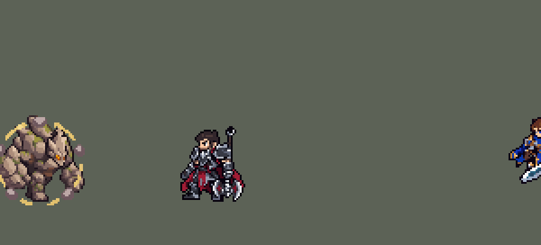

<!-- 本页上半部分由 tools/docs/gen_hero_docs.py 按仓库里现在的数据生成，手改会被覆盖；「开发记录」以下是手写的，生成时原样保留。 -->

# 墨菲特 Malphite


| 项目 | 内容 |
|---|---|
| id | `league_malphite` |
| 所属的包 | 主包（mod_id `league`） |
| 分路 | 上单 |
| 分类 / 标签 | 近战（Melee） · AP / Magic / Melee / Tank / CC |
| 高清帧 | 1 倍像素（无高清帧） |
| 附加包 | [大招瞄准附加包](#附加包)（`league_ult_aim`） |



其他预览：[逐帧预览](../preview/league_malphite_frames.png)、[特效表](../preview/league_malphite_effects.png)

## 现在的技能

下面是游戏里显示的技能说明（`league/text/champion.i18n` 的简体中文，去掉了颜色和图标），冷却、距离来自 `league/champion/league_malphite.data_champion`；1 秒 = 60 tick。

### 普攻 / 被动（被动「花岗岩护盾」）

*攻击间隔 1.17 秒 · 攻击距离 25000*

普攻用岩石拳头猛砸，造成100% 攻击力的物理伤害。被动 花岗岩护盾：获得60 + 60% 法术强度的护盾，护盾被打破10秒后重新生成。雷霆拍击：护甲提高10%，护盾存在时提高20%。

### 技能1 · 地震碎片

*冷却 6 秒 · 施放距离 60000 · 施放：指定目标 · 敌人（不含防御塔）*

朝目标掷出一块碎石，造成60 + 50% 法术强度的魔法伤害并减速25%，持续3秒；墨菲特偷取这部分速度，移动速度提高25%，持续3秒。

### 技能2 · 大地震颤

*冷却 7 秒 · 施放距离 30000 · 施放：无目标 · 敌人（不含防御塔）*

猛击地面，对周围敌人造成50 + 40% 法术强度 + 2% 自身最大生命值的魔法伤害，并使其攻击速度降低20%，持续3秒。随后 雷霆拍击：4秒内普攻额外对前方扇形区域的敌人造成10 + 1% 自身最大生命值的物理伤害。

### 大招 · 势不可挡

*冷却 60 秒 · 施放距离 75000 · 施放：指定目标 · 敌方英雄*

冲向一名敌方英雄，冲锋中免疫控制。落地时对周围敌人造成150 + 60% 法术强度 + 3% 自身最大生命值的魔法伤害，并击飞1.25秒。

### 数值

攻击力 80（每级 +6）、法强 30（每级 +15）、生命 1100（每级 +120）、护甲 40（每级 +10）、魔抗 30（每级 +5）、移速 1000（每级 +10）。

## 附加包

附加包是可选的原生代码 mod（都在附加包合集 `league_addons` 里），**不装主包里的英雄也是完整的**。

### 大招瞄准附加包

[大招瞄准附加包](../../addons/league_ult_aim/README.md)：`league_ult_aim` v0.1.0（通用附加包，下面只列和墨菲特有关的部分）

| 英雄 | 主包（AI 自己挑） | 装了附加包 |
|---|---|---|
| 墨菲特 R 势不可挡 | 点一名敌方英雄（常常是离得最近的），撞起他身边 30000 内的人 | 改点射程（75000）内身边敌方英雄最多的那个（一样多就照 AI 的）；R 好了、有人身边能撞起 3 个以上英雄时，AI 没想放也放 |

## 相关脚本和素材

- [`tools/lol/extract_malphite.py`](../../tools/lol/extract_malphite.py)
- [`tools/art/preview_malphite.py`](../../tools/art/preview_malphite.py)
- [`tools/art/import_malphite.py`](../../tools/art/import_malphite.py)
- [`assets/source/malphite/`](../../assets/source/malphite)

## 开发记录

> 下面是原来 README 里「英雄：墨菲特」一节，原样搬过来（只改了相对链接）。

| 部分 | 内容 |
|---|---|
| 定位 | 上单（Melee），第四组第一个，本包第一个吃法强和生命值的坦克上单（盖伦、德莱厄斯吃攻击力，提莫是法师） |
| 普攻 | 岩石拳头猛砸，100% 攻击力的物理伤害，攻击间隔 1.17 秒 |
| 被动 | 「花岗岩护盾」：60 + 60% 法术强度的护盾，被打破 10 秒后重新长出来，出生和复活后的第一次行动就有。英雄联盟是 10 秒没挨打回盾、护盾值 10% 最大生命值；引擎没有"受到伤害"的触发，护盾也不能按最大生命值算（护盾只有固定值、攻击力、法强三种加成）。所以护盾挂一个跟着护盾存在的标记（`WithShield`），盾破了标记就没了，他的下一次行动开始计 10 秒，计完后的下一次行动重新套盾：长时间团战里大约每 10 秒回一次，比原版略强。60 + 60% 法强在 1–12 级约等于原版的 10% 最大生命值。合并 W「雷霆拍击」的被动：护甲 +10%，护盾在时 +20% |
| 技能1 | Q「地震碎片」：掷出一块碎石，造成 60 + 50% 法术强度的魔法伤害，减速 25% 持续 3 秒，他偷走这部分速度（移速 +25%，3 秒）。射程 60000，冷却 6 秒，也对小兵和野怪放 |
| 技能2 | E「大地震颤」：猛击地面，半径 36000 内的敌人受到 50 + 40% 法术强度 + 2% 自身最大生命值的魔法伤害，攻速降低 20% 持续 3 秒。原版 E 吃护甲，引擎的伤害读不到护甲，改成自身最大生命值（基础游戏的食人魔、LoL Reborn 的加里奥和赛恩也是这样）。合并 W「雷霆拍击」的主动：之后 4 秒普攻额外对前方扇形（`Forward` + `DirDot`）内的所有敌人造成 10 + 1% 最大生命值的物理伤害。冷却 7 秒，也对小兵和野怪放 |
| 大招 | R「势不可挡」：冲向一名敌方英雄（`MoveToTarget`），冲锋时免疫控制，落地砸出大坑，对周围半径 30000 的敌人造成 150 + 60% 法术强度 + 3% 最大生命值的魔法伤害并击飞 1.25 秒。英雄联盟是冲向一个地点，这里追着目标冲，保证击飞落在选中的英雄身上，他身边的人一起飞。只对英雄放，冷却 60 秒 |
| 附加包 | 可选的附加包 [`addons/league_ult_aim`](../../addons/league_ult_aim/README.md)（在附加包合集里，原生代码，只有 AI 钩子）：R 照英雄联盟玩家的打法，点射程内身边敌方英雄最多的那个，能撞起 3 个以上英雄时主动放 |
| 连招 | 用户要求（「有连招要做连招」「都要帮我补」）：英雄联盟的 **R E（Q）**——势不可挡落地时半径 30000 内有敌方英雄，Q 和 E 的剩余冷却立刻压到冷却时间的 2%（3 tick 的 `skill_cooldown_mult` 4900；同一个 buff 带 `ult_cooldown_mult` −4900，R 自己的冷却不受影响），在他 28 tick 的落地动作结束前就好了，并打开 1.25 秒的窗口（和击飞一样长）；窗口里放 E 不再抬手 11 tick：摆出 R 落地砸地的姿势，第 4 tick 就砸下（同样的范围、伤害和减攻速），趁敌人还在空中，之后再接 Q。没砸到英雄就什么都不变。两个分支里都有 E 的伤害，AI 不会放空技能；每次砸中英雄的 R（冷却 60 秒）最多多出一次 E 和一次 Q。改动由 `tools/fix/combo_malphite.py` 写入 |
| 数值 | 攻击 80（+6）、法强 30（+15）、生命 1100（+120）、护甲 40（+10）、魔抗 30（+5）、移速 1000（+10），和原版坦克一样。数值是自己设计的，用 SDK 对战模拟调：打上路，对 6 个原版上单（格斗家、处刑人、枪骑士、长柄战士、骑士、狂战士），三套队友阵容、两边各 24 局。初版 +4.38，每局只死 0.6 次；拆开测试，削坦度 −0.2、削伤害 −2.0、削控制 −1.6，所以伤害和控制一起削，坦度基本保留；R 击飞 1.5 秒是 +1.80，1.25 秒是 +1.01。按美术定下的出手帧重跑，两批种子 +1.31 / +1.63，再把 E 的生命值加成从 3% 降到 2%：+0.91 / +1.02，原版格斗家同样两批是 +0.93 / +1.08 |
| 亚索联动 | 击飞算控制。亚索中路、墨菲特上路时，亚索大招每局放 2.19 次，和同样带击飞大招的原版格斗家（2.15）一样（原版骑士 0.92），亚索不用调 |
| 精灵图 | 9 个动作 54 帧：待机、跑步、普攻、Q、E、R 冲锋、R 落地砸地、受击、死亡。背刺顶到脚底 45 px（原版食人魔 44），14 色，动作全部取自英雄联盟原版动画 |
| 特效 | 普攻命中、雷霆拍击命中、Q 碎石和碎裂、E 砸地冲击波和敌人脚下的震起、R 落地大坑和击飞的喷发石柱、花岗岩护盾的石片护圈、雷霆拍击的拳边电弧 |
| 图标 | 官方技能图标（Q / E / R），64×64 |
| 音频 | 从本地客户端提取的 11 条技能音效和 3 条中文语音。中文语音库里墨菲特没有技能台词：Q、E 用原版施法时的喊声，R 用一句攻击台词。不提交到仓库，按下面的命令在本地生成 |

```bash
python tools/lol/extract_malphite.py --lol "D:\WeGameApps\lol" --vgmstream "<vgmstream-cli.exe 路径>"
python tools/lol/native_pose.py assets/source/malphite/poses.json --out <渲染文件夹> --alpha --parts
python tools/art/restyle_native.py assets/source/malphite/poses.json --renders <渲染文件夹>   # 角色图
python tools/art/import_native.py --hero malphite
python tools/art/import_malphite.py      # 特效；--raw <Codex 的交付文件夹> 先把原始图转成原尺寸条
python tools/art/preview_malphite.py
```

美术（提示词见 [`assets/source/malphite/PROMPTS.md`](../../assets/source/malphite/PROMPTS.md)）：
- 分工：角色图由 Claude 画，Codex 只画特效。
- 比例和镜头：镜头 yaw 35、pitch 25，不镜像，腿 0.85，高度 26（从原版头顶量到脚底，加上背刺共 45 px，和原版食人魔 44 px 一样大）。
- 头部：原版的头很小，垂在胸前，游戏尺寸下只有 6 格宽；放大（1.6–2.6 倍）或按材质投色都和胸口的石头混成一团，所以头是逐格画的，再贴到每一帧上。第一轮三张圆脸（发光细眼、圆眼加暗红嘴、熔岩嘴）用户都不认可：像吉祥物，颜色浅得像贴纸，细角像耳朵。改成照原版的结构、参考 oppi 在 LoL Reborn 里画阿利斯塔和赛恩的方式：侧面的深色石头口鼻、从口鼻长出的粗大浅色石角（立在背刺前方的空白处）、眉骨下一只发黄光的眼睛，再加浅色岩板面和裂纹、角根的深色石环（V12a）。原版的头留在胸口按岩石色投色（`"under"`），手绘头下面就不会留洞。
- 贴头位置：一开始贴在原版头部关节上（离手绘头 19 行），原版的小脑袋一点头、一摆动，手绘头就和身体脱开，当时的 55 帧里有 9 帧（出拳蓄力、R 落地、倒地）。改成跟着两肩中点走（`native_pose.py` 的 `"anchor"`、`restyle_native.py` 的 `"head": {"anchor": true}`），倒地时按躯干倾斜把头一起放平，并逐帧统计头和身体的接触像素检查。
- 动作：R 冲锋用原版的 `RunUlt`，落地砸地借用暴击动作的下砸（原版 R 只有冲锋这一段）。跑步从原版、混合待机 40%、60% 三个循环动图里用户选了 40%：原版压低身子冲撞式跑，显得矮小；40% 还在跑，体型和待机一致。待机 6 帧都用第 1 帧，第 3–5 帧小腿以上下移 1 格呼吸。
- 特效用 Codex 画的 10 张（生图原稿，半透明边）：`import_malphite.py --raw` 按交付清单的 `rect` 切帧，每张 16 色、硬透明，按技能范围定大小，比例在画面上量：普攻命中 14 px、雷霆拍击 26 px、Q 碎石连尾迹 16 px、Q 碎裂 22 px、E 敌人脚下 14 px、E 冲击波 72 px 宽（半径 36000）、R 大坑 64 px 宽（半径 30000）、击飞石柱 32 px 高、护盾石圈 50 px（包住他 43 px 宽的身体）、拳边两道电弧相距 40 px。砸地冲击波和大坑是施法者身上播放的特效（不随方向旋转），画在人物下层。
- 出手时刻和动画对齐：普攻第 8 tick（第 3 帧拳头落下）、Q 第 12 tick（第 4 帧出手）、E 第 11 tick（第 4 帧双拳砸地）、R 落地后 4 tick（砸地那一帧）。
- 结果：14 色，和右边像素同色的比例 45%（原版英雄 18%–46%）。头像截取点 (4, −42)：在他头顶，头像框里能看到角和眼睛。

逐帧预览：[`docs/preview/league_malphite_frames.png`](../preview/league_malphite_frames.png?v=1014g)，特效：[`docs/preview/league_malphite_effects.png`](../preview/league_malphite_effects.png?v=1014g)。
