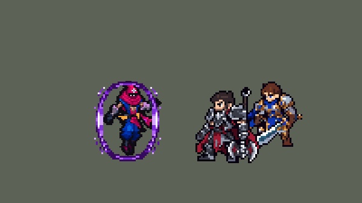

<!-- 本页上半部分由 tools/docs/gen_hero_docs.py 按仓库里现在的数据生成，手改会被覆盖；「开发记录」以下是手写的，生成时原样保留。 -->

# 玛尔扎哈 Malzahar


| 项目 | 内容 |
|---|---|
| id | `league_malzahar` |
| 所属的包 | 主包（mod_id `league`） |
| 分路 | 中单 |
| 分类 / 标签 | 法师（Magician） · AP / Magic / Range / CC |
| 高清帧 | PPU 1.38（画成 115%） |
| 附加包 | [玛尔扎哈附加包](#附加包)（`league_malzahar`） |



其他预览：[逐帧预览](../preview/league_malzahar_frames.png)、[特效表](../preview/league_malzahar_effects.png)

## 现在的技能

下面是游戏里显示的技能说明（`league/text/champion.i18n` 的简体中文，去掉了颜色和图标），冷却、距离来自 `league/champion/league_malzahar.data_champion`；1 秒 = 60 tick。

### 普攻 / 被动（被动「虚空穿越」）

*攻击间隔 1.5 秒 · 攻击距离 52000*

射出虚空弹。被动虚空穿越：获得90 + 40% 法强护盾，护盾存在时免疫控制；护盾被打破后12秒重新获得。

### 技能1 · 煞星幻象 / 虚空虫群

*冷却 9 秒 · 施放距离 65000 · 施放：指定目标 · 敌人（不含防御塔）*

煞星幻象：4秒内造成170 + 80% 法强魔法伤害，目标死亡时跳到附近的敌人身上。虚空虫群随之撕咬目标，每0.5秒造成14 + 8% 法强魔法伤害。

### 技能2 · 虚空召唤

*冷却 7 秒 · 施放距离 80000 · 施放：指定目标 · 敌人（不含防御塔）*

在目标两侧打开虚空裂隙，裂隙合拢时对范围内的敌人造成70 + 45% 法强魔法伤害并沉默1.5秒。

### 大招 · 冥府之握

*冷却 70 秒 · 施放距离 70000 · 施放：指定目标 · 敌方英雄*

压制一名敌方英雄（优先煞星幻象的目标）：引导期间使其眩晕，2.5秒内造成220 + 80% 法强魔法伤害，脚下留下持续伤害的虚空区域。玛尔扎哈被控制时引导中断。

### 数值

攻击力 76（每级 +7）、法强 40（每级 +20）、生命 860（每级 +92）、护甲 18（每级 +7）、魔抗 20（每级 +4）、移速 910（每级 +9）。

## 附加包

附加包是可选的原生代码 mod（都在附加包合集 `league_addons` 里），**不装主包里的英雄也是完整的**。

### 玛尔扎哈附加包

[玛尔扎哈附加包](../../addons/league_malzahar/README.md)：`league_malzahar` v0.1.1

主包 `league` 保持纯数据。用户选了「做：E 跳转 + 被动精确」。这个附加包用原生代码做主包数据做不准的两件事：

- **虚空穿越（被动）**：英雄联盟里玛尔扎哈身上有一层法术护盾：受到的伤害大幅减少、免疫控制；被非小兵的伤害打中后很快消失，
  一段时间没受到英雄伤害才回来。主包数据读不到「被谁打了」「多久没挨打」，只能做成墨菲特那样的护盾（打破后过一会儿回来）。
  附加包的被动 `league_malzahar:void`：
  - 准备好时给他挂 `league_malzahar_p_shift`：受到的伤害减少 `p_dr`%（90%）、**免疫控制**；画面是主包数据里绑的 `p_shift`；
  - 第一次被**英雄、野怪或防御塔**打中后再持续 `p_linger` tick（0.25 秒）就消失；**小兵**的伤害照样减少，但打不破它；
  - 消失后，**`p_cd` tick 内没受到英雄伤害**才重新准备好（每挨一次英雄伤害重新计时）；每条命开始时是准备好的。
- **煞星幻象的跳转**：主包数据里幻象的目标死了只能跳一次，而且晚零点几秒（数据看不到死亡，靠打标记再检查）。
  附加包里幻象每打中一个单位都会调用原生效果 `league_malzahar:vision` 记下它；目标在幻象的 `e_t` tick（4 秒）内死了，
  **立刻**跳到它倒下处 `e_jump`（40000）内最近的敌人身上：**先找英雄**，没有再找小兵、野怪，不找防御塔。
  新目标重新受到完整的幻象（`e_t` tick 内每 `e_p` tick 一段，共 `e_dmg` + `e_ap`% 法强的魔法伤害，由附加包结算），
  头上挂 `league_malzahar_e_markb`（主包数据里绑了幻象的画面）；它死了照样再跳，**没有次数限制**。
  英雄联盟里跳转还会刷新 E 的冷却；TFM2 的冷却加速 buff 会把 Q 一起刷新，所以不做。

## 相关脚本和素材

- [`tools/kit/build_malzahar.py`](../../tools/kit/build_malzahar.py)
- [`tools/kit/setup_malzahar.py`](../../tools/kit/setup_malzahar.py)
- [`tools/lol/extract_malzahar.py`](../../tools/lol/extract_malzahar.py)
- [`tools/art/preview_malzahar.py`](../../tools/art/preview_malzahar.py)
- [`tools/art/rig_malzahar.py`](../../tools/art/rig_malzahar.py)
- [`tools/art/design_malzahar.py`](../../tools/art/design_malzahar.py)
- [`assets/source/malzahar/`](../../assets/source/malzahar)

## 开发记录

> 下面是原来 README 里「英雄：玛尔扎哈」一节，原样搬过来（只改了相对链接）。

| 部分 | 内容 |
|---|---|
| 定位 | 中单（Magician，标签 AP / Magic / Range / CC），第 103 位英雄。虚空先知 玛尔扎哈（客户端里名字和称号是反着的，按官方）：远程 AP 法师，悬浮着施法。用户的选择：中单远程 AP 法师；技能 1 = E 煞星幻象 + W 虚空虫群（虫子跟着幻象咬同一个目标），技能 2 = Q 虚空召唤，大招 = R 冥府之握；虚空虫做成目标身上的画面（数据里的召唤物不会走也不会打）；被动在主包里做成护盾 + 免控，另做附加包；四个连招都做；悬浮、袍子盖住腿，移动是滑行 |
| 普攻 / 被动 | 虚空弹（攻击距离 52000，攻击间隔 90 tick，第 9 tick 出手，100% 攻击物理，追踪）。「虚空穿越」：每次出手先查墨菲特那样的护盾梯子——身上挂着 `p_shift`（`WithShield` 时长、免疫控制），护盾 90 + 40% 法强；被打破后 720 tick（12 秒）回来，每条命开始时都有 |
| 技能1 | E「煞星幻象」+ W「虚空虫群」：冷却 540 tick，对 65000 内的敌人放（第 9 tick 出手）。幻象打中的单位 4 秒内共受到 170 + 80% 法强的魔法伤害（每 15 tick 一段）；虚空虫同时咬他，每 30 tick 一口 14 + 8% 法强，共 4 秒。目标在幻象期间阵亡，幻象跳到倒下处 40000 内的一个敌方英雄身上（没有英雄就找别的敌人）；数据里只能跳一次、晚零点几秒 |
| 技能2 | Q「虚空召唤」：冷却 420 tick，对 80000 内的敌人放。第 9 tick 双手一合，目标两侧打开两道裂隙，24 tick 后光束在中间相撞：半径 18000 内的敌人受到 70 + 45% 法强的魔法伤害并沉默 1.5 秒 |
| 大招 | R「冥府之握」：冷却 4200 tick，对 70000 内的敌方英雄放（有幻象缠着的英雄优先：等幻象下一段落在他身上再抓）。TFM2 没有压制，做成玛尔扎哈引导时每 15 tick 刷新一次眩晕：2.5 秒内共 220 + 80% 法强的魔法伤害；玛尔扎哈被控制时引导在下一次检查中断，眩晕 15 tick 内结束。脚下留下 5 秒、半径 20000 的虚空领域（每 30 tick 10 + 5% 法强）。引导时手上一道虚空光束连到目标（用户：「大招没连接线啊」「连接线放脚上的？」）：每 4 tick 一段 16 像素的光束从他手的高度飞向目标，首尾相接 |
| 连招 | E → W（虫子先咬幻象的目标）；R → Q（抓完 2 秒内放 Q，光束立刻相撞）；Q → E（Q 沉默英雄后 2 秒内放 E，幻象不用前摇）；R 优先抓被幻象缠着的英雄 |
| 附加包 | 可选的附加包 [`addons/league_malzahar`](../../addons/league_malzahar/README.md)（在附加包合集里，原生代码，主包不装它也完整）：**虚空穿越照英雄联盟**——受到的伤害减少 90%、免疫控制，第一次被英雄、野怪或防御塔打中 0.25 秒后消失，12 秒没受到英雄伤害才回来；**幻象跳转不限次数、立刻跳**（先找英雄）。日志 `league_malzahar.log`。还没在游戏里看过日志 |
| 数值 | 攻击 76（+7）、法强 40（+20）、生命 860（+92）、护甲 18（+7）、魔抗 20（+4）、移速 910（+9）（同组中单法师的属性） |
| 平衡 | 中路对五个基础法师，两批种子：草案 d0（Q 85 + 55%）+2.69 / +2.24 偏强，定下 d1（Q 70 + 45%）+1.27 / +1.50；按动作帧重新对时间后 +1.63 / +1.61。同组中单（辛德拉、维克托、泽拉斯、安妮）+1.04..+1.68 |
| 精灵图（高清帧 PPU 1.38，画成 115%） | Codex 画了两张原画（A 袍子盖住腿），用户选 A-02，再让 Codex 按格子重画，用户选 B（露腿、脚尖朝下的悬浮）；所有动作都是 3/4 正面（不画侧面）。[`tools/art/design_malzahar.py`](../../tools/art/design_malzahar.py) 从 Codex 原稿切成 48 行的造型：额头的菱形印记是 3 × 3，眼睛一格、压在眉下，光、金边、刀鞘亮色优先。Codex 照英雄联盟的骨架画了 35 张动作细稿，[`tools/art/import_malzahar_strips.py`](../../tools/art/import_malzahar_strips.py) 按造型的格子读回：每个动作按头的大小定一个缩放，造型的脸贴进每一帧，滑行时头保持稳定，R 的引导循环接在起手最后一帧上，死亡是 1-2-3-倒下-躺平。[`tools/art/rig_malzahar.py`](../../tools/art/rig_malzahar.py) 写 1 倍帧和高清帧，`ppu_restyle.py` 加一格描边、按 115% 抬高。起初 PPU 2.2，用户：「像素有点高 降低点需要」，从对比图里选了每个游戏像素 1.2 格（PPU 1.38） |
| 选人卡片 | 用户：「蚂蚱在BP界面位置偏高」。没设 `banpick_center` 时卡片按他的 `center` −16 放，他又是悬浮的（待机脚底在站位点下 8 px，别人 11–12），兜帽顶到卡片上沿；设 −8，脚落到画布底边，和别的英雄一样（2026-10-15） |
| 特效 | Codex 第 3 步的 13 个特效（`assets/source/malzahar/codex_fx`）。[`tools/art/import_malzahar_fx.py`](../../tools/art/import_malzahar_fx.py)：11 张用 Codex 自己读回的 1 倍图；虚空虫按 9 格读回成了一团，从原稿放大 1.3 倍重读（眼睛、镰刀爪留住）；被动光壳的斜边被空心框切断，从原稿重读成完整的椭圆。R 的光束 `r_link` 截自 Codex 画的 Q 光束（第 5 帧），上下对称、4 帧流动。飞弹上下对称，其余左右对称（红方不镜像），导入时逐帧检查 |
| 音效 | 英雄联盟的音效和配音（`tools/lol/extract_malzahar.py`，17 段）：普攻出手 / 打中、被动、E 出手 / 打中 / 跳转、虫子出现 / 咬、Q 出手 / 合拢 / 打中、R 出手 / 每段 / 领域，配音 Q / E / R |
| 图标 | 官方技能图标（E 煞星幻象 / Q 虚空召唤 / R 冥府之握，另有 W 虚空虫群、被动虚空穿越），从本地客户端取 |

重新生成（素材来自本机的英雄联盟客户端，音频不进仓库）：

```bash
python tools/lol/extract_malzahar.py
python tools/kit/build_malzahar.py                 # 技能数据，数字都在脚本的参数表 P 里
python tools/kit/setup_malzahar.py                 # 五种语言的文字、音效配置、共享文件里他的键
python tools/art/design_malzahar.py                # Codex 的原稿切成造型
python tools/art/import_malzahar_strips.py         # Codex 的动作细稿读回
python tools/art/rig_malzahar.py                   # 1 倍帧和原密度的高清帧
python tools/art/ppu_restyle.py --hero malzahar    # 描边、按 115% 抬高
python tools/art/ppu_hd.py --hero malzahar         # hd_ / lo_ 帧
python tools/art/import_malzahar_fx.py             # 特效
python tools/art/preview_malzahar.py               # 预览和演示 GIF
python addons/league_malzahar/make_override.py     # 附加包的副本（主包的玛尔扎哈改了就重跑）
```

美术提示词见 [`assets/source/malzahar/`](../../assets/source/malzahar) 里的 `PICTURE_PROMPT.md`、`GRID_PROMPTS.md`、`MODEL_STRIPS.md`、`PROMPTS_FX.md`；Codex 的交付在 `codex_picture/`、`codex_grid/`、`codex_strips/`、`codex_fx/`。

逐帧预览：[`docs/preview/league_malzahar_frames.png`](../preview/league_malzahar_frames.png?v=1014m)，特效：[`docs/preview/league_malzahar_effects.png`](../preview/league_malzahar_effects.png?v=1014m)。
