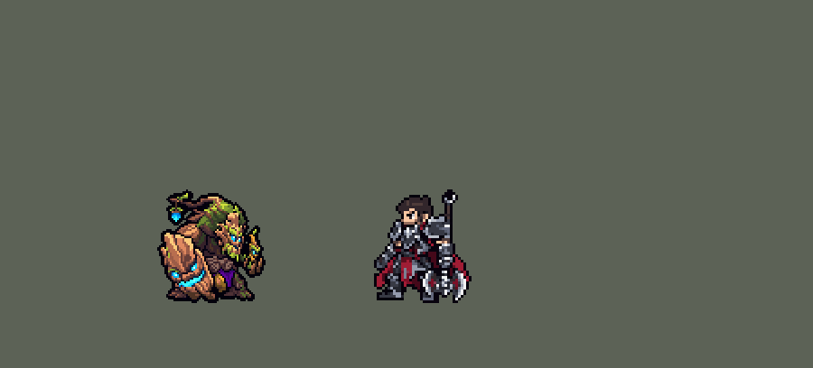

<!-- 本页上半部分由 tools/docs/gen_hero_docs.py 按仓库里现在的数据生成，手改会被覆盖；「开发记录」以下是手写的，生成时原样保留。 -->

# 茂凯 Maokai


| 项目 | 内容 |
|---|---|
| id | `league_maokai` |
| 所属的包 | 主包（mod_id `league`） |
| 分路 | 辅助 |
| 分类 / 标签 | 功能型（Util） · AP / Magic / Melee / Tank / CC / Heal |
| 高清帧 | PPU 1.3 |
| 附加包 | [茂凯附加包](#附加包)（`league_maokai`） |



其他预览：[逐帧预览](../preview/league_maokai_frames.png)、[特效表](../preview/league_maokai_effects.png)

## 现在的技能

下面是游戏里显示的技能说明（`league/text/champion.i18n` 的简体中文，去掉了颜色和图标），冷却、距离来自 `league/champion/league_maokai.data_champion`；1 秒 = 60 tick。

### 普攻 / 被动

*攻击间隔 1.25 秒 · 攻击距离 26000*

巨臂砸击。吸元秘术：技能命中后下一次普攻额外造成2%最大生命魔法伤害，回复40 + 60% 法强生命（4秒一次）。树苗投掷：每10秒自动向敌方英雄扔树苗，敌人靠近就爆炸：100 + 50% 法强魔法伤害，减速35%。

### 技能1 · 荆棘重击

*冷却 6 秒 · 施放距离 30000 · 施放：指定目标 · 敌人（不含防御塔）*

巨拳砸地，推开身边的敌人，冲击波对前方敌人造成100 + 40% 法强魔法伤害外加目标2%最大生命伤害，并减速95%（很快减弱）。

### 技能2 · 扭曲突刺

*冷却 10 秒 · 施放距离 45000 · 施放：指定目标 · 敌方英雄*

化作树根冲向敌方英雄（途中免伤免控），到达后禁锢1.3秒，造成100 + 40% 法强魔法伤害。身边有友方英雄或正在交战时才放。

### 大招 · 自然之握

*冷却 60 秒 · 施放距离 70000 · 施放：指定目标 · 敌方英雄*

召唤荆棘墙缓缓向前推进，碰到的敌人受到180 + 75% 法强魔法伤害并被禁锢0.8~2.4秒（推得越远越久），撞到英雄后他加速。有2名敌方英雄或交战时才放。

### 数值

攻击力 72（每级 +6）、法强 25（每级 +15）、生命 1420（每级 +135）、护甲 50（每级 +9）、魔抗 36（每级 +4）、移速 1000（每级 +10）。

## 附加包

附加包是可选的原生代码 mod（都在附加包合集 `league_addons` 里），**不装主包里的英雄也是完整的**。

### 茂凯附加包

[茂凯附加包](../../addons/league_maokai/README.md)：`league_maokai` v0.1.0

|  | 主包（纯数据） | 附加包 |
|---|---|---|
| 吸元秘术回血 | 固定值 + 法术强度（数据读不到生命） | 按等级回复最大生命的 4.5%–12%（英雄联盟） |
| 吸元秘术就绪 | 他的技能命中敌人后 | 他的技能命中敌人后，**或被敌方英雄的技能打中后**（近似：打他的敌方英雄的技能、技能 2 或大招在 1.5 秒内刚进入冷却，就算技能打中——原生被动收到伤害时分不出普攻和技能） |
| 草丛里的树苗 | 和别处一样（数据读不到地形） | 读地图的草丛格子；立在草丛里的树苗爆炸半径更大（34000）、伤害 ×1.6、减速 45%（英雄联盟草丛里的树苗更强） |

装上附加包后游戏里显示的说明（和主包不同的部分）：

- **普攻 / 被动**：【扩展包】巨臂砸击。吸元秘术：技能命中或被敌方技能打中后，下一次普攻额外造成2%最大生命魔法伤害，回复4.5%~12%最大生命（随等级）。树苗投掷：每10秒扔一棵，敌人靠近就爆炸：100 + 50% 法强魔法伤害，减速35%；在草丛里更强。

## 相关脚本和素材

- [`tools/kit/build_maokai.py`](../../tools/kit/build_maokai.py)
- [`tools/kit/setup_maokai.py`](../../tools/kit/setup_maokai.py)
- [`tools/lol/extract_maokai.py`](../../tools/lol/extract_maokai.py)
- [`tools/art/preview_maokai.py`](../../tools/art/preview_maokai.py)
- [`tools/art/rig_maokai.py`](../../tools/art/rig_maokai.py)
- [`assets/source/maokai/`](../../assets/source/maokai)

## 开发记录

> 下面是原来 README 里「英雄：茂凯」一节，原样搬过来（只改了相对链接）。

| 部分 | 内容 |
|---|---|
| 定位 | 辅助（Util，标签 AP / Magic / Melee / Tank / CC / Heal），第 125 位英雄。扭曲树精 茂凯：被暗影岛的黑雾逼得愤怒的巨大树精（10-17 的分组计划 A 组的辅助）。用户的选择：「全按推荐做：辅助、布局A、做扩展包、PPU 1.2、加高手连招」（PPU 后来改成 1.5，再降到 1.3，见精灵图）。技能 1 = Q 荆棘重击，技能 2 = W 扭曲突刺，大招 = R 自然之握；E 树苗投掷没有自己的格子，守望自动扔。技能名照英雄联盟 16.20 的官方中文 |
| 普攻 / 被动 | 巨臂砸击（第 11 tick 打中，防御塔也打），攻击间隔 75 tick，射程 26000。**吸元秘术**：他的技能打中敌人后（`sap` 5 秒），下一次普攻额外造成他最大生命 2% 的魔法伤害，并回复 40 + 60% 法术强度的生命，两次之间至少 4 秒（英雄联盟是回复最大生命的 4.5%–12%，冷却随施法缩短：数据读不到生命，按最大生命回血在附加包里） |
| E | **树苗投掷**（守望自动扔，10 秒一次）：有敌方英雄在 60000 内、他没在施法时，把树苗扔向那名英雄出手时站的位置（走开就砸不到人）；树苗落地 0.5 秒后戒备 12 秒（英雄联盟 30 秒：包里的陷阱最长 12 秒，再长技能树太大），一次一棵；敌人（小兵也算）走到 14000 以内就扑上去炸开：24000 内 100 + 50% 法术强度的魔法伤害，减速 35% 2 秒（照提莫蘑菇的触发 / 爆炸标记）。草丛里更强在附加包里（数据读不到地形） |
| 技能1 | **Q 荆棘重击**（对 30000 内的敌人放，小兵、野怪也打）：第 12 tick 巨拳砸地，身边 16000 内的敌人被推开，一道冲击波往前推 45000：100 + 40% 法术强度的魔法伤害外加目标最大生命 2%（真实伤害：魔法伤害没有按目标生命的字段），减速 95% 很快减弱（两层减速叠在一起）。冷却 6 秒 |
| 技能2 | **W 扭曲突刺**，**看场面才放**（用户的规则：看好时机）：身边 70000 内有友方英雄、或正在交战、或 R 刚定住了人时才放，不一个人钻进人堆。他沉进地里，一团树根在地下和他一起冲向目标（途中免伤免控：游戏里「不可选中」只有放逐，放逐会让队伍丢视野），冒出来把目标**禁锢 1.3 秒**，100 + 40% 法术强度的魔法伤害。冷却 10 秒 |
| 连招 | 用户的「加高手连招」：**W → Q**：禁锢落地时 Q 已就绪就马上砸一记 Q；**R → W**：荆棘墙定住英雄后 2 秒内 W 不等队友直接冲 |
| 大招 | **R 自然之握**，**看场面才放**：按 R 只是待命 10 秒，守望每 12 tick 看一次：60000 内有两个敌方英雄，或交战时有一个，才放；10 秒没等到就退还冷却。第 20 tick 两臂砸地，一道荆棘墙从他面前慢慢往前推（照娜美的大招：穿透的直线弹道，速度 1500、宽 56000、走 200000，躲得开），碰到的敌人受到 180 + 75% 法术强度的魔法伤害并被**禁锢**，推得越远越久（0.75 秒内 0.8 秒、1.6 秒内 1.6 秒、更远 2.4 秒：英雄联盟 0.8–2.6 秒连续变化，数据按施放时挂的两个标记分三档），每人一次；撞到英雄后他加速（40% 两档减弱）。冷却 60 秒 |
| 附加包 | 可选的附加包 [`addons/league_maokai`](../../addons/league_maokai/README.md)（在附加包合集里，原生代码，主包不装它也完整）：**吸元秘术按等级回复最大生命的 4.5%–12%**；**被敌方技能打中也会充好吸元秘术**（近似：打他的敌方英雄的技能 1.5 秒内刚进入冷却就算技能打中——原生被动收到伤害时分不出普攻和技能）；**草丛里的树苗更强**（读地图的草丛格子：爆炸半径 34000、伤害 ×1.6、减速 45%）。日志 `league_maokai.log`（HEAL、STRUCK、SAPLING、BUSHES） |
| 数值 | 攻击 72（+6）、法强 25（+15）、生命 1420（+135）、护甲 50（+9）、魔抗 36（+4）、移速 1000（+10）、射程 26000 |
| 平衡 | 10 分钟经典引擎模拟，辅助位对原版五个辅助（牧师、吟游诗人、附魔师、武僧、道士），三套阵容两边各打：初稿 -0.85，只加数值几乎不动（-1.2 ~ -0.9，单批噪声约 ±0.7）；定稿缩短 E / W 冷却（10 秒）、W 身边有友方英雄的距离放宽到 70000、禁锢 1.3 秒，Q / W / E 伤害 100、R 180，生命 1420（+135）、护甲 50（+9）、魔抗 36：种子 1–16 平均 **+0.04**（每局输出 5222、阵亡 1.6；同批对照布隆 +0.48、芮尔 +0.60、蕾欧娜 +1.31，种子 1–8） |
| 精灵图（高清帧 PPU 1.3） | Codex 第 0 步画了待机（A）和树苗（C）两张原画（[`tools/art/pack_maokai_picture.py`](../../tools/art/pack_maokai_picture.py)），[`tools/art/review_maokai_size.py`](../../tools/art/review_maokai_size.py) 和塔姆、布隆、芮尔、内瑟斯、加里奥、墨菲特、阿利斯塔按游戏大小并排，用户：「用40的吧」。第 1 步 Codex 在游戏格子上重画（[`tools/art/pack_maokai_model.py`](../../tools/art/pack_maokai_model.py)），按 PPU 1.2 删到 48 行太糊，用户：「太模糊了 PPU调整一下像素」，改成 PPU 1.5：[`tools/art/design_maokai_cut.py`](../../tools/art/design_maokai_cut.py) 读回 A-2（80 行）、每次删掉「删了损失最小」的一行 / 一列到 60 行（蓝色发光和描边权重更高），树苗 C-2 12×18。动作照塔姆的做法（用户：「动作帧的话你参考塔姆怎么做的 做完后自己review 完美了再喊我review」）：[`tools/art/rig_maokai.py`](../../tools/art/rig_maokai.py) 把定稿切成巨臂（连拳头落地的根须指头）、远侧爪子和树苗、灯笼、腰带下垂着的根须、远侧树根腿和树干，只整格平移、分层、逐行平移（腿绕胯摆）。腿改了三轮：蹲下时从树根里抽掉一行、巨臂往前盖住膝根（「腿部变形了吧 少了像素？」）→ 腿一格不抽，树干沉到腿后面；把垂饰当膝盖、把拳头的根须当脚横着挪（「左腿完全不动啊？」「左右腿还是太奇怪了」）→ 按材质图重认结构：近侧腿整个藏在巨拳后面，走路是拳头和远侧腿轮流迈步（像大猩猩那样撑着拳头走），远侧腿绕胯摆动、整条腿每一格都在，垂饰被拳头推着晃，用户：「走路可以了」。看了演示：「太高清了 降低点像素」，[`tools/art/review_maokai_ppu.py`](../../tools/art/review_maokai_ppu.py) 按游戏大小并排 1.5 / 1.4 / 1.3 / 1.2，用户：「1.3吧 怎么感觉右手和身体是断开的」：60 行的删减把胡子和手之间隔一列删一列，描边权重又高，原画里从胡子下面连进手腕的苔藓袖子成了苔藓和描边一格一格交错；`rig_maokai.SLEEVE` 把那里 10 个描边格按 A-2 换回袖子的苔藓色（只换描边格，别的不动），再由 `ppu_restyle` 降到 **PPU 1.3**（hd.rs 已登记，大小不变）。动作：待机（树干下沉、灯笼晃）、走路、普攻、Q 砸地、W 钻地 / 冒出、E 扔树苗、R 两臂砸地、挨打、阵亡（往前扑倒，灯笼掉在地上立着） 2026-10-19 补帧（对照英雄联盟）：普攻、Q、E、R 原来手臂只按行上下挪，改成绕肩膀整转四分之一圈：普攻后抡→举过头→砸到身前，Q、R 高举再砸，E 远侧爪子往前甩出；手臂抬离地面时设计图里拳头后面没有近侧腿，用远侧根须腿左右镜像补上（只在手臂转开的帧里出现）；死亡 8 帧（落地回弹） |
| 特效 | 第 3 步 21 张特效（[`tools/art/pack_maokai_fx.py`](../../tools/art/pack_maokai_fx.py)，颜色照英雄联盟：被动的绿色自然魔法，Q 的橄榄褐尘土和白色光刺，W 带青色光纹的树根和泥块，树苗爆炸的青绿色，R 带刺的树根、荆棘和发青光的地裂），Codex 画并读回成游戏大小（`assets/source/maokai/codex_fx`），地上和身上的全部左右对称（游戏不镜像特效图），四张飞行图（树苗、Q 冲击波、W 地下的树根团、R 荆棘墙）朝右、上下对称（图跟着飞行方向转，荆棘墙斜着放就是斜的），地上的树苗正面朝前。[`tools/art/import_maokai_fx.py`](../../tools/art/import_maokai_fx.py)：打中的在身上，Q / W / R 的砸地在他脚下，飞行图以弹道为中心，树苗落地的最后一帧撑到戒备开始，站岗 4 帧正好 0.5 秒（每 0.5 秒重放一次），W / R 的禁锢是缠住腿的树根。写成 `league_maokai_fx` 和 `league_maokai_big` |
| 音效 | 英雄联盟的音效和配音（[`tools/lol/extract_maokai.py`](../../tools/lol/extract_maokai.py)，21 段）：普攻出手 / 打中、吸元秘术打中 / 回血、Q 出手 / 冲击波 / 打中、W 出手 / 树根缠住 / 打中、E 出手 / 落地 / 扑人 / 爆炸、R 出手 / 荆棘墙 / 打中，配音是他的 Q / E / R 台词和一句喊话（中文）；几个事件名在音效库里解析不到，用最接近的代替（脚本开头写了） |
| 图标 | 官方技能图标（荆棘重击、扭曲突刺、自然之握，另有树苗投掷和吸元秘术），从本地客户端取 |

重新生成（素材来自本机的英雄联盟客户端，音频不进仓库）：

```bash
python tools/lol/extract_maokai.py --lol "D:\WeGameApps\lol" --vgmstream <vgmstream-cli.exe>
python tools/kit/build_maokai.py                    # 技能数据，数字都在脚本的参数表 P 里
python tools/kit/setup_maokai.py                    # 五种语言的文字、音效配置、共享文件里他的键
python tools/art/design_maokai_cut.py               # Codex 第 1 步的造型读回（PPU 1.5，A-2 / C-2）
python tools/art/rig_maokai.py                      # 1 倍帧和 1.5 的原帧（整块摆，腿绕胯摆，补回右手的袖子）
python tools/art/ppu_restyle.py --hero maokai       # 描边、降到 PPU 1.3（不要加 --preview）
python tools/art/ppu_hd.py --hero maokai            # hd_ / lo_ 帧
python tools/art/import_maokai_fx.py                # 特效
python tools/art/preview_maokai.py                  # 预览和演示 GIF
python addons/league_maokai/make_override.py        # 附加包的副本（主包的茂凯改了就重跑）
```

美术提示词见 [`assets/source/maokai/`](../../assets/source/maokai) 里的 `PICTURE_PROMPT.md`、`MODEL_PROMPTS.md`、`PROMPTS_FX.md`；Codex 的交付在 `codex_picture/`、`codex_model/`、`codex_fx/`。

逐帧预览：[`docs/preview/league_maokai_frames.png`](../preview/league_maokai_frames.png?v=1018b)，特效：[`docs/preview/league_maokai_effects.png`](../preview/league_maokai_effects.png?v=1018b)。
