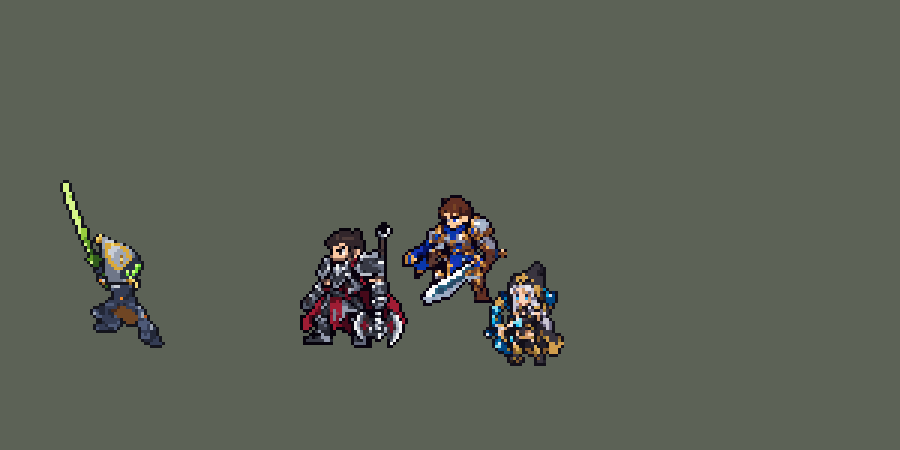

<!-- 本页上半部分由 tools/docs/gen_hero_docs.py 按仓库里现在的数据生成，手改会被覆盖；「开发记录」以下是手写的，生成时原样保留。 -->

# 易 Master Yi


| 项目 | 内容 |
|---|---|
| id | `league_masteryi` |
| 所属的包 | 主包（mod_id `league`） |
| 分路 | 打野 |
| 分类 / 标签 | 刺客（Assassin） · AD / Melee |
| 高清帧 | 1 倍像素（无高清帧） |
| 附加包 | [参与击杀附加包：金克丝、崔丝塔娜、易、图奇](#附加包)（`league_takedowns`） |



其他预览：[逐帧预览](../preview/league_masteryi_frames.png)、[特效表](../preview/league_masteryi_effects.png)

## 现在的技能

下面是游戏里显示的技能说明（`league/text/champion.i18n` 的简体中文，去掉了颜色和图标），冷却、距离来自 `league/champion/league_masteryi.data_champion`；1 秒 = 60 tick。

### 普攻 / 被动（被动「双重打击」）

*攻击间隔 0.8 秒 · 攻击距离 25000*

普攻造成100% 攻击力的物理伤害。被动 双重打击：连续第4次普攻会追加一刀，造成60% 攻击力的物理伤害。

### 技能1 · 阿尔法突袭

*冷却 9 秒 · 施放距离 50000 · 施放：指定目标 · 敌人（不含防御塔）*

消失并免疫伤害和控制，0.6秒内闪击4次：先对目标造成20 + 60% 攻击力的物理伤害，再随机斩击附近的敌人3次（可重复），每次10 + 25% 攻击力。可以暴击。

### 技能2 · 无极剑道

*冷却 10 秒 · 施放距离 26000 · 施放：无目标 · 敌人（不含防御塔）*

先冥想0.75秒：1秒内受到的伤害降低40%，2秒内回复20 + 12% 攻击力的生命值。随后5秒内普攻附加8 + 16% 攻击力的真实伤害（阿尔法突袭每击75%），下一次普攻必定触发双重打击。

### 大招 · 高原血统

*冷却 50 秒 · 施放距离 40000 · 施放：无目标 · 敌方英雄*

7秒内获得45% 攻击速度和45% 移动速度，阿尔法突袭和无极剑道的冷却加快40%。

### 数值

攻击力 105（每级 +25）、生命 920（每级 +85）、护甲 25（每级 +7）、魔抗 15（每级 +3）、移速 1100（每级 +14）。

## 附加包

附加包是可选的原生代码 mod（都在附加包合集 `league_addons` 里），**不装主包里的英雄也是完整的**。

### 参与击杀附加包：金克丝、崔丝塔娜、易、图奇

[参与击杀附加包：金克丝、崔丝塔娜、易、图奇](../../addons/league_takedowns/README.md)：`league_takedowns` v0.3.1

| 英雄 | 主包（纯数据） | 装了附加包 |
|---|---|---|
| 易 | 无极剑道期间阿尔法突袭、冥想的冷却加快 40%（近似） | 每一次英雄击杀和助攻，阿尔法突袭和冥想的剩余冷却减 70%，无极剑道开着时再延长 4 秒；每次普攻阿尔法突袭冷却减 1 秒；无极剑道期间免疫减速 |

## 相关脚本和素材

- [`tools/lol/extract_masteryi.py`](../../tools/lol/extract_masteryi.py)
- [`tools/art/preview_masteryi.py`](../../tools/art/preview_masteryi.py)
- [`tools/art/import_masteryi.py`](../../tools/art/import_masteryi.py)
- [`assets/source/masteryi/`](../../assets/source/masteryi)

## 开发记录

> 下面是原来 README 里「英雄：易（无极剑圣）」一节，原样搬过来（只改了相对链接）。

| 部分 | 内容 |
|---|---|
| 定位 | 刺客（Assassin），第三组的打野。包里此前只有李青一个刺客 |
| 普攻 | 剑击，100% 攻击力的物理伤害。被动「双重打击」：4 秒内连续的第 4 次普攻多砍一刀，造成 60% 攻击力的物理伤害（英雄联盟也是第 4 下，层数 4 秒） |
| 技能1 | Q「阿尔法突袭」：射程 50000，冷却 9 秒。瞬移到目标身上砍一刀（20 + 60% 攻击力），之后每 12 tick 随机闪到身边 35000 内的一个敌人再砍一刀（10 + 25% 攻击力），共 4 下，最后回到目标身边。可以重复砍同一个人：英雄联盟里重复砍同一目标只有 25% 伤害，数据分不出是不是同一个目标，所以后三下伤害较低。Q 期间（0.8 秒）隐身（`CasterInvisible`），同时有一个受到伤害降低 100%、免疫控制的 buff：贴身的敌人还能对他出手，但每下只掉 1 点血。最初是每一下之后给自己施加 11 tick 的放逐（`Banish`），敌人选不中他，但被放逐的单位不再给己方提供视野：他一个人在野区或敌群里时，周围的野怪和敌方英雄每一下都会掉进战争迷雾、从画面上消失（用户在游戏里发现）；只隐身又挡不住贴身的敌人。可以暴击，无极剑道期间每下附带 75% 的真实伤害。英雄联盟里普攻会减少 Q 的冷却，这里改成固定的短冷却（英雄联盟 18 秒）。小兵、野怪也会放 |
| 技能2 | E「无极剑道」合并 W「冥想」：近身有敌人时放（射程 26000），冷却 10 秒。先盘腿冥想 0.75 秒：1 秒内受到的伤害降低 40%，2 秒内回复 20 + 12% 攻击力的生命值；随后 5 秒内普攻附加 8 + 16% 攻击力的真实伤害（阿尔法突袭每击 6 + 12%），下一次普攻必定是双重打击。英雄联盟的冥想能引导 4 秒、按已损失生命加成治疗；这里 AI 不看血量（冷却一好就放，模拟里满血也放），所以改成开打时短暂冥想再接剑道 |
| 大招 | R「高原血统」：附近 40000 内有敌方英雄时放，冷却 50 秒。7 秒内攻击速度 +45%、移动速度 +45%，Q 和技能2 的冷却加快 40%，代替英雄联盟"击杀、助攻返还冷却"。免疫减速做不到（减速是 buff，引擎没有这个字段）；击杀延长持续时间也做不到 |
| 附加包 | 可选的附加包 [`addons/league_takedowns`](../../addons/league_takedowns/README.md)（在附加包合集里，原生代码，主包不装它也完整）：照英雄联盟，参与击杀英雄时阿尔法突袭和冥想的剩余冷却减 70%、无极剑道开着时延长 4 秒，每次普攻阿尔法突袭冷却减 1 秒，无极剑道期间免疫减速（副本去掉主包近似用的「冷却加快 40%」） |
| 数值 | 攻击 105（+25）、生命 920（+85）、护甲 25（+7）、魔抗 15（+3）、移速 1100（+14），攻击间隔 0.8 秒，射程 25000。SDK 对战模拟（打野位，两边各 36 局）团队击杀差 −0.62（Q 用放逐时 −1.79）；原版刺客打野：`demon` +0.03、`circus_blade` −2.21、`hunter` −2.83、`inquisitor` −3.25、`ninja` −4.57，他在原版打野的中上。初版 +4.67，已下调 |
| 修正（0.15.0） | 冥想的治疗写在一个无目标（`None`）动作的 `WithSelf` 里（见迦娜一节后的说明），从来没有生效过。修好后易明显变强：SDK 对战模拟（打野位，对 5 个原版刺客打野，两边、三套队友阵容各 24 局）团队击杀差 +0.50 → +1.98。冥想治疗从 80 + 40% 降到 20 + 12% 是 +1.17（另一批种子 +1.13），再把无极剑道的真伤从 10 + 20% 降到 8 + 16%（阿尔法突袭每击 7 + 15% → 6 + 12%）是 +0.58，回到修正前的水平 |
| 精灵图 | 9 个动作 46 帧：待机、跑步、普攻、双重打击第二刀、Q 闪斩、冥想、R、受击、死亡。头盔顶到脚底 34 px（高举的剑另算），22 色，动作全部取自英雄联盟原版动画 |
| 特效 | 普攻斩光、双重打击 X 斩、无极剑道真伤金星、阿尔法突袭 X 闪斩和消失残影、无极剑道金色剑气、冥想莲花和上升光环、高原血统开启爆发和脚下加速光环 |
| 图标 | 官方技能图标（Q / E / R），64×64 |
| 音频 | 从本地客户端提取的 8 条技能音效和 3 条中文语音（Q、冥想、R；无极剑道没有语音）。不提交到仓库，按下面的命令在本地生成 |
| 修正（0.170.2） | 用户让查附加包日志时在芸阿娜身上发现：引擎给大招冷却封顶时，把 `skill_cooldown_mult` 也算进去（技能冷却削减同时压大招）。高原血统期间 Q 和技能 2 冷却加快 40%，大招自己的冷却也被压到 71%。同一个 buff 加上相同大小的负 `ult_cooldown_mult` 抵掉（[`tools/fix/ult_cooldown_offset.py`](../../tools/fix/ult_cooldown_offset.py) / 生成脚本），只减原本要减的技能。经典模拟（8 个种子，三套阵容两边各打） +1.27 → +1.62（误差），每局开大 3.3 → 3.1 次 |
| 高清帧（PPU 1.35） | 2026-10-23 用 PPU 重做（用户：「下个英雄可以重构维鲁斯」「设计通过，用 PPU 1.5（和现在一样高）」「动作帧你可以参考隔壁oppi 这样就不要依赖codex了」「做完美了喊我review」）。Codex 先画一张设计图（[`tools/art/pack_varus_ppu.py`](../../tools/art/pack_varus_ppu.py) / [`PICTURE_PROMPT_PPU.md`](../../assets/source/varus/PICTURE_PROMPT_PPU.md)），第二张（粗格）原图按它自己 17.65 × 17.28 px 的格子读回成 58 × 59（[`tools/art/design_varus_hd.py`](../../tools/art/design_varus_hd.py)），待机就是这张设计图。动作不再找 Codex，全部用设计图自己的格子摆（[`tools/art/rig_varus_hd.py`](../../tools/art/rig_varus_hd.py)，参考 oppi 的艾希和英雄联盟每帧的关节）：部件逐格切开（弓、持弓的爪和前臂是一整块，近侧手臂、两条腿、身体），站着拼回来和设计图逐格一样；拉弓时弓整块抬高 4 格，拉弦的手臂上臂照原样从肩膀垂下、前臂在肘部转平握弦（第一版整条手臂横过来，用户：「左手拉弓箭有点变形」）；弦和箭画在特效层（不加描边），上半根弦从头后面过、不挡脸，箭和弦在拉满弓时停在爪子上；Q 蓄力时上身沉一格（腿不动）。跑步的腿按设计图腿的每一行沿骨头重新排（大腿、小腿取那一段的行，左右取那一侧的格），靴子整块贴（近侧镜像，脚尖都朝前），两条腿从同一点出发，换腿时都是清楚的「人」字，远侧腿的亮色压暗一档；近侧手臂和腿反向摆，弓随手起伏。死亡照英雄联盟：被击中后仰、身体抬起，把弓甩在脚前（整块翻倒，弓尖朝下），捂住胸口跪下（两膝着地，靴子转 90° 踮在身后）。旧特效按新弓的箭位挪（`FX_AT`），普攻、Q、R 的箭从 3.8 px 高平着飞出（`y_offset` 1200）；塞拉斯偷到的 R 跟着改（league_sylas 0.2.4）。头像截取点 (1, −39)，选人卡片 −12。**修正（0.199.1）**：用户：「维鲁斯建模小了，展示建模快照的地方全看不见」。一是 PPU 1.5 时身体只有 35 px（旧版 39 px，当时按连弓带人的总高对齐，弓比旧版高），改成 PPU 1.35，像素一格不动、每格变大，头顶到脚底回到 39 px，箭的高度、特效位置随之重算（`y_offset` −500，league_sylas 0.2.5）；二是待机轮播的第 0 帧来自 `idle_base`，它的高清帧加外描边后 66 宽、1 倍帧 43 宽，不是 PPU 倍，`league.dll` 就不换这张动画表，图鉴、选人卡片画不出来、战场退回 1 倍帧——[`ppu_restyle.py`](../../tools/art/ppu_restyle.py) 现在对 `idle_base` 也按精确宽度对齐（`EXACT`）。预览里不再在身上另画一遍已经烘进帧里的放箭特效 |

```bash
python tools/lol/extract_masteryi.py --lol "D:\WeGameApps\lol" --vgmstream "<vgmstream-cli.exe 路径>"
python tools/lol/native_pose.py assets/source/masteryi/poses.json --out <渲染文件夹> --alpha --parts
python tools/art/restyle_native.py assets/source/masteryi/poses.json --renders <渲染文件夹>   # 角色图
python tools/art/import_native.py --hero masteryi
python tools/art/import_masteryi.py      # 特效；--raw <Codex 的交付文件夹> 先把原始图转成原尺寸条
python tools/art/preview_masteryi.py
```

美术（提示词见 [`assets/source/masteryi/PROMPTS.md`](../../assets/source/masteryi/PROMPTS.md)）：
- 分工：角色图由 Claude 画，Codex 只画特效。
- 比例和镜头：镜头 yaw 40、pitch 25、不镜像（普攻向右突刺），头 1.8（头盔占身高 38%，原版英雄约 36%）。头盔顶饰在英雄联盟里是 `Hair1-4` 骨骼，跟着头盔一起放大。腿上两把短剑在 34 px 里只会是杂点，不画。
- 头盔：2013 版的易整张脸都在头盔里。按材质投色时，头盔上的细金边和银色会变成每帧都不一样的碎块，所以照高清渲染逐格画了一个头盔，每帧贴到英雄联盟动画的头部位置（各帧头部倾角和待机相差多在 20° 以内）。死亡时他向前扑倒，头盔跟着转 90°（`restyle_native.py` 的新选项 `forward`）。脸在三个方案里用户选了 A：右下一簇绿色复眼镜片。下颚原来是一整条金色，在小尺寸下像一张黄嘴，改成只在前端留一个小金喙。
- 动作图：`restyle_native.py` 按材质给英雄联盟动画逐帧投色（暗蓝灰铠甲、深棕衣摆、金边、橙色宝石、黄绿长剑）。待机 6 帧都用第 1 帧，第 3–5 帧上半身下移 1 格呼吸，分界在枢轴下 1 行：他的后脚比前脚高 5 行，分界再低会把后脚也带着上下动。高举的剑是每一帧的最高处，找不到头部模板，跑步改按英雄联盟的头部关节对齐（`import_native.py` 的 `PASTED`）。
- 特效用 Codex 画的 9 张（生图原稿，和蕾欧娜一样）：`import_masteryi.py --raw` 按画面之间最宽的空列切帧（Q 闪斩第 3、4 帧连在一起，按等宽切），再按技能和身体定大小：斩光 20 px、X 斩 24 px、真伤金星 16 px、阿尔法突袭 34 px、消失残影 30 px；剑气、冥想和高原血统爆发按原稿里的空人形等于他的身高缩放，高原血统的地面光圈 22 px 宽。循环的剑气和加速光环按格子中心定位，逐帧不抖。
- 出手时刻和动画对齐：普攻第 12 tick 命中（挥剑落下那一帧），双重打击第二刀再过 8 tick；Q 每 12 tick 一下，每下重播 12 tick 的闪斩动作；技能2 的 45 tick 正好是 750 ms 的冥想动作。
- 结果：22 色，和右边像素同色的比例 38%（原版英雄 18%–46%）。头像截取点 (0, −35)：原来找头顶的规则会把剑尖当成头顶，现在最上面 12 行都很细时往下多看 20 行（其他英雄结果不变）。

逐帧预览：[`docs/preview/league_masteryi_frames.png`](../preview/league_masteryi_frames.png?v=1014g)，特效：[`docs/preview/league_masteryi_effects.png`](../preview/league_masteryi_effects.png?v=1014g)。
