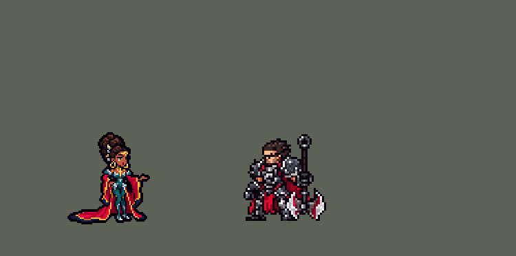

<!-- 本页上半部分由 tools/docs/gen_hero_docs.py 按仓库里现在的数据生成，手改会被覆盖；「开发记录」以下是手写的，生成时原样保留。 -->

# 梅尔 Mel


| 项目 | 内容 |
|---|---|
| id | `league_mel` |
| 所属的包 | 主包（mod_id `league`） |
| 分路 | ADC |
| 分类 / 标签 | 法师（Magician） · AP / Magic / Range / CC |
| 高清帧 | PPU 1.5 |
| 附加包 | [梅尔附加包](#附加包)（`league_mel`） |



其他预览：[逐帧预览](../preview/league_mel_frames.png)、[特效表](../preview/league_mel_effects.png)

## 现在的技能

下面是游戏里显示的技能说明（`league/text/champion.i18n` 的简体中文，去掉了颜色和图标），冷却、距离来自 `league/champion/league_mel.data_champion`；1 秒 = 60 tick。

### 普攻 / 被动

*攻击间隔 1.17 秒 · 攻击距离 55000*

射出金色光弹。灼灼之光：每放一个技能，下次普攻多射3枚光弹（最多9枚），每枚12 + 5% 法强魔法伤害；打中英雄叠一层夺命残影。灵魂折镜：每25秒第一次打中英雄时张开屏障1.25秒，受到的伤害减少50%并反弹40%，移速+25%。

### 技能1 · 耀光齐射

*冷却 6 秒 · 施放距离 85000 · 施放：指定目标 · 敌人（不含防御塔）*

耀光飞弹落在目标处，连续爆炸6次，每次对范围内的敌人造成22 + 15% 法强魔法伤害。

### 技能2 · 阳炎涡旋

*冷却 10 秒 · 施放距离 80000 · 施放：指定目标 · 敌人（不含防御塔）*

射出阳炎法球，中心的敌人受到60 + 50% 法强魔法伤害并被禁锢1秒；周围的敌人减速30%，1.5秒内受到10 + 6% 法强×4魔法伤害。

### 大招 · 鎏金蚀日

*冷却 35 秒 · 施放距离 70000 · 施放：指定目标 · 敌方英雄*

无视距离打击所有带夺命残影的敌方英雄，每层残影造成15 + 8% 法强魔法伤害。

### 数值

攻击力 72（每级 +5）、法强 40（每级 +24）、生命 920（每级 +95）、护甲 18（每级 +7）、魔抗 22（每级 +4）、移速 900（每级 +9）。

## 附加包

附加包是可选的原生代码 mod（都在附加包合集 `league_addons` 里），**不装主包里的英雄也是完整的**。

### 梅尔附加包

[梅尔附加包](../../addons/league_mel/README.md)：`league_mel` v0.1.3

主包 `league` 保持纯数据。用户选了「做附加包」，又要求「有连招要做连招」。主包的数据做不到英雄联盟里梅尔的两件事——**夺命残影的处决**（数据读不到生命，也数不了目标身上的层数）和**灵魂折镜的反弹**（没有效果能挡住或拐弯一个弹体）——所以放在这个附加包里用原生代码做，外加连招：

- **夺命残影的处决**：英雄联盟里梅尔每次打中都叠一层残影，残影的伤害够了，下一次打中就直接处决。副本里每一层残影（普攻、灼灼之光的光弹、Q 的每次爆炸、E 的法球中心打中英雄时）除了主包的残影（R 读它），还在英雄身上挂一层 `league_mel_m_mark`，并调 `league_mel:overwhelm`：那名英雄身上的层数 × (`x_st` 15 + `x_ratio` 8% 法强) ≥ 他的生命 + 护盾时，用真实伤害打掉剩下的生命（处决），并消耗本包的层数；放一次金色的处决画面和音效。
- **灵魂折镜**：英雄联盟里 W 生成屏障，把敌人的弹体反弹回去、她自己不受伤害、加移速。主包只能「每 25 秒第一次打中英雄时张开屏障」；副本去掉了这一条，被动 `league_mel:reflect` 每 tick 看一遍场上的弹体：
  - W 好了（`w_cd` 1500 tick）、一个敌方英雄的弹体飞到她 `w_near`（30000）以内，就张开屏障 `w_t`（75 tick）：受到的伤害减少 `w_red`% 50、反弹 `w_ref`% 40、移速 +`w_ms`% 25（和主包同名的 `league_mel_w_on`，画面一样），放 W 的音效和配音；
  - 屏障开着时，飞到她 `w_back`（6000）以内的每个敌方英雄的弹体（同一个人 20 tick 内只算一次）：复制一枚金色光弹飞回发射的人，按飞行时间打中，造成 `w_back_dmg` 40 + `w_back_r` 25% 法强魔法伤害。原来的弹体删不掉（接口只能读弹体），屏障减掉一半伤害。
- **连招**（用户：「有连招要做连招」；`src/combo.rs`）：AI 钩子 `league_mel:combo`（优先级 110，排在 league_ult_press 之后）替游戏的 AI 按 Q、E、R，像英雄联盟里会玩的人那样：
  - **E → Q**：AI 想用 Q 砸一个敌方英雄、E 好了、那名英雄在 E 的施放距离内：先替它按 E（阳炎涡旋的中心禁锢他）。
  - **禁锢住了接 Q**：法球禁锢了英雄（她身上开着 `league_mel_e_combo`）、Q 好了、Q 够得着被禁锢的敌方英雄：替 AI 朝他按 Q。主包数据里这时的 Q 快速落在被控住的英雄身上，六次爆炸全打在他身上。
  - **残影 → R**：鎏金蚀日打所有带残影的敌方英雄，伤害按层数算，所以 R 要等残影叠起来：一名英雄身上的残影够打掉他的生命 + 护盾（`R KILL`），或者两名以上英雄的残影都够打掉他们 40% 的生命（`R MANY`），才按 R；AI 自己想按 R 但两样都不够时不放，改成普攻它的目标（`R HELD`）。R 的施放点一名 R 距离内最近的敌方英雄（伤害是全图的）。
  - 被控住、正在放技能（施法动作）或被强制位移时什么都不做；格子的冷却自己看（引擎的「输入合法」不看冷却）。

## 相关脚本和素材

- [`tools/kit/build_mel.py`](../../tools/kit/build_mel.py)
- [`tools/kit/setup_mel.py`](../../tools/kit/setup_mel.py)
- [`tools/lol/extract_mel.py`](../../tools/lol/extract_mel.py)
- [`tools/art/preview_mel.py`](../../tools/art/preview_mel.py)
- [`tools/art/rig_mel.py`](../../tools/art/rig_mel.py)
- [`assets/source/mel/`](../../assets/source/mel)

## 开发记录

> 下面是原来 README 里「英雄：梅尔」一节，原样搬过来（只改了相对链接）。

| 部分 | 内容 |
|---|---|
| 定位 | 下路（Mage，标签 AP / Magic / Range / CC），第 144 位英雄，E 组的下路替补（英雄联盟里没有剩下的下路射手，法师梅尔顶上）。流光镜影 梅尔：深色皮肤、头顶高高盘起的黑色发髻，金色发饰和耳坠，深青绿的贴身长裙外披一件很长的深红长袍、身后拖着长长的下摆，金色的袖口和腰饰。用户的选择：「技能方案 A（Q / E / R，被动和 W 进普攻）」「做附加包」「只做 3/4 正面」「有连招要做连招」。团战经理只有三个主动技能位：技能 1 = Q 耀光齐射，技能 2 = E 阳炎涡旋，大招 = R 鎏金蚀日；被动灼灼之光（夺命残影）和 W 灵魂折镜在普攻里。技能名照英雄联盟 16.20.1 的 Data Dragon（五种语言） |
| 普攻 / 被动 / W | 射出金色光弹（射程 55000，100% 攻击，从她远侧的手心飞出）。**灼灼之光**：每放一个技能（Q、E、R），下次普攻多射 3 枚小光弹（最多 9 枚，腰间亮起 3 / 6 / 9 颗光点），每枚 12 + 5% 法强魔法伤害。**夺命残影**：普攻、每枚光弹、Q 的每次爆炸、E 的法球中心打中敌方英雄都叠一层残影（6 秒，每一层是英雄身上单独的一个效果，所以真的按次数叠）；主包里残影只给 R 用（数据读不到生命，做不了处决，附加包做）。**灵魂折镜**：每 25 秒第一次打中敌方英雄时张开金色屏障 1.25 秒：受到的伤害减少 50%、反弹 40%、移速 +25%（英雄联盟里只反弹弹体；数据挡不住弹体，附加包照英雄联盟做） |
| 技能1 | **Q 耀光齐射**（对小兵、野怪也放，射程 85000）：一阵光弹落在目标处，0.23 秒后开始连续爆炸 6 次、每次相隔 0.1 秒，半径 20000 内每次 22 + 15% 法强魔法伤害，每次给英雄叠一层残影（一个按节奏跳的圆，技能数据小，游戏每 tick 都复制它）。冷却 6 秒 |
| 技能2 | **E 阳炎涡旋**（对小兵、野怪也放，射程 80000）：朝目标射出一颗阳炎法球、一直飞到 95000：中心（6000）的敌人受到 60 + 50% 法强魔法伤害并被禁锢 1 秒；周围的光（17000）减速 30%（1.5 秒），1.5 秒内灼烧 4 次、每次 10 + 6% 法强魔法伤害。冷却 10 秒 |
| 大招 | **R 鎏金蚀日**（只对敌方英雄，射程 70000，开打时放）：头顶升起金色日蚀，全图每个带残影的敌方英雄身上落下一道天光，每层残影 15 + 8% 法强魔法伤害（按层数算，和英雄联盟一样）。实现：R 在她身上开一个 6 tick 的标记，残影每 6 tick 看一次，恰好每层打一次（SDK 实测 1 / 10 / 3 层分别打 1 / 10 / 3 次）。冷却 35 秒 |
| 连招 | 用户要求：「有连招要做连招」。主包数据里：**E → Q**——法球禁锢了英雄后 1.25 秒内放 Q，光弹 4 tick 就落在被控住的英雄身上，六次爆炸全打在他身上；每个技能都给下一下普攻加光弹。附加包的 AI 钩子替游戏的 AI 按：**E → Q**（AI 想用 Q 砸英雄、E 好了就先按 E）；**禁锢住了接 Q**；**残影 → R**（残影够打死一名英雄，或者两名以上英雄的残影都够打掉他们 40% 的生命才放，不够时留着大招、改成普攻） |
| 附加包 | 可选的附加包 [`addons/league_mel`](../../addons/league_mel/README.md)（在附加包合集里，原生代码，主包不装它也完整），照英雄联盟：**夺命残影的处决**（英雄身上的层数 × (15 + 8% 法强) 够打掉他的生命 + 护盾时，用真实伤害处决，头上的残影印记炸开金光）；**灵魂折镜挡弹体**（敌方英雄的弹体飞到她 30000 内、W 好了就张开屏障，屏障开着时每个飞到身边的弹体复制一枚金色光弹飞回发射的人，40 + 25% 法强魔法伤害）；上面的**连招**。日志 `league_mel.log`（SPAWN、EXECUTE、W UP、REFLECT、E FIRST / Q ON ROOT / R KILL / R MANY / R HELD） |
| 数值 | 攻击 72（+5）、法强 40（+24）、生命 920（+95）、护甲 18（+7）、魔抗 22（+4）、移速 900（+9）、射程 55000 |
| 平衡 | 10 分钟经典引擎模拟，下路对五个原版射手（archer / gunner / boomerang_hunter / poison_dart_hunter / bomber），三套阵容两边各打，两批种子：初稿 +1.56 / +1.25（约 +1.4，同批斯莫德 +1.36 / +2.00）。进游戏后用户：「梅尔在游戏里太变态了 几乎是垄断级别胜率的数值怪」「梅尔保留反弹，只削数值」——附加包的处决和反弹光弹在数据之外又加了一截，所以削到 **+0.45 / −0.21**（约 +0.1）：屏障减伤 100% → 50%（反弹 40% 保留），Q 每次 30 → 22，E 80 → 60，R 和处决每层 20 → 15，反弹光弹 60 + 40% → 40 + 25% 法强。附加包（原生代码）经典引擎跑不了，只有单元测试 |
| 精灵图（高清帧 PPU 1.5） | Codex 第 0 步画了 3/4 正面的长袍拖尾（A）和短袍两张（只做 3/4，不做侧面；[`tools/art/pack_mel_picture.py`](../../tools/art/pack_mel_picture.py)：英雄联盟模型的第一张贴图是白色的遮罩，`pose_ref.py --submesh-texture` 换上 `Mel_Base_TX_CM` 才有颜色；读回 [`design_mel_hd.py`](../../tools/art/design_mel_hd.py)，大小对比 [`review_mel_size.py`](../../tools/art/review_mel_size.py)），用户：「A 长袍拖尾」「44」「PPU 1.5」（66 行）。第 1 步 Codex 在游戏格子上画了三稿（[`pack_mel_model.py`](../../tools/art/pack_mel_model.py) / [`design_mel_model.py`](../../tools/art/design_mel_model.py)），用户选了 A-3（58 × 65，脸是 Codex 原画的）。动作照英雄联盟的动画由我自己拼（[`rig_mel.py`](../../tools/art/rig_mel.py)，用户：「我自己照英雄联盟摆」）：手、袖子整块移动不失真，长袍分成前片 / 拖尾 / 下摆 / 开衩，腿按英雄联盟的脚位画、弓步手摆；待机只在腰以上呼吸（整个上身往下沉会把腿压短，用户：「上下摆动导致腿部变形」）、跑（8 帧）、普攻（抬手 → 光弹）、Q（举手 → 光弹齐射）、E（推出法球）、R（举起 → 砸下）、挨打、阵亡（倒地、拖尾铺在身后）。对照英雄联盟的动画（[`review_mel_actions.py`](../../tools/art/review_mel_actions.py) 一张 GIF 左右对比）。选人卡片缩到 0.90（发髻很高） |
| 特效 | 18 张特效（[`tools/art/pack_mel_fx.py`](../../tools/art/pack_mel_fx.py) 的提示词，颜色照英雄联盟：金色和白金的光，品红-深红的点缀，R 的日蚀是黑色的日心加金色日冕），Codex 画好按格子交回；[`import_mel_fx.py`](../../tools/art/import_mel_fx.py) 照技能播放的位置摆好，写成 `league_mel_fx` 和 `league_mel_big`（齐射、法球、日蚀、天光、屏障，附加包的处决）。齐射照数据的节奏落下 6 次；三种飞行的光弹 / 法球画成朝右、上下对称（Codex 画的光弹上下不对称，导入时对折），别的全部左右对称（游戏不镜像特效图） |
| 音效 | 英雄联盟的音效和配音（[`tools/lol/extract_mel.py`](../../tools/lol/extract_mel.py)，16 段）：普攻出手 / 打中，光弹，Q 出手 / 爆炸，E 出手 / 禁锢，R 出手 / 打中，W 屏障 / 反弹，处决；Q、E、R、W 的配音（片段名 `league_mel_sfx_*`，和声音名不同） |
| 图标 | 官方技能图标（耀光齐射、阳炎涡旋、鎏金蚀日，另有灵魂折镜和灼灼之光），从本地客户端取 |

重新生成（素材来自本机的英雄联盟客户端，音频不进仓库）：

```bash
python tools/lol/extract_mel.py --lol "D:\WeGameApps\lol" --vgmstream <vgmstream-cli.exe>
python tools/kit/build_mel.py                       # 技能数据，数字都在脚本的参数表 P 里
python tools/kit/setup_mel.py --face 0,-30 --banpick -10   # 五种语言的文字、音效配置、共享文件里她的键
python tools/art/design_mel_model.py                # Codex 第 1 步的造型读回（A-3）
python tools/art/rig_mel.py                         # 1 倍帧和 1.5 的原帧
python tools/art/ppu_restyle.py --hero mel          # 外描边（不要加 --preview）
python tools/art/ppu_hd.py --hero mel               # hd_ / lo_ 帧
python tools/art/import_mel_fx.py                   # 特效
python tools/art/preview_mel.py                     # 预览和演示 GIF
python addons/league_mel/make_override.py           # 附加包的副本（主包的梅尔改了就重跑）
```

美术提示词见 [`assets/source/mel/`](../../assets/source/mel) 里的 `PICTURE_PROMPT.md`、`MODEL_PROMPTS.md`、`PROMPTS_FX.md`；Codex 的交付在 `codex_picture/`、`codex_model/`、`codex_fx/`。

逐帧预览：[`docs/preview/league_mel_frames.png`](../preview/league_mel_frames.png?v=1020a)，特效：[`docs/preview/league_mel_effects.png`](../preview/league_mel_effects.png?v=1020a)。
