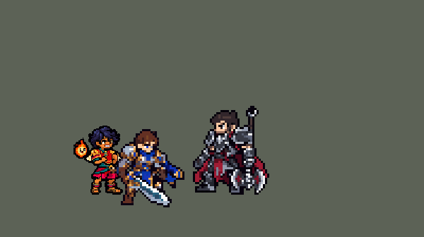

<!-- 本页上半部分由 tools/docs/gen_hero_docs.py 按仓库里现在的数据生成，手改会被覆盖；「开发记录」以下是手写的，生成时原样保留。 -->

# 米利欧 Milio


| 项目 | 内容 |
|---|---|
| id | `league_milio` |
| 所属的包 | 主包（mod_id `league`） |
| 分路 | 辅助 |
| 分类 / 标签 | 功能型（Util） · AP / Magic / Range / Heal / Shield |
| 高清帧 | PPU 2.2 |
| 附加包 | [米利欧附加包](#附加包)（`league_milio`） |



其他预览：[逐帧预览](../preview/league_milio_frames.png)、[特效表](../preview/league_milio_effects.png)

## 现在的技能

下面是游戏里显示的技能说明（`league/text/champion.i18n` 的简体中文，去掉了颜色和图标），冷却、距离来自 `league/champion/league_milio.data_champion`；1 秒 = 60 tick。

### 普攻 / 被动（被动「热情洋溢！」）

*攻击间隔 1.5 秒 · 攻击距离 53000*

射出小火球。被动热情洋溢！：技能触及的友方获得30%攻击力和法术强度（5秒），米利欧获得15%移速。

### 技能1 · 火爆飞踢

*冷却 7 秒 · 施放距离 75000 · 施放：方向 · 敌人（不含防御塔）*

踢出火球，击退命中的第一个敌人，随后火球落下，对周围敌人造成120 + 70% 法强魔法伤害并减速40%（1.5秒）。

### 技能2 · 融融情谊 / 依依不舍

*冷却 18 秒 · 可存 2 次 · 施放距离 90000 · 施放：指定目标 · 敌方英雄*

融融情谊（2次）：友方英雄获得80 + 40% 法强护盾和16%移速（2.5秒）。依依不舍：在其身上点燃营火6秒，每1秒治疗周围友方22 + 4% 法强并增加攻击距离。

### 大招 · 生生不息

*冷却 60 秒 · 施放距离 75000 · 施放：无目标 · 敌方英雄*

友方被控制或被敌人贴身时，为周围友方英雄恢复150 + 50% 法强生命，免疫控制1秒并获得65%韧性（3秒）。

### 数值

攻击力 85（每级 +6）、法强 30（每级 +15）、生命 950（每级 +88）、护甲 20（每级 +7）、魔抗 22（每级 +4）、移速 1000（每级 +10）。

## 附加包

附加包是可选的原生代码 mod（都在附加包合集 `league_addons` 里），**不装主包里的英雄也是完整的**。

### 米利欧附加包

[米利欧附加包](../../addons/league_milio/README.md)：`league_milio` v0.1.2

|  | 主包（纯数据） | 装了附加包 |
|---|---|---|
| 热情洋溢！ | E 和 R 触及的友方 5 秒内攻击力、法强 +30% | E、R 触及的友方（**营火每一跳也算**）身上挂记号（画面不变，攻击力、法强 +20%）；他**下一次打中敌人**（普攻或技能，不算防御塔）就把那个敌人点燃：**1.5 秒内 20-100 魔法伤害**（按米利欧的等级，1-12 级线性；对野怪最多 100），记号和加成随即用掉（没打到人 5 秒后过期） |
| 生生不息什么时候放 | AI 放出后待命 10 秒，期间友方被控制、敌方英雄贴身、或友方身边有敌方英雄就放 | 他身边（R 的圈小一圈）有友方英雄（**队友或他自己**）危险才放：身边有敌方英雄，而且**被硬控着**（眩晕、禁锢、击飞、嘲讽、恐惧、魅惑，还剩半秒以上），或**生命低于 30%**，或 **1 秒内被打掉三成、只剩六成以下**；几个人都危险时救最危险的。没人危险时 AI 想放 R，改成普攻，R 留着 |
| 解控 | 只给 1 秒免控（挡新的控制，已经在身上的眩晕还在） | R 生效时圈里身上有控制的友方英雄**真的被解控**（再加主包的 1 秒免控和韧性） |

## 相关脚本和素材

- [`tools/kit/build_milio.py`](../../tools/kit/build_milio.py)
- [`tools/kit/setup_milio.py`](../../tools/kit/setup_milio.py)
- [`tools/lol/extract_milio.py`](../../tools/lol/extract_milio.py)
- [`tools/art/preview_milio.py`](../../tools/art/preview_milio.py)
- [`tools/art/rig_milio.py`](../../tools/art/rig_milio.py)
- [`assets/source/milio/`](../../assets/source/milio)

## 开发记录

> 下面是原来 README 里「英雄：米利欧」一节，原样搬过来（只改了相对链接）。

| 部分 | 内容 |
|---|---|
| 定位 | 辅助（Util，标签 AP / Magic / Range / Heal / Shield），第 105 位英雄。明烛 米利欧（客户端里名字和称号是反着的，按官方）：远程 AP 软辅，伊施塔尔的火焰治疗小男孩。用户的选择（全按推荐）：辅助；技能 1 = Q 火爆飞踢，技能 2 = E 融融情谊 + W 依依不舍（W 冷却好时同一下给同一个队友点营火，玛尔扎哈 E→W 的做法，不会空放），大招 = R 生生不息；被动主包做近似 + 附加包做精确；高清 PPU 约 2.2；职业连招开 |
| 普攻 / 被动 | 小火球（攻击距离 53000，攻击间隔 90 tick，第 14 tick 出手，100% 攻击物理，追踪，从手心飞出）。「热情洋溢！」：英雄联盟里他的技能碰到的队友下一次命中会灼烧目标、米利欧加移速；数据跑不了别人的普攻，所以 E、W、R 碰到的队友 5 秒内攻击力和法强 +30%（娜美 E 的做法），米利欧移速 +15% 1.5 秒 |
| 技能1 | Q「火爆飞踢」：冷却 420 tick，方向施法，小兵、野怪也会踢（第 17 tick 踢出，从踢出去的脚飞出）。火球撞上的第一个敌人被撞退 14 像素；36 tick 后火球落在他被撞到的地方：半径 25000 内的敌人受到 120 + 70% 法强的魔法伤害、减速 40% 1.5 秒。优先踢贴近我方英雄的敌方英雄（职业连招） |
| 技能2 | E「融融情谊」（2 次）+ W「依依不舍」：冷却 1080 tick，敌方英雄在 90000 内时放（不在战斗里乱放）。一团暖焰从高举的手飞向队友（优先正被那个敌人贴着的队友，其次身边的队友，没人就给自己）：护盾 80 + 40% 法强、移速 +16% 2.5 秒。W 冷却（1500 tick）好时同一下在他脚下点起营火：6 秒跟着他走，每秒给半径 35000 内的队友英雄回 22 + 4% 法强、加 7000 攻击距离 |
| 大招 | R「生生不息」：冷却 3600 tick。数据读不到血量，做成阿利斯塔 R 那样先「上膛」600 tick：队友英雄被控制、敌方英雄贴近米利欧、或敌方英雄贴近身边的队友时才放，没用掉就退回冷却。第 20 tick（落地张开双臂）给 75000 内的队友英雄（包括自己）回 150 + 50% 法强、免疫控制 1 秒、韧性 65% 3 秒，并点燃热情洋溢 |
| 附加包 | 可选的附加包 [`addons/league_milio`](../../addons/league_milio/README.md)（在附加包合集里，原生代码，主包不装它也完整）：**热情洋溢照英雄联盟**——E、W 营火、R 碰到的队友（和米利欧自己）下一次命中让目标 1.5 秒内受到 20-100（按等级）的灼烧，打野怪最多 100，打出这一下标记就没了（队友打谁靠一个只旁观、不改操作的 AI 钩子记下来；0.1.2 起灼烧自己的那几跳不再算成谁打中的——引擎下一 tick 才结算它，0.1.1 会把它当成队友或米利欧的这一下，提前用掉记号）；**R 看血量放**——75000 内的队友英雄被控 0.5 秒以上、血量 ≤30%、或 1 秒内掉了 30% 且 ≤60%，并且附近有敌方英雄时才放，否则按住；**R 真解控**（圈里被控的队友直接解掉）。日志 `league_milio.log`（点燃 / 灼烧 / R 放出、按住、解控）。10-17 的游戏日志里查出了上面灼烧的毛病（0.1.1） |
| 数值 | 攻击 85（+6）、法强 30（+15）、生命 950（+88）、护甲 20（+7）、魔抗 22（+4）、移速 1000（+10）（同组远程辅助的属性） |
| 平衡 | 辅助位对五个基础辅助，两批 12 个种子：草案 d0 -2.02 偏弱，热情洋溢加到 30% / 5 秒、R 放宽、属性加上去后定下 d9：+0.28 / -0.25（平均 +0.02）。同组辅助（娑娜 +0.31、布隆 +0.28、娜美 +0.04、萨勒芬妮 0.00、璐璐 -0.07、巴德 -0.30、索拉卡 -1.07、迦娜 -1.15、卡尔玛 -1.71）的中间 |
| 精灵图（高清帧 PPU 2.2） | Codex 画了两张原画（A 只有男孩，B 肩后飘着加载画面里的小火精灵），用户选 B、发顶到鞋底 32 个游戏行；第 1 步 Codex 在格子上重画了正面和两稿侧身，用户选侧身 B（稍带 3/4）。[`tools/art/design_milio_hd.py`](../../tools/art/design_milio_hd.py) 从 Codex 的原稿读回造型（Codex 自己整理的 12 px 版本又糊了），侧身贴上正面那颗头。Codex 照英雄联盟的骨架画了 36 张动作细稿，[`tools/art/import_milio_strips.py`](../../tools/art/import_milio_strips.py) 读回：每帧的比例取头发、衣服、凉鞋三种面积的中位数（Codex 每帧画的大小不一样），造型的头贴进每一帧（手臂从头前经过时手在前），Q、R 跳起的帧保持离地，收招帧用侧身造型。跑步第一版两腿一直一前一后（用户：「走路没后交叉步 步伐没有变化」），按加里奥的办法让 Codex 照每帧的腿部骨架线只重画腿，[`tools/art/import_milio_run.py`](../../tools/art/import_milio_run.py) 取 Codex 原稿里自己画的腿（它交的成品是把一条腿逐段拉伸套上去的），排成两腿轮流、从身下交叉前摆的跑步。[`tools/art/rig_milio.py`](../../tools/art/rig_milio.py) 降到 2.2（同一颗头只降一次，每帧一样）、火精灵在他身后肩膀高度慢半拍跟着飘（死亡时缩小飘散）、待机呼吸、受击闪白 |
| 特效 | Codex 第 3 步的 15 个特效 + 8 张画进帧的图（`assets/source/milio/codex_fx`）。[`tools/art/import_milio_fx.py`](../../tools/art/import_milio_fx.py)：Codex 自己读回的小图太糊（暖焰的光丝成了点、Q 撞击的火环断开），15 张全部从原稿按我们的尺寸重读、逐格对称；Q 落地的火柱 Codex 画到他身高的两倍多，竖直压到 0.6。画进帧的 8 张（普攻手心的火球、Q 脚前的球和一脚踢飞、E 举手聚焰和送出、R 双手聚火 / 落地张臂的火和光环 / 余光）在 `rig_milio.py --pinholes` 叠到高清帧上。飞行物按画面定出手高度：手心、踢出去的脚、高举的手 |
| 音效 | 英雄联盟的音效和配音（`tools/lol/extract_milio.py`，15 段）：普攻出手 / 打中、Q 踢出 / 撞上 / 落地、E 抱住、W 营火 / 回血、R 出手 / 回血、被动点燃，配音 Q / W / E / R |
| 图标 | 官方技能图标（Q 火爆飞踢 / E 融融情谊 / R 生生不息，另有 W 依依不舍、被动热情洋溢），从本地客户端取 |

重新生成（素材来自本机的英雄联盟客户端，音频不进仓库）：

```bash
python tools/lol/extract_milio.py
python tools/kit/build_milio.py                    # 技能数据，数字都在脚本的参数表 P 里
python tools/kit/setup_milio.py                    # 五种语言的文字、音效配置、共享文件里他的键
python tools/art/design_milio_hd.py                # Codex 的原稿读回成正面和侧身造型
python tools/art/import_milio_strips.py            # Codex 的动作细稿读回
python tools/art/import_milio_run.py               # 重画腿的跑步
python tools/art/rig_milio.py                      # 1 倍帧和 2.2 的高清帧
python tools/art/ppu_restyle.py --hero milio       # 描边
python tools/art/import_milio_fx.py                # 特效和画进帧的图
python tools/art/rig_milio.py --pinholes           # 补小洞、叠上画进帧的图
python tools/art/ppu_hd.py --hero milio            # hd_ / lo_ 帧
python tools/art/preview_milio.py                  # 预览和演示 GIF
python addons/league_milio/make_override.py        # 附加包的副本（主包的米利欧改了就重跑）
```

美术提示词见 [`assets/source/milio/`](../../assets/source/milio) 里的 `PICTURE_PROMPT.md`、`MODEL_PROMPTS.md`、`MODEL_STRIPS.md`、`RUN_PROMPT.md`、`PROMPTS_FX.md`；Codex 的交付在 `codex_picture/`、`codex_model/`、`codex_strips/`、`codex_run/`、`codex_fx/`。

逐帧预览：[`docs/preview/league_milio_frames.png`](../preview/league_milio_frames.png?v=1015a)，特效：[`docs/preview/league_milio_effects.png`](../preview/league_milio_effects.png?v=1015a)。
