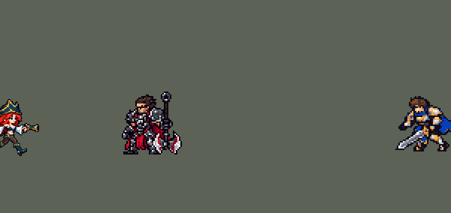

<!-- 本页上半部分由 tools/docs/gen_hero_docs.py 按仓库里现在的数据生成，手改会被覆盖；「开发记录」以下是手写的，生成时原样保留。 -->

# 厄运小姐 Miss Fortune


| 项目 | 内容 |
|---|---|
| id | `league_missfortune` |
| 所属的包 | 主包（mod_id `league`） |
| 分路 | ADC |
| 分类 / 标签 | 射手（Range） · AD / Range |
| 高清帧 | 1 倍像素（无高清帧） |
| 附加包 | [目标标记附加包](#附加包)（`league_marks`） |



其他预览：[逐帧预览](../preview/league_missfortune_frames.png)、[特效表](../preview/league_missfortune_effects.png)

## 现在的技能

下面是游戏里显示的技能说明（`league/text/champion.i18n` 的简体中文，去掉了颜色和图标），冷却、距离来自 `league/champion/league_missfortune.data_champion`；1 秒 = 60 tick。

### 普攻 / 被动（被动「厄运的眷顾」）

*攻击间隔 1 秒 · 攻击距离 55000*

双枪射击，造成100% 攻击力的物理伤害。被动厄运的眷顾：对新目标的第一枪（她击杀上一个目标后，或1.25秒没开枪后）额外造成40% 攻击力的物理伤害。

### 技能1 · 一箭双雕

*冷却 6 秒 · 施放距离 60000 · 施放：指定目标 · 敌人（不含防御塔）*

射出一发子弹，对命中的第一个敌人造成20 + 100% 攻击力的物理伤害，子弹继续飞，对其身后的下一个敌人造成20 + 140% 攻击力的物理伤害（含厄运的眷顾）。第一发击杀目标时，第二发暴击，伤害翻倍。

### 技能2 · 枪林弹雨

*冷却 10 秒 · 施放距离 70000 · 施放：地点 · 敌人（不含防御塔）*

向目标区域倾泻2秒弹雨，每0.25秒对区域内的敌人造成10 + 15% 攻击力的物理伤害（共80 + 120% 攻击力）并减速40%。随后大步流星：4秒内获得40% 攻击速度和20% 移动速度。

### 大招 · 弹幕时间

*冷却 50 秒 · 施放距离 75000 · 施放：地点 · 敌方英雄*

原地引导3秒，向前方锥形区域连射12波子弹，每波对其中的敌人造成15 + 45% 攻击力的物理伤害，可以暴击。她受到眩晕、禁锢、击飞等控制或阵亡时引导中断。

### 数值

攻击力 100（每级 +20）、生命 900（每级 +90）、护甲 20（每级 +7）、魔抗 15（每级 +3）、移速 900（每级 +9）。

## 附加包

附加包是可选的原生代码 mod（都在附加包合集 `league_addons` 里），**不装主包里的英雄也是完整的**。

### 目标标记附加包

[目标标记附加包](../../addons/league_marks/README.md)：`league_marks` v0.1.1

| 英雄 | 主包（纯数据） | 装了附加包（英雄联盟） |
|---|---|---|
| 厄运小姐 爱心一击 | 上一个目标被她打死，或 1.25 秒没开枪，下一枪算新目标 | 和上一枪打的不是同一个人就算新目标 |

## 相关脚本和素材

- [`tools/lol/extract_missfortune.py`](../../tools/lol/extract_missfortune.py)
- [`tools/art/preview_missfortune.py`](../../tools/art/preview_missfortune.py)
- [`tools/art/import_missfortune.py`](../../tools/art/import_missfortune.py)
- [`assets/source/missfortune/`](../../assets/source/missfortune)

## 开发记录

> 下面是原来 README 里「英雄：厄运小姐」一节，原样搬过来（只改了相对链接）。

| 部分 | 内容 |
|---|---|
| 定位 | ADC（Range），第三组第四个，本包第三个射手（艾希、金克丝之后） |
| 普攻 | 双枪射出子弹，100% 攻击力的物理伤害，射程 55000（英雄联盟 550，比艾希的 600 短一点） |
| 被动 | 「厄运的眷顾」：对新目标的第一枪额外造成 40% 攻击力的物理伤害，目标身上爆一颗红心。引擎读不出"这一枪和上一枪是不是同一个目标"（`SwitchByBuff` 只看施法者身上的 buff，在目标身上挂一个长时间的隐藏标记又一定会显示状态图标：`Bleed` 流血、`Fire` 燃烧、`Heal` 治疗、`Poison` 中毒，引擎只收这四种），所以近似为：她上一枪（或 Q 的第一发）打死了目标，或者 1.25 秒没开枪（新的一场战斗）。模拟里她换目标的 134 次里有 98 次是旧目标死了，其中 91 次是她自己补的刀；停火超过 1.25 秒后的普攻 87% 打的是新目标。漏掉的是 AI 在旧目标活着时主动换人。约一半的普攻带红心 |
| 技能1 | Q「一箭双雕」：一发子弹射向目标，打中的第一个敌人受到 20 + 100% 攻击力的物理伤害；再打中它身后的下一个敌人，造成 20 + 140% 攻击力（含被动）。第一发打死目标时，第二发暴击（×2），就是英雄联盟里补死小兵、暴击身后英雄的打法。英雄联盟的第二发在身后的扇形里弹射；引擎的随机选目标会把第一个目标再选一次，在子弹停下的地方放扇形也一样（范围效果按实体编号结算、英雄在前，不按远近，第一个目标总在扇形里）。所以同时射出两发同速（12000）的穿透子弹：看得见的窄子弹（半径 5000）只结算第一个敌人；看不见的宽子弹（半径 20000）在第一发命中后等 1 tick，之后 7 tick 内碰到的第一个敌人吃第二发（一次性的锁），不会再打回第一个目标。第一版只有窄子弹，身后的敌人要正好站在弹道上，游戏里几乎弹不到第二个英雄：同样 6 局模拟，第二发打到英雄 14 次（大多打在和第一个目标挤在一起的小兵上），现在 46 次，最远到第一个目标身后 88000。子弹速度 7000 时 AI 会侧身躲开约 15%，提到 12000 后每发都中。射程 60000，冷却 6 秒，也对小兵和野怪放 |
| 技能2 | E「枪林弹雨」：在目标区域下 2 秒弹雨（半径 30000），每 0.25 秒一波，每波 10 + 15% 攻击力的物理伤害（共 80 + 120%），减速 40%。英雄联盟的 E 是吃法强的法术伤害，她在这里没有法强，改成吃攻击力。合并 W「大步流星」：放完 E 后 4 秒攻速 +40%、移速 +20%。W 的被动（一段时间没受伤后加移速）引擎没有"未受伤"的触发，只保留主动部分。射程 70000，冷却 10 秒，也对小兵和野怪放 |
| 大招 | R「弹幕时间」：原地引导 3 秒，朝施放时锁定的方向（`Position` 施法）连射 12 波，每波对 50° 锥形（±25°，`Forward` + `DirDot`，长 100000）内的敌人造成 15 + 45% 攻击力的物理伤害，动作类型是普攻，所以每波都吃暴击率。模拟里眩晕打断不了已经排好的延时效果，所以每一波先找"自己身边 1 格内被控制的友方英雄"（就是她自己）：被眩晕、禁锢、击飞、击退、恐惧、魅惑时下一波起停止；她死了也停（每波检查引导 buff）。只对英雄放，冷却 50 秒。2026-10-01 加宽：原来是 40°（±20°），而且只管画面的矩形（`LineRangeProjectile` 100000 × 36000，没有效果）作用对象写的是敌人，AI 把它当成要躲的技能，每一波都往两边让、让出了锥形：下路 144 局里每次 R 打中英雄 4.75 次（每波 0.43 个，三分之二的波一个英雄都没打中），射程内敌方英雄偏离中线的中位角度从第 1 波的 5° 涨到第 12 波的 50°。只加宽锥形帮助不大（±25° 5.1 次、±30° 5.4 次、±35° 5.7 次），矩形改窄到 1000 宽、锥形 ±25° 是 6.6 次；现在锥形 ±25°，矩形只作用于友方（`applied_target: Ally`，大小和画面不变；敌人不再躲它，友方也没有去躲）：每次 R 7.1 次（每波 0.67 个）。击杀差两批 +3.34 / +2.78（改前 +2.77 / +3.09，在两批之间的波动以内），造成的伤害多 5% |
| 附加包 | 可选的附加包 [`addons/league_marks`](../../addons/league_marks/README.md)（在附加包合集里，原生代码，主包不装它也完整）：爱心一击照英雄联盟打在每一个新目标上（主包是上一个目标死了或 1.25 秒没开枪） |
| 连招 | 用户要求：「有连招要做连招」「都要帮我补」。英雄联盟里厄运小姐先 E 弹雨减速一片，再开 R 弹幕时间扫射走不出锥形的人。原来 E 和 R 各放各的，R 总要先蓄势 8 tick 才射第一波。**E→R**：弹雨里有敌方英雄时（一个只对英雄的隐形弹雨，和弹雨同样大小、同样 2 秒、每 15 tick 一次），厄运小姐身上的连招窗口一直开着（最后一次碰到英雄后再留 60 tick，1 秒）；窗口里放 R，第 1 tick 就开始引导、射出第一波（平时第 8 tick），整段弹幕时间（12 波，被控就停、阵亡就停）照旧，只是提前 7 tick。伤害、减速、波数、冷却都不变；窗口不用掉（R 冷却 50 秒）。R 的效果树多了一份（游戏每 tick 只复制技能 1、技能 2，大招的大小不影响性能），E 只多一个隐形弹雨。数据由 [`tools/fix/combo_missfortune.py`](../../tools/fix/combo_missfortune.py) 改 |
| 数值 | 攻击 100（+20）、生命 900（+90）、护甲 20（+7）、魔抗 15（+3）、移速 900（+9），攻击间隔 1 秒，和原版射手一样。没有其他 mod 做过她，数值是自己设计的，用 SDK 对战模拟调：打下路，三套队友阵容、两边各 36 局，团队击杀差 +4.41；原版射手 `gunner` +3.43、`soldier` +2.74、`archer` +2.43、`gambler` +1.91，本包艾希 +3.78、金克丝 +4.19。按美术定下的出手帧（普攻、Q、E、R 都在第 8 tick），初版（被动 60%、E 冷却 9 秒）是 +5.50，改成被动 40%、E 冷却 10 秒。再把 R 每波降到 40% 是 +4.47，没有差别，所以 R 保持 45%。Q 改成宽子弹找第二个目标后是 +4.39（同样的局，修前 +4.41），伤害略高，数值不用动 |
| 亚索联动 | 她只有减速，不算亚索大招要的控制，亚索不用调 |
| 精灵图 | 2026-10-04 用户在游戏里看到待机「有点怪异」（白色 T 形的肚皮、远侧手臂一块白、左上的枪像飘在头发边）：照英雄联盟原版在游戏尺寸下描（`tools/art/fix_missfortune_model.py`，逐帧补丁在 `assets/source/missfortune/modelfix/`），有明暗的腰腹、白布喇叭袖和前臂，枪拿在英雄联盟的位置（远侧垂在大腿边、近侧在腰间）；枪改成带握把和喇叭口的手枪，一个持枪姿势里只用一张图（「武器不自然啊」「右边的枪移动时变形」）。8 个动作 49 帧：待机、跑步、普攻、Q、E、R、受击、死亡。帽顶到脚底 36 px（原版戴帽子的赌徒 36、枪手 37 也把帽子算在内），23 色，动作全部取自英雄联盟原版动画 |
| 特效 | 普攻子弹、红心子弹、普攻命中、红心爆开、Q 子弹、Q 命中、弹射命中（带红心）、暴击爆炸、大步流星、弹雨区域、R 的扇形弹幕、R 命中火花 |
| 图标 | 官方技能图标（Q / E / R），64×64 |
| 音频 | 从本地客户端提取的 10 条技能音效和 3 条中文语音（Q、W、R；E 没有语音，E 的施放音带 W 的台词）。不提交到仓库，按下面的命令在本地生成 |

```bash
python tools/lol/extract_missfortune.py --lol "D:\WeGameApps\lol" --vgmstream "<vgmstream-cli.exe 路径>"
python tools/lol/native_pose.py assets/source/missfortune/poses.json --out <渲染文件夹> --alpha --parts
python tools/art/restyle_native.py assets/source/missfortune/poses.json --renders <渲染文件夹>   # 角色图
python tools/art/import_native.py --hero missfortune
python tools/art/import_missfortune.py      # 特效；--raw <Codex 的交付文件夹> 先把原始图转成原尺寸条
python tools/art/preview_missfortune.py
```

美术（提示词见 [`assets/source/missfortune/PROMPTS.md`](../../assets/source/missfortune/PROMPTS.md)）：
- 分工：角色图由 Claude 画，Codex 只画特效。
- 比例和镜头：镜头 yaw 35、pitch 25，不镜像（看得到脸和胸前，两把枪都在）。帽子是头部下面的 `Hat` 骨骼，放大头会连帽子一起放大：头 1.7 时三角帽占了 35 行里的 10 行、脸只有 4 行。改成头 2.1、帽子单独 0.75（`"scale": {"Hat": 0.75}`），脸大到能画三行的眼睛，帽子仍是三角帽；腿 0.65，头发 0.5，两把枪是武器部件（`^[lr]_weapon$`）。
- 造型图：先在英雄联盟 36 格的剪影上按材质整体投色（帽子、头发、皮肤、白袖子、深青色、深色），再逐格画头：更宽、两个尖角、金色帽带的三角帽，刘海，蓝眼睛，暗红唇，远侧的头发鼓出脸颊（竖直的一条边在深色卡片上像半个头）。三个脸里用户选了 C（三行眼、上挑眼线、红唇），又觉得眼睛上方那排纯黑睫毛紧贴刘海"一坨黑线太怪"；从三种改法里选了 C1：去掉上挑、睫毛改成暗红棕色。
- 动作图：头部贴在每一帧英雄联盟头部关节的位置，身体按造型图的颜色逐帧投色。死亡时两把枪脱手就隐藏（逐帧 `hide`），贴头不旋转（`"turn": {"dead": 180}`），停在 3.4 秒趴在地上抬着头的那一帧：再往后英雄联盟里她的腿翘到头顶上，转 90° 或竖着的头都会压在腿上。待机 6 帧都用第 1 帧，第 3–5 帧靴筒以上下移 1 格呼吸；跑步用待机时的头部朝向（`head_like`）。
- 特效用 Codex 画的 12 张（生图原稿，R 的一波是黑底）：`import_missfortune.py --raw` 按交付清单的 `source_rect` 切帧，黑底按亮度转透明，按技能范围定大小：普攻子弹 12 px、红心子弹 14 px、命中 14 px、红心爆开 18 px、Q 子弹 20 px、Q 命中 22 px、弹射 24 px、暴击 32 px、R 火花 10 px、大步流星的地圈 20 px、弹雨地圈 60 px 宽（半径 30000）。弹雨是在施法点播放的特效（`ViewEffect`），不随施法方向旋转：第一版把它做成弹雨区域（投射物）的画面，投射物画面会转向施法方向，在中路往左放时子弹往上飞。R 的一波压成 100 × 72 px（长 100000 的矩形，Codex 画的 ±20°），枪口固定在每一格的同一列，子弹逐帧往前飞；锥形加宽到 ±25° 后（2026-10-01），导入的第二步把七发子弹各自整颗往外挪到 1.3 倍远，成 100 × 93 px，子弹本身不缩放，最外两发落在新锥形的边上（演示动图跟着加高 12 px，免得最下面一发出画）。
- 出手时刻和动画对齐：普攻、Q、E、R 都在第 8 tick（普攻第 3 帧开枪、Q 第 3 帧、E 举枪朝天那一帧、R 蓄势后的第一发）。
- 结果：23 色，和右边像素同色的比例 35%（原版英雄 18%–46%）。头像截取点 (1, −34)：和赌徒一样在帽顶下 1 格。
- 黑边（2026-10-01，用户：「顺便帮我清理一下厄运小姐的黑边部分 干净一点」）：加进 `import_native.py` 的 `COMPLETE` 和 `CLEAN`。动作帧的外圈大多是另一种近黑（`#030203`，待机是 `#040213`），几处金色、发梢的边没描。现在缺描边的浅色边外补一格（582 格），外圈的近黑统一成待机那种，双层描边的内鼓包（96 格）和碎点（76 格）改成旁边的颜色，斜阶梯多出的一格去掉（42 格），眼睛周围的脸不动。第一版直接用菲奥娜的规则，逐帧审查（6 个审查代理看完四个英雄的每一帧）发现它把鞋底削成尖、把李青的黑辫子削细、把枪口、发梢、手腕红条纹这些深色像素直接涂黑、把画里第二种近黑画的内部分隔线当碎点改掉；现在用严格规则（`strips.clean_outline(strict=True)`，`import_native.py` 的 `STRICT`）：两种近黑都算描边，外圈只把近黑统一成一种，不把任何有颜色的像素涂黑，补描边新加的像素不改色，碎点只算周围一格内没有别的近黑的那种，阶梯外角只在斜阶梯处去掉（方角、直线、实心的深色块不动），找不到眼睛的帧（倒地、转身）整帧不改色。

逐帧预览：[`docs/preview/league_missfortune_frames.png`](../preview/league_missfortune_frames.png?v=1014g)，特效：[`docs/preview/league_missfortune_effects.png`](../preview/league_missfortune_effects.png?v=1014g)。
