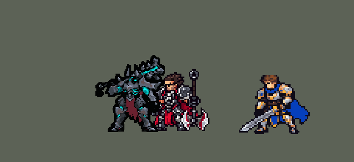

<!-- 本页上半部分由 tools/docs/gen_hero_docs.py 按仓库里现在的数据生成，手改会被覆盖；「开发记录」以下是手写的，生成时原样保留。 -->

# 莫德凯撒 Mordekaiser


| 项目 | 内容 |
|---|---|
| id | `league_mordekaiser` |
| 所属的包 | 主包（mod_id `league`） |
| 分路 | 上单 |
| 分类 / 标签 | 近战（Melee） · AP / Magic / Melee / Shield / CC |
| 高清帧 | PPU 2（画成 110%） |
| 附加包 | [莫德凯撒附加包](#附加包)（`league_mordekaiser`） |



其他预览：[逐帧预览](../preview/league_mordekaiser_frames.png)、[特效表](../preview/league_mordekaiser_effects.png)

## 现在的技能

下面是游戏里显示的技能说明（`league/text/champion.i18n` 的简体中文，去掉了颜色和图标），冷却、距离来自 `league/champion/league_mordekaiser.data_champion`；1 秒 = 60 tick。

### 普攻 / 被动

*攻击间隔 1.07 秒 · 攻击距离 25000*

黑暗起兮：普攻附带40% 法强魔法伤害。普攻、Q、E命中英雄叠层，3层时移速+3%，每0.5秒对周围敌人造成4 + 15% 法强 + 1% 最大生命魔法伤害。

### 技能1 · 破灭之锤

*冷却 6 秒 · 施放距离 38000 · 施放：指定目标 · 敌人（不含防御塔）*

挥锤砸向前方一条直线，造成80 + 70% 法强魔法伤害；只砸中一个敌人时改为112 + 98% 法强。

### 技能2 · 断魂一扼

*冷却 2 秒 · 施放距离 50000 · 施放：指定目标 · 敌方英雄*

甩出断魂之爪，造成60 + 60% 法强魔法伤害并把敌人拉到身前。冷却中被英雄贴近时改为不坏之身：获得70 + 60% 法强护盾，护盾仍在时回复40 + 40% 法强生命。

### 大招 · 轮回绝境

*冷却 60 秒 · 施放距离 48000 · 施放：指定目标 · 敌方英雄*

诅咒一名敌方英雄7秒：偷取其10%攻击、法强、护甲、魔抗和生命，逃远会被拉回；期间将其击杀则回复150 + 50% 法强生命。

### 数值

攻击力 74（每级 +9）、法强 50（每级 +20）、生命 1040（每级 +104）、护甲 32（每级 +8）、魔抗 25（每级 +4）、移速 980（每级 +11）。

## 附加包

附加包是可选的原生代码 mod（都在附加包合集 `league_addons` 里），**不装主包里的英雄也是完整的**。

### 莫德凯撒附加包

[莫德凯撒附加包](../../addons/league_mordekaiser/README.md)：`league_mordekaiser` v0.1.4

主包 `league` 保持纯数据。用户要了附加包；问到「R做不了独特空间吗？」，选了「放逐两人 + 附加包算单挑」，并且「嘲讽不做」（和英雄联盟一样）。这个附加包用原生代码做主包数据做不到的两件事：

- **轮回绝境（R）真的把人拖进领域**：主包里 R 是诅咒 7 秒、按固定数值偷属性、跑远了被拉回。附加包的 `league_mordekaiser:realm` 在 R 出手那一 tick：
  - 在射程（48000，加两人身体）里挑**攻击 + 法强最高**的敌方英雄（英雄联盟里大家都把大招给对面的核心）；
  - 按他此刻的面板**真偷 10%**：攻击、法强、护甲、魔抗、最大生命（他身上 `league_mordekaiser_r_curse` 减，莫德身上 `league_mordekaiser_r_steal` 加，7 秒）；
  - 两人都被**放逐 7 秒**：离开战场，谁也选不中、看不见；原地留一个 `league_mordekaiser_r_realm` 漩涡；
  - 领域里的单挑由附加包算：被动每 tick 看，谁的攻击间隔到了谁出手（`deal_damage` 走引擎自己的伤害流程：护甲魔抗、击杀、统计都算）。莫德每下 攻击 + 40% 法强，外加满层黑暗起兮的光环（每 0.5 秒 4 + 15% 法强 + 1% 最大生命）；对方每下 攻击 + 40% 法强（代替他的技能）；
  - 对方死在领域里：莫德回复 150 + 50% 法强，偷来的属性再留 15 秒（英雄联盟：留到对方复活），莫德提前出来；莫德先死：对方提前出来；都活着就 7 秒后两人在原地出现。
- **不坏之身（W）按伤害攒护盾**：主包的护盾是固定数值。附加包的被动在他每次命中时攒打出伤害的 45%（打小兵、野怪按 25% 算），每次受伤时攒受到伤害的 15%，最多最大生命的 30%，脱战 1 秒后慢慢掉。W 放出时整份变成护盾（至少最大生命的 5%，3 秒），2.5 秒后按护盾还剩多少回复 40%（护盾剩余量引擎能直接读到）。

## 相关脚本和素材

- [`tools/kit/build_mordekaiser.py`](../../tools/kit/build_mordekaiser.py)
- [`tools/kit/setup_mordekaiser.py`](../../tools/kit/setup_mordekaiser.py)
- [`tools/lol/extract_mordekaiser.py`](../../tools/lol/extract_mordekaiser.py)
- [`tools/art/preview_mordekaiser.py`](../../tools/art/preview_mordekaiser.py)
- [`tools/art/rig_mordekaiser.py`](../../tools/art/rig_mordekaiser.py)
- [`tools/art/import_mordekaiser.py`](../../tools/art/import_mordekaiser.py)
- [`assets/source/mordekaiser/`](../../assets/source/mordekaiser)

## 开发记录

> 下面是原来 README 里「英雄：莫德凯撒」一节，原样搬过来（只改了相对链接）。

| 部分 | 内容 |
|---|---|
| 定位 | 上单（Melee，标签 AP / Magic / Melee / Shield / CC），第 96 位英雄。铁铠冥魂 莫德凯撒：扛着大锤「夜临」的亡灵铁甲巨人，普攻物理，技能全是魔法伤害。用户的选择：上单、近战 AP 战士；技能1 = Q，技能2 = E 接 W，大招 = R 诅咒单挑（后来「嘲讽不做」，附加包里做成「放逐两人 + 附加包算单挑」的独特空间）；被动做在主包里；加入高手连招；附加包；高清帧（PPU） |
| 普攻 / 被动 | 锤击（攻击距离 25000，第 10 tick 打中，攻击间隔 64 tick），100% 攻击物理 + 40% 法强魔法。「黑暗起兮」：普攻、Q、E 打中英雄各叠一层（每层 240 tick，打中就刷新），三层时移速 +3%，身边一圈黑暗光环：他每出一招就起一段 120 tick 的脉冲（league_amumu 绝望的做法），每 30 tick 对 24000 内的敌人造成 4 + 15% 法强 + 自身最大生命 1% 的魔法伤害。E 的被动「法术穿透」是一个永久的 10% 魔法穿透 |
| 技能1 | Q「破灭之锤」：冷却 360 tick，对 38000 内的敌人放（小兵野怪也算），第 10 tick 锤子往目标方向砸出一条直线（42000 长、半宽 6000），80 + 70% 法强魔法伤害；同一下只砸中一个敌人时（英雄联盟的「孤立」，同一 tick 一条计数线先数人数）改为 112 + 98% 法强。**高手连招**：E 拉到英雄后 120 tick 内放 Q 没有前摇 |
| 技能2 | E「断魂一扼」和 W「不坏之身」共用技能位（技能位冷却 120 tick，E、W 各有自己的冷却标记：E 780、W 720）。E：第 8 tick 从他手里甩出一道鬼爪（54000 长、半宽 6000），60 + 60% 法强魔法伤害，把线上的敌人拉到身前，打中英雄叠被动。E 在冷却、40000 内有敌方英雄时放 W：70 + 60% 法强护盾 180 tick，150 tick 后护盾还在就回复 40 + 40% 法强生命（英雄联盟是按剩余护盾的一部分回血，数据读不到护盾量，附加包做） |
| 大招 | R「轮回绝境」：冷却 3600 tick，对 48000 内的敌方英雄放，第 8 tick 诅咒他 420 tick（英雄联盟的 7 秒领域）：他攻击、法强、护甲、魔抗、最大生命 −10%，莫德凯撒攻击 +12、法强 +25、护甲 +8、魔抗 +6、生命 +150（数据读不到对方的面板，附加包按真实面板偷）；每 30 tick 看他跑出 45000 就拉回来（数据里没有「距离」：从他脚下放一个 45000 的圈，圈里找不到莫德凯撒就拉）；他死在诅咒里，莫德凯撒回复 150 + 50% 法强，偷来的属性再留 900 tick。没有嘲讽（用户：「嘲讽不做啊 和英雄联盟一样」）。**高手连招**：R 出手后 120 tick 内放 E 没有前摇 |
| 附加包 | 可选的附加包 [`addons/league_mordekaiser`](../../addons/league_mordekaiser/README.md)（在附加包合集里，原生代码，主包不装它也完整）。用户：「R做不了独特空间吗？」——数据做不到把两个人隔开；隐身也隔不开（视野整队共享，贴身单挑时两队都看得见），所以附加包的 R **把射程里攻击 + 法强最高的敌方英雄和莫德凯撒一起放逐 7 秒**：两人离开战场，谁也选不中、看不见，原地留一个领域漩涡；领域里的单挑由附加包算（两人按各自的攻击间隔出手，引擎自己的伤害流程：莫德凯撒攻击 + 40% 法强外加满层光环，对方攻击 + 40% 法强代替技能），按对方此刻的真实面板偷 10%；对方死在里面，莫德凯撒回血、属性多留 15 秒并提前出来，莫德凯撒先死则对方提前出来。W 的护盾按他打出伤害的 45%（打小兵野怪 25%）和受到伤害的 15% 攒（上限最大生命 30%），快结束时按护盾还剩多少回复 40%。附加包里的莫德凯撒是 `make_override.py` 从主包生成的副本，技能 2 和大招的说明以「【附加包】」开头。日志 `league_mordekaiser.log`。领域里的单挑还没在游戏里看过日志 |
| 数值 | 攻击 74（+9）、法术强度 50（+20）、生命 1040（+104）、护甲 32（+8）、魔抗 25（+4）、移速 980（+11）。SDK 对战模拟：上单位，对 6 个原版上单（`fighter`、`executioner`、`lancer`、`pole_warrior`、`knight`、`berserker`），两边、三套队友阵容各 24 局。团队击杀差（种子 1–24）+1.60，同一批艾瑞莉娅 +1.67、雷克顿 +1.78、格温 +1.33；带嘲讽的第一版 +1.98 / +2.71 偏强，削了生命和 W（+1.11 / +1.42），去掉嘲讽后只剩 +0.41，生命和 W 恢复、Q 80（孤立 112） |
| 精灵图（高清帧 PPU 5，2026-10-13 画风统一后 PPU 2.2，同日放大到 115% 时 PPU 2.0（见开头）） | 原画 A（3/4 正面，锤子扛在肩上）按 Codex 原稿自己的格子读回当造型（[`tools/art/design_mordekaiser_hd.py`](../../tools/art/design_mordekaiser_hd.py)，166×246 格、48 色；Codex 自己整理的 8 px 版是缩小过的 14 色，没用），用户选「描边加粗」（卡萨丁的做法：外描边加粗 3 格），大小先选 110%，装进游戏后「铁男感觉做的太大了吧？」改成 95%，又「铁男再稍微调大点」定为 100%（连锤子约 49 个游戏像素、身体约 43，和达瑞斯、诺提勒斯放在一起量过）；画风统一以后和牛头站一起显小、还是太清晰（「为什么模型看起来小啊 牛头那种就看起来很大」「铁男再游戏里还是过于高清」），按大小对比图改成 115%、PPU 2.0（连锤子约 55 个游戏像素，每个游戏像素 1.74 格；帧上移 3 格让脚底留在地上）；装进游戏后「铁男和布隆游戏里偏大了」，按大小对比图改回 100%（连锤子约 47 个游戏像素，泰坦 51；帧下移 3 格，RESTYLE lift_sq，像素不变）；游戏 0.6.4 时「铁男模型太小」「铁男到110%吧」——110%（连锤子约 52 个游戏像素；帧比 115% 时下移 1 格，像素不变）。用户：「待机姿势和走路放技能的时候应该不一样的」——待机和卡片用 A（约 30°），**移动和所有技能身体转向右边 65°**（从英雄联盟模型的 30 / 50 / 65 / 80° 里选的）：Codex 照 65° 画了站姿、走路 4 张和普攻举锤 / 砸下、Q 举锤 / 砸地、E 伸爪、R 锤指前方（`codex_run`、`codex_turned`），读回后亮度对齐到同一档、上半身站在同一列。用户：「我自己缩小和补尖刺」——两张举锤比站姿高一成，按「每组删损失最小的一行 / 一列」缩回站姿的高度、再贴回原尺寸的头盔；普攻砸下被 Codex 切平的锤头尖刺从原稿读回（锤头砸进地里一点）。[`tools/art/rig_mordekaiser.py`](../../tools/art/rig_mordekaiser.py)：待机呼吸（上半身抬 1–2 格），W 是站姿闪青绿，受击后退加闪白，死亡是第一轮 Codex 画的单膝跪地和仰面倒下。1 倍帧（没有 league.dll 时用）是高清帧每 5×5 一块取多数色 |
| 头像 | 截取点 (1, −29)，画风统一后 (1, −27)：头盔顶（不算两根角） |
| 特效 | Codex 生图的 17 张（用户贴来的总览图，下载文件夹里的 10 张无损 PNG，[`tools/art/import_mordekaiser.py`](../../tools/art/import_mordekaiser.py) 按卡萨丁的做法切格：每个特效一个缩放、颜色贴回灵魂青绿 / 黑烟 / 铁色 / 碎石四套配色；红色方的对称逐格检查：Q 的地裂和 E 的鬼爪上下对称、从他脚下往前铺，其余左右对称；贴地的画面按底边对齐）：`league_mordekaiser_fx` 锤击打中、光环烧到、Q 砸中 / 孤立重击、E 抓中、W 护盾 / 回血、R 诅咒印记 / 拉回 / 领域击杀 / 头顶诅咒冠；`league_mordekaiser_big` 被动光环、Q 地裂 / 砸地冲击、E 鬼爪、R 开大漩涡、领域入口（附加包放逐时播放，循环 7 秒）。Q 的地裂和 E 的鬼爪各是一条只带画面的直线（伤害线只活 2–3 tick，看不见） |
| 音效 | 英雄联盟的音效和配音（`tools/lol/extract_mordekaiser.py`）：锤击 / 打中、被动叠满、Q 砸地 / 砸中、E 甩出 / 抓中、W 护盾 / 回血、R 开大 / 领域击杀；Q、E、W、R 各用他自己的技能台词（片段名 `league_mordekaiser_sfx_vo_*`，和声音名不同）。版权属于 Riot Games，**不提交到仓库**，按下面的命令在本地生成 |
| 图标 | 官方技能图标（Q 破灭之锤 / E 断魂一扼 / R 轮回绝境，另有 W 不坏之身、被动），从本地客户端提取，缩到 64×64 |
| 修正（附加包 0.1.1） | 用户让查游戏日志时发现：领域里对手先死后，莫德凯撒自己还隐身、选不中到 7 秒满（日志每次「R WON」后都是 `STILL BANISHED`，一天 95 次；他先死时对手 0 tick 就出来）——游戏 0.6.4 解不开他身上那份带漩涡的长放逐。现在他的放逐一次 24 tick、单挑还在就每 12 tick 续上，漩涡单独播；提前结束最多再放逐 0.4 秒（[`addons/league_mordekaiser`](../../addons/league_mordekaiser)） |
| 修正（走路，2026-10-22） | 用户：「铁男的走路也要改」。原来的走路是 Codex 照 65° 画的 4 帧（每帧 133 毫秒）：第 1、3 帧迈出去的是同一条腿，第 2、4 帧抬的也是同一条，像一直拖着一条腿走；每帧的盔甲各画各的，上身每帧形状都在变。现在是 8 帧，照英雄联盟的 walk（它的 run 把后脚踢到水平，对他太轻巧；关节由 [`tools/lol/pose_joints.py`](../../tools/lol/pose_joints.py) 读成 `assets/source/mordekaiser/run_joints.json`，近侧是英雄联盟的左腿）。上身每帧都是 65° 站姿原样，随英雄联盟的胯部上下起伏；两条腿用站姿自己的腿甲（大腿甲、膝甲、护胫、铁靴，靴子上的红边跟着脚走），按英雄联盟大腿、小腿的角度绕胯、膝、踝转（站地的脚落在地上，膝盖最多弯 30°），下面垫一条用护胫自己的颜色画的腿，甲片转开的地方不露缝；转过的格子取最近的格子的颜色，画风统一缩到 PPU 2.0 后看不出转的锯齿。远侧的腿暗一档，近侧的大腿在布条下面、膝甲以下在布条上面（[`rig_mordekaiser.py`](../../tools/art/rig_mordekaiser.py) `run`）。步子照以前的「铁男的走路步伐感觉有点大啊」收着：英雄联盟角度的 45%，游戏里两脚最宽 34.5 像素（待机 31，Codex 那两帧原来是 42 / 47.5，后来收到 31.5 / 30.5）；一圈仍是 533 毫秒。画风统一那一步的 16 色仍按原来那 4 帧取（[`ppu_restyle.py`](../../tools/art/ppu_restyle.py) `palette_fit`，原来的走路留在 `codex_run/run_palette_orig.png`），其他动作一个像素都没变。主包 0.189.16、`league.dll` 0.7.103 |

重新生成（素材来自本机的英雄联盟客户端，音频不进仓库）：

```bash
python tools/lol/extract_mordekaiser.py --lol "D:\WeGameApps\lol" --vgmstream "<vgmstream-cli.exe 路径>"
python tools/kit/build_mordekaiser.py            # 技能数据，数字都在脚本的参数表 P 里；--nodes 看每棵技能树的节点数
python tools/kit/setup_mordekaiser.py            # 五种语言的文字、音效配置、共享文件里他的键
python tools/art/design_mordekaiser_hd.py        # 原画 A 读回成高清造型
python tools/lol/pose_joints.py assets/source/mordekaiser/poses.json --tag run --joints Pelvis,L_Hip,L_KneeLower,L_Foot,L_Toe,R_Hip,R_KneeLower,R_Foot,R_Toe --json assets/source/mordekaiser/run_joints.json   # 走路：英雄联盟 walk 的腿部关节
python tools/art/rig_mordekaiser.py              # 高清帧 + 1 倍帧（league_mordekaiser 和 assets/source/ppu/orig/mordekaiser_*.png）
python tools/art/ppu_restyle.py --hero mordekaiser   # 画风统一（PPU 2.0）
python tools/art/ppu_hd.py --hero mordekaiser
python tools/art/import_mordekaiser.py           # 特效：总览图切格，拼成特效表
python tools/art/preview_mordekaiser.py          # 预览和演示 GIF
python addons/league_mordekaiser/make_override.py    # 附加包的副本（主包的莫德凯撒改了就重跑）
```

美术（提示词见 [`assets/source/mordekaiser/`](../../assets/source/mordekaiser) 里的 `PICTURE_PROMPT.md`、`POSE_PROMPTS.md`、`TURNED_PROMPTS.md`、`PROMPTS_FX.md`）：

- 原图：Codex 画了 A（3/4 正面）和 B（正侧面），用户选 A；B 的原稿格子比 A 粗，没用。
- 造型：A 的原稿按它自己的格子读回（`hd/front.png`）。
- 动作：第一轮 Codex 照 A 的角度画了 13 张姿势（`codex_poses`，现在只用其中的死亡两张）；用户要求走路和技能转身后，第二轮照 65° 画了站姿、走路 4 张、技能 6 张（`codex_run`、`codex_turned`）；走路 2026-10-22 起改成 65° 站姿自己的腿甲按英雄联盟 walk 的关节转（8 帧，见上面的修正）。
- 特效：17 张来自 Codex 的总览图（`codex_fx/`）。

逐帧预览：[`docs/preview/league_mordekaiser_frames.png`](../preview/league_mordekaiser_frames.png?v=1022m)（游戏里用的 hd_ 高清帧），特效：[`docs/preview/league_mordekaiser_effects.png`](../preview/league_mordekaiser_effects.png?v=1014g)。
