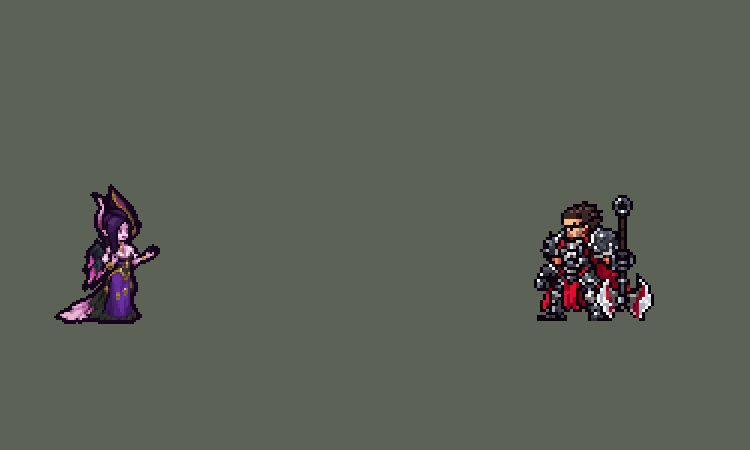

<!-- 本页上半部分由 tools/docs/gen_hero_docs.py 按仓库里现在的数据生成，手改会被覆盖；「开发记录」以下是手写的，生成时原样保留。 -->

# 莫甘娜 Morgana


| 项目 | 内容 |
|---|---|
| id | `league_morgana` |
| 所属的包 | 主包（mod_id `league`） |
| 分路 | 辅助 |
| 分类 / 标签 | 功能型（Util） · AP / Magic / CC / Shield / Heal |
| 高清帧 | PPU 1.5 |
| 附加包 | 无 |



其他预览：[逐帧预览](../preview/league_morgana_frames.png)、[特效表](../preview/league_morgana_effects.png)

## 现在的技能

下面是游戏里显示的技能说明（`league/text/champion.i18n` 的简体中文，去掉了颜色和图标），冷却、距离来自 `league/champion/league_morgana.data_champion`；1 秒 = 60 tick。

### 普攻 / 被动（被动「灵魂吸取」）

*攻击间隔 1.5 秒 · 攻击距离 50000*

普攻射出一团暗影，造成100% 攻击力的物理伤害。被动 灵魂吸取：技能对英雄造成伤害时，为自己回复约为伤害15%的生命值。

### 技能1 · 暗之禁锢

*冷却 9 秒 · 施放距离 80000 · 施放：方向 · 敌人（不含防御塔）*

射出暗之禁锢，穿过小兵和野怪，对沿途敌人造成80 + 60% 法术强度的魔法伤害，停在第一个敌方英雄身上并将其禁锢2秒。每12秒同时在其脚下留下折磨之影，4秒内共造成80 + 40% 法术强度的魔法伤害。

### 技能2 · 黑暗之盾

*冷却 8 秒 · 施放距离 90000 · 施放：指定目标 · 敌方英雄*

对敌方英雄施法，为身边一名友方英雄套上150 + 70% 法术强度的护盾，持续5秒，护盾存在时免疫控制。身边没有队友时护住自己。

### 大招 · 灵魂镣铐

*冷却 50 秒 · 施放距离 45000 · 施放：指定目标 · 敌方英雄*

锁住身边所有敌方英雄，造成170 + 80% 法术强度的魔法伤害并减速20%，自身移动速度提高20%。跑出锁链范围的敌人会挣断锁链；3秒后仍被锁住的敌方英雄再受到一次伤害并被眩晕1.5秒。

### 数值

攻击力 75（每级 +6）、法强 30（每级 +16）、生命 900（每级 +95）、护甲 22（每级 +8）、魔抗 25（每级 +4）、移速 1000（每级 +10）。

## 相关脚本和素材

- [`tools/lol/extract_morgana.py`](../../tools/lol/extract_morgana.py)
- [`tools/art/preview_morgana.py`](../../tools/art/preview_morgana.py)
- [`tools/art/import_morgana.py`](../../tools/art/import_morgana.py)
- [`assets/source/morgana/`](../../assets/source/morgana)

## 开发记录

> 下面是原来 README 里「英雄：莫甘娜」一节，原样搬过来（只改了相对链接）。

| 部分 | 内容 |
|---|---|
| 定位 | 辅助（Util），第五组的辅助，凯尔的妹妹；本包第五个辅助（索拉卡、蕾欧娜、迦娜、锤石之后），第一个给队友免疫控制的辅助 |
| 普攻 | 射出一团暗影弹，100% 攻击力的物理伤害，射程 50000，攻击间隔 1.5 秒 |
| 被动 | 「灵魂吸取」：Q、W、R 打中英雄时按伤害的约 15% 给自己回血（数据读不到实际伤害，按技能数值的 15% 写死：Q 12 + 9% 法术强度，W 每跳 2 + 1%，R 每段 25 + 12%） |
| 技能1 | Q「暗之禁锢」，合并 W「折磨之影」（用户选的 A）：射出暗影弹核，穿过小兵和野怪，对沿途敌人造成 80 + 60% 法术强度的魔法伤害，停在第一个敌方英雄身上并禁锢 2 秒。两发同路径的弹：一发看不见、穿透的弹打伤害，一发可见、只认英雄的弹负责停下和禁锢；禁锢的下一 tick 起伤害弹不再伤人，被定住的英雄身后的单位不会挨打。每 12 秒同时在被定住的英雄脚下留下折磨之影，4 秒内共 80 + 40% 法术强度的魔法伤害。射程 80000，冷却 9 秒，也对小兵和野怪放；射程内有敌方英雄时朝英雄射（AI 对兵线放技能时一般瞄小兵，初版 39 次 Q 只定住 5 次英雄）。弹速 10000：英雄联盟的 Q 很慢，但这里英雄每 tick 走约 1000，弹速 3500 时 AI 躲掉九成，10000 时 36% 的 Q 定住英雄 |
| 技能2 | E「黑暗之盾」（用户选的 A，迦娜 E 的规则）：对射程内的敌方英雄施法（所以只在打架时放），给身边（50000 内）一名友方英雄套上 150 + 70% 法术强度的护盾，持续 5 秒，护盾在时免疫控制；身边没有队友时给自己。护盾挡所有伤害（游戏的护盾不分类型），不像原版只挡魔法。实测免疫控制对队友有效：3 局里带盾的英雄只被控过 1 次。射程 90000，冷却 8 秒 |
| 大招 | R「灵魂镣铐」（用户选的 A，原版规则）：身边有敌方英雄就放，锁住 50000 内所有敌方英雄，造成 170 + 80% 法术强度的魔法伤害并减速 20%，自己移速 +20%。每个被锁的英雄各有一条锁链：每 1/3 秒从莫甘娜向他发一个看不见的检查弹，在命中点判断她是否还在锁链范围内（84000，按原版 1050 / 625 的比例），在就续上减速和锁链画面；跑出范围一次锁链就断，之后不再减速、也不会被眩晕（和英雄联盟一样）。3 秒后仍被锁住的英雄再受一次伤害并被眩晕 1.5 秒。她中途阵亡锁链全断。冷却 50 秒。第一版在 3 秒时眩晕范围内所有敌方英雄（跑出去又回来的、没被锁过的也算），按用户反馈改成逐条检查 |
| 数值 | 攻击 75（+6）、法术强度 30（+16）、生命 900（+95）、护甲 22（+8）、魔抗 25（+4）、移速 1000（+10）。数值是自己设计的，用 SDK 对战模拟调：打辅助，对 5 个原版辅助（`priest`、`bard`、`enchanter`、`monk`、`taoist`），两边、三套队友阵容各 24 局，一批 720 局。初稿 -2.96（Q 几乎定不住英雄）；Q 改成朝英雄射、弹速 10000 后 -1.04；护盾 80 → 150、E 冷却 10 → 8 秒、R 半径 40000 → 50000 后 -0.11（12 局一组）；按动作帧定下出手时机（普攻第 8 tick、Q 第 9 tick、E 第 12 tick、R 第 10 tick）后两批 +0.54 / +0.32，同样两批迦娜 +0.11 / +0.31、锤石 +0.80 / +0.34、蕾欧娜 +0.78 / +1.23。R 改成逐条锁链检查后眩晕少了（被锁的英雄约六成 3 秒内阵亡、两成跑出范围），两批掉到 −0.16 / −0.22；R 伤害 120 + 60% → 170 + 80%、Q 伤害 70 → 80 后回到 +0.27 / +0.67（R 150 + 70% 为 +0.23 / −0.15，R 170 + 80% 不改 Q 为 −0.12 / +0.31）。莫甘娜每局放 Q 约 38 次（定住英雄 13–21 次，W 9–15 次）、E 约 19 次、R 约 3.5 次 |
| 亚索联动 | Q 的禁锢和 R 的眩晕都能触发亚索的 R：莫甘娜在队里时亚索每局 R 到被控英雄 1.52 次（迦娜 0.94、原版牧师 0.65；R 改成逐条锁链之前测的，现在 R 的眩晕更少，只会更低），在本包辅助的范围内，亚索不用调 |
| 精灵图 | 8 个动作 50 帧：待机、移动、普攻、Q、E、R、受击、死亡。造型按用户给的新立绘重做（方案 A），Codex 画：Q 版大头，两只金边弯角的王冠、黑紫长卷发、尖耳，背后半张开的黑紫羽翼（下半截洋红），紫金开衩长裙；角尖到脚底 45 px、35 px 宽，26 色。每帧的时机和站位照英雄联盟原版动画渲染的参考帧 |
| 高清帧（PPU 1.5） | 2026-10-16 按 Codex 的新原画用 PPU 重做（用户：「帮我利用PPU重做一下娜美 莫甘娜 锐雯的模型吧 动作帧就不让codex做了 参照塔姆那样慢慢做就行了 特效还是老样子」，后来「娜美 风女 莫甘娜可以先合并」）：原画读成 PPU 1.5 的造型，切成几个零件，动作不让 Codex 画，全部从造型自己摆（[`tools/art/ppu_rig.py`](../../tools/art/ppu_rig.py)），零件只整格移动或从原画按角度重新取样，身体本身不变形（[`tools/art/rig_morgana_hd.py`](../../tools/art/rig_morgana_hd.py)，原画 [`assets/source/morgana/hd/picture.png`](../../assets/source/morgana/hd/picture.png)，角尖到裙摆 45 个游戏像素）：举起的手臂（肩到张开的手）按肩转，远侧收在身后的青色翅膀、拖在地上的粉色裙尾、裙子、上半身各是一个零件。画风统一只把外描边加粗一格（[`tools/art/ppu_restyle.py`](../../tools/art/ppu_restyle.py)），每个动作的帧数、时间和站位和原来一样，特效照旧；`hd_` 帧由 [`tools/art/ppu_hd.py`](../../tools/art/ppu_hd.py) 写进图里。 |
| 特效 | 暗影弹和命中、Q 暗影弹核（冰蓝核心、锁链尾迹）和穿透命中的星芒、禁锢（脚下光环，两股锁链缠上身）、W 焦油地（裂纹透洋红光、冒紫烟）、E 黑暗之盾（紫色罩子、冰蓝下沿）、R 出手爆环（扩到大招范围）、锁链扣中、持续锁链（腰上一圈、一段拉向左边）、锁链崩断和头顶的眩晕法阵 |
| 图标 | 官方技能图标（Q / E / R），64×64 |
| 音频 | 从本地客户端提取的 10 条技能音效和 2 条中文语音（Q、R；E 没有施法语音，W 的语音会和 Q 叠在一起，不用）。不提交到仓库，按下面的命令在本地生成 |

```bash
python tools/lol/extract_morgana.py --lol "D:\WeGameApps\lol" --vgmstream "<vgmstream-cli.exe 路径>"
python tools/lol/native_pose.py assets/source/morgana/poses.json --out <渲染文件夹> --alpha --parts
python tools/art/tidy_morgana.py <Codex 的动作交付文件夹>   # 角色图：整理 Codex 按造型 A 画的动作原稿，写进 assets/source/native/
python tools/art/import_native.py --hero morgana
python tools/art/import_morgana.py      # 特效；--raw <Codex 的特效交付文件夹> 先把原始图转成原尺寸条
python tools/art/rig_morgana_hd.py    # 高清帧（PPU 1.5）：从原画的造型摆出全部动作，写 assets/source/ppu/orig/
python tools/art/ppu_restyle.py --hero morgana
python tools/art/ppu_hd.py --hero morgana
python tools/art/preview_morgana.py
```

美术（造型的提示词见 [`assets/source/morgana/MODEL_REDESIGN.md`](../../assets/source/morgana/MODEL_REDESIGN.md)，8 张动作图的见 [`MODEL_REDESIGN_STRIPS.md`](../../assets/source/morgana/MODEL_REDESIGN_STRIPS.md)，第一版造型 B 的见 [`MODEL_PROMPTS.md`](../../assets/source/morgana/MODEL_PROMPTS.md)，特效的见 [`PROMPTS.md`](../../assets/source/morgana/PROMPTS.md)；Codex 五次交付的交接说明、清单和实际用的提示词在 [`codex_model/`](../../assets/source/morgana/codex_model)）：
- 分工：模型和特效都由 Codex 画（从卢锡安起的分工），Claude 写提示词包、整理和导入。
- 造型：第一版 Codex 交 A / B / C 三个造型草稿，用户选 B（羽冠、收着的黑翅），按它做完了动作和特效（整理工具 `draft_to_grid.py` 和它的 `morgana_design.json` 在提交 314e2c9 及之前）。之后用户给了一张新立绘，造型重做（`MODEL_REDESIGN.md`）：Codex 交 A（翅膀半张开）/ B（收拢）两张生图原稿（1254 px，四万多种颜色），用户让 Claude 选，选了 A。整理到游戏尺寸：按原稿自己的像素网格取色（59×76 格、24 色），头发、翅膀、长裙的暗紫色用 3×3 多数色压平，按阿狸那一轮（18 个英雄重画）的做法每组删掉和相邻最像的一行（列）缩到 44 行（不按颜色投票，投票会把脸糊掉），补一圈描边、描边里面换成材质的暗色。远处的眼睛原来只有 1 格（用户：“怎么就一个眼睛”），改成两只 2×2、同一行、中间隔 2 格皮肤，脸加宽到 7 格，用户通过。35×45 px、26 色，眼睛的 #C83CA6 只用在 6 格眼睛上。
- 动作参考：镜头镜像、yaw 20、pitch 25（英雄联盟的待机是侧身站，这样拖尾落在身后），头放大到 2.4 倍，隐藏展开的翅膀和花；96×96 的格子，脚底在站位点下 11 行（`native/morgana_cells.json`）。给 Codex 的参考包：现在的动作 8 倍、英雄联盟同一帧的渲染、对位图（渲染只在本地）。
- 整理（`tidy_morgana.py`）：Codex 按造型 A 画的 8 张动作图也是生图原稿（50 帧，品红底，几万种颜色，每张比例不同：一个游戏像素 4.4–7.2 个原稿像素）。在游戏像素上整理：每张按站着的帧定比例（角尖到脚底 45 行），每个像素取原稿中心 3×3 的中位色、映射到造型的 26 色；每帧只贴造型的脸（额头、睫毛、双眼、脸颊、嘴、下巴，8 行 7 格，放在和画的脸最吻合的位置），头发和角留 Codex 画的、跟着身体动（第一版整个头贴上去，跳起那帧头和身体像分开了）；受击第 1 帧和死亡第 4–7 帧贴闭眼的脸（两条短线），死亡最后一帧脸朝下照原稿；眼睛对到英雄联盟那一帧头的位置（普攻、Q 的前倾照原版），受击和死亡整张用同一个相对站位点的偏移，身体不左右滑；最低一行对齐脚底（R 照原版离地，移动有上下起伏，倒地的帧可低 2 行，`morgana_targets.json`）；暗紫色和造型一样用 3×3 多数色压平（金饰、皮肤、洋红和描边不动）；描边用原稿画的那一圈（取色后散在几种近黑色上，统一换成造型的描边色），只在取色丢了描边的地方补一格，描边里面的黑圈换成材质的暗色。第一版在每帧外面又套了一圈描边，每帧比待机胖一格（面积多 10%–20%），放技能时像变大了一下，用户从 GIF 里看出来后改掉。
- 导入：待机 6 帧用造型本身，第 3–5 帧裙摆下沿往上 5 行以上下沉一格呼吸（`BOB`，接缝的两行只差 8 格阴影）；移动按眼睛的颜色把头稳在同一列（`EYES`）；头像截取点 (−2, −41)，在两只角之间的发顶。
- 特效用 Codex 画的 11 张（生图原稿，真透明，69 帧）：`import_morgana.py --raw` 按交付清单切帧，每张 16 色、硬透明。R 爆环和命中的切线挪进了图形之间的空隙，格子不等宽，所以锚点都量在图上：弹和命中量白色亮核，禁锢量脚下光环，焦油地量椭圆（上面的烟不算），护盾量下沿，持续锁链量腰环（左边拉出的锁链和上面的烟不算），眩晕量法阵。按技能范围定大小：暗影弹 14 px 长，Q 弹核连锁链尾迹 28 px（带刺的球约 14 px，弹的判定半径 7000），命中 14–20 px，禁锢从光环到锁链顶 36 px（到 35 px 英雄的头顶），焦油地的椭圆 44 px 宽（半径 22000），护盾 42 px 高，R 爆环的圆环 100 px（半径 50000），腰环 22 px，崩断 28 px，法阵 24 px。暗影弹和 Q 弹核以亮核为中心上下镜像成严格对称（游戏按方向转，朝左时整张转 180°）。禁锢一次播 2 秒（缠上 3 帧、循环 4 帧 ×4、断开 2 帧），焦油地 4 秒，崩断加眩晕 1.5 秒（崩断在腰上，法阵在头顶，离地 40 px），护盾是 buff 的三段（升起、保持、碎开）。
- 结果：26 色，和右边像素同色的比例 40%（原版英雄 18%–46%）。
- 眼睛和脸型（10 月 8–9 日，用户：“莫甘娜的眼睛……像英雄联盟一点”“莫甘娜脸型要改”，两次都选 A）：2×2 的粉眼换成一行发光的紫眼（外侧亮紫 #C9A6FF、内侧深紫 #8A4FE0，下面一行是皮肤，外眼角往上挑一格，`fix_morgana_eyes.py`）；方下巴收成正中的尖下巴（嘴那行左右各留 2 格，下一行各留 1 格，再下面一格是下巴尖，切掉的格子变描边，`fix_morgana_face.py`，每帧按自己的眼睛找中线，躺倒的死亡帧不动）。`clean_morgana.py` 给每帧贴的干净头部也换成新脸，而且改成认紫色眼睛：它原来认粉色，眼睛换色后头部就没贴上，游戏里露出了生图原稿那些杂乱的方块。`import_native.py` 稳头用的眼睛颜色换成深紫，算出来每帧的头列和原来用粉色时一样。和 main 比，每帧只改了脸上 15–21 格。待机第 3、7 帧腰下面和 main 上的图差 62 格：这是 10 月 8 日呼吸第二版改了切线挑法（同一份源图在 main 上重新导入也这样），以前没有重新导入。

逐帧预览：[`docs/preview/league_morgana_frames.png`](../preview/league_morgana_frames.png?v=1017a)，特效：[`docs/preview/league_morgana_effects.png`](../preview/league_morgana_effects.png?v=1017a)。
