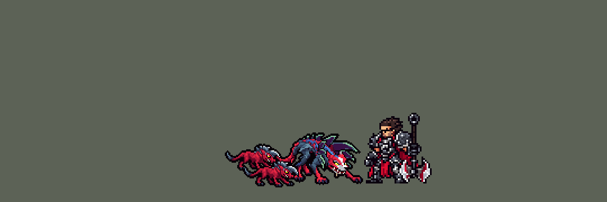

<!-- 本页上半部分由 tools/docs/gen_hero_docs.py 按仓库里现在的数据生成，手改会被覆盖；「开发记录」以下是手写的，生成时原样保留。 -->

# 纳亚菲利 Naafiri


| 项目 | 内容 |
|---|---|
| id | `league_naafiri` |
| 所属的包 | 主包（mod_id `league`） |
| 分路 | 打野 |
| 分类 / 标签 | 刺客（Assassin） · AD / Melee |
| 高清帧 | PPU 1.5 |
| 附加包 | [纳亚菲利附加包](#附加包)（`league_naafiri`） |



其他预览：[逐帧预览](../preview/league_naafiri_frames.png)、[特效表](../preview/league_naafiri_effects.png)

## 现在的技能

下面是游戏里显示的技能说明（`league/text/champion.i18n` 的简体中文，去掉了颜色和图标），冷却、距离来自 `league/champion/league_naafiri.data_champion`；1 秒 = 60 tick。

### 普攻 / 被动

*攻击间隔 0.97 秒 · 攻击距离 23000*

扑咬目标。狂烈种群：每次普攻和技能命中时狗群一起撕咬，造成8 + 12% 攻击力物理伤害（非英雄单位减半）。

### 技能1 · 暗裔犬牙

*冷却 1 秒 · 施放距离 50000 · 施放：指定目标 · 敌人（不含防御塔）*

掷出匕首，造成30 + 25% 攻击力物理伤害并流血5秒（共30 + 45% 攻击力）；狗群扑向命中的英雄撕咬3秒。4秒内下次普攻掷出第二把匕首，造成35 + 55% 攻击力，命中英雄回复35 + 30% 攻击力生命。

### 技能2 · 剔骨本能

*冷却 1 秒 · 施放距离 32000 · 施放：指定目标 · 敌人（不含防御塔）*

冲向目标，撕裂周围的敌人两次，造成35 + 50% 攻击力和25 + 40% 攻击力物理伤害。

### 大招 · 猎狗血性

*冷却 50 秒 · 施放距离 60000 · 施放：指定目标 · 敌方英雄*

暴吼：0.75秒不可选取，5秒内狗群翻倍、攻击力+20%、移速+20%；随后扑向敌方英雄，造成70 + 65% 攻击力物理伤害、减速并降低20%护甲。7秒内参与击杀可再扑一次，获得70 + 40% 攻击力护盾。

### 数值

攻击力 100（每级 +18）、生命 940（每级 +88）、护甲 26（每级 +8）、魔抗 18（每级 +4）、移速 1100（每级 +13）。

## 附加包

附加包是可选的原生代码 mod（都在附加包合集 `league_addons` 里），**不装主包里的英雄也是完整的**。

### 纳亚菲利附加包

[纳亚菲利附加包](../../addons/league_naafiri/README.md)：`league_naafiri` v0.1.1

|  | 主包（纯数据） | 装了附加包 |
|---|---|---|
| 第二把匕首 | 固定伤害 | 目标每损失 1% 生命多 1% 伤害（空血时翻倍，英雄联盟的 ExecuteMultiplier 2） |
| 再扑 | 扑中的英雄 7 秒内阵亡就能再扑一次（只看那一个） | 扑中后 7 秒内**她参与的任何一次英雄击杀**（击杀或助攻）都让大招就绪、再扑一次（一次大招只给一次） |
| 开大 | 游戏 AI 射程里有英雄就开 | 只在**扑得死**（飞扑 + 两把匕首 + 一半流血 + 剔骨 + 狗咬、按护甲算，打得穿生命和护盾）、**有队友一起打**（目标生命 60% 以下、旁边有我方英雄）或**团战**（她身边两名以上我方英雄、射程里两名以上敌方英雄）时开，扑最该扑的那个；不值得时 AI 想开大就改成普攻原目标；再扑时扑射程里生命最少的 |
| 狗群 | 两只伙伴画在她自己的帧里，一直两只 | 暴吼期间她的每个动作换成图里四只狗的 `p4_*` 版本 |

装上附加包后游戏里显示的说明（和主包不同的部分）：

- **技能1 · 暗裔犬牙**：【附加包】掷出匕首，造成30 + 25% 攻击力物理伤害并流血5秒；狗群扑向命中的英雄。4秒内下次普攻掷出第二把匕首，造成35 + 55% 攻击力，目标每损失1%生命多1%伤害，命中英雄回复35 + 30% 攻击力生命。
- **大招 · 猎狗血性**：【附加包】暴吼：0.75秒不可选取，狗群翻倍、攻击力+20%、移速+20%；随后扑向敌方英雄，造成70 + 65% 攻击力物理伤害、减速并降低20%护甲。7秒内每次参与击杀都可再扑一次，获得70 + 40% 攻击力护盾。

## 相关脚本和素材

- [`tools/kit/build_naafiri.py`](../../tools/kit/build_naafiri.py)
- [`tools/kit/setup_naafiri.py`](../../tools/kit/setup_naafiri.py)
- [`tools/lol/extract_naafiri.py`](../../tools/lol/extract_naafiri.py)
- [`tools/art/preview_naafiri.py`](../../tools/art/preview_naafiri.py)
- [`tools/art/rig_naafiri.py`](../../tools/art/rig_naafiri.py)
- [`assets/source/naafiri/`](../../assets/source/naafiri)

## 开发记录

> 下面是原来 README 里「英雄：纳亚菲利」一节，原样搬过来（只改了相对链接）。

| 部分 | 内容 |
|---|---|
| 定位 | 打野（Assassin，标签 AD / Melee），第 148 位英雄。百裂冥犬 纳亚菲利：暗裔匕首附身的沙漠猎犬头犬，深红色的狼头、白色口鼻斑纹、黄眼睛、嘴角叼着匕首的骨柄，背和肩上是石板蓝的甲壳，脖子和肩上一大圈深紫色、镶薄荷绿边的刀刃；**两只狗群伙伴（深红色的小猎犬，戴着带前刃的灰色骨头盔）画在她自己的每一帧里**，跟着她站、跑、扑咬（10-20 之后分组的 F 组；用户：「改打野啊」——计划里排在中单，按用户改成打野）。照英雄联盟 16.20 的技能。团战经理只有三个主动技能位：技能 1 = Q 暗裔犬牙，技能 2 = E 剔骨本能，大招 = R 猎狗血性，W 暴吼并进大招的起手（高手的 W → R）；被动狂烈种群在每一下命中里。技能名照英雄联盟 16.20 的 Data Dragon（五种语言；W、R 两个键 14.x 互换过，技能内部名还是旧的：Data Dragon 的 NaafiriW 是 R 键的猎狗血性） |
| 普攻 / 被动 | 扑上去咬一口（100% 攻击）。**狂烈种群**：每一下普攻和每个技能命中时狗群也咬一口，8 + 12% 攻击的物理伤害（非英雄单位减半）；暴吼期间狗群四只，每口翻倍。召唤物在数据里不会走也不会攻击，狗群是画在她帧里的伙伴加上命中时的撕咬伤害和画面 |
| 技能1 | **暗裔犬牙**（冷却 8 秒，射程 50000，对 `EnemyWithoutTower`，野怪兵线也打）：跃起甩出第一把匕首，30 + 25% 攻击，再流血 5 秒共 30 + 45% 攻击；打中英雄时狗群扑上去，跟着他撕咬 3 秒（安妮的提伯斯那样跟着目标走，他死了就停）。4 秒内她的下一下普攻甩出**第二把匕首**：35 + 55% 攻击，打中英雄回 35 + 30% 攻击的生命（英雄联盟的第二段回血） |
| 技能2 | **剔骨本能**（冷却 10 秒，射程 32000）：冲到目标身上，周围 18000 内撕裂两次：35 + 50% 攻击、25 + 40% 攻击，狗群跟着咬一口 |
| 大招 | **暴吼 + 猎狗血性**（冷却 50 秒，射程 60000，只对敌方英雄）：先仰天一吼——0.75 秒不可选取（受到的伤害 -100%、免控）、5 秒内狗群翻倍、攻击 +20%、移速 +20%——再飞扑到英雄身上：70 + 65% 攻击，减速 99% 0.25 秒，护甲 -20% 3 秒。扑中后 7 秒内他阵亡（佛耶戈的击杀窗口）就能在 12 秒内**再扑一次**：不再暴吼，带 70 + 40% 攻击的护盾 3 秒 |
| 连招 | 「有连招要做连招」：**R → Q → Q2 → E**：飞扑落地马上甩出第一把匕首（Q 冷却好了才接），第二把匕首在下一下普攻，打中英雄马上接剔骨本能（E 冷却好了才接）；参与击杀后再扑下一个 |
| 附加包 | [`addons/league_naafiri`](../../addons/league_naafiri/README.md)（在附加包合集里，原生代码，主包不装它也完整；用户：「做附加包啊 4也做」）：**第二把匕首的斩杀**（目标每损失 1% 生命多 1% 伤害，空血翻倍）、**任何一次参与击杀都能再扑**（`on_kill` / `on_assist`，不再只认扑中的那个人）、**聪明开大**（扑得死、目标残血且旁边有队友、或团战时才开，扑最该扑的那个；不值得时 AI 想开大就改成普攻）、**暴吼时四只狗**（照纳尔的整身巨型：显示钩子在暴吼期间把她的动作换成图里四只狗的 `p4_*` 版本）。经典引擎模拟跑不了原生代码；斩杀和开大要在游戏里看日志 |
| 数值 | 攻击 100（+18）、生命 940（+88）、护甲 26（+8）、魔抗 18（+4）、移速 1100（+13）、射程 23000 |
| 平衡 | 经典引擎模拟（打野，对忍者、恶魔、猎人、狼人、吸血鬼，两边三套阵容）：种子 1-8 +1.60、9-16 +0.22（同时跑的格雷福斯 +1.57 / +0.02、沃里克 +0.57）。草稿（攻击 112 +22，狗群 10 + 16%，流血 40 + 60%，飞扑 80 + 80%）中单 +5.07、打野 +3.90，太强，按方案 g2 削。草稿还有 170 / 240 局引擎除零（第二把匕首全在存活判断后面，AI 读出 0 伤害）：加了诱饵伤害（gangplank 的办法） |
| 精灵图（高清帧 PPU 1.5） | Codex 第 0 步画了她和伙伴（3/4 和侧面），用户选「30」「PPU 1.5」「只用 3/4」；第 1 步选 A-2 / P-2：她 77 × 45（30 游戏像素），伙伴 49 × 24（16 游戏像素，英雄联盟里伙伴大约她一半高）。四足兽的大动作（人立张嘴、前扑、跃空、贴地飞扑、仰天长嚎、趴倒）光靠一张 3/4 造型转部件做不出来，所以请 Codex 照英雄联盟那一帧（按团战经理的大头比例渲染、按造型大小放在格子上）画了 18 个关键姿势（她 13 个、伙伴 5 个，[`tools/art/pack_naafiri_poses.py`](../../tools/art/pack_naafiri_poses.py)）；[`tools/art/design_naafiri_poses.py`](../../tools/art/design_naafiri_poses.py) 在每张里找到造型的头，按头的格子乘 1.13 读回（Codex 画的身子比造型大一圈），把造型的头贴回去（一张脸用在所有帧）；蓄势、人立张嘴、人立仰头、仰天长嚎的头和造型差太多，按面积定比例、保留 Codex 的头。[`tools/art/rig_naafiri.py`](../../tools/art/rig_naafiri.py) 摆动作：两只伙伴跟在她身后（远的靠上画在她后面，近的靠下画在她前面），一起站、错开半步跑、跟着她扑咬，阵亡时消失，跑步和冲刺时落得更后面；`p4_*` 是四只狗的一套（附加包暴吼时用）。用户看过对照 GIF：「动作可以了」。2026-10-22 用户：「的确纳亚菲利（狗形态）也有这问题」（跑步跳动频率太高）：跑步（平时和带四只狗的 p4_run）每帧 110 → 150 毫秒（一圈 0.44 → 0.6 秒，塞拉斯、奎桑提的做法）；主包 0.195.5、league.dll 0.7.123 |
| 特效 | 21 张特效（[`tools/art/pack_naafiri_fx.py`](../../tools/art/pack_naafiri_fx.py) 的提示词，参考是英雄联盟里纳亚菲利自己的贴图），Codex 画的，[`tools/art/import_naafiri_fx.py`](../../tools/art/import_naafiri_fx.py) 按清单切帧、逐帧查对称（匕首和狗群的速度线上下对称，其余左右对称），按技能放好；每张进哪张表直接读技能数据，不会对不上 |
| 音效 | 英雄联盟的音效和配音（[`tools/lol/extract_naafiri.py`](../../tools/lol/extract_naafiri.py)）：普攻、狗群撕咬和扑上去、两把匕首、剔骨本能、暴吼、飞扑、扑中、参与击杀刷新，三句台词 |
| 图标 | 官方技能图标（暗裔犬牙、剔骨本能、猎狗血性），从本地客户端取 |

重新生成（素材来自本机的英雄联盟客户端，音频不进仓库）：

```bash
python tools/lol/extract_naafiri.py --lol "D:\WeGameApps\lol" --vgmstream <vgmstream-cli.exe>
python tools/kit/build_naafiri.py                   # 技能数据，数字都在脚本的参数表 P 里
python tools/kit/setup_naafiri.py                   # 五种语言的文字、音效配置、共享文件里她的键（脸 12,-12，卡片 -18）
python addons/league_naafiri/make_override.py       # 附加包的副本（第二把匕首的斩杀、击杀后再扑）
python tools/art/design_naafiri_model.py            # Codex 第 1 步的造型读回（A-2 / P-2）
python tools/art/design_naafiri_poses.py            # Codex 的 18 个姿势读回（--rematch 重新找头）
python tools/art/import_naafiri_fx.py               # 特效 -> league_naafiri_fx / league_naafiri_big
python tools/art/rig_naafiri.py                     # 1 倍帧和 1.5 的原帧（--review DIR 先看）
python tools/art/ppu_restyle.py --hero naafiri      # 外描边、脸的位置
python tools/art/ppu_hd.py --hero naafiri           # hd_ / lo_ 帧
python tools/art/preview_naafiri.py                 # 预览和演示 GIF
```
