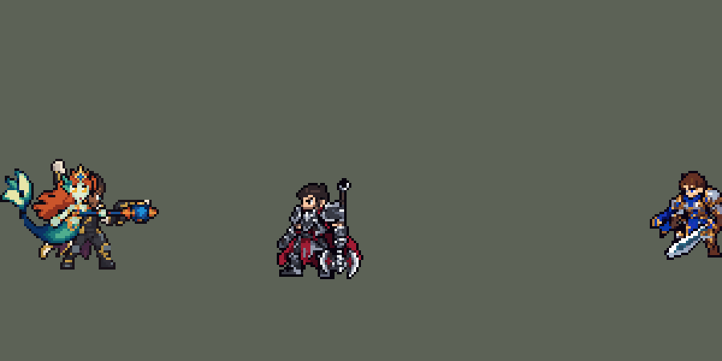

<!-- 本页上半部分由 tools/docs/gen_hero_docs.py 按仓库里现在的数据生成，手改会被覆盖；「开发记录」以下是手写的，生成时原样保留。 -->

# 娜美 Nami


| 项目 | 内容 |
|---|---|
| id | `league_nami` |
| 所属的包 | 主包（mod_id `league`） |
| 分路 | 辅助 |
| 分类 / 标签 | 功能型（Util） · AP / Magic / CC / Heal |
| 高清帧 | PPU 1.5（画成 90%） |
| 附加包 | 无 |



其他预览：[逐帧预览](../preview/league_nami_frames.png)、[特效表](../preview/league_nami_effects.png)

## 现在的技能

下面是游戏里显示的技能说明（`league/text/champion.i18n` 的简体中文，去掉了颜色和图标），冷却、距离来自 `league/champion/league_nami.data_champion`；1 秒 = 60 tick。

### 普攻 / 被动（被动「踏浪之行」）

*攻击间隔 1.5 秒 · 攻击距离 55000*

普攻射出一颗水弹，造成100% 攻击力的物理伤害。被动 踏浪之行：技能命中友方英雄时，使其移动速度提高20%，持续1.5秒。

### 技能1 · 冲击之潮

*冷却 7 秒 · 施放距离 60000 · 施放：指定目标 · 敌人（不含防御塔）*

水流先治疗身边一名友方英雄（没有则治疗自己）70 + 35% 法术强度的生命值，再弹向附近敌人造成65 + 45% 法术强度的魔法伤害，不会弹回娜美。唤潮之佑：被治疗者4秒内攻击力和法术强度提高15%，被击中者减速25%。

### 技能2 · 碧波之牢

*冷却 10 秒 · 施放距离 70000 · 施放：地点 · 敌人（不含防御塔）*

向敌人（优先敌方英雄）扔出水泡，落地时对范围内的敌人造成80 + 60% 法术强度的魔法伤害，并将其困在水泡中击飞1.25秒。

### 大招 · 怒涛之啸

*冷却 50 秒 · 施放距离 90000 · 施放：方向 · 敌方英雄*

召唤一道巨浪朝敌方英雄推进，对沿途敌人造成150 + 70% 法术强度的魔法伤害，击飞0.5秒并减速60%，巨浪走得越远减速越久（2至3秒）。经过的友方英雄获得双倍踏浪之行加速。

### 数值

攻击力 82（每级 +6）、法强 31（每级 +15）、生命 906（每级 +88）、护甲 20（每级 +8）、魔抗 22（每级 +4）、移速 1000（每级 +10）。

## 相关脚本和素材

- [`tools/lol/extract_nami.py`](../../tools/lol/extract_nami.py)
- [`tools/art/preview_nami.py`](../../tools/art/preview_nami.py)
- [`tools/art/import_nami.py`](../../tools/art/import_nami.py)
- [`tools/art/design_nami.py`](../../tools/art/design_nami.py)
- [`assets/source/nami/`](../../assets/source/nami)

## 开发记录

> 下面是原来 README 里「英雄：娜美」一节，原样搬过来（只改了相对链接）。

| 部分 | 内容 |
|---|---|
| 定位 | 辅助（Util），第六组的辅助；本包第六个辅助（索拉卡、蕾欧娜、迦娜、锤石、莫甘娜之后），第一个在敌我之间来回弹跳的辅助 |
| 普攻 | 手杖的宝珠射出一颗水弹，100% 攻击力的物理伤害，射程 55000，攻击间隔 1.5 秒 |
| 被动 | 「踏浪之行」：她的技能碰到的友方英雄移速 +20%，持续 1.5 秒（W 治疗的队友；R 巨浪经过的队友拿到两倍） |
| 技能1 | W「冲击之潮」，合并 E「唤潮之佑」（用户选的 A）：60000 内有敌人时放（射程内有敌方英雄时打英雄，没有就打小兵或野怪，打野、清线也会放），冷却 7 秒。水流先打敌人：65 + 45% 法术强度的魔法伤害，减速 25% 持续 1 秒；弹向第一个目标 50000 内的一名友方英雄：回复 70 + 35% 法术强度的生命，4 秒内攻击力和法术强度 +15%（唤潮之佑），再加被动的加速；再弹向那名友方英雄 50000 内的一名敌方英雄：60 + 40% 法术强度的魔法伤害并减速。身边没有别的友方英雄时水流飞回娜美自己，给她回血、祝福，再找她身边的敌人。英雄联盟里水流从一个英雄飞到下一个；团战经理2 里所有投射物都从施法者身上出发（SDK 模拟里量的，只有飞回施法者的那一种从命中点出发），所以弹跳是在上一段的命中点周围找下一个目标、每段间隔 9 tick 播放画面。直接找最后一个敌人时十次有九次打回第一个目标，所以第一个目标是英雄时，最后一段要那边有两名敌方英雄才打（Claude 定的规则，之后每局打回第一个目标 0.5 次、打到另一个英雄 1.3 次）。英雄联盟的唤潮之佑是强化队友接下来三次攻击并附带减速；团战经理2 读不到别人的攻击，改成攻击力和法术强度 +15%，减速放在 W 自己的伤害上 |
| 技能2 | Q「碧波之牢」：70000 内有敌人时放（射程内有敌方英雄时朝英雄扔），冷却 10 秒。第 11 tick 抛出水泡，抛物线飞 0.4 秒，落点提前亮出提示圈；落地时对半径 22000 内的敌人造成 80 + 60% 法术强度的魔法伤害，把他们困在水泡里击飞 1.25 秒。模拟里 39% 的 Q 困住英雄，平均每次 1.45 个 |
| 大招 | R「怒涛之啸」：90000 内有敌方英雄时放，冷却 50 秒。第 17 tick 从插在地上的手杖放出巨浪（速度 2500、走 160000、半径 32000），穿过的敌人受 150 + 70% 法术强度的魔法伤害，击飞 0.5 秒并减速 60%；巨浪走得越远减速越久（出手后 32 tick 内打中的 2 秒，之后的 3 秒；英雄联盟是 2 到 4 秒）；经过的友方英雄拿到两倍的踏浪之行加速 |
| 连招 | 用户要求：「有连招要做连招」「都要帮我补」。英雄联盟里娜美 Q 困住人，趁他浮在水泡里把 R 的巨浪推过去，躲不开。**Q→R**：水泡落地困住敌方英雄时（一个只对英雄的隐形落点，和水泡同样大小），娜美身上开一个 75 tick（1.25 秒，和击飞一样长）的连招窗口；窗口里放 R，第 1 tick 就放出巨浪（平时第 17 tick），而且朝 90000 内被控制（困在水泡里）的英雄推，没有才照施法方向推。伤害、击飞、减速、冷却都不变；窗口不用掉（R 冷却 50 秒）。数据由 [`tools/fix/combo_nami.py`](../../tools/fix/combo_nami.py) 改 |
| 数值 | 攻击 80（+6）、法术强度 30（+15）、生命 880（+85）、护甲 20（+8）、魔抗 22（+4）、移速 1000（+10）。数值是自己设计的，用 SDK 对战模拟调：打辅助，对 5 个原版辅助（`priest`、`bard`、`enchanter`、`monk`、`taoist`），两边、三套队友阵容各 12 局，一批 360 局。初稿 +1.21；W 改成上面的弹跳规则、第一段 65 + 45% 等削弱后两批 +0.68 / +1.14（同两批莫甘娜 +0.78 / +0.42、迦娜 +0.53 / −0.19）；按动作帧定下出手时机（普攻第 11 tick，W 第 8 tick，Q 第 11 tick，R 第 17 tick）后 +0.96 / +0.60。娜美每局放 W 约 40 次（打英雄约 13 次）、Q 约 23 次、R 约 2.8 次 |
| 亚索联动 | Q 和 R 的击飞都算亚索大招要的控制：娜美在队里时亚索每局 R 到被控英雄 1.77 次（同一批迦娜 0.94），在本包辅助的范围内（蕾欧娜 1.85），亚索不用调 |
| 精灵图 | 8 个动作 49 帧：待机、移动、普攻、W、Q、R、受击、死亡。造型按用户给的图由 Codex 按游戏尺寸画（第三轮 A）：红色长发、金冠嵌蓝宝石、琥珀色大眼、鱼鳍耳，金蓝贝壳胸衣和腰带，青绿鳞片的长尾往左下卷、淡黄绿的扇形尾鳍，手持深蓝杖身、金框蓝宝珠的法杖。金冠到尾鳍尖 50 px、36 px 宽，21 色；尾鳍落在脚底线上（原来像迦娜一样浮空 3 px，收藏界面里比别人高，用户让整体下移 3 格）。每帧的时机和站位照英雄联盟原版动画渲染的参考帧 |
| 高清帧（PPU 1.5） | 2026-10-16 按 Codex 的新原画用 PPU 重做（用户：「帮我利用PPU重做一下娜美 莫甘娜 锐雯的模型吧 动作帧就不让codex做了 参照塔姆那样慢慢做就行了 特效还是老样子」，后来「娜美 风女 莫甘娜可以先合并」）：原画读成 PPU 1.5 的造型，切成几个零件，动作不让 Codex 画，全部从造型自己摆（[`tools/art/ppu_rig.py`](../../tools/art/ppu_rig.py)），零件只整格移动或从原画按角度重新取样，身体本身不变形（[`tools/art/rig_nami_hd.py`](../../tools/art/rig_nami_hd.py)，原画 [`assets/source/nami/hd/picture.png`](../../assets/source/nami/hd/picture.png)，王冠到尾鳍 50 个游戏像素）。用户：「锐雯诺手贾克斯还有曙光和娜美的动作极度没有还原LOL里面」——所以她的动作逐帧照英雄联盟原版动画的骨骼摆：[`tools/lol/league_joints.py`](../../tools/lol/league_joints.py) 用 `native_pose.py` 的同一套 Q 版模型和镜头读出每帧关节的位置，`ppu_rig.Driver` 照着转零件：拿杖的手臂按英雄联盟的肩到手转，法杖按杖头相对胸口的位置瞄准（杖身两端的连线，杖头的挂点不在杖身上），手画在杖上；上半身跟着骨盆走、按胸口前倾；尾鳍按尾尖相对骨盆的起落抬起。待机保留原画的姿势（英雄联盟的待机把法杖往前倾），死亡最后几帧整体转 90° 躺下、头朝前，和英雄联盟倒下的方向一样。画风统一只把外描边加粗一格（[`tools/art/ppu_restyle.py`](../../tools/art/ppu_restyle.py)），每个动作的帧数、时间和站位和原来一样，特效照旧；`hd_` 帧由 [`tools/art/ppu_hd.py`](../../tools/art/ppu_hd.py) 写进图里。 |
| 特效 | 普攻水弹和命中水花、W 水流（弹跳、飞回）、打中敌人的水花、治疗友军的水流、唤潮之佑的水环（友军身上）、踏浪之行的脚下水涡、Q 水泡（抛物线）、落点提示圈、落地炸开的水柱、水牢泡泡（被困的敌人身上）、R 月牙形巨浪、击飞水柱 |
| 图标 | 官方技能图标（W / Q / R），64×64 |
| 音频 | 从本地客户端提取的 12 条技能音效和 2 条中文语音（Q、R）。不提交到仓库，按下面的命令在本地生成 |

```bash
python tools/lol/extract_nami.py --lol "D:\WeGameApps\lol" --vgmstream "<vgmstream-cli.exe 路径>"
python tools/lol/native_pose.py assets/source/nami/poses.json --out <渲染文件夹>   # 动作参考帧
python tools/art/design_nami.py      # 造型：Codex 的游戏尺寸原稿换脸、缩到别的英雄的大小，写 assets/source/native/nami_native.png
python tools/art/tidy_nami.py <动作交付> <返修交付>@attack,skill,skill2,hit <R 的返修交付>@ult
python tools/art/import_native.py --hero nami
python tools/art/import_nami.py      # 特效；--raw <Codex 的特效交付文件夹> 先转成原尺寸条
python tools/lol/league_joints.py assets/source/nami/poses.json --out <关节文件夹>   # 英雄联盟每帧的关节位置
python tools/art/rig_nami_hd.py --joints <关节文件夹>/nami_joints.json   # 高清帧（PPU 1.5）：照英雄联盟的骨骼摆，写 assets/source/ppu/orig/
python tools/art/ppu_restyle.py --hero nami
python tools/art/ppu_hd.py --hero nami
python tools/art/preview_nami.py
```

美术（造型的提示词见 [`assets/source/nami/MODEL_PROMPTS.md`](../../assets/source/nami/MODEL_PROMPTS.md)，8 条动作的见 [`MODEL_STRIPS.md`](../../assets/source/nami/MODEL_STRIPS.md)，特效的见 [`PROMPTS.md`](../../assets/source/nami/PROMPTS.md)；Codex 的交接说明在 [`codex_model/`](../../assets/source/nami/codex_model)、[`codex_strips/`](../../assets/source/nami/codex_strips)、[`codex_fx/`](../../assets/source/nami/codex_fx)）：
- 分工：模型和特效都由 Codex 画，Claude 写提示词包、整理和导入，按"造型 → 动作 → 特效"分三步。
- 造型：第一轮 Codex 在约 80 格高画（游戏尺寸的约 1.7 倍），尾巴被画短了；照原图把尾巴描回去再缩小，用户觉得"都不满意 看起来太奇怪了""主要是要不模糊细节好"。第三轮照主线卢锡安的做法让 Codex 直接按游戏尺寸画（金冠到尾鳍尖约 50 格），整理时只按它自己的格子取像素。用户选 A，再修两处：脸原来是方的（"怎么方形的脸？"），换成用户选的 D（椭圆脸、尖下巴，两只 2×2 的琥珀色眼睛带白色高光，琥珀色 `#F2B233` 只用在眼睛上）；体型比别的英雄大（"体型还是太大 能不能尽量和别的英雄一个尺寸"），按用户选的 W 每组删掉和相邻最像的一行（列），脸和法杖杖身所在的行列不删，缩到 36×50（和迦娜的面积相近）；尾鳍的浅色换成原图的淡黄绿 `#E8E6A8`。`design_nami.py` 从 Codex 的原稿逐步重建定稿 [`nami_native.png`](../../assets/source/native/nami_native.png)。
- 动作参考（`poses.json`）：镜头镜像、yaw 45、pitch 25，头 1.4、头发 0.6，高度 47，浮空 3 px，96×96 的格子。英雄联盟的娜美没有腿，`native_pose.py` 新加的 `"legs"` 选项用尾巴（`Tail1` 链）量脚底；`"flat"` 的帧伸出渲染图下边时（插在地上的法杖、死亡时脸朝下）现在会重新量一次。移动照她基础移速下播的直立游（`run_base` 同时播 `Nami_run_C` 和 `Nami_run_L`），取 `Nami_run_L` 的前 1 秒：尾巴摆一下，8 帧 × 125 ms 首尾相接；普攻 `Nami_attack1`，W `Nami_spell2`，Q `Nami_spell1`，R `Nami_spell4`（抛杖、跃起、落下插杖），死亡 `Nami_Death`（最后三帧沉到地上）。
- 整理（`tidy_nami.py`）：Codex 按定稿画了 7 条动作（43 帧），全部过了检查（8×8 方块、定稿的 21 色、脚底线，每帧的头和定稿逐格一致，动作和英雄联盟原版的位置只差 1–2 格）。第一版有 13 帧法杖散开（宝珠脱开或没了、格子里飘着碎片），Codex 自己第二遍修好了大半，R 也改成低跳、第 5–6 帧把法杖插在地上；剩下的发回两轮返修，附上从定稿抠出的整根法杖让它逐格贴（竖的、朝右、朝左，斜着拿时整根旋转）。`tidy_nami.py` 把几次交付拼齐：移动、死亡、R 用第二遍，普攻、W、Q、受击用返修版，R 的第 2–3 帧用第二轮返修；普攻、W、Q、R、受击的最后一帧换成定稿站姿，回到待机时不跳；删掉不连在身上的 12 格以下的碎点（按八邻域算，斜着一格宽的法杖算连着）。
- 导入：待机 6 帧用定稿，按琥珀色的眼睛定头的位置（`EYES`），移动时头稳在同一列。动作参考和 Codex 画的帧都浮空 3 px；用户在收藏界面（所有英雄的脚在同一条线上）看到她偏上，要「整体下移 3 格、去掉浮空」：`import_native.py` 的 `SINK` 把每帧往下移 3 格，但不越过脚底线（R 落地插杖的 2 帧、死亡躺地的 3 帧本来就贴地，不动），画面一个像素都不变。待机第 3–5 帧除了尾鳍尖和法杖底，整个人下沉一格再浮回来（`BOB` 的缝在脚底线上 3 行，那两行只差 4 格），和原来浮着上下动的样子一样。移动时尾巴拖在身后，身体比待机悬得高（最低点离地 14 px），头的高度和待机一样。头像截取点 (6, −47)，在金冠处（浮空时这个点比金冠低 3 px）。选人卡片设 `banpick_center` (0, −1)，见「选人卡片位置」一节。
- 黑边和脖子（用户：「黑边处理了吗」「缩小后脖子和身体有点怪……一上一下的时候感觉身体要分离一样」）：Codex 画的定稿只有 85% 的外轮廓是黑边，动作帧 68–91%（发梢、手指、腰带、尾巴边）。`import_native.py` 的 `COMPLETE` 在切帧、下移之后用 skill 的 `strips.complete_outline`，在缺黑边的浅色边外补一格描边色，画好的像素一个不改；1 格宽的法杖杆两侧不补（原版的细兵器也不描边），脚底线以下不加（改为把边缘像素本身压成描边色）。每帧到 94–100%，颜色数不变，`metrics` 的描边检查从警告变成通过；以后每个英雄都这样补（用户：「后面英雄都要用的」，写进了 skill 的 art-spec）。移动的 8 帧里头是定稿原样贴的，Codex 画的身体在第 1–4 帧比第 5–8 帧和定稿低一格，游动时脖子忽长忽短：`NECK` 把第 1–4 帧下巴以上整体下移一格（和待机呼吸同一个办法），8 帧的肩膀都在下巴下同一行，头随身体一起上下。
- 特效用 Codex 画的 13 张（62 帧）：每张交了生图原稿、它自己整理成 8×8 方块的版本和 1 倍图。1 倍图的格子是原格子的 1/8，大多数正好是想要的大小，照原样用（每个方块一个游戏像素，不重新取样）：水弹 25×10（和迦娜、莫甘娜的普攻弹差不多）、W 水流 26×14、治疗约 25×33、祝福约 28×36（这两张用 Codex 最后精修过的版本）、Q 水泡约 24、炸开 27×29、水牢约 35×45、R 击飞水柱约 30×46、被动水涡 32×12。要和别的英雄或技能范围对上的按多数色重新取样、只用 Codex 自己的颜色：普攻命中 18 px、W 打中 20 px（Codex 画的约 27），Q 落点圈 44 px 宽（半径 22000），R 巨浪 64 px 高（半径 32000，从生图原稿取样，Codex 的格子里只有 46 px 高），巨浪上下镜像成严格对称。锚点：飞行的水弹和水流在格子中线、亮白的水头上，命中量亮核，治疗、祝福、水牢在格子中间（人形空位的中心），落点圈在椭圆中心、放在脚底线上，炸开、击飞水柱和水涡量最低一行（放在脚底线上）。落点圈持续水泡飞行的 0.4 秒，水牢 1.25 秒，祝福和水涡是 buff 的循环画面（水涡画在人物下面）。
- 出手时刻和动画对齐：普攻第 4 帧宝珠前刺（第 11 tick），W 第 3 帧甩出水流（第 8 tick），Q 第 4 帧甩出水泡（第 11 tick），R 第 5 帧插杖（第 17 tick）。
- 结果：21 色，和右边像素同色的比例 34%（原版英雄 18%–46%）。待机每帧 949 个不透明像素（补描边前 918），和迦娜（902）、卢锡安（983）相近。

逐帧预览：[`docs/preview/league_nami_frames.png`](../preview/league_nami_frames.png?v=1017a)，特效：[`docs/preview/league_nami_effects.png`](../preview/league_nami_effects.png?v=1017a)。
