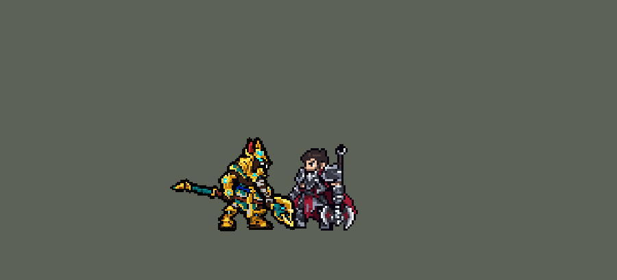

<!-- 本页上半部分由 tools/docs/gen_hero_docs.py 按仓库里现在的数据生成，手改会被覆盖；「开发记录」以下是手写的，生成时原样保留。 -->

# 内瑟斯 Nasus


| 项目 | 内容 |
|---|---|
| id | `league_nasus` |
| 所属的包 | 主包（mod_id `league`） |
| 分路 | 上单 |
| 分类 / 标签 | 近战（Melee） · AD / Melee / Tank |
| 高清帧 | PPU 1.2 |
| 附加包 | [内瑟斯附加包](#附加包)（`league_nasus`） |



其他预览：[逐帧预览](../preview/league_nasus_frames.png)、[特效表](../preview/league_nasus_effects.png)

## 现在的技能

下面是游戏里显示的技能说明（`league/text/champion.i18n` 的简体中文，去掉了颜色和图标），冷却、距离来自 `league/champion/league_nasus.data_champion`；1 秒 = 60 tick。

### 普攻 / 被动

*攻击间隔 1.2 秒 · 攻击距离 26000*

法杖重击。吞噬灵魂：生命偷取12%。枯萎：交战时每12秒自动衰老一名交战中的敌方英雄5秒：减速35%→75%，攻速降低25%→49%。

### 技能1 · 汲魂痛击

*冷却 4 秒 · 施放距离 31000 · 施放：指定目标 · 敌人（不含防御塔）*

法杖重击，造成50 + 100% 攻击力物理伤害，外加与层数相同的魔法伤害。击杀单位+4层，击杀英雄+10层（死后清空）。

### 技能2 · 灵魂烈焰

*冷却 10 秒 · 施放距离 50000 · 施放：指定目标 · 敌人（不含防御塔）*

在目标处燃起灵魂之火：造成50 + 3% 最大生命魔法伤害，之后5秒内每秒10 + 1% 最大生命，火中敌人护甲-30%。

### 大招 · 死神降临

*冷却 60 秒 · 施放距离 50000 · 施放：指定目标 · 敌方英雄*

变身15秒：生命+300，护甲魔抗+40，攻击距离增加，Q、E冷却减半；沙暴每0.5秒造成周围敌人2%最大生命真实伤害。2名敌方英雄在身边或交战时才放。

### 数值

攻击力 90（每级 +16）、生命 1100（每级 +110）、护甲 32（每级 +8）、魔抗 25（每级 +4）、移速 980（每级 +10）。

## 附加包

附加包是可选的原生代码 mod（都在附加包合集 `league_addons` 里），**不装主包里的英雄也是完整的**。

### 内瑟斯附加包

[内瑟斯附加包](../../addons/league_nasus/README.md)：`league_nasus` v0.1.0

|  | 主包（纯数据） | 装了附加包 |
|---|---|---|
| 汲魂痛击的层数 | 击杀单位 +4、击杀英雄 +10，死亡时清空，每条命重新叠 | **永久保留**：死了、复活后一层不少（英雄联盟的规则） |
| 死神降临的冷却 | Q 和 E 冷却都减半 | **只有 Q 冷却减半**（英雄联盟的规则），E 照常 |
| 死神降临的身体 | 普攻、Q、E、W 是大号的动作，站着、走着、挨打还是原来的大小，身边沙暴光环 | **整个身体变大**：站着、走着、挨打都是变大、眼睛和宝石发光的他（游戏 0.6.4），形态结束换回 |
| 开大时机 | 看场面（见上） | **不变**，照主包，日志里记下每次变身时身边几个敌方英雄 |

装上附加包后游戏里显示的说明（和主包不同的部分）：

- **技能1 · 汲魂痛击**：【附加包】法杖重击，造成50 + 100% 攻击力物理伤害，外加与层数相同的魔法伤害。击杀单位+4层，击杀英雄+10层（永久）。
- **大招 · 死神降临**：【附加包】变身15秒：生命+300，护甲魔抗+40，攻击距离增加，Q冷却减半；沙暴每0.5秒造成周围敌人2%最大生命真实伤害。2名敌方英雄在身边或交战时才放。期间整个人变大。

## 相关脚本和素材

- [`tools/kit/build_nasus.py`](../../tools/kit/build_nasus.py)
- [`tools/kit/setup_nasus.py`](../../tools/kit/setup_nasus.py)
- [`tools/lol/extract_nasus.py`](../../tools/lol/extract_nasus.py)
- [`tools/art/preview_nasus.py`](../../tools/art/preview_nasus.py)
- [`tools/art/rig_nasus.py`](../../tools/art/rig_nasus.py)
- [`assets/source/nasus/`](../../assets/source/nasus)

## 开发记录

> 下面是原来 README 里「英雄：内瑟斯」一节，原样搬过来（只改了相对链接）。

| 部分 | 内容 |
|---|---|
| 定位 | 上单（Melee，标签 AD / Melee / Tank），第 121 位英雄。沙漠死神 内瑟斯：豺狼头的飞升者，金色头冠和大肩甲，举着月牙长杖。用户的选择：「全按推荐做：上单、布局A、做扩展包、PPU 1.2、R大号形态」。技能 1 = Q 汲魂痛击，技能 2 = E 灵魂烈焰，大招 = R 死神降临；W 枯萎没有自己的格子，由被动的守望自动放（斯维因 W 的做法）。技能名照英雄联盟 16.20 的官方中文 |
| 普攻 / 被动 | 法杖重击（隐形的追踪打击，第 9 tick 落下），攻击间隔 72 tick，射程 26000。**吞噬灵魂**：生命偷取 12%（每条命第一次普攻或按 R 时挂上的永久 buff） |
| W | **枯萎**（被动的守望在交战中每 12 秒放一次）：50000 内正在交战的敌方英雄衰老 5 秒，减速 35% 逐秒加深到 75%，攻速降低 25% 加深到 49%（五层 buff 隔一秒叠上去，都持续到最后） |
| 技能1 | **Q 汲魂痛击**（对 31000 内的敌人放，比普攻远 5000，小兵、野怪也打）：50 + 100% 攻击力物理伤害，外加和层数相同的魔法伤害。**用它打死单位 +4 层，打死英雄 +10 层**（英雄联盟的击杀判定：金克丝的做法）。数据里没有能按层数算伤害的效果，所以每层是他身上一个带法术强度的永久 buff，叠层伤害按法术强度（ApAttack 100%）算——他没有别的法术强度。引擎在他死亡时清掉所有 buff，所以主包里层数每条命重新叠（说明里写着「死后清空」），附加包让它永久。冷却 4 秒 |
| 技能2 | **E 灵魂烈焰**（对 50000 内的敌人放）：隐形的抛射落在目标出手时站的位置（走开就躲得掉），半径 28000：燃起时 50 + 最大生命 3% 魔法伤害，之后 5 秒里每秒 10 + 最大生命 1%，站在火里的敌人护甲 −30%。冷却 10 秒 |
| 大招 | **R 死神降临**，**看场面才变身**（用户的规则：看好时机）：按 R 只是待命 10 秒，守望每 12 tick 看一次，**40000 内有两个敌方英雄**，或者**正在和敌方英雄交战、40000 内有一个**时才变身；10 秒没等到就退还冷却（只留 1 秒）。变身 15 秒：生命 +300（同时回复 300）、护甲魔抗 +40、攻击距离 +4000、Q 和 E 冷却减半（数据只能整体减技能冷却，附加包只减 Q），沙暴每 0.5 秒对 30000 内所有敌人造成最大生命 2% 的真实伤害。期间普攻、Q、E、W 是大号身体的动作（`b_*`）。冷却 60 秒。游戏的 AI 按标记当时选中的那一支打分，所以照奥莉安娜的做法加了打分分支 |
| 附加包 | 可选的附加包 [`addons/league_nasus`](../../addons/league_nasus/README.md)（在附加包合集里，原生代码，主包不装它也完整）：**汲魂痛击的层数死后不掉**（维迦附加包的做法，死后原样补回）；**死神降临只让 Q 冷却减半**（`entity_reduce_cooldown`，E 照常）；**整身变大**（站着、走着、挨打都是变大的他，游戏 0.6.4 的显示钩子）。开大时机照主包。日志 `league_nasus.log`（KEEP、STACK、RISE、QCD、FORM） |
| 数值 | 攻击 90（+16）、生命 1100（+110）、护甲 32（+8）、魔抗 25（+4）、移速 980（+10）、射程 26000 |
| 平衡 | 上单对六个基础上单（fighter / executioner / lancer / pole_warrior / knight / berserker），三套阵容、两边各打、8 个种子，10 分钟经典引擎模拟：草案（Q 30 + 100%、3 / 10 层，攻击 82，生命 1050，沙暴 1%，只在单挑时开大）+0.33（同批德莱厄斯 +1.99）；Q 50 + 4 层 −0.35；加攻击 90、生命 1100 +0.50；沙暴 2%、Q 4 秒 +0.98，但一局只开 0–4 次大；改成交战就开、待命 10 秒：+1.55，一局约 5 次（定稿）；再加攻击 95、E 70 + 4% 是 +2.67，太强没用 |
| 精灵图（高清帧 PPU 1.2） | Codex 第 0 步画了平时（A）和死神降临（B，眼睛和青绿宝石发光）两张原画（[`tools/art/pack_nasus_picture.py`](../../tools/art/pack_nasus_picture.py)），[`tools/art/review_nasus_size.py`](../../tools/art/review_nasus_size.py) 和上单们按游戏大小并排，用户：「A 44，B 按 1.35 倍（59）」。第 1 步 Codex 在游戏格子上重画（[`tools/art/pack_nasus_model.py`](../../tools/art/pack_nasus_model.py)），[`tools/art/design_nasus_cut.py`](../../tools/art/design_nasus_cut.py) 读回、整行整列删到 53 / 71 行（脸的行列保留），取 A-1 和 B-1。动作不找 Codex（用户：「动作帧按照塔姆那样做吧 做到完美了喊我review」）：[`tools/art/rig_nasus.py`](../../tools/art/rig_nasus.py) 照英雄联盟的动作在定稿上无损摆——法杖是一整件道具，只做 8 种无损朝向（原样、上下翻、转半圈、直角转）、插进近侧的拳头；手臂绕肩膀转直角；上身只往下沉进腰布。大号形态 B 用它自己的部件摆同样的动作，和 A 放在同一张图、同一个站位点。走路先找 Codex 按 oppi 赛恩的走路换皮重画，三轮都被用户指出问题（「跑步的时候武器变形了吧」「怎么感觉脱节了」「下半身严重变形了吧」：image_gen 每帧把法杖、腿和腰布重画一遍），最后整个不用 Codex：上身、手臂、法杖、腰布是待机原样，两条腿各自整块平移、抬起（着地 5 帧往后蹬、抬起 3 帧往前迈，两腿错开半个周期，落脚时身体下沉一行）；站姿太宽，两腿交叉不了，所以各在自己一侧往里收步（慎的做法）。用户：「这版走路可以」 2026-10-19 补帧：Q 起手原来只把前举的杖顺着杖身往后拉、E 只往前推，改用 R 里的举杖朝天姿势（Q 第 1、2 帧举过头再砸，E 第 3、4 帧举杖），变大后的 `b_skill` / `b_skill2` 同样 |
| 特效 | 第 3 步 11 张特效（[`tools/art/pack_nasus_fx.py`](../../tools/art/pack_nasus_fx.py)，颜色照英雄联盟：汲魂痛击、灵魂烈焰、枯萎是紫色的灵魂之火带白芯，灵魂烈焰的地面符文是蓝紫色，死神降临是金黄沙尘加紫色能量，减护甲是英雄联盟的金色裂盾），Codex 画并读回成游戏大小（`assets/source/nasus/codex_fx`）。没有飞行的画面（打击都是隐形的），所以全部左右对称（游戏不镜像特效图）。Codex 的读回把吸魂压扁了 5 倍、把枯萎的两肩紫气挤成目标两边的竖条，这两张由 [`tools/art/readback_nasus_fx.py`](../../tools/art/readback_nasus_fx.py) 从它的生图原稿按原比例重新读回。[`tools/art/import_nasus_fx.py`](../../tools/art/import_nasus_fx.py)：打中的在身上，裂盾在头顶，枯萎符文和紫气跟着中招的英雄 5 秒，灵魂烈焰的火圈在落点地上（3–6 帧循环铺满 5 秒），沙暴在他脚下和身后。写成 `league_nasus_fx` 和 `league_nasus_big`。用户：「特效通过」 |
| 音效 | 英雄联盟的音效和配音（[`tools/lol/extract_nasus.py`](../../tools/lol/extract_nasus.py)，16 段）：普攻挥杖 / 打中、汲魂痛击出手 / 打中 / 吸魂、枯萎出手 / 打中、灵魂烈焰出手 / 爆发 / 燃烧、死神降临变身 / 沙暴，配音是他的 Q / W / E / R 台词（中文） |
| 图标 | 官方技能图标（汲魂痛击、灵魂烈焰、死神降临，另有枯萎和被动），从本地客户端取 |
| 修正（0.170.2） | 用户让查附加包日志时在芸阿娜身上发现：引擎给大招冷却封顶时，把 `skill_cooldown_mult` 也算进去（技能冷却削减同时压大招）。死神降临期间 Q（和 E）冷却减半，大招自己的冷却也被减半。同一个 buff 加上相同大小的负 `ult_cooldown_mult` 抵掉（[`tools/fix/ult_cooldown_offset.py`](../../tools/fix/ult_cooldown_offset.py) / 生成脚本），只减原本要减的技能。经典模拟（8 个种子，三套阵容两边各打） +1.55 → +1.20，每局按大 5.8 → 4.7 次 |

重新生成（素材来自本机的英雄联盟客户端，音频不进仓库）：

```bash
python tools/lol/extract_nasus.py --lol "D:\WeGameApps\lol" --vgmstream <vgmstream-cli.exe>
python tools/kit/build_nasus.py                      # 技能数据，数字都在脚本的参数表 P 里
python tools/kit/setup_nasus.py                      # 五种语言的文字、音效配置、共享文件里他的键（头像点在 VIEW）
python tools/art/design_nasus_cut.py                 # Codex 第 1 步的造型读回（A-1、B-1）
python tools/art/rig_nasus.py                        # 1 倍帧和 1.2 的原帧（无损摆姿，平时 / 大号，走路是待机的腿）
python tools/art/ppu_restyle.py --hero nasus         # 描边（不要加 --preview）
python tools/art/ppu_hd.py --hero nasus              # hd_ / lo_ 帧
python tools/art/readback_nasus_fx.py                # 枯萎、吸魂从 Codex 生图原稿重新读回（原稿在 Codex 的输出文件夹）
python tools/art/import_nasus_fx.py                  # 特效
python tools/art/preview_nasus.py                    # 预览和演示 GIF
python addons/league_nasus/make_override.py          # 附加包的副本（主包的内瑟斯改了就重跑）
```

美术提示词见 [`assets/source/nasus/`](../../assets/source/nasus) 里的 `PICTURE_PROMPT.md`、`MODEL_PROMPTS.md`、`PROMPTS_FX.md`；Codex 的交付在 `codex_picture/`、`codex_model/`、`codex_run/`（没用上的换皮走路，图已删，只留提示词和交付说明）、`codex_fx/`。

逐帧预览：[`docs/preview/league_nasus_frames.png`](../preview/league_nasus_frames.png?v=1017a)，特效：[`docs/preview/league_nasus_effects.png`](../preview/league_nasus_effects.png?v=1017a)。
