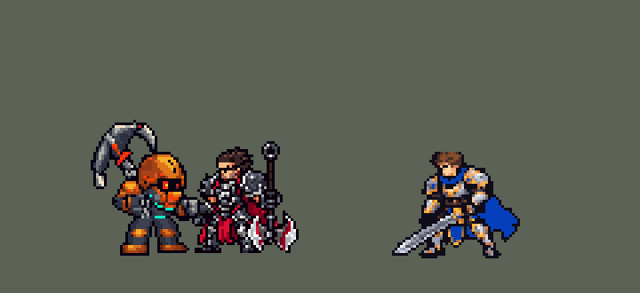

<!-- 本页上半部分由 tools/docs/gen_hero_docs.py 按仓库里现在的数据生成，手改会被覆盖；「开发记录」以下是手写的，生成时原样保留。 -->

# 诺提勒斯 Nautilus


| 项目 | 内容 |
|---|---|
| id | `league_nautilus` |
| 所属的包 | 主包（mod_id `league`） |
| 分路 | 辅助 |
| 分类 / 标签 | 功能型（Util） · AP / Magic / Melee / Tank / CC / Shield |
| 高清帧 | 1 倍像素（无高清帧） |
| 附加包 | [诺提勒斯钩墙附加包](#附加包)（`league_nautilus`） |



其他预览：[逐帧预览](../preview/league_nautilus_frames.png)、[特效表](../preview/league_nautilus_effects.png)

## 现在的技能

下面是游戏里显示的技能说明（`league/text/champion.i18n` 的简体中文，去掉了颜色和图标），冷却、距离来自 `league/champion/league_nautilus.data_champion`；1 秒 = 60 tick。

### 普攻 / 被动

*攻击间隔 1.33 秒 · 攻击距离 25000*

排山倒海：普攻敌方英雄时将其禁锢0.83秒，并额外造成20 + 30% 法强魔法伤害，之后6秒内不再触发。

### 技能1 · 疏通航道

*冷却 10 秒 · 施放距离 75000 · 施放：方向 · 敌方英雄*

抛出铁锚，钩中第一个敌方英雄，造成75 + 60% 法强魔法伤害，并把双方拉向彼此。

### 技能2 · 泰坦之怒

*冷却 8 秒 · 施放距离 25000 · 施放：指定目标 · 敌人（不含防御塔）*

获得110 + 60% 法强护盾，6秒内普攻还会伤及目标周围的敌人15 + 20% 法强。暗流涌动：地面震荡三波，周围敌人受到70 + 50% 法强魔法伤害并减速40%1.25秒。

### 大招 · 深海冲击

*冷却 50 秒 · 施放距离 80000 · 施放：指定目标 · 敌方英雄*

对射程内一名敌方英雄发出深海冲击波：沿途敌人被击飞并受到60 + 30% 法强伤害；目标受到150 + 80% 法强魔法伤害，击飞1秒后眩晕0.75秒。

### 数值

攻击力 78（每级 +6）、法强 25（每级 +12）、生命 1120（每级 +120）、护甲 40（每级 +8）、魔抗 28（每级 +5）、移速 990（每级 +10）。

## 附加包

附加包是可选的原生代码 mod（都在附加包合集 `league_addons` 里），**不装主包里的英雄也是完整的**。

### 诺提勒斯钩墙附加包

[诺提勒斯钩墙附加包](../../addons/league_nautilus/README.md)：`league_nautilus` v0.1.3

主包 `league` 保持纯数据、全平台可用；钩墙要读地图的墙，只能用原生代码，所以放在这个附加包里（合集 `league_addons` 也带着它）。
装上后，诺提勒斯的 Q「疏通航道」：锚沿路线**先碰到野区的墙**（引擎的碰撞墙，5v5 地图 90 格）时，把他拉到墙边，并**返还一半冷却**——
和英雄联盟一样；先碰到敌方英雄时照主包钩人（两人拉向彼此）。

## 相关脚本和素材

- [`tools/kit/build_nautilus.py`](../../tools/kit/build_nautilus.py)
- [`tools/kit/setup_nautilus.py`](../../tools/kit/setup_nautilus.py)
- [`tools/lol/extract_nautilus.py`](../../tools/lol/extract_nautilus.py)
- [`tools/art/preview_nautilus.py`](../../tools/art/preview_nautilus.py)
- [`tools/art/rig_nautilus.py`](../../tools/art/rig_nautilus.py)
- [`tools/art/import_nautilus.py`](../../tools/art/import_nautilus.py)
- [`tools/art/design_nautilus.py`](../../tools/art/design_nautilus.py)
- [`assets/source/nautilus/`](../../assets/source/nautilus)

## 开发记录

> 下面是原来 README 里「英雄：诺提勒斯」一节，原样搬过来（只改了相对链接）。

| 部分 | 内容 |
|---|---|
| 定位 | 辅助（Util，标签 AP / Magic / Melee / Tank / CC / Shield），第 90 位英雄。深海泰坦 诺提勒斯：近战坦克开团，铁锚钩中敌方英雄后两人拉向彼此，普攻定身，护盾加三波地震，大招冲击波一路击飞、目标击飞后眩晕。用户的选择：辅助、分类 Util；Q 钩中后双方拉向彼此（在中间会合）；W 和 E 合进一个技能位；大招打射程内的敌方英雄；被动做在主包里；加入高手连招；Q 钩墙做成附加包 |
| 普攻 | 挥锚砸下，攻击距离 25000，第 13 tick 命中（动作第 4 帧），攻击间隔 80 tick |
| 被动 | 「排山倒海」：普攻敌方英雄时禁锢 50 tick（0.83 秒），额外造成 20 + 30% 法强魔法伤害，之后 360 tick（6 秒）内不再触发。英雄联盟是每个英雄各算 6 秒；数据读不到目标身上的标记，所以冷却算在他自己身上。只对英雄：普攻里有一发只打英雄的分身弹带着它（佛耶戈的做法），打小兵野怪不触发 |
| 技能1 | Q「疏通航道」：冷却 600 tick（10 秒），朝 75000 内的敌方英雄方向施放，第 14 tick 抛出铁锚（每 tick 6000，飞 85000，宽 10000），钩中第一个敌方英雄：75 + 60% 法强魔法伤害，两人拉向彼此——英雄被拖向他（每 tick 2500，一口气拖完整段距离），他拉着锚链（动作 `skill_pull`），33 tick 后（最远的一钩也拖完了）冲到英雄身边，补上没拖完的那段（韧性会缩短拖拽），大约在中间会合；落空不拉。原来只拖 8 tick、他从第一 tick 就往前冲：钩得远时他自己冲了约四分之三的路，而且拖完后英雄能走能跳，他的冲刺还锁着人一路追过去（用户：「有时候他会跟着被拉过来的敌人走」；经典模拟里 38 次钩中有 12 次追过了英雄原来站的地方，改后 41 次 0 次，34 次最后贴在一起）。两人同时对冲、一起拖满整段的做法也试过：拖拽的方向在钩中那一刻就定了，30 次里 20 次两人穿过对方，最远穿过 46000。锚穿过小兵和野怪，和锤石、布里茨的钩子一样（用户选的是小兵会挡；数据分不出锚撞到的是不是英雄，要让小兵挡住，就会连小兵一起钩过来）。**高手连招 Q 接普攻**：钩中后 2 秒内下一次普攻无视被动冷却，直接禁锢 |
| 钩墙附加包 | 可选的附加包 [`addons/league_nautilus`](../../addons/league_nautilus/README.md)（在附加包合集里，原生代码，主包不装它也完整）：锚先碰到野区的墙时把他拉到墙边、返还一半冷却，和英雄联盟一样；先碰到敌方英雄就照主包钩人。附加包里的诺提勒斯是 `make_override.py` 从主包生成的副本，Q 的说明以「【钩墙版】」开头。游戏里的日志（10 月 12 日看过）：后台模拟的对局和观战的对局里都有钩墙、拉过去、冷却减半 |
| 技能2 | W「泰坦之怒」和 E「暗流涌动」合进一个技能位：冷却 480 tick（8 秒），对 25000 内的敌人放（小兵野怪也算）。护盾 110 + 60% 法强，持续 360 tick（6 秒），护盾在时普攻还会伤及目标周围 18000 内的敌人，15 + 20% 法强；第 8 tick 砸地，三波地震（相隔 5 tick）震荡身边 32000，每个敌人受一次 70 + 50% 法强魔法伤害，减速 40% 持续 1.25 秒 |
| 大招 | R「深海冲击」：冷却 3000 tick（50 秒），对 80000 内的敌方英雄放，第 16 tick 砸地放出冲击波（每 tick 2500）冲向目标，沿途敌人击飞 30 tick、受到 60 + 30% 法强魔法伤害；目标受到 150 + 80% 法强魔法伤害，击飞 60 tick（1 秒）后眩晕 45 tick（0.75 秒）。用户选的是打最远的英雄，但数据里没有按距离排序的效果，所以在射程内随机挑一个英雄（打到后排和前排一样常见）。**高手连招 Q 接 R**：Q 钩中后 2 秒内放 R，先打刚钩中的英雄（30000 内最近的一个） |
| 数值 | 攻击 78（+6）、法术强度 25（+12）、生命 1120（+120）、护甲 40（+8）、魔抗 28（+5）、移速 990（+10），攻击间隔 80 tick，和本包的蕾欧娜、布里茨同类（坦克辅助）。数值是自己设计的，SDK 对战模拟：打辅助，对 5 个原版辅助（`priest`、`bard`、`enchanter`、`monk`、`taoist`），两边、三套队友阵容各 12 局，一批 360 局。团队击杀差：种子 1–12 −1.14、13–24 −1.59（同两批蕾欧娜 +0.90 / +0.92、布里茨 −0.14 / +1.27）；伤害最高（每局约 4440，蕾欧娜约 3780、布里茨约 3240），但死得也多（每局约 3 次，她们约 2 次）。比另外两个坦克辅助弱一档，还没调 |
| 精灵图 | 9 个动作 56 帧：待机 8（静止，用户要站直不晃：「待机时上下浮动模型还变形」）、移动 8（待机原地迈步）、普攻 6（第 4 帧砸下）、Q（`skill`）6（第 5 帧抛锚）、Q 拉过去（`skill_pull`）4、W+E（`skill2`）6（第 3 帧砸地）、R 8（第 5 帧砸地）、受击 2、死亡 8。头盔顶到鞋底 39 行，背后的锚尖到鞋底 51 行。头像截取点 (3, −37)，选人卡片 −5 |
| 特效 | Codex 生图的 17 张（游戏尺寸版逐格切，`import_nautilus.py`；红色方的对称逐格检查：飞行的锚和冲击波上下对称，其余左右对称）：`league_nautilus_fx` 普攻命中的水花、被动的水柱和脚下水圈（禁锢）、Q 飞出的铁锚（带一截铁链）/ 钩中的水花、W 海绿色的护盾外壳 / 溅射光环、E 命中 / 脚下的水洼（减速）、R 砸地放出的深水炸弹 / 脚下的水刺（击飞）/ 头上的一圈泡泡（眩晕）；`league_nautilus_big` R 冲过去的冲击波 / 目标身上的大水柱、E 一圈比一圈大的三道地面浪。颜色照英雄联盟：海水泡沫的白和浅蓝绿、深水的蓝绿，W 是海绿光，锚是定稿的铁灰和铜锈箍 |
| 音效 | 英雄联盟的音效和配音（`tools/lol/extract_nautilus.py`）：挥锚 / 命中、被动、Q 抛锚 / 飞行 / 钩中 / 钩墙（附加包）、W 护盾、E 砸地、R 施放 / 冲击波 / 击飞；Q、E、R 的配音（片段名 `league_nautilus_sfx_vo_*`，和声音名不同）。版权属于 Riot Games，**不提交到仓库**，按下面的命令在本地生成 |
| 图标 | 官方技能图标（Q 疏通航道 / W 泰坦之怒 / R 深海冲击），从本地客户端提取，缩到 64×64 |

重新生成（素材来自本机的英雄联盟客户端，音频不进仓库）：

```bash
python tools/lol/extract_nautilus.py --lol "D:\WeGameApps\lol" --vgmstream "<vgmstream-cli.exe 路径>"
python tools/kit/build_nautilus.py         # 技能数据，数字都在脚本的参数表 P 里；--nodes 看每棵技能树的节点数
python tools/kit/setup_nautilus.py         # 五种语言的文字、音效配置、共享文件里他的键（头像点和选人卡片点也在里面）
python tools/art/design_nautilus.py --pick p35   # 造型：写成 nautilus_native.png
python tools/art/fix_nautilus_strips2.py   # 动作：修好 Codex 的动作条，画待机的腿，走路由待机迈步而成
python tools/art/import_native.py --hero nautilus
python tools/art/import_nautilus.py        # 特效：游戏尺寸版逐格切，拼成特效表
python tools/art/preview_nautilus.py       # 预览和演示 GIF
python addons/league_nautilus/make_override.py   # 钩墙附加包的副本（主包的诺提勒斯改了就重跑）
```

美术（提示词见 [`assets/source/nautilus/`](../../assets/source/nautilus) 里的 `PICTURE_PROMPT.md`、`MODEL_PROMPTS.md`、`REFINE_PROMPTS.md`、`MODEL_STRIPS.md`、`MODEL_STRIPS2.md`、`LEGS_PROMPT.md`、`PROMPTS_FX.md`）：

- 造型：Codex 画的两张图（`codex_picture/`），用户选 A（锚背在背上），按格子切成游戏尺寸的定稿 p35（39×48，`design_nautilus.py`）。
- 动作：Codex 的第二版侧面动作条（`codex_strips2/`），`fix_nautilus_strips2.py` 修：普攻和 Q 的青铜调回其他动作的亮度、去掉身上零星的红点；背着的锚换成 Codex 自己挥舞的那把直锚（用户：「钩子画的过大了 适当缩小」「武器给我画直了啊」）；死亡帧里 Codex 另画的锚换成同一把，倒立在身边；大招的变形帧换成其他动作的帧。
- 待机：用户：「其实你学学oppi的泰坦吧」「照着他的做吧」「你看他的待机的腿做的非常好啊」——照 oppi 的诺提勒斯和设计稿正面图的站法，3/4 正侧面和头、胸一致：两条直腿分开站在胯下，近腿（画面左）原色踩地，远腿（画面右）暗一档、高一行，靴子外八，靴面亮；锚照英雄联盟的待机斜背在背上（`IDLE_LEGS`）。静止不动。
- 移动：用户：「走路的时候武器是不是也应该是斜着」「参考oppi走路步伐」「泰坦走路姿势应该有点太空漫步的感觉的」——每一帧就是待机本身：同一个身体、斜背的锚、待机的两条腿，两条腿在身下原地轮流抬起（oppi 的步子），抬膝 2→3 行（抬起的腿去掉上面几行，大腿朝前、藏在膝盖后面，护膝挂在胯下），同时整个人上浮 1→2 行再落下（英雄联盟深海泰坦那种在海底行走的飘），落地往前一格、换腿时收回（`WALK`）。8 帧都站在同一列，身体不会左右抖。
- 特效：17 张用 Codex 的游戏尺寸版逐格切。

逐帧预览：[`docs/preview/league_nautilus_frames.png`](../preview/league_nautilus_frames.png?v=1014g)，特效：[`docs/preview/league_nautilus_effects.png`](../preview/league_nautilus_effects.png?v=1014g)。
