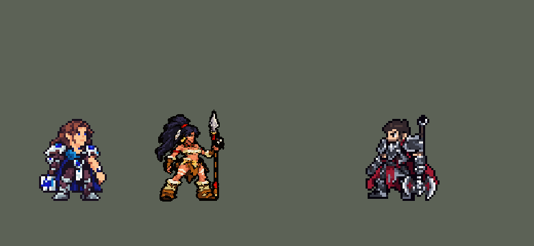

<!-- 本页上半部分由 tools/docs/gen_hero_docs.py 按仓库里现在的数据生成，手改会被覆盖；「开发记录」以下是手写的，生成时原样保留。 -->

# 奈德丽 Nidalee


| 项目 | 内容 |
|---|---|
| id | `league_nidalee` |
| 所属的包 | 主包（mod_id `league`） |
| 分路 | 打野 |
| 分类 / 标签 | 刺客（Assassin） · AP / Magic / Range / Melee / Heal |
| 高清帧 | PPU 2.2 |
| 附加包 | [奈德丽附加包](#附加包)（`league_nidalee`） |



其他预览：[逐帧预览](../preview/league_nidalee_frames.png)、[特效表](../preview/league_nidalee_effects.png)

## 现在的技能

下面是游戏里显示的技能说明（`league/text/champion.i18n` 的简体中文，去掉了颜色和图标），冷却、距离来自 `league/champion/league_nidalee.data_champion`；1 秒 = 60 tick。

### 普攻 / 被动

*攻击间隔 0.87 秒 · 攻击距离 23000*

寻觅：标枪或夹子命中英雄将其捕猎4秒，期间移速+20%。出手前按战况切换人形（远程）和美洲狮（近战）形态，切换冷却3秒。

### 技能1 · 标枪投掷 / 推倒

*冷却 1 秒 · 施放距离 85000 · 施放：指定目标 · 敌人（不含防御塔）*

人形：投出标枪造成88+80% 法强魔法伤害，飞得越远越高（最多220%）。推倒：下次攻击额外造成40+50% 攻击力物理和52+62% 法强魔法伤害，对捕猎目标+40%。

### 技能2 · 野性奔腾 / 猛扑

*冷却 1 秒 · 施放距离 55000 · 施放：无目标 · 敌人（不含防御塔）*

人形：治疗友方英雄45+45% 法强，攻速+40%持续7秒；冷却时放丛林伏击，持续造成18+16% 法强魔法伤害。猛扑：扑向敌人造成70+48% 法强魔法伤害；挥击造成98+80% 法强魔法伤害。

### 大招 · 美洲狮形态

*冷却 20 秒 · 施放距离 65000 · 施放：指定目标 · 刚交过手的敌方英雄*

化身美洲狮，重置美洲狮技能，扑向英雄造成160+90% 法强魔法伤害，落地挥击并准备推倒。

### 数值

攻击力 110（每级 +25）、法强 50（每级 +20）、生命 980（每级 +100）、护甲 28（每级 +7）、魔抗 24（每级 +4）、移速 1100（每级 +12）。

## 附加包

附加包是可选的原生代码 mod（都在附加包合集 `league_addons` 里），**不装主包里的英雄也是完整的**。

### 奈德丽附加包

[奈德丽附加包](../../addons/league_nidalee/README.md)：`league_nidalee` v0.1.1

|  | 主包（纯数据） | 装了附加包 |
|---|---|---|
| 变身后的样子 | 只有出招（普攻、推倒、猛扑、挥击、大招）是豹子的动作，待机、跑步、受击、阵亡还是人形（游戏按名字自动播这几个，数据换不了） | **整个身体**都是豹子（只在游戏 0.6.4 上，别的版本退回左边那样） |
| 寻觅（被动） | 标枪 / 夹子命中英雄：捕猎 4 秒、移速 +20% | 另外**在草丛里和离开草丛后 2 秒移速 +10%**，附近有看得见的敌方英雄时 +30%（英雄联盟的「寻觅」） |
| 标枪投给谁 | AI 选的目标（常常是小兵、野怪） | 射程内**线上没被小兵野怪挡着的敌方英雄**：被捕猎的优先，再按飞得远（伤害高）、血少排；都被挡着就不换 |
| 猛扑猎杀扑向谁 | AI 选的最近打过的英雄 | 射程内**被捕猎的、血量比例最低的**敌方英雄 |

## 相关脚本和素材

- [`tools/kit/build_nidalee.py`](../../tools/kit/build_nidalee.py)
- [`tools/kit/setup_nidalee.py`](../../tools/kit/setup_nidalee.py)
- [`tools/lol/extract_nidalee.py`](../../tools/lol/extract_nidalee.py)
- [`tools/art/preview_nidalee.py`](../../tools/art/preview_nidalee.py)
- [`tools/art/rig_nidalee.py`](../../tools/art/rig_nidalee.py)
- [`tools/art/import_nidalee.py`](../../tools/art/import_nidalee.py)
- [`assets/source/nidalee/`](../../assets/source/nidalee)

## 开发记录

> 下面是原来 README 里「英雄：奈德丽」一节，原样搬过来（只改了相对链接）。

| 部分 | 内容 |
|---|---|
| 定位 | 打野（Assassin，标签 AP / Magic / Range / Melee / Heal），第 97 位英雄。狂野女猎手 奈德丽：人形远程投标枪，变成美洲狮近战扑咬，技能是魔法伤害。用户的选择：打野 AP 刺客；两种形态 R 来回切换——但游戏的大招 5 级才解锁，用户选「1 级起就能变身」：切换做在普攻里，5 级的大招换成「猛扑猎杀」；被动做在主包里，草丛加速做成附加包；加入高手连招；附加包整身变豹 + 挑目标；高清帧（PPU）：人形 3/4 正面、美洲狮侧面 |
| 形态 / 普攻 | 每次普攻第一 tick 先看要不要变身（变身冷却 180 tick，英雄联盟 R 的 3 秒）：**人变豹**——刚标中英雄（`hunt`），或身边 32000 内有敌人而标枪在冷却；**豹变人**——推倒用掉了（且 3 级起猛扑、挥击也都在冷却），而标枪或治疗好了。变身那一下播变身动作（16 tick），不出手。人形：攻击距离 50000（底子是美洲狮的 23000，人形加一个永久的 `range` +27000 的 buff：攻击距离不能减，所以每条命先给人形），第 9 tick 投出标枪，100% 攻击物理。美洲狮：近战爪击（第 8 tick），推倒准备好时换成扑咬 |
| 被动 | 「寻觅」：标枪或夹子打中敌方英雄就**捕猎**它 240 tick（头顶猎人标记）：她移速 +20%，猛扑能扑 50000 远（平时 25000）、冷却 150 tick（平时 300），推倒伤害 ×1.4。数据只读得到她自己身上的 buff，所以捕猎记在她身上，意思是「附近有被捕猎的英雄」；英雄联盟里打中野怪也算捕猎，这里只算英雄 |
| 技能1 | 人形 Q「标枪投掷」：冷却 360 tick，对 85000 内的敌人放（小兵野怪也算），第 14 tick 投出一根直线标枪（碰到第一个单位就停，躲得开），飞得越远越痛：飞行不到 10 tick 88 + 80% 法强，不到 19 tick ×1.6，再远 ×2.2（出手时挂两个计时标记，命中时看还剩哪个，泽拉斯 E 的做法），打中英雄捕猎。美洲狮 Q「推倒」：冷却 300 tick，准备好下一击（240 tick 内）：扑咬造成 40 + 50% 攻击物理和 52 + 62% 法强魔法，被捕猎 ×1.4 |
| 技能2 | 人形：E「野性奔腾」优先——给 55000 内的一个友方英雄回 45 + 45% 法强、攻速 +40% 420 tick；E 在冷却时放 W「丛林伏击」：夹子抛到被控住的敌方英雄脚下（没有就抛到最近的敌人脚下），每 30 tick 夹一次 18 + 16% 法强魔法，持续 240 tick，夹到英雄捕猎。美洲狮：W「猛扑」优先——扑到 25000 内的敌人身上（被捕猎时扑 50000 内的英雄），落地 70 + 48% 法强魔法，挥击好了就接着挥；W 在冷却时放 E「挥击」：身边 20000 内 98 + 80% 法强魔法 |
| 大招 | 5 级「美洲狮形态」猛扑猎杀：冷却 1200 tick，对最近打过的敌方英雄放：人形瞬间变豹（不占普攻），美洲狮的冷却全部重置，扑过去落地 160 + 90% 法强魔法，接着挥击，推倒也准备好。**高手连招**：标枪中了就变豹扑过去、挥击、推倒收尾；夹子优先放在被控住的英雄脚下；E 给队友回血加攻速 |
| 附加包 | 可选的附加包 [`addons/league_nidalee`](../../addons/league_nidalee/README.md)（在附加包合集里，原生代码，主包不装它也完整）：**整身变豹**（照凯隐附加包换正在播的动画名：美洲狮形态时站着、跑着、受击、阵亡也是豹子，阵亡按倒下前的形态画，复活是人形；只在游戏 0.6.4 上）；**草丛加速**（读地图的草丛：草丛里和离开后 2 秒移速 +10%，附近有看得见的敌方英雄时 +30%）；**挑目标**（标枪投给射程内线上没被小兵野怪挡着的英雄，被捕猎的优先、再按飞得远、血少；猛扑猎杀扑向被捕猎的、血量比例最低的英雄）。附加包里的奈德丽是 `make_override.py` 从主包生成的副本，普攻、Q、R 的说明以「【附加包】」开头。日志 `league_nidalee.log`。还没在游戏里看过日志 |
| 数值 | 攻击 110（+25）、法术强度 50（+20）、生命 980（+100）、护甲 28（+7）、魔抗 24（+4）、移速 1100（+12）。SDK 对战模拟：打野位，对 5 个原版打野（`demon`、`circus_blade`、`hunter`、`inquisitor`、`ninja`），两边、三套队友阵容各 24 局。团队击杀差：种子 1–24 +1.56、25–48 +0.97（同两批伊芙琳 +1.38 / +1.30、莉莉娅 +1.33 / +1.77、卡兹克 +0.97 / +1.16）。第一版 −3.99 / −4.24：普攻只有原版打野的一半（62 +6 每 62 tick，原版 120 +30 每 50 tick），只用人形 −2.1、只用美洲狮 −3.0 |
| 精灵图（高清帧 PPU 2.2） | Codex 照用户给的两张设定图画了四张原画，用户选人形 A（标枪竖在远侧手里）和美洲狮 A（侧面站立），两者按原画的比例。原稿按各自的格子读回当造型（[`tools/art/design_nidalee_hd.py`](../../tools/art/design_nidalee_hd.py)：人形 101×168 格、美洲狮的格子比人形粗，用户选「按 7/6 放大」到 230×113 格，两种形态共用 56 色）。动作由 Codex 照英雄联盟的动作逐帧画（[`tools/art/pack_nidalee_strips.py`](../../tools/art/pack_nidalee_strips.py)，68 帧：人形 3/4 正面、美洲狮正侧面），[`tools/art/import_nidalee_strips.py`](../../tools/art/import_nidalee_strips.py) 读回：按造型的脸匹配出每个动作画大了多少缩回去（美洲狮多半画大了一成左右）、脚底贴地、直立的帧贴回造型的脸。人形跑步：Codex 画的 8 帧都是同一条腿在前，先换成布隆的走法，用户：「跑动姿势不像LOL的」——又试过前倾（「站直了啊」「怎么身体歪的」），最后是身体站直、两腿在身下一前一后迈步（[`tools/art/run_nidalee.py`](../../tools/art/run_nidalee.py)，用户：「OK」）。[`tools/art/rig_nidalee.py`](../../tools/art/rig_nidalee.py)：两种形态一张图（人形的动作 + 美洲狮的 `c_*`），待机呼吸、受击后退加闪白，1 倍帧（没有 league.dll 时用）。然后照泽丽统一画风（「按泽丽标准」，用户从三种里选 A：头 1.2、宽 1.3、矮 0.9；美洲狮只降像素不改身材），像素降到每个游戏像素 2.2 格，外描边加一格（之后用户：「豹子形态太大了」「还有豹子的像素太高」——从真实比例的对比图里选了美洲狮 75%、每个游戏像素 1.65 格：在粗格子上降像素、描边、平涂，再放回 2.2 格的图里，每帧爪子贴回原来那一行，人形的帧一个像素没变）；再统一成平涂像素（`crisp`：16 色加分界线，脸、绿眼睛、额头的绿点和红绳红环原样保留）。头像截取点 (5, −34) |
| 特效 | Codex 生图的 24 张（[`tools/art/pack_nidalee_fx.py`](../../tools/art/pack_nidalee_fx.py)）。它自己读回的 1 倍版把叶子、光圈读成了大色块，所以从原稿按卡萨丁的做法重新切格（[`tools/art/import_nidalee.py`](../../tools/art/import_nidalee.py)：分界挪到最空的那一列，颜色贴回金光 / 绿叶 / 尘土 / 木头 / 石头五套配色，普攻小标枪的细木杆补回一行）；红色方的对称逐格检查：两根标枪上下对称、沿飞行方向转，其余全部左右对称。夹子在地上 4 秒 |
| 音效 | 英雄联盟的音效和配音（`tools/lol/extract_nidalee.py`）：人形投枪 / 打中、美洲狮爪击 / 打中、推倒准备 / 扑咬 / 咬中、标枪飞出 / 打中、治疗、夹子抛出 / 落地 / 夹住、猛扑 / 落地 / 扑中、挥击 / 打中、两种变身、猎杀扑击；Q、W、E、变身、猎杀各用她自己的台词，美洲狮出招是豹子的低吼（片段名 `league_nidalee_sfx_vo_*`，和声音名不同）。版权属于 Riot Games，**不提交到仓库**，按下面的命令在本地生成 |
| 图标 | 官方技能图标（Q 标枪投掷 / E 野性奔腾 / R 美洲狮形态，另有美洲狮的 Q2 / W2 / E2、人形 W、被动），从本地客户端提取，缩到 64×64 |

重新生成（素材来自本机的英雄联盟客户端，音频不进仓库）：

```bash
python tools/lol/extract_nidalee.py --lol "D:\WeGameApps\lol" --vgmstream "<vgmstream-cli.exe 路径>"
python tools/kit/build_nidalee.py              # 技能数据，数字都在脚本的参数表 P 里；--nodes 看每棵技能树的节点数
python tools/kit/setup_nidalee.py              # 五种语言的文字、音效配置、共享文件里她的键
python tools/art/design_nidalee_hd.py          # 原画读回成两种形态的高清造型
python tools/art/import_nidalee_strips.py      # Codex 的动作条读回（大小、贴地、贴脸）
python tools/art/run_nidalee.py                # 人形跑步
python tools/art/rig_nidalee.py                # 1 倍帧 + 原样的高清帧（assets/source/ppu/orig）
python tools/art/ppu_restyle.py --hero nidalee # 泽丽的画风
python tools/art/ppu_hd.py --hero nidalee
python tools/art/import_nidalee.py             # 特效：原稿切格，拼成特效表
python tools/art/preview_nidalee.py            # 预览和演示 GIF
python addons/league_nidalee/make_override.py  # 附加包的副本（主包的奈德丽改了就重跑）
```

美术（提示词见 [`assets/source/nidalee/`](../../assets/source/nidalee) 里的 `PICTURE_PROMPT.md`、`MODEL_STRIPS.md`、`RUN_FIX.md`、`PROMPTS_FX.md`）：

- 原图：用户给的两张设定图（`user_ref/`）当主参考，Codex 画了人形 A / B、美洲狮 A / B（`codex_picture/`），用户选两个 A。
- 动作：Codex 的 68 帧（`codex_strips/`），读回后在 `frames/`；人形跑步是我们自己画的（`run_nidalee.py`；`RUN_FIX.md` 是没用上的重画包）。
- 特效：24 张来自 Codex 的原稿（`codex_fx/raw/`）。

逐帧预览：[`docs/preview/league_nidalee_frames.png`](../preview/league_nidalee_frames.png?v=1014g)（游戏里用的 hd_ 高清帧），特效：[`docs/preview/league_nidalee_effects.png`](../preview/league_nidalee_effects.png?v=1014g)。
