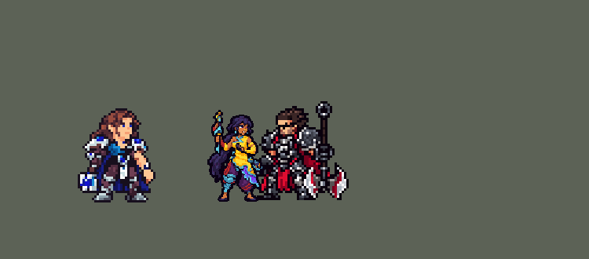

<!-- 本页上半部分由 tools/docs/gen_hero_docs.py 按仓库里现在的数据生成，手改会被覆盖；「开发记录」以下是手写的，生成时原样保留。 -->

# 尼菈 Nilah


| 项目 | 内容 |
|---|---|
| id | `league_nilah` |
| 所属的包 | 主包（mod_id `league`） |
| 分路 | ADC |
| 分类 / 标签 | 射手（Range） · AD / Melee / Heal / Shield |
| 高清帧 | PPU 1.98（画成 90%） |
| 附加包 | [尼菈附加包](#附加包)（`league_nilah`） |



其他预览：[逐帧预览](../preview/league_nilah_frames.png)、[特效表](../preview/league_nilah_effects.png)

## 现在的技能

下面是游戏里显示的技能说明（`league/text/champion.i18n` 的简体中文，去掉了颜色和图标），冷却、距离来自 `league/champion/league_nilah.data_champion`；1 秒 = 60 tick。

### 普攻 / 被动

*攻击间隔 0.93 秒 · 攻击距离 30000*

喜色川流：鞭刃近战攻击。游刃万变后4秒内，射程+125，攻击扇形顺劈，额外造成25% 攻击力物理伤害，并回复伤害10%的生命。

### 技能1 · 游刃万变

*冷却 1 秒 · 施放距离 60000 · 施放：方向 · 敌人（不含防御塔）*

朝目标方向甩出鞭刃，对直线上的所有敌人造成40+100% 攻击力物理伤害，并强化之后4秒的攻击。

### 技能2 · 纵情逐流 / 轻纱飞漾

*冷却 1 秒 · 施放距离 55000 · 施放：指定目标 · 敌方英雄*

纵情逐流：穿过敌方英雄冲刺，落地对周围造成60+45% 攻击力物理伤害，2层充能。用完时放轻纱飞漾：2.25秒内闪避所有攻击，技能伤害-25%，移速+20%，附近友方英雄同样获得1.5秒。

### 大招 · 神恩激荡

*冷却 40 秒 · 施放距离 35000 · 施放：指定目标 · 敌方英雄*

旋转鞭刃1秒，每段造成12+20% 攻击力物理伤害，最后造成100+110% 攻击力物理伤害并把周围敌人拉到身边；附近友方英雄回复40+30% 攻击力生命并获得40+30% 攻击力护盾。

### 数值

攻击力 104（每级 +21）、生命 1000（每级 +95）、护甲 26（每级 +7）、魔抗 18（每级 +3）、移速 1000（每级 +10）。

## 附加包

附加包是可选的原生代码 mod（都在附加包合集 `league_addons` 里），**不装主包里的英雄也是完整的**。

### 尼菈附加包

[尼菈附加包](../../addons/league_nilah/README.md)：`league_nilah` v0.1.1

|  | 主包（纯数据） | 装了附加包 |
|---|---|---|
| 喜色川流（被动） | 只有 Q 强化期间的普攻回血 | 另外**她和附近友方英雄每次回血、得到护盾都多 15%**（英雄联盟的「乐无止境」：她给的、给她的治疗和护盾都更强） |
| 轻纱飞漾什么时候放 | E 两层用完，AI 想放技能 2 就放 | E 两层用完后，**只有刚被敌方英雄打中才放**（0.75 秒内），没被打就先普攻，留着 W 躲集火 |
| 纵情逐流冲向谁 | AI 选的目标 | 射程内**血量比例最低的**敌方英雄 |
| 神恩激荡什么时候放 | 射程里有敌方英雄就放 | 圈里有 **2 个以上**敌方英雄才放；只有 1 个时，他血量不到一半、她自己血量不到 40%、或者附近没有别的敌方英雄会赶来，也放；最多等 1.5 秒 |

## 相关脚本和素材

- [`tools/kit/build_nilah.py`](../../tools/kit/build_nilah.py)
- [`tools/kit/setup_nilah.py`](../../tools/kit/setup_nilah.py)
- [`tools/lol/extract_nilah.py`](../../tools/lol/extract_nilah.py)
- [`tools/art/preview_nilah.py`](../../tools/art/preview_nilah.py)
- [`tools/art/rig_nilah.py`](../../tools/art/rig_nilah.py)
- [`assets/source/nilah/`](../../assets/source/nilah)

## 开发记录

> 下面是原来 README 里「英雄：尼菈」一节，原样搬过来（只改了相对链接）。

| 部分 | 内容 |
|---|---|
| 定位 | ADC（Range，标签 AD / Melee / Heal / Shield），第 99 位英雄。不羁之悦 尼菈：下路的近战射手，鞭刃普攻比普通近战长一截，Q 之后普攻扇形顺劈、吸血，E 穿过敌人冲刺，W 闪避普攻，R 旋转拉人并给友方回血加护盾。用户的选择（全是推荐项）：下路近战 ADC；Q 直线鞭击 + 4 秒强化；技能 2 是 E 冲刺（2 层），E 用完时放 W；R 旋转 + 拉人 + 回血护盾；被动做在主包里，另做附加包；高清帧按泽丽标准；加入高手连招 |
| 普攻 | 「喜色川流」：鞭刃近战，攻击距离 30000，第 13 tick 出手，100% 攻击物理。Q 之后 240 tick 内（「游刃万变」的强化）：攻击距离 +12500，普攻同时扇形顺劈（扇形半径是攻击距离 + 12500 + 6000），扇形里每个敌人受到 25% 攻击物理，普攻按伤害回血 10% |
| 技能1 | Q「游刃万变」：冷却 300 tick，朝 60000 内的敌人方向第 12 tick 甩出一条直线长鞭（长 62000、宽 6000，穿透），40 + 100% 攻击物理，然后开启 240 tick 的强化普攻。E 落地后 90 tick 内（以及 R 结束时）Q 好着，就改成原地**旋斩**：身边 28000 内 40 + 100% 攻击物理，同样开启强化 |
| 技能2 | E「纵情逐流」：2 层充能（每层 540 tick），两次之间至少隔 40 tick；穿过 55000 内的敌方英雄冲刺到他身后，落地对身边 16000 内造成 60 + 45% 攻击物理，Q 好着就接旋斩。两层都在充能时放 W「轻纱飞漾」：冷却 1200 tick，135 tick 内闪避所有普攻（普攻伤害 -100%）、技能伤害 -25%、移速 +20%，身边 18000 内的友方英雄同样获得 90 tick |
| 大招 | R「神恩激荡」：冷却 2400 tick，对 35000 内的敌方英雄放，原地旋转 60 tick：每 7 tick 对身边 38000 内的敌人造成 12 + 20% 攻击物理，第 46 tick 最后一击 100 + 110% 攻击物理并把他们拉到身边；同时 50000 内的友方英雄（含她自己）回复 40 + 30% 攻击的生命、得到 40 + 30% 攻击的护盾（180 tick）；Q 好着就接旋斩。**高手连招**：E 穿过去落地接旋斩、再强化普攻；R 拉近以后接 Q；W 让身边的队友一起闪避 |
| 附加包 | 可选的附加包 [`addons/league_nilah`](../../addons/league_nilah/README.md)（在附加包合集里，原生代码，主包不装它也完整）：**喜色川流**（她和身边 100000 内的友方英雄每次回血、得到护盾都多 15%：SDK 给被动的接口里没有「被治疗时」，每 tick 比对生命和护盾补上）；**轻纱飞漾等被打中才开**（E 两层用完后，只有刚被敌方英雄打中才放 W，否则先普攻）；**纵情逐流冲残血**（射程内血量比例最低的敌方英雄）；**神恩激荡等能卷进多人再放**（圈里 2 个以上，或者唯一那个血量不到一半、她自己血量不到 40%、附近没有别的敌方英雄会来；最多等 1.5 秒）。附加包里的尼菈是 `make_override.py` 从主包生成的副本，普攻、技能 2、R 的说明以「【附加包】」开头。日志 `league_nilah.log`。还没在游戏里看过日志 |
| 数值 | 攻击 104（+21）、生命 1000（+95）、护甲 26（+7）、魔抗 18（+3）、移速 1000（+10）。SDK 对战模拟：下路，对原版的枪手、士兵、弓箭手、赌徒、鞭子大师，两边、三套队友阵容各 24 局。团队击杀差：种子 1–24 +1.52（同批莎弥拉 +1.69、泽丽 +1.70、图奇 +1.60）。第一版 +3.90：每局回血 4173（别的射手约 830），强化普攻吸血 18%、顺劈 40%、R 的回血护盾 60 + 30%，都调低了 |
| 精灵图（高清帧 PPU 1.98，画成 90%） | Codex 画了两张原画，用户选 A（收起来的鞭刃竖直举在肩旁），原稿按格读回当正面造型，「保留 99 格，PPU 2.5」：从刃尖到脚底 99 格一比一，约 40 个游戏像素高，游戏里按 90% 画（「模型别太大」）。侧面造型由 Codex 在同一套 12 px 格子上画（A 稿，完全侧身），动作也由 Codex 画（侧面朝右）。跑步是我们自己画的：从造型自己的两条腿按关节一段段摆（[`tools/art/nilah_stride.py`](../../tools/art/nilah_stride.py)、[`tools/art/run_nilah.py`](../../tools/art/run_nilah.py)），前后改了好几轮（「走路时候腿部有变形吧？」「还是变形啊」「而且腿这么粗？」），用户：「就这样吧 可以下一步了」。[`tools/art/rig_nilah.py`](../../tools/art/rig_nilah.py)：待机是正面造型呼吸（腰以上抬 0–2 格），受击是侧面后退加闪白，其余是 Codex 的动作；1 倍帧（没有 league.dll 时用）每个像素取下面格子的多数色。照泽丽统一画风只把外描边加到两格、帧下移 3 格（90% 时脚底留在地上）。后来用户：「尼拉好像也太高清了」，从一张各档密度的对比图里选了每个游戏像素 2.2 格（艾希、奈德丽那一档）：`ppu_restyle.py` 把她从 2.5 降到 1.98（显示 90% 正好 2.2），画进帧的鞭子、水痕按身体同一个中心、同一个比例一起缩（`pixel_down.scale_fx`），需要配合 league.dll 里她的新 PPU。头像截取点 (−1, −36) |
| 特效 | Codex 画特效时额度用完了，只交了一张总览图；我先用代码画了一版，用户：「你拿我给你的这个修复啊 这个特效好啊」——改回从 Codex 的总览图修（[`tools/art/import_nilah_fx.py`](../../tools/art/import_nilah_fx.py)）：每张图在原图大小上取一半镜像成严格左右对称，缩到游戏像素，颜色贴回水（白芯到深蓝）和彩色（粉、紫、薄荷、金）两套配色；帧序列用 Codex 的几张图轮流，起手和消散用它们缩小、变暗、散成水珠。修掉的：单方向的图（q_hit 的彗星尾、eq_hit 的斜线、a_hit 的弯钩）取对称的一半或不用；r_pull 环里和 E 水痕里画的小人去掉；W 纱幕那几格画成了横向彩条，改用它的竖向彩带放在人两侧轮流播放；治疗的光拱拉高到头顶上方，丝带、火焰、光环让开身体。普攻、强化普攻、Q 的鞭子和 E 的水痕有方向，画进她自己的帧里（红色方跟着她翻），鞭子加粗到约一个游戏像素、从刃尖接出去，在外描边加粗之后才贴上（特效没有描边）。`league_nilah_fx`：普攻 / 强化普攻 / Q / 旋斩 / E / R 每一下 / R 拉人的打中、W 碰到队友、R 回血护盾、Q 强化光环；`league_nilah_big`：旋斩的水环、R 的旋风和爆发、W 的纱幕（她的和队友的） |
| 音效 | 英雄联盟的音效和配音（`tools/lol/extract_nilah.py`）：鞭刃普攻 / 打中、强化普攻 / 打中、Q 甩鞭 / 打中、旋斩 / 打中、E 冲刺 / 打中、W 纱幕 / 碰到队友、R 旋转 / 每一下 / 拉人 / 回血；Q、W、E、R 各用她自己的台词（片段名 `league_nilah_sfx_vo_*`，和声音名不同）。版权属于 Riot Games，**不提交到仓库**，按下面的命令在本地生成 |
| 图标 | 官方技能图标（Q 游刃万变 / E 纵情逐流 / R 神恩激荡），从本地客户端提取，缩到 64×64 |

重新生成（素材来自本机的英雄联盟客户端，音频不进仓库）：

```bash
python tools/lol/extract_nilah.py --lol "D:\WeGameApps\lol" --vgmstream "<vgmstream-cli.exe 路径>"
python tools/kit/build_nilah.py               # 技能数据，数字都在脚本的参数表 P 里；--nodes 看每棵技能树的节点数
python tools/kit/setup_nilah.py               # 五种语言的文字、音效配置、共享文件里她的键
python tools/art/design_nilah_hd.py           # 原画读回成正面高清造型
python tools/art/import_nilah_strips.py       # Codex 的动作条读回
python tools/art/run_nilah.py                 # 跑步（腿由 nilah_stride.py 摆）
python tools/art/import_nilah_fx.py           # 特效：Codex 的总览图修成特效表，鞭子和水痕画进帧
python tools/art/rig_nilah.py                 # 1 倍帧 + 原样的高清帧（assets/source/ppu/orig）
python tools/art/ppu_restyle.py --hero nilah  # 泽丽的画风（特效在描边之后贴上）
python tools/art/ppu_hd.py --hero nilah
python tools/art/preview_nilah.py             # 预览和演示 GIF
python addons/league_nilah/make_override.py   # 附加包的副本（主包的尼菈改了就重跑）
```

美术（提示词见 [`assets/source/nilah/`](../../assets/source/nilah) 里的 `PICTURE_PROMPT.md`、`MODEL_PROMPTS.md`、`MODEL_STRIPS.md`、`PROMPTS_FX.md`）：

- 原图：Codex 画了 A / B 两张（`codex_picture/`），用户选 A。
- 造型：正面是原画 A 按格读回（`hd/front.png`），侧面是 Codex 画的 A 稿（`codex_model/`，`hd/side.png`）。
- 动作：Codex 的动作条（`codex_strips/`），读回后在 `frames/`；跑步是我们自己画的。
- 特效：Codex 的总览图（`codex_fx/overview.jpg`），画进帧里的鞭子和水痕在 `fx_bake/`。

逐帧预览：[`docs/preview/league_nilah_frames.png`](../preview/league_nilah_frames.png?v=1014g)（游戏里用的 hd_ 高清帧），特效：[`docs/preview/league_nilah_effects.png`](../preview/league_nilah_effects.png?v=1014g)。
