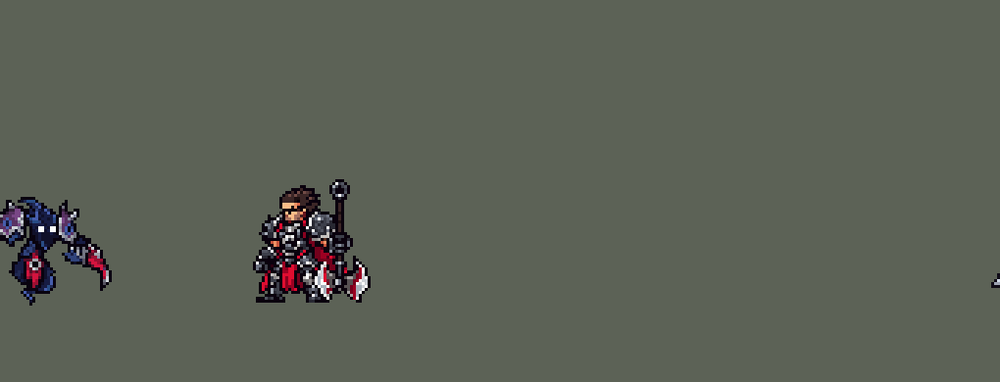

<!-- 本页上半部分由 tools/docs/gen_hero_docs.py 按仓库里现在的数据生成，手改会被覆盖；「开发记录」以下是手写的，生成时原样保留。 -->

# 魔腾 Nocturne


| 项目 | 内容 |
|---|---|
| id | `league_nocturne` |
| 所属的包 | 主包（mod_id `league`） |
| 分路 | 打野 |
| 分类 / 标签 | 刺客（Assassin） · AD / Melee / CC |
| 高清帧 | 1 倍像素（无高清帧） |
| 附加包 | [魔腾黑暗附加包](#附加包)（`league_nocturne_dark`） |



其他预览：[逐帧预览](../preview/league_nocturne_frames.png)、[特效表](../preview/league_nocturne_effects.png)

## 现在的技能

下面是游戏里显示的技能说明（`league/text/champion.i18n` 的简体中文，去掉了颜色和图标），冷却、距离来自 `league/champion/league_nocturne.data_champion`；1 秒 = 60 tick。

### 普攻 / 被动（被动「暗影之刃」）

*攻击间隔 0.8 秒 · 攻击距离 23000*

暗刃斩击。被动 暗影之刃：每12秒或每第4次普攻横扫周围所有敌人，造成120% 攻击力的物理伤害，每命中一个敌人回复15 + 20% 法强生命值。

### 技能1 · 梦魇之径

*冷却 7 秒 · 施放距离 66000 · 施放：方向 · 敌人（不含防御塔）*

掷出暗影之刃，对路径上的敌人造成40 + 85% 攻击力的物理伤害，留下5秒影径，被击中的敌方英雄身后也拖着影径。魔腾在影径上获得25% 移动速度和15% 攻击力。

### 技能2 · 无言恐惧

*冷却 11 秒 · 施放距离 30000 · 施放：指定目标 · 敌人（不含防御塔）*

用梦魇灵链拴住目标2秒，造成80 + 120% 法强的魔法伤害，结束时目标仍在附近则被恐惧1.33秒，魔腾追击时移速+40%。同时升起黑暗庇护1.5秒：技能伤害降为1、免疫控制，期间受到攻击则攻速+40%5秒。

### 大招 · 鬼影重重

*冷却 50 秒 · 施放距离 110000 · 施放：指定目标 · 敌方英雄*

黑暗降临：魔腾飞扑和落地期间，我方所有英雄隐身（敌人只能看见身边的单位），魔腾飞扑一名敌方英雄，落地造成120 + 120% 攻击力的物理伤害，飞行中免疫控制。

### 数值

攻击力 110（每级 +27）、法强 30（每级 +10）、生命 940（每级 +90）、护甲 27（每级 +8）、魔抗 18（每级 +4）、移速 1100（每级 +13）。

## 附加包

附加包是可选的原生代码 mod（都在附加包合集 `league_addons` 里），**不装主包里的英雄也是完整的**。

### 魔腾黑暗附加包

[魔腾黑暗附加包](../../addons/league_nocturne_dark/README.md)：`league_nocturne_dark` v0.4.2

主包 `league` 保持纯数据。主包里魔腾的 R 让己方所有英雄隐身 3 秒、敌方英雄头上一团黑雾，再飞扑一名敌方英雄。
这个附加包用原生代码把「黑暗降临」做得更像 League：

- **敌人只能看见身边**：R 的动作期间（出手到落地——最长 60 tick 保底，见过最长的飞扑 51 tick——落地后再 20 tick 的爆开），魔腾一方的每个英雄，40000 内没有敌方英雄时隐身（每 tick 续上），
  有敌方英雄贴近就现身。League 里被黑暗笼罩的人视野缩到身边；本作没有按队伍改视野的接口，用「贴近才看得见」来做。
- **全屏变暗**：R 出手时，在魔腾身上（不跟随，留在出手处）播一张 1280×1280（整张地图那么大）的半透明深蓝贴图，
  镜头跟着他，盖满整屏；叠 3 层、每层隔 4 tick，各播 0.75 秒，所以很快地一层层变暗、最后一层层亮回来（约 55% 暗）。
  它画在单位下面（z −1）：地面变暗，英雄、血条和技能特效照样看得清。
  v0.4.1：原来播在地图中心的坐标上，游戏里不变暗（用户：「梦魇说附加包放大不会全图变黑」）——播在坐标上的画面从没确认过能显示，
  离镜头远的中心点也可能被裁掉；播在英雄身上的画面（基兰、卡兹克的附加包）都在游戏里确认过。日志里每层写一行 `veil layer on Nocturne: played`
  （游戏不收会写 `REFUSED by the game`）。
- **敌人只打得到身边的（v0.3.0，鬼影重重）**：本作的视野是全队共享的——一个敌人贴近，整队都看得见，魔腾飞扑落地后
  连远处的射手都锁他（测试时 R 期间 52 次出手里 47 次打魔腾，一半从 6 万外起手）。League 的鬼影重重是每个敌人只看得见
  自己身边、没有共享视野。所以黑暗里每个敌方英雄每 tick 的决定都过一遍（扩展包的「玩家 AI 输入」钩子）：他要攻击、
  施放到的魔腾一方单位（英雄、小兵）离他超过 40000，这一下就换成朝它走过去，走到 40000 以内照常出手。指向点的技能看
  点附近 15000 内的单位，指方向的看方向两侧 15 度、150000 内离方向线最近的。近战基本不受影响，远程和远距离技能要贴近才打得到。
- 黑雾、飞扑、伤害、画面、声音都和主包一样。
- **只在大招动作期间（v0.4.0）**：原来黑暗固定 3 秒，魔腾 0.75 秒就飞扑、落地爆开完了，之后两秒多看不出在放大，队友却还隐着身（用户：「魔腾不放大的时候也全队隐身」）。现在黑暗从出手到落地，落地（原生效果 `land`）后只再留 20 tick，主包的隐身也一样。
- **黑暗一直到落地（v0.4.2）**：出手时的黑暗原来最长 32 tick，可飞扑常常更久（目标在跑）——10-24 的日志 178 次 R 有 97 次落地晚于 32 tick、最长 51：黑暗先停、队友现身、鬼影重重失效，落地再开 20 tick，中间断一截（`darkness over` 比 `DARKNESS` 多一百行）。现在保底 60 tick，盖过最长的飞扑；每次 R 只有一行 `darkness over`，在落地 20 tick 后。

## 相关脚本和素材

- [`tools/lol/extract_nocturne.py`](../../tools/lol/extract_nocturne.py)
- [`tools/art/preview_nocturne.py`](../../tools/art/preview_nocturne.py)
- [`tools/art/rig_nocturne.py`](../../tools/art/rig_nocturne.py)
- [`tools/art/import_nocturne.py`](../../tools/art/import_nocturne.py)
- [`tools/art/design_nocturne.py`](../../tools/art/design_nocturne.py)
- [`assets/source/nocturne/`](../../assets/source/nocturne)

## 开发记录

> 下面是原来 README 里「英雄：魔腾」一节，原样搬过来（只改了相对链接）。

| 部分 | 内容 |
|---|---|
| 定位 | 打野（近战，分类 Assassin），按用户排的顺序是第九组的打野（同组有青钢影、乐芙兰、卡莎、娑娜），提前做了；本包第九个打野（李青、阿木木、易、艾克、费德提克、贝蕾亚、黛安娜、萨科之后）。刺客：Q 的影径给自己加速、加攻击，E 拴住目标 2 秒、拴住了就把他吓跑，同时套上黑暗庇护；R 飞扑期间全队隐身，从一屏外飞扑敌方英雄 |
| 普攻 | 刀刃挥击，100% 攻击力的物理伤害，射程 23000，攻击间隔 48 tick（0.8 秒，W 的被动攻速算在里面，别的刺客是 50–52），第 8 tick 命中（动作第 3 帧），身前一道刀弧 |
| 被动 | 「暗影之刃」：每 12 秒、或者上次横扫后的第 4 次普攻（英雄联盟里每次普攻给冷却减 1–3 秒，打起来大约每 4 下一次），下一次普攻改成横扫：身边 20000 内的所有敌人（不含防御塔）受到 120% 攻击力的物理伤害，每打中一个给他回 15 + 20% 法术强度的生命。第 4 下用三级计数（`p_n1` → `p_n2` → `p_n3`，12 秒没打就清零）。范围从单位的边缘算，正在砍的目标在普攻的最大射程上也打得到：每局约 49 次横扫，13% 没打中人、20% 打中两个以上 |
| 技能1 | Q「梦魇之径」（用户选的「真的影径」）：朝 66000 内的敌人施放（`Direction`，小兵和野怪也算），冷却 7 秒。第 10 tick（动作第 3 帧）掷出暗影之刃，每 tick 4500，穿过路上的所有敌人，造成 40 + 85% 攻击力的物理伤害。刀飞过的路上留下黄昏之径 5 秒：地上的影径画面，加上沿路每隔 12000 一个半径 9000 的检查区，每 6 tick 看他是否站在里面；被刀打中的敌方英雄脚下也拖着一条影径（他身上每 6 tick 朝魔腾发一个隐形的检查，15000 内就算）。站在影径上：移速 +25%、攻击 +15%（每次检查刷新 10 tick，只有一份）。每局放 Q 约 43 次，每次之后的 5 秒里约 2 秒站在影径上 |
| 技能2 | E「无言恐惧」+ W「黑暗庇护」（用户选的「E 当技能2，W 并入 E」）：对 30000 内的敌人施放（小兵和野怪也算），冷却 11 秒。第 8 tick 灵链抓住目标：锁链一节一节从目标飞回魔腾（费德提克 W 的做法），2 秒内 4 次魔法伤害，每次 20 + 30% 法术强度；2 秒到时朝目标发一个隐形的检查，他还在 60000 内（从他身体的边缘算，两人中心约 78000），就恐惧 80 tick（1.33 秒），恐惧期间魔腾移速 +40%（E 的被动，不分方向）。同一下套上 1.5 秒黑暗庇护：不受技能伤害、免控，再加一个 1 点护盾；期间挨一下（普攻或技能都算）护盾就破，之后最近的一次检查（每 6 tick 一次）给他 5 秒攻速 +40%（英雄联盟 W 的被动翻倍）。每局放 E 约 24 次（对英雄约 5 次），黑暗庇护触发 14–19 次。6 局带日志的对局里，拴住英雄 30 次，14 次走到 2 秒的检查（没走到的 16 次里有 10 次是目标先死了），其中 7 次被吓跑（断开距离 45000 时是 4 次）。破盾检查和锁链各只写一次（一个轮询区域、目标身上一个 AddCasted；轮询区域要从一个 1 tick 落地的隐形抛物线投射物的落点生成，直接写在技能里不会出现），E 的技能树从 260 个节点减到 56 个：一个魔腾上场时，每 tick 的 CPU 从原版对局的 1.38 倍降到 1.17 倍（引擎每 tick 都复制技能树，性能会话的计时工具测的） |
| 大招 | R「鬼影重重」（用户选的「我方全队隐身 + 飞扑」）：对 110000 内的敌方英雄施放，冷却 50 秒。第 8 tick（动作第 3 帧）黑暗降临：我方所有英雄（包括他）隐身、每个敌方英雄头上罩一团黑雾（只是画面），都只在大招的动作里——飞扑途中（出手时 32 tick）和落地爆开（落地时再 20 tick，取长的）。原来固定 3 秒，他 0.75 秒就落地爆开完了，之后两秒多看不出在放大、队友却还隐着身（用户：「魔腾不放大的时候也全队隐身」，选了「只在大招动作期间隐身」）；他飞向目标（每 tick 3500，途中免控），落地造成 120 + 120% 攻击力的物理伤害，接一记十字斩。每局约 6 次 |
| 连招 | 英雄联盟的 Q → R → E（用户：「有连招要做连招」「都要帮我补」）。原来 R 和 E 各放各的：E 的 11 秒冷却常常花在小兵和野怪上，飞扑落地时正在冷却。现在 E 出手时给他记一个 660 tick 的冷却标记（`league_nocturne_e_cd`，比格子的真冷却最多晚 8 tick 结束，没有标记就说明 E 好了）；R 落在英雄身上的下一个 tick，那个英雄还活着、E 还在冷却，就去掉标记、给他一个 2 tick 的 `skill_cooldown_mult` 10000（`ult_cooldown_mult` −10000 抵掉，R 自己的 50 秒不动）：E 剩下的冷却压到 6 tick 以内（Q 也一起压到 4 tick，这个字段分不开两个技能），AI 站在刚扑中的英雄身上马上放 E 拴住他，2 秒后照常恐惧。E 本来就好了就什么都不返还；落地把人打死了也不返还（英雄联盟的连招要活着的目标）。Q 在 R 前面：被 Q 打中的英雄脚下拖着影径（15000 内算数），扑到他身上 6 tick 内就站上影径（移速 +25%、攻击 +15%），原来就有，没改。E 的技能树只多两个节点，不复制第二份；脚本 `tools/fix/combo_nocturne.py`（`--check` 检查是否已打上），附加包 `league_nocturne_dark` 用 `make_override.py` 重新生成 |
| 数值 | 攻击 110（+27）、法术强度 30（+10）、生命 940（+90）、护甲 27（+8）、魔抗 18（+4）、移速 1100（+13），攻击间隔 0.8 秒。数值是自己设计的，用 SDK 对战模拟调：打野，对 5 个原版打野（`demon`、`circus_blade`、`hunter`、`inquisitor`、`ninja`），三套队友阵容、两边各 24 局，一批 720 局。全队隐身是这套技能的核心：R 隐身 4 秒 +2.12、2 秒 +0.12、不隐身 −1.86（被动回血减半是 +2.16，几乎没影响）；定 3 秒后两批 +1.30 / +1.31，偏强；攻击成长 24 改 22 后 +1.01 / +0.76（改成 Q 30 + 75% 是 +1.43，在噪声范围里，Q 不是关键）；E 的断开距离从 45000 放到 60000 后两批 **+1.19 / +0.99**，和萨科（+1.08 / +1.27）、黛安娜（+1.04 / +1.03）同一档。0.53.2 隐身改成只在大招动作期间后（同一批种子）：原版 +0.84、只改隐身 −0.35；补大招伤害（200 + 150% −0.62）、缩冷却（35 秒 −0.82）都没用，攻击成长才是关键（成长 25 加大招 160 + 140% +0.39、26 +0.10、27 +0.38、28 +0.09、29 +0.40，噪声约 ±0.4）；基础攻击 100 改 110、成长 22 改 27 两批 **+0.88 / +0.61**（原版 +0.84 / +0.99），回到原来那一档 |
| 亚索联动 | E 的恐惧是亚索大招要的控制，但对英雄每局只吓到 1 次左右：魔腾打野、亚索同队时，亚索每局 R 到被控英雄 0.83 次（同一批原版忍者 0.65；之前一批萨科 2.04、李青 1.52），亚索不用调 |
| 精灵图 | 10 个动作 56 帧：待机、移动、普攻、横扫、Q、E、R（起飞和飞扑）、R 落地斩、受击、死亡（移动、普攻、Q、E、R、落地斩按英雄联盟的动作重摆，见下）。造型是 Codex 按游戏尺寸画的 B 版，削到 40 行：深蓝的烟影身体弓着背，头顶向后卷的深蓝冠，两只白色的方眼，紫色的护肩上嵌着蓝眼，胸口一颗红色的眼形纹章，银边的红色刀刃从两条手臂垂下，下身是一条烟尾巴（英雄联盟的模型没有下半身）。头冠到尾巴尖 40 px，33 px 宽，20 色 |
| 特效 | 普攻的红色刀弧（31 × 40 px）和打中时的刀痕（13 px），横扫绕身的红蓝光环（72 × 24 px）和每个被打中的敌人身上的刀痕（15 px），飞行的暗影之刃（35 px）和地上的黄昏之径（66 px 长，Q 的射程），刀穿过时的冒烟刀痕（16 px）和被打中的英雄脚下的影径（23 px），E 抓住目标的灵链（24 px）、飞回的锁链（一节 24 px，节节相接）和每次伤害的紫光（12 px），被吓到的单位头顶的眼睛漩涡（15 px），黑暗庇护的护罩（50 × 48 px，1.5 秒）和破盾时的爆发（32 × 36 px），R 施法时地上的黑暗冲击波（114 px 宽）、我方英雄隐身时的黑雾（28 px）、敌方英雄头上的黑雾（30 px，3 秒）、飞扑的拖影（52 px）和落地的十字斩（76 × 36 px） |
| 图标 | 官方技能图标（Q / E / R），64×64 |
| 音频 | 从本地客户端提取的 13 条技能音效和 4 条中文语音（Q、E、黑暗庇护触发、R），合成 12 个游戏音效。不提交到仓库，按下面的命令在本地生成 |

```bash
python tools/lol/extract_nocturne.py --lol "D:\WeGameApps\lol" --vgmstream "<vgmstream-cli.exe 路径>"
python tools/lol/native_pose.py assets/source/nocturne/poses.json --out <渲染文件夹>   # 动作参考帧
python tools/art/design_nocturne.py       # 造型：Codex 的 B 版削到 40 行
python tools/art/fix_nocturne_strips.py   # Codex 的动作条（待机、横扫、受击、死亡）：去掉散落的描边碎块
python tools/art/rig_nocturne.py          # 移动、普攻、Q、E、R、落地斩：定稿的部件按英雄联盟的动作重摆
python tools/art/import_native.py --hero nocturne
python tools/art/import_nocturne.py       # 特效（两轮交付，导入时提亮）
python tools/art/preview_nocturne.py
```

美术（原画的提示词见 [`assets/source/nocturne/PICTURE_PROMPT.md`](../../assets/source/nocturne/PICTURE_PROMPT.md)，造型的见 [`MODEL_PROMPTS.md`](../../assets/source/nocturne/MODEL_PROMPTS.md)，动作的见 [`MODEL_STRIPS.md`](../../assets/source/nocturne/MODEL_STRIPS.md)，特效的见 [`PROMPTS_FX.md`](../../assets/source/nocturne/PROMPTS_FX.md) 和补充的 [`PROMPTS_FX2.md`](../../assets/source/nocturne/PROMPTS_FX2.md)；Codex 的交接说明在 [`codex_model/`](../../assets/source/nocturne/codex_model)、[`codex_strips/`](../../assets/source/nocturne/codex_strips)、[`codex_fx/`](../../assets/source/nocturne/codex_fx)、[`codex_fx2/`](../../assets/source/nocturne/codex_fx2)）：
- 分工：模型和特效都由 Codex 画，Claude 写提示词包、整理和导入，按"原画 → 造型 → 动作 → 特效"分四步。
- 原画：Codex 画了 A（英雄联盟待机那样弓着背浮在空中）、B（直立浮空）两张，用户选 A。
- 造型：造型包要 44 行（A 用原画的头，B 头大一些），Codex 交回的两版都是正面、左右对称，A 37 × 50、B 37 × 46。用户：「用 Codex B，削到 44 格」，又说「最后要削到40-41格」，从 41、40 两版里选了 40。`design_nocturne.py` 在 Codex 的画布上删掉 6 行（第 56、59、62、86、93、95 行）和 4 列（第 45、54、71、79 列），都是和相邻行列最像的，两只眼睛（各 2 × 2 纯白）和胸口的纹章不动：33 × 40，20 色。
- 动作参考（`poses.json`）：镜头 yaw 10、pitch 20，镜像；头 2.4 倍，刀刃 0.6 倍；英雄联盟的模型没有下半身（烟尾巴是粒子特效），渲染到披风下摆为止，腿只认 `hip`；高度 34，离地 6，120 × 104 的格子。待机 `nocturne_idle1`，移动 `nocturne_run`（8 帧 × 100 ms，平地，头保持待机时的样子），普攻 `nocturne_attack1`，横扫 `nocturne_crit`（英雄联盟的暴击动作），Q `nocturne_Spell1`，E `nocturne_Spell3`，R 起飞 `nocturne_Spell4_activate`、飞扑 `nocturne_Spell4`（4 帧 × 155 ms，飞多久循环多久），落地斩 `nocturne_attack3`，受击取 `nocturne_death` 开头和待机混合，死亡 `nocturne_death`。
- 动作：Codex 用定稿的像素部件摆姿势（拆开、平移、旋转，头只平移），9 条 50 帧，待机 6 帧用定稿；它先试的一次生图改了手臂比例和像素密度，自己弃用了。导入前逐帧检查，旋转留下的 61 处散落的描边碎块（1–3 格、不在脚底线上的近黑小块）由 `fix_nocturne_strips.py` 去掉。死亡的最后两帧化成一滩烟，只剩两把刀。
- 按英雄联盟重摆（`rig_nocturne.py`）：Codex 的版本只动手臂，身体一直正面不动（它的交接说明也写了没有复刻转身）。用户：「感觉梦魇平A的姿势和英雄联盟不一样？ 改一改吧」「所以你能改吗？不用 codex」「剩下的有不一样的地方也拜托你改了 走路姿势这种」。把英雄联盟的动作按游戏尺寸渲染出来（正面之外再从 yaw 45、75 看前倾）逐条对比，差得远的有六条：移动是弓着背滑行、双臂张成拱形、刀向外向后（Codex 的是待机上下晃），普攻 attack1 是转身斩（蓄力把刀拉到身后 → 低身前冲出刀 → 转到背对镜头、一把刀高举挥下 → 转回正面），Q 双臂平展后向前下方掷出，E 双臂高举后俯身前抓，R 先把双刃竖起、再前倾俯冲、刀往后拖，落地斩是大开大合的横扫；横扫（crit：双臂平展）、受击、死亡（化成烟）大意一致，保留 Codex 的。做法：定稿按自己的描边切成头（头冠、头、眼睛）、两个护肩、两条手臂（刀和手）、带纹章的躯干、尾巴，每帧只移动这些部件——平移、90° 旋转和镜像（无损），其他角度用 RotSprite（先 Scale2x 三次放大 8 倍，绕关节按最近邻旋转，再取回 1 倍，刀的像素块不碎），整体前倾用逐行错位（头不错位，按眼睛那一行的偏移整体平移，方眼不会变斜），手臂外移时补一段两格粗的深蓝上臂连到护肩；转身斩的两帧用背面：定稿左右镜像，眼睛、纹章和护肩的宝石涂掉。边缘到不了的小空洞填身体的深蓝，描边由导入时补齐。帧数和每帧时长没变，技能的出手时刻还落在原来的帧上。
- 导入：待机 6 帧用定稿，第 3–5 帧从站位点下第 9 行（尾巴）往上下沉一格呼吸（`BOB`）；按白色的眼睛定头的位置（`EYES`，纯白只在眼睛上）；描边补齐（`COMPLETE`）。头像截取点 (−1, −35)。待机最高点 −28（头冠），装得进选人卡片，不设 `banpick_center`。
- 特效：Codex 的特效那一轮收到的是动作包（Codex 的记录里用户发去的是 `nocturne_strips_pack.zip`），它照着包里的说明自己挑了 8 张画（普攻刀弧、横扫光环、暗影之刃、黄昏之径、锁链、黑暗庇护、飞扑拖影、落地斩，`codex_fx/`）；缺的 11 张（打中、横扫打中、Q 打中、英雄脚下的影径、E 抓取、E 伤害、恐惧、破盾、R 冲击波、隐身黑雾、敌方黑雾）按同样的格式出补充包（`PROMPTS_FX2.md` → `codex_fx2/`）。两轮都是每张 4 帧、120 × 104 的格子、锚点在单位脚底：`import_nocturne.py` 把锚点放到站位点下 11 行（站位点在脚底上 11 px），飞行的刀按自己居中，黄昏之径从 88 px 均匀抽掉列缩到 Q 的 66 px，锁链取 Codex 那条 52 px 长绳中间均匀的 24 px 作一节（技能每 12 tick 发一节、每 tick 飞 1600，节节相接）。恐惧、脚下影径和敌方黑雾是三个形态按 1-2-3-2 往返循环。
- 提亮：两轮都只用定稿的 19 色，大部分是最暗的三种深蓝，整套是全包最暗的特效（平均亮度 36–42，最亮的一成也只有 72；同样走暗色的费德提克、莫甘娜、萨科都有 200 以上的高光），打中的特效叠到德莱厄斯身上就看不见了。导入时换色（`LIFT`）：最暗的三种深蓝各提一级（烟的暗色核心不变），其余的蓝提成亮蓝、浅蓝和近白的边，紫色和红色提两级（新加 7 个颜色），形状一格不动：小特效平均亮度 96、最亮的一成 193。所有颜色都只提一级时打中的特效还是看不清，都提两三级时黑暗变成了粉白色。
- 出手时刻和动画对齐：普攻第 3 帧（第 8 tick），横扫第 3 帧（第 8 tick），Q 第 3 帧掷出（第 10 tick），E 第 3 帧（第 8 tick），R 第 3 帧起飞（第 8 tick）、飞扑的 4 帧循环到落地，落地斩第 1 帧出刀。

逐帧预览：[`docs/preview/league_nocturne_frames.png`](../preview/league_nocturne_frames.png?v=1014g)，特效：[`docs/preview/league_nocturne_effects.png`](../preview/league_nocturne_effects.png?v=1014g)。
