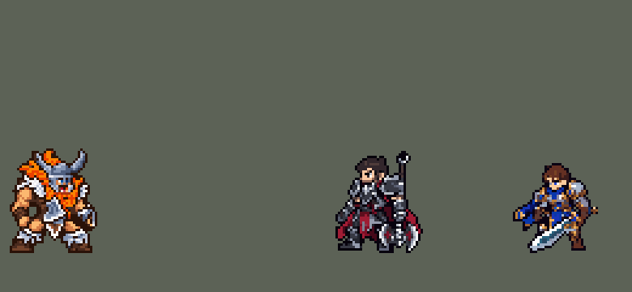

<!-- 本页上半部分由 tools/docs/gen_hero_docs.py 按仓库里现在的数据生成，手改会被覆盖；「开发记录」以下是手写的，生成时原样保留。 -->

# 奥拉夫 Olaf


| 项目 | 内容 |
|---|---|
| id | `league_olaf` |
| 所属的包 | 主包（mod_id `league`） |
| 分路 | 上单 |
| 分类 / 标签 | 近战（Melee） · AD / Melee |
| 高清帧 | 1 倍像素（无高清帧） |
| 附加包 | [奥拉夫读血附加包](#附加包)（`league_olaf_rage`） |



其他预览：[attack_tween](../preview/league_olaf_attack_tween.gif)、[逐帧预览](../preview/league_olaf_frames.png)、[特效表](../preview/league_olaf_effects.png)

## 现在的技能

下面是游戏里显示的技能说明（`league/text/champion.i18n` 的简体中文，去掉了颜色和图标），冷却、距离来自 `league/champion/league_olaf.data_champion`；1 秒 = 60 tick。

### 普攻 / 被动

*攻击间隔 1.07 秒 · 攻击距离 25000*

狂战之怒：越挨打攻速越高（每层+20%，共4层），最高两层吸血12%。挺过去（自动，13秒）：交战时攻速+40%并获得护盾。诸神黄昏被动：护甲、魔抗+12。

### 技能1 · 逆流投掷

*冷却 8 秒 · 施放距离 50000 · 施放：指定目标 · 敌人（不含防御塔）*

向目标所在处掷斧，沿途造成100 + 100% 攻击力伤害，减速30%、护甲-20%。斧头插地5秒，走过去捡起则冷却大幅缩短。

### 技能2 · 鲁莽挥击

*冷却 5 秒 · 施放距离 28000 · 施放：指定目标 · 敌人（不含防御塔）*

鲁莽挥击，造成110 + 90% 攻击力真实伤害，自己承受其中30%；击杀则返还。

### 大招 · 诸神黄昏

*冷却 50 秒 · 施放距离 40000 · 施放：无目标 · 敌方英雄*

免疫控制，攻击力+30%、移速+20%，持续3秒；攻击英雄时延续（最多10秒）。

### 数值

攻击力 100（每级 +18）、生命 1100（每级 +108）、护甲 34（每级 +8）、魔抗 25（每级 +4）、移速 1000（每级 +11）。

## 附加包

附加包是可选的原生代码 mod（都在附加包合集 `league_addons` 里），**不装主包里的英雄也是完整的**。

### 奥拉夫读血附加包

[奥拉夫读血附加包](../../addons/league_olaf_rage/README.md)：`league_olaf_rage` v0.1.0

主包 `league` 保持纯数据，不装本包也完整、平衡过。数据读不到生命，所以主包里奥拉夫的被动「狂战之怒」是替代做法：

- **主包**：挨打计数——普攻时发现 1 点护盾被打破就升一层（`league_olaf_p_1`..`p_4`，每层攻速 +20%，最高两层再吸血 12%），离开战斗一段时间掉一层。
- **英雄联盟**：已损失的生命越多，攻速越高。

## 相关脚本和素材

- [`tools/kit/build_olaf.py`](../../tools/kit/build_olaf.py)
- [`tools/kit/setup_olaf.py`](../../tools/kit/setup_olaf.py)
- [`tools/lol/extract_olaf.py`](../../tools/lol/extract_olaf.py)
- [`tools/art/preview_olaf.py`](../../tools/art/preview_olaf.py)
- [`tools/art/rig_olaf.py`](../../tools/art/rig_olaf.py)
- [`tools/art/import_olaf.py`](../../tools/art/import_olaf.py)
- [`tools/art/design_olaf.py`](../../tools/art/design_olaf.py)
- [`assets/source/olaf/`](../../assets/source/olaf)

## 开发记录

> 下面是原来 README 里「英雄：奥拉夫」一节，原样搬过来（只改了相对链接）。

| 部分 | 内容 |
|---|---|
| 定位 | 上单（近战，分类 Melee），第 81 位英雄。狂战士 奥拉夫：掷斧捡斧、真实伤害、免控冲锋。用户选上单、完整还原 + 高手连招 |
| 普攻 / 被动 | 双斧劈砍，射程 25000，攻击间隔 64 tick，第 12 tick 命中。被动「狂战之怒」：英雄联盟里已损失生命越多攻速越高、还有吸血；数据读不到生命，改成挨打计数（蛮王的受击探测：普攻时发现 1 点护盾被打破就升一层），最多 4 层，每层攻速 +20%，最高两层再吸血 12%，离开战斗每 90 tick 掉一层。可选的扩展包 `league_olaf_rage` 按真实的已损失生命给层数（见下） |
| 挺过去（自动） | W「挺过去」没有技能位，冷却 780 tick（13 秒）：普攻时 30000 内有敌方英雄就怒吼一声，攻速 +40% 4 秒，护盾 100 + 40% 攻击力 2.5 秒 |
| 技能1 | Q「逆流投掷」：冷却 480 tick（8 秒），射程 50000，也对小兵和野怪放。第 12 tick 把斧头抛向目标所在处（飞 10 tick，躲得开），同时一道看不见的刃光沿途穿过：100 + 100% 攻击力物理伤害、减速 30% 1.5 秒、护甲 −20% 4 秒。斧头插在落点 5 秒，他走到 9000 内就捡起来：Q 和 E 的冷却压到 45%（英雄联盟的捡斧刷新），大招不受影响；地上最多同时两把 |
| 技能2 | E「鲁莽挥击」：冷却 300 tick（5 秒），射程 28000：110 + 90% 攻击力真实伤害，自己承受其中 30%（真实伤害），打死目标就返还。第 14 tick 砸中（动作里双斧落地那一帧，英雄联盟施法 0.25 秒） |
| 大招 | R「诸神黄昏」：冷却 3000 tick（50 秒），40000 内有敌方英雄时放：3 秒免疫控制、攻击力 +30%、移速 +20%；普攻或 E 打中英雄就延续，最多 10 秒。被动：没开大时护甲、魔抗 +12（3 级起） |
| 附加包（对线） | 可选的附加包 [`addons/league_ult_press`](../../addons/league_ult_press/README.md)（在附加包合集里，原生代码，主包不装它也完整）：对线时游戏 0.6.4 的 AI 常把他停在对面英雄 26–32k 外（近战射程 25k）、下令「走到自己脚下」站着不打（只读观察包：他身边 50000 内有敌方英雄时站着不动 22–32%，盖伦 2.7%、贾克斯 3.9%；这些站桩 93% 在 10 分钟前、对面只有 1 人）。附加包替 AI 上去平 A（用户：「卡密尔、瑟提、奥拉夫对线被 AI 停住时，附加包替他们上去平 A（血量够、不在对面塔下、不被以少打多）」）：原地站了 15 tick、普攻好了、AI 还让他原地站时，35000 内最近的敌方英雄——他生命不低于一半、目标离敌方塔 75000 以外、目标身边 60000 内的敌方英雄不多于他身边的我方英雄（含他）——就普攻他，打出一下或 1.5 秒后重新算 |
| 高手连招 | R 冲入（免控）→ E → 捡斧再投：捡起斧头压低冷却，马上再掷，E 也跟着刷新 |
| 数值 | 攻击 100（+18）、生命 1100（+108）、护甲 34（+8）、魔抗 25（+4）、移速 1000（+11）。数值是自己设计的，用 SDK 对战模拟调：上单，对 6 个原版上单（`fighter`、`executioner`、`lancer`、`pole_warrior`、`knight`、`berserker`），3 套阵容、两边各打，10 分钟。初稿 −1.20；攻击 90 → 100、生命 1020 → 1100、狂战之怒每层 12% → 20%、吸血 6% → 12%、E 70 + 60% → 110 + 90%、冷却 6 → 5 秒、Q 70 → 100、挺过去护盾 60 → 100、大招攻击 +20% → +30% 后：种子 1–12 +1.28（同期蛮王 +1.34、德莱厄斯 +1.71），13–24 +1.71（蛮王 +1.24） |
| 亚索联动 | 奥拉夫只有减速，没有击飞，亚索大招不受影响，不用调 |
| 精灵图 | 8 个动作 50 帧：待机 8（身体在靴子上呼吸）、移动 8（英雄联盟原版 0.97 秒一圈，8 × 120 毫秒）、普攻 6、Q（`skill`）6、E（`skill2`）6、R（`ult`）6、受击 2、死亡 8。高 43 px、宽 36 px，21 色。头像截取点 (3, −41)，选人卡片 −8（待机最高点在站位点上方 31.5 px） |
| 特效 | Codex 生图的 13 张（`import_olaf.py --raw`，按技能范围缩到游戏尺寸、颜色归到包里给的色阶）：`league_olaf_fx` 普攻劈痕、翻滚的飞斧、斧头落地的冲击、插在地上的斧头（每 0.25 秒重放，等他来捡）、Q 命中和脚下寒气减速、捡斧的冰蓝光环、挺过去开启和身后的血气、满层狂怒的红色怒气；`league_olaf_big` E 双斧砸中的 X 形劈痕和闪电、R 怒吼和脚下的怒火。配色照英雄联盟的技能图标：冰蓝钢光 + 白芯，怒火红橙。飞斧随飞行方向转，插地的斧头是地上的实物，其余左右对称 |
| 音效 | 英雄联盟的音效和配音（`tools/lol/extract_olaf.py`）：挥斧和命中、Q 掷出 / 命中 / 斧头落地 / 捡斧、W、E 出手和命中、R；Q、W、E、R 的配音。版权属于 Riot Games，**不提交到仓库**，按下面的命令在本地生成 |
| 图标 | 官方技能图标（Q / E / R），从本地客户端提取，缩到 64×64；W 自动，没有技能位 |

重新生成（素材来自本机的英雄联盟客户端，音频不进仓库）：

```bash
python tools/lol/extract_olaf.py --lol "D:\WeGameApps\lol" --vgmstream "<vgmstream-cli.exe 路径>"
python tools/kit/build_olaf.py          # 技能数据，数字都在脚本的参数表 P 里；--nodes 看每棵技能树的节点数
python tools/kit/setup_olaf.py --face 3,-41 --banpick -8   # 五种语言的文字、音效配置、共享文件里他的键
python tools/art/design_olaf.py --final  # 造型：瘦身后的定稿（olaf_design_43.txt）
python tools/art/fix_olaf_strips.py     # 动作：Codex 改回待机大小的重画 + 交叉步跑步 + 定稿的头
python tools/art/import_native.py --hero olaf
python tools/art/import_olaf.py         # 特效（--raw assets/source/olaf/codex_fx：从 Codex 的原稿重做）
python tools/art/preview_olaf.py        # 逐帧预览、特效表、演示 GIF
```

美术（动作的提示词见 [`assets/source/olaf/MODEL_STRIPS_v2.md`](../../assets/source/olaf/MODEL_STRIPS_v2.md)，瘦身见 [`SLIM_PACK.md`](../../assets/source/olaf/SLIM_PACK.md) 和 [`SLIM_STRIPS.md`](../../assets/source/olaf/SLIM_STRIPS.md)，大小和跑步见 [`SIZE_RUN.md`](../../assets/source/olaf/SIZE_RUN.md) 和 [`RUN_CROSS.md`](../../assets/source/olaf/RUN_CROSS.md)，普攻过渡帧见 [`ATTACK_TWEEN.md`](../../assets/source/olaf/ATTACK_TWEEN.md)，特效的见 [`PROMPTS_FX.md`](../../assets/source/olaf/PROMPTS_FX.md)；Codex 的交付在 [`codex_model/`](../../assets/source/olaf/codex_model)、[`codex_strips_v2/`](../../assets/source/olaf/codex_strips_v2)、[`codex_slim/`](../../assets/source/olaf/codex_slim)、[`codex_strips_slim/`](../../assets/source/olaf/codex_strips_slim)、[`codex_strips_size/`](../../assets/source/olaf/codex_strips_size)、[`codex_run_cross/`](../../assets/source/olaf/codex_run_cross)、[`codex_attack_tween/`](../../assets/source/olaf/codex_attack_tween)、[`codex_fx/`](../../assets/source/olaf/codex_fx)）：

- 原画：Codex 画了待机（A，两手各一把斧）和 Q 举斧蓄力（B）两版，A 用作造型，B 给 Q 的动作参考。
- 造型：Codex 第二轮的生图原稿按格读回（48 × 45），用户选 42 行；删行时头上的角整只保留（「头上的角要完整」），再按材质归色精修（「再精修一下吧 有点模糊啊」），嘴用之前那版。之后用户「奥拉夫稍微瘦一点 肌肉明显点」：Codex 在定稿上画了 A / B 两版瘦身，用户选 B（肩那一段 37 → 32 格，手臂、肩膀、大腿的肌肉用皮肤三档颜色分块），头换回定稿的头，43 × 36。
- 动作：Codex 第一版的身体比造型大、头整块贴上去带着一条肩毛；用造型零件重摆的版本被退回（用户：「身体太奇怪了吧。。。和英雄联盟也不一样啊」）。第二版让 Codex 照英雄联盟原版逐帧把整个人一起画（提示词按原版骨骼量了每帧的腿、胯、身体、手：跑步弓身冲锋后脚高踢、普攻右手举斧下劈、Q 左手高举再弓步掷斧、E 下蹲跃起双斧砸地、R 仰头怒吼双斧交叉、死亡跪下再向前扑倒），`fix_olaf_strips.py` 在 Codex 画头的位置换上定稿的头、把用描边色画的黑靴子和背心改回深棕皮革、补掉漏光的小孔；瘦身后 Codex 再拿通过的动作条当骨架换成新身材（`codex_strips_slim`），头沿用通过那版每帧的位置。用户：「非常好」。进游戏后用户：「奥拉夫跑动时为什么变大一圈 好违和」「还有跑动姿势太浮夸了吧」——Codex 把所有动作照待机的大小重画（`codex_strips_size`）；仍偏大的 R、死亡缩到 85%、E 到 90%，画瘦了的受击改用瘦身版缩到 80%（整行整列删除，不重新采样，头不动：`import_native.py` 的 `SHRINK_TAGS`）。跑步先是两只脚都钉在原地（「感觉像在平移」），再让 Codex 照逐帧的腿部引导图画交叉步（`codex_run_cross`：着地的脚往后蹬，另一条腿后踢再越过去）；它第 6 帧把刚落地的脚又抬起来，去掉这帧，跑步 7 帧；每帧落到地面线上，头跟着躯干起伏。之后用户：「奥拉夫战斗时有很强的顿挫感」——查下来节奏、技能树都正常，是普攻每一刀都从正面待机一下切到侧身大开步、最后从低位前冲一下弹回站直；用户选了「首尾各补一帧过渡，其余帧不动」，Codex 画了两帧（[`ATTACK_TWEEN.md`](../../assets/source/olaf/ATTACK_TWEEN.md)，交付在 `codex_attack_tween/`）：起手半转身抬斧，接在待机和普攻 1 之间；收招从前冲起身一半，接在普攻 5 和 6 之间。整段仍是 400 毫秒、第 4 帧（第 12 tick）出伤，帧时长 40 / 50 / 50 / 60 / 70 / 50 / 40 / 40（`fix_olaf_strips.py` 的 `TWEEN`）。
- 特效：Codex 第 3 步的 13 张生图原稿；挺过去的血气光环原稿是一整圈很厚的火，和大招的火分不开，只留亮边。

逐帧预览：[`docs/preview/league_olaf_frames.png`](../preview/league_olaf_frames.png?v=1015t)，特效：[`docs/preview/league_olaf_effects.png`](../preview/league_olaf_effects.png?v=1015t)。

可选的扩展包 [`addons/league_olaf_rage`](../../addons/league_olaf_rage/README.md)（原生代码，主包不装它也完整）：读真实的生命，已损失 15% 起一层狂怒，之后每多 17% 再一层，和英雄联盟一样按血量给攻速和吸血。
