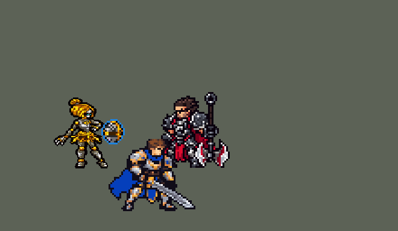

<!-- 本页上半部分由 tools/docs/gen_hero_docs.py 按仓库里现在的数据生成，手改会被覆盖；「开发记录」以下是手写的，生成时原样保留。 -->

# 奥莉安娜 Orianna


| 项目 | 内容 |
|---|---|
| id | `league_orianna` |
| 所属的包 | 主包（mod_id `league`） |
| 分路 | 中单 |
| 分类 / 标签 | 法师（Magician） · AP / Magic / Range / CC / Shield |
| 高清帧 | PPU 2.25 |
| 附加包 | [奥莉安娜附加包](#附加包)（`league_orianna`）、[游戏 AI 不按的技能替它按](#附加包)（`league_ult_press`） |



其他预览：[逐帧预览](../preview/league_orianna_frames.png)、[特效表](../preview/league_orianna_effects.png)

## 现在的技能

下面是游戏里显示的技能说明（`league/text/champion.i18n` 的简体中文，去掉了颜色和图标），冷却、距离来自 `league/champion/league_orianna.data_champion`；1 秒 = 60 tick。

### 普攻 / 被动

*攻击间隔 1.5 秒 · 攻击距离 55000*

发射发条弹。发条协奏：普攻附带18 + 15% 法强魔法伤害，4秒内连续普攻再叠加，最多2层。

### 技能1 · 指令：攻击

*冷却 5 秒 · 施放距离 70000 · 施放：指定目标 · 敌人（不含防御塔）*

把球扔到敌方英雄脚下并停留，造成85 + 65% 法强魔法伤害。指令：杂音：球附近有敌人时自动放电，造成85 + 85% 法强魔法伤害，减速30%，队友加速30%。

### 技能2 · 指令：防卫

*冷却 9 秒 · 施放距离 75000 · 施放：指定目标 · 敌方英雄*

把球送给离敌人最近的队友（被贴身时给自己），提供60 + 45% 法强护盾，路过的敌人受到60 + 30% 法强魔法伤害。带球者+12护甲和魔抗。

### 大招 · 指令：冲击波

*冷却 70 秒 · 施放距离 90000 · 施放：无目标 · 敌方英雄*

待命6秒，球附近有敌方英雄时放出冲击波：造成250 + 100% 法强魔法伤害并把敌人甩向球。

### 数值

攻击力 76（每级 +6）、法强 40（每级 +20）、生命 860（每级 +95）、护甲 20（每级 +7）、魔抗 22（每级 +4）、移速 900（每级 +9）。

## 附加包

附加包是可选的原生代码 mod（都在附加包合集 `league_addons` 里），**不装主包里的英雄也是完整的**。

### 奥莉安娜附加包

[奥莉安娜附加包](../../addons/league_orianna/README.md)：`league_orianna` v0.2.0

|  | 主包（纯数据） | 装了附加包 |
|---|---|---|
| Q / E 的球从哪飞出 | 从她手里飞出，原来位置的球同时消失 | **从球所在的位置飞出**：地上、队友身上、飞回来的半路都行；E 路过的敌人按球到队友这条线算 |
| E 送给谁 | 随机挑一个敌方英雄，送给他附近的一个队友（她被贴身时给自己） | **送给最危险的队友**：身边有敌方英雄的队友里，近一秒受到的伤害比例 × 2 + 已损失生命比例最高的；她自己身边有敌人而且更危险时留给自己 |
| R 什么时候放 | 球附近有敌方英雄（0.124.2 起；之前要 2 个敌方英雄，或 1 个正在被打的落单目标） | 同主包；每个人能不能被冲击波打死照样算（按他的魔抗：伤害 × 100 / (100 + 魔抗)），写进日志（v0.1.0 是「2 个敌方英雄或能打死 1 个」，用户：「发条的大招条件太苛刻」） |
| 补兵 | 游戏的 AI 把她在兵线、塔边的固定路点之间来回带，兵线到了跟前也很少普攻（玩家：「Orianna doesn't walk up to farm」） | **走上去补刀**（v0.2.0）：附近没有敌方英雄时，普攻距离内的小兵先打这一下打得死的、其次血最少的；60k 内的兵线走上去打；塔下要有己方小兵扛塔才去 |

装上附加包后游戏里显示的说明（和主包不同的部分）：

- **技能1 · 指令：攻击**：【附加包】球从它所在的位置飞到敌方英雄脚下并停留，造成85 + 65% 法强魔法伤害。指令：杂音：球附近有敌人时自动放电，造成85 + 85% 法强魔法伤害，减速30%，队友加速30%。
- **技能2 · 指令：防卫**：【附加包】球从它所在的位置飞向最危险的队友（自己更危险时回到身边），提供60 + 45% 法强护盾，路过的敌人受到60 + 30% 法强魔法伤害。带球者+12护甲和魔抗。
- **大招 · 指令：冲击波**：【附加包】待命6秒，球附近有敌方英雄时放出冲击波：造成250 + 100% 法强魔法伤害并把敌人甩向球。

### 游戏 AI 不按的技能替它按

[游戏 AI 不按的技能替它按](../../addons/league_ult_press/README.md)：`league_ult_press` v0.5.7（通用附加包，下面只列和奥莉安娜有关的部分）

|  | 装了附加包，什么时候按 |
|---|---|
| 奥莉安娜 E、基兰 E | 在打架：她 / 他或射程内的队友 40000 内有敌方英雄（基兰也追射程内生命不到 40% 的） |
| 凯尔、卡尔玛、伊芙琳、奥莉安娜的 R（备好式） | 身边有敌方英雄就按（凯尔 50000、卡尔玛 70000、伊芙琳 45000、奥莉安娜 60000）：这几个 R 格只是「备好」，主包在之后几秒里自己判断时机放出，没用上退还冷却，按下去不会白费 |

## 相关脚本和素材

- [`tools/kit/build_orianna.py`](../../tools/kit/build_orianna.py)
- [`tools/kit/setup_orianna.py`](../../tools/kit/setup_orianna.py)
- [`tools/lol/extract_orianna.py`](../../tools/lol/extract_orianna.py)
- [`tools/art/preview_orianna.py`](../../tools/art/preview_orianna.py)
- [`tools/art/rig_orianna.py`](../../tools/art/rig_orianna.py)
- [`assets/source/orianna/`](../../assets/source/orianna)

## 开发记录

> 下面是原来 README 里「英雄：奥莉安娜」一节，原样搬过来（只改了相对链接）。

| 部分 | 内容 |
|---|---|
| 定位 | 中单（Magician，标签 AP / Magic / Range / CC / Shield），第 113 位英雄。发条魔灵 奥莉安娜：指挥身边的发条球打人、护人、震人的法师。用户的选择：「中单法师、做附加包、方案可以」——技能 1 = Q 指令：攻击（W 指令：杂音没有自己的格子，和 Q 共用图标、自动放），技能 2 = E 指令：防卫，大招 = R 指令：冲击波；高清 PPU 2.2（84 行） |
| 球 | 和英雄联盟一样有三个位置：**在她身边**（她身上一个一直在的标记，画面是漂在她身边的球，标记还带 E 的被动护甲和魔抗）、**停在地上**（Q 扔到哪就停在哪，每 15 tick 一个检查点：重画地上的球、在那里判断 W / R，离她超过 110 码（英雄联盟 1290）或停满 5 秒就飞回来）、**挂在队友身上**（E 送过去的跟着他走，离她太远或 10 秒后飞回来）。W 和 R 都以球为中心放。球的逻辑放在普攻挂在她身上的一个周期效果（控制器）里：技能树每 tick 复制一遍，大了会卡；每条命第一次普攻之前，Q 只是扔出去再飞回来、E 只给自己加盾。身边的球画在她脚中间往前 17 像素、离地 20 像素（[`tools/art/import_orianna_fx.py`](../../tools/art/import_orianna_fx.py) `BALL_AT`；原来 12 像素，用户：「奥利安娜走路的时候球有点挡脸了」，17 在待机和跑步的每一帧都不碰她） |
| 普攻 / 被动 | 发条电弹（远程 55 码，攻击间隔 90 tick）。**发条协奏**：普攻多 18 + 15% 法强魔法伤害；4 秒内连续普攻每次再多 4 + 3%，最多 2 层（英雄联盟是同一目标；数据分不出打的是谁，所以连续普攻就叠） |
| 技能1 | Q「指令：攻击」：冷却 300 tick，70 码内有敌方英雄时，球飞向他出手时站的地方（18 tick 落地，走开能躲），落点第一个单位 85 + 65% 法强魔法伤害、其余 70%，球停在那里。只有小兵、野怪时球打一下就飞回来。**W「指令：杂音」**：冷却 420 tick，球附近 24 码有敌方英雄就自己放（附近没有英雄、只有兵时用来清线）：85 + 85% 法强魔法伤害，敌人减速 30%、队友加速 30%，2 秒 |
| 技能2 | E「指令：防卫」（游戏的 AI 按标记当时选中的那一支给技能打分：控制器在跑时 E 那一支只是立个标记，AI 看着不值得放，游戏里一局只放一两次；现在打分时它看到的是 E 的护盾——护盾给谁都按全额算，不会像伤害那样改变 AI 的走位）：冷却 540 tick，75 码内有敌方英雄才放（打架时用）：22 码内有敌人贴着她就给自己；否则送给离敌方英雄最近的队友（敌方英雄 40 码内的队友）。60 + 45% 法强护盾 2.5 秒，球路过的敌人 60 + 30% 法强魔法伤害，带球的人护甲、魔抗 +12（英雄联盟的被动） |
| 大招 | R「指令：冲击波」：冷却 4200 tick，**看时机**（用户的规则「看好时机」）：按下后待命 6 秒，**球附近 42 码有敌方英雄就放**（0.124.2，用户：「发条的大招条件太苛刻」——之前要 36 码内 2 个敌方英雄，或 1 个正在被打、70 码内没有第二个敌方英雄的落单目标：模拟 4 局 18 次待命只放出 11 次；现在 20 次放出 17 次。半径 36 → 42 码：英雄联盟 R 的 415 是 W 225 的 1.8 倍）：0.5 秒后 250 + 100% 法强魔法伤害，把敌人甩向球（28 码，英雄联盟 340）。没等到就缩短冷却 |
| 附加包 | 可选的附加包 [`addons/league_orianna`](../../addons/league_orianna/README.md)（在附加包合集里，原生代码，主包不装它也完整）：**球从它所在的位置飞出**（Q、E 的球从地上、队友身上、飞回来的半路出发，E 路上的伤害按球到队友这条线算）；**E 送给最危险的队友**（身边有敌人的队友里，近一秒受到的伤害比例和已损失生命最多的；她自己更危险就留给自己）；**R 读血量**（待命时对球附近每个敌方英雄算能不能打死，写进日志；0.124.2 起球附近有敌方英雄就放，和主包一样）。按模拟编号分开记。日志 `league_orianna.log`（THROW、SEND、E-HIT、BACK、PICK、KILL） |
| 附加包（替 AI 按） | 可选的附加包 [`addons/league_ult_press`](../../addons/league_ult_press/README.md)（在附加包合集里，原生代码，主包不装它也完整）：游戏 0.6.4 的 AI 很少按她的 R 和 E（只读观察包：每 10 分钟 0.5 次和 0.7 次，31 局）。附加包按局面替 AI 按（用户：「有问题的英雄全部改成rust」）：R（只是待命 6 秒）——60000 内有敌方英雄就按，放不放由主包看球附近；E——她或 75000 内的队友 40000 内有敌方英雄（在打架）就按，送给谁由主包或 league_orianna 决定 |
| 数值 | 攻击 76（+6）、法强 40（+20）、生命 860（+95）、护甲 20（+7）、魔抗 22（+4）、移速 900（+9） |
| 平衡 | 中路对五个基础中单（pyromancer / ice_mage / lightning_mage / wind_mage / white_mage），三套阵容、两边各打，10 分钟经典引擎模拟，每批 16 个种子 480 局（同一套数值单批误差约 ±0.34 杀，所以每个方案都看两批）。0.122.0：+0.76 / −0.05（种子 1–16 / 17–32；同批辛德拉 +1.20 / +1.57），伤害 11.9k（辛德拉 12.4k）——平均比辛德拉弱约 1 杀。**0.124.2 加强**：Q 70 + 55% → **85 + 65%**、W 70 + 70% → **85 + 85%**，R 放宽（见大招）：**+1.30 / +1.36**，伤害 13.7k / 14.0k。比过的方案（两批）：只加基础伤害（Q、W 各 +15）+0.06 / +0.25，只加法强系数（Q 65%、W 80%）+0.41 / +0.36，两样各加一点（80 + 65% / 80 + 80%）+0.98 / +0.85，同样再放宽 R +0.95 / +1.11，只放宽 R +0.36 / −0.12；生命 +60 是 −0.41（种子 1–16），不用。附加包的数据部分（原生调用换成替身）在模拟里正常：每局 E 18.7 次。亚索 R：奥莉安娜在中路同队时每局 0.62 次（0.122.0；闪电法师 3.19、辛德拉 2.06）——她的冲击波只拉扯 0.2 秒，拉长到 0.4 秒（同样距离）也只到 0.78，亚索不改 |
| 精灵图（高清帧 PPU 2.25，Q 版） | 2026-10-22 重做成 Q 版（用户：「奥利安娜的建模和动作帧不全 能让codex帮忙重做吗」「我要的是Q版的 现在明显质量不行啊 还有动作少太多了」）。Codex 照英雄联盟的模型（按 Q 版比例放大头、缩短腿的渲染）在游戏格子上画两稿 Q 版造型，每稿正面 + 侧面（[`tools/art/pack_orianna_chibi.py`](../../tools/art/pack_orianna_chibi.py)，提示词 `CHIBI_PROMPTS.md`，交付在 `assets/source/orianna/codex_chibi/`）；它自己缩到格子上的图是糊的，原稿按各自的格子读回很干净，[`tools/art/design_orianna_chibi.py`](../../tools/art/design_orianna_chibi.py) 按蛮王的办法整行整列删到游戏大小（脸不动）。用户选 Q1 正面，「把头缩小点 身体放长点就完美了」：头和身体分开删（头 0.66、身体 0.80，眼睛不动），选 A，侧面按同样比例（`chibi/design-front.png` 58 × 86、`design-side.png` 48 × 87）。动作用户：「60帧吧 不交给codex了 你自己慢慢处理」：[`tools/art/rig_orianna.py`](../../tools/art/rig_orianna.py) 照英雄联盟每个动作的关节（[`tools/lol/native_pose.py`](../../tools/lol/native_pose.py) 的 `dump_joints`，侧身 40° 的待机做参照）一帧一帧摆——每帧都是正面造型的头（同一张脸），身体、裙子、钥匙是侧面造型自己的格子整块移动，前倾是上半身整行平移；大腿、上臂、前臂画成造型配色的金属圆柱（左上受光、一圈描边），小腿用造型自己的护甲小腿绕膝盖转，膝 / 踝 / 肘的球、靴子和手（8 个无损方向）照抄造型。待机 8 帧（正面造型腰以上沉一行，腿不动）、跑步 8（卡特琳娜的跑法：8 个脚步相位、前倾 1:2）、普攻 8、Q 8、W 8、E 8、R 10、受击 2（正面）、死亡 10（倒地是无损的 90° 翻转，先离地 5 格再落地）；出手帧按技能数据的 tick 对齐（普攻第 4 帧 = a_st 10，Q / E 第 4 帧 = 100 ms，R 第 9 帧 = r_delay 500 ms）。新的头和身体之间偶尔裂开的缝填脖子的深色，手臂和身体之间的细缝填描边色。PPU 2.25：86 行 = 原来的 38.2 游戏像素，身高不变。头像点 (0, −35)。主包 0.189.20、`league.dll` 0.7.107 |
| 特效 | Codex 第 3 步（[`tools/art/pack_orianna_fx.py`](../../tools/art/pack_orianna_fx.py)）画了 15 张（用户贴在对话里，`assets/source/orianna/codex_fx`；球漂在身边那张没交）。[`tools/art/import_orianna_fx.py`](../../tools/art/import_orianna_fx.py)：按格子读、去黑底、按游戏大小缩、取提示词的色阶、左右对称（电弹上下对称）；R 的漩涡和冲击环画成了俯视的圆，压成地上的椭圆（光柱随之约 48 px 高），最深的蓝只留在边上（第 1 帧和渐隐的环原来是一大片深色）；E 的护盾压成竖的椭圆。Codex 的球约 25 格，缩到游戏大小就糊，所以球的三种画面（身边、地上、飞行）用游戏大小的球，外加一圈淡蓝光（用户：「球太大了吧？」，在 14 / 12 / 11 / 10 里选了 11）；2026-10-22 Q 版重做后换成新造型的球：Codex 新画的球按新配色（钢银 + 古铜环 + 弧脊）手画成 12 × 12（`chibi/ball_1x.png`，整行整列删和按块投票都糊成一团黑）。W 的脉冲和 R 的冲击波画在人物下面（z −1），地上的球画在人物上面。用户：「特效通过」 |
| 音效 | 英雄联盟的音效和配音（[`tools/lol/extract_orianna.py`](../../tools/lol/extract_orianna.py)，14 段）：电弹出手 / 打中、球飞出 / 落地 / 打中、杂音、送球 / 护盾、冲击波 / 打中，配音 Q / W / E / R。2026-10-22 用户：「技能音效好像也没有」——技能音效第一版提取时峰值只有 −9 到 −18 dBFS、配置音量 0.45–0.65（实际约 0.13，拉克丝约 0.53），提取峰值整体 +8 dB（最高 −2）、技能音量 0.75–0.9（普攻 0.5–0.6），实际中位约 0.49；配音不变 |
| 图标 | 官方技能图标（Q 指令：攻击 / E 指令：防卫 / R 指令：冲击波，另有 W 指令：杂音、被动），从本地客户端取 |

重新生成（素材来自本机的英雄联盟客户端，音频不进仓库）：

```bash
python tools/lol/extract_orianna.py --lol "D:\WeGameApps\lol" --vgmstream <vgmstream-cli.exe>
python tools/kit/build_orianna.py                  # 技能数据，数字都在脚本的参数表 P 里
python tools/kit/setup_orianna.py --face 0,-35     # 五种语言的文字、音效配置、共享文件里她的键
python tools/art/design_orianna_chibi.py --out <目录>   # Q 版造型：Codex 原稿读回、头和身体分开删（结果在 chibi/）
python tools/lol/native_pose.py assets/source/orianna/poses.json --out %TEMP%/or_q/pose_n --alpha   # 英雄联盟的关节（本地）
python tools/art/rig_orianna.py                    # 1 倍帧和 2.25 的原帧（--review <目录>：和英雄联盟对照的 GIF）
python tools/art/ppu_restyle.py --hero orianna     # 描边（不要加 --preview）
python tools/art/ppu_hd.py --hero orianna          # hd_ / lo_ 帧
python tools/art/import_orianna_fx.py              # 特效
python tools/art/preview_orianna.py                # 预览和演示 GIF
python addons/league_orianna/make_override.py      # 附加包的副本（主包的奥莉安娜改了就重跑）
```

美术提示词见 [`assets/source/orianna/`](../../assets/source/orianna) 里的 `CHIBI_PROMPTS.md`（Q 版造型）、`PROMPTS_FX.md`（特效）和最初的 `PICTURE_PROMPT.md`、`MODEL_PROMPTS.md`；Codex 的交付在 `codex_chibi/`、`codex_fx/`（和最初的 `codex_picture/`、`codex_model/`）。

逐帧预览：[`docs/preview/league_orianna_frames.png`](../preview/league_orianna_frames.png?v=1022)，特效：[`docs/preview/league_orianna_effects.png`](../preview/league_orianna_effects.png?v=1022)。
