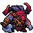

<!-- 本页上半部分由 tools/docs/gen_hero_docs.py 按仓库里现在的数据生成，手改会被覆盖；「开发记录」以下是手写的，生成时原样保留。 -->

# 奥恩 Ornn



| 项目 | 内容 |
|---|---|
| id | `league_ornn` |
| 所属的包 | 主包（mod_id `league`） |
| 分路 | 上单 |
| 分类 / 标签 | 近战（Melee） · AD / Melee / Tank / CC / Shield |
| 高清帧 | PPU 1.5 |
| 附加包 | [奥恩附加包](#附加包)（`league_ornn`） |


其他预览：[逐帧预览](../preview/league_ornn_frames.png)、[特效表](../preview/league_ornn_effects.png)

## 现在的技能

下面是游戏里显示的技能说明（`league/text/champion.i18n` 的简体中文，去掉了颜色和图标），冷却、距离来自 `league/champion/league_ornn.data_champion`；1 秒 = 60 tick。

### 普攻 / 被动

*攻击间隔 1.2 秒 · 攻击距离 25000*

活体锻炉：护甲、魔抗+10%，生命+6%。W/E/R使敌方英雄易碎，普攻打中易碎的英雄造成8%最大生命真实伤害并击飞。风箱炎息：每12秒喷火，不可阻挡并获得护盾，造成50 + 5% 最大生命魔法伤害。

### 技能1 · 火山突堑

*冷却 8 秒 · 施放距离 75000 · 施放：地点 · 敌人（不含防御塔）*

砸地裂出一道裂隙，造成50 + 100% 攻击力物理伤害并减速40%，尽头升起熔岩柱，持续4秒。

### 技能2 · 炽烈冲锋

*冷却 12 秒 · 施放距离 55000 · 施放：指定目标 · 敌人（不含防御塔）*

冲向目标，造成60 + 4% 最大生命物理伤害。撞上熔岩柱时撞碎它，周围敌人击飞1秒并受到40 + 3% 最大生命物理伤害，英雄易碎。

### 大招 · 熔铸之神的召唤

*冷却 50 秒 · 施放距离 90000 · 施放：指定目标 · 敌方英雄*

召唤熔岩公羊从远处冲向自己，造成120 + 3% 最大生命魔法伤害并减速50%；公羊到身边时头槌把它顶回去，沿路造成120 + 3% 最大生命魔法伤害并击飞。

### 数值

攻击力 80（每级 +8）、生命 1100（每级 +115）、护甲 38（每级 +9）、魔抗 30（每级 +4）、移速 1000（每级 +10）。

## 附加包

附加包是可选的原生代码 mod（都在附加包合集 `league_addons` 里），**不装主包里的英雄也是完整的**。

### 奥恩附加包

[奥恩附加包](../../addons/league_ornn/README.md)：`league_ornn` v0.4.5

|  | 主包（纯数据） | 装了附加包 |
|---|---|---|
| 熔岩柱 | 只是画面，4 秒 | **真的地形**：立在裂隙的尽头 4 秒，立起时把站在上面的单位推开，之后谁都走不进去（两边的英雄、小兵、野怪，他自己也算） |
| E 的地震 | Q 之后 4 秒内的冲撞都地震 | **撞上柱子或墙才地震**：撞上目标的那一刻柱子够近（30000 加上柱子和他的半径），或冲撞方向 14000 内是墙（卡蜜尔附加包的墙格、地图的四边）；撞上的柱子随之碎掉 |
| 易碎 | 记在奥恩身上：W / E / R 打中英雄后，他的下一下普攻打中任何英雄都引爆 | **记在每个英雄身上**：只有带着易碎的英雄被他普攻打中才引爆（最大生命 8% 的真实伤害、击飞、从他身边击退） |
| 活体锻炉 | 护甲、魔抗 +10%，生命 +6% | **照英雄联盟**：他的装备的护甲、魔抗、生命 +10%，每锻造过一件杰作再 +4%（5 件后 +30%）；**锻造杰作一共 5 件、每人一件**：他自己 9 级（英雄联盟 13 级），队友在他 10、10、11、12 级（英雄联盟 14–17 级）按下路、中路、打野、上路、辅助的先后，锻造的是**装备栏里第一件传说装备**，只有这一件的主属性 +40%（英雄联盟：这一件加 1000 金币的属性）。**符文、出门装不锻造**（开局就在装备栏里的；4+6 装备 mod 的符文什么时候到手都不锻造），鞋、小件也不锻造。4+6 装备 mod 的第 5 阶成装算传说装备（0.4.3）。按他身上的装备 buff 算，游戏的、数据 mod 的、原生 mod 的装备都一样。**锻造看得见**：比赛下方玩家栏里锻造成杰作的那一件图标外一圈金色光晕、右下角一个小铁砧（他自己的亮，队友的淡），刚锻造时闪一下金光 |
| 连招 | 数据里：Q 之后 4 秒内的 E 地震；R 的两段在一次施法里（公羊回到身边就头槌） | AI 钩子按顺序：**Q → E**（AI 想放 E 而柱子没立、Q 好着时先放 Q 朝那人立柱）、**柱子旁边的英雄**（柱子立着、E 好了、有敌方英雄离柱子够近就替 AI 按 E 撞过去）、**易碎优先**（普攻够得着带易碎的英雄就改打他） |

装上附加包后游戏里显示的说明（和主包不同的部分）：

- **普攻 / 被动**：【扩展包】活体锻炉：双抗、生命+10%；9级起锻造杰作，每人第一件传说装备+40%。W/E/R使敌方英雄易碎，普攻打中易碎的英雄造成8%最大生命真实伤害并击飞。风箱炎息：每12秒喷火，不可阻挡并获得护盾，造成50 + 5% 最大生命魔法伤害。
- **技能1 · 火山突堑**：【扩展包】砸地裂出一道裂隙，造成50 + 100% 攻击力物理伤害并减速40%，尽头升起挡路的熔岩柱，持续4秒。
- **技能2 · 炽烈冲锋**：【扩展包】冲向目标，造成60 + 4% 最大生命物理伤害。撞上熔岩柱或墙时周围敌人击飞1秒并受到40 + 3% 最大生命物理伤害，英雄易碎。

## 相关脚本和素材

- [`tools/kit/build_ornn.py`](../../tools/kit/build_ornn.py)
- [`tools/kit/setup_ornn.py`](../../tools/kit/setup_ornn.py)
- [`tools/lol/extract_ornn.py`](../../tools/lol/extract_ornn.py)
- [`tools/art/preview_ornn.py`](../../tools/art/preview_ornn.py)
- [`tools/art/rig_ornn.py`](../../tools/art/rig_ornn.py)
- [`assets/source/ornn/`](../../assets/source/ornn)

## 开发记录

> 下面是原来 README 里「英雄：奥恩」一节，原样搬过来（只改了相对链接）。

| 部分 | 内容 |
|---|---|
| 定位 | 上单（Melee，标签 AD / Melee / Tank / CC / Shield），第 146 位英雄。山隐之焰 奥恩：驼背的羊角半神铁匠——灰蓝皮肤、肩膀和手臂粗壮，头上一对刻着暗红符文、角尖发红的深铁灰大羊角，深红的鬃毛和大胡子，青铜胸甲、深紫红的皮围裙，近手拎着大钢锤，熔岩的远手拿着小锤。用户的选择：「技能方案 A（Q / E / R，W 进普攻）」「做附加包」「上单」「有连招要做连招」。团战经理只有三个主动技能位：技能 1 = Q 火山突堑，技能 2 = E 炽烈冲锋，大招 = R 熔铸之神的召唤；W 风箱炎息放在普攻里；英雄联盟里活体锻炉的买装备、升级装备做不了，被动留下属性加成和易碎。技能名照英雄联盟 16.20.1 的 Data Dragon（五种语言） |
| 被动 | **活体锻炉**：护甲、魔抗 +10%，生命 +6%（永久 buff，阵亡后他的动作会再挂上）。**易碎**：W、E 撞柱的地震、R 的两头公羊打中敌方英雄后让他易碎 3 秒（身上一个标记），奥恩的下一下普攻打中英雄就引爆：目标最大生命 8% 的**真实伤害**、短暂的击退和击飞。数据只读得到施法者自己身上的 buff，所以主包把易碎记在奥恩身上（下一下普攻打中任何英雄都引爆），附加包按每个英雄分开记 |
| 普攻 / W 风箱炎息 | 抡起大锤砸下（100% 攻击，射程 25000）。**风箱炎息**（冷却 12 秒）：30000 内有敌方英雄时，普攻改成喷火 0.75 秒：**不可阻挡**，获得 120 的护盾（2 秒），朝前方锥形喷 5 次火，每次 10 + 1% 他的最大生命的魔法伤害，英雄另受自身最大生命 2% 的真实伤害；最后一次让英雄易碎 |
| 技能1 | **火山突堑**（射程 75000，冷却 8 秒）：砸地，一道裂隙朝目标点裂过去、裂满 80000，沿途 50 + 100% 攻击的物理伤害并减速 40% 2 秒；裂隙的尽头升起**熔岩柱**，立 4 秒 |
| 技能2 | **炽烈冲锋**（射程 55000，冷却 12 秒）：冲向目标，撞上时 18000 内 60 + 4% 他的最大生命的物理伤害。**撞上熔岩柱**（连招 Q → E）：柱子碎掉，30000 内的敌人**击飞** 1 秒并再受 40 + 3% 他的最大生命的物理伤害，英雄易碎。数据看不到柱子在哪，所以主包里 Q 之后 4 秒内冲向目标就算撞上柱子（裂隙朝着目标裂过去，柱子立在他身后）；附加包里柱子是真的地形，撞上墙也地震 |
| 大招 | **熔铸之神的召唤**（射程 90000，冷却 50 秒，只对英雄放）：在目标身后远处召出一头熔岩公羊，冲回他身边（半宽 18000：用户「R的羊的效果范围和效果都要做大点」，原来 12000），沿路 120 + 3% 他的最大生命的魔法伤害并减速 50% 1.5 秒，英雄易碎；他举着锤子等公羊到身边，**一头槌把它顶回去**（连招 R1 → R2，英雄联盟的再次施放）：第二头公羊朝目标冲出 110000，沿路再 120 + 3% 并**击飞** 1 秒，英雄易碎 |
| 连招 | 用户要求：「有连招要做连招」。**Q → E**：Q 立柱，E 撞上柱子地震击飞（主包：Q 之后 4 秒内的 E）；**R1 → R2**：公羊回到身边就头槌顶回去，两段在一次施法里；**易碎 → 普攻**：W / E 地震 / R 让英雄易碎，下一下普攻引爆 |
| 附加包 | 可选的附加包 [`addons/league_ornn`](../../addons/league_ornn/README.md)（在附加包合集里，原生代码，主包不装它也完整），照英雄联盟：**熔岩柱是挡路的地形**（谁都走不进去，立起时把上面的人推开），**E 撞上柱子或墙才地震**，**易碎记在每个英雄身上**（只有被普攻打中的那个带易碎的英雄引爆）；**活体锻炉加强装备**（用户：「有装备系统吧 你可以加强装备属性吧」「你也要能兼容mod的装备啊」）：他的装备主属性 +20%，按英雄身上的装备 buff 算，游戏的和 mod 的装备都算，9 级起锻造杰作：他自己 +35%、每个友方英雄的装备 +10%；**AI 连招**：AI 想放 E 而柱子没立时先 Q 立柱、柱子旁边有英雄就按 E 撞过去、普攻先打易碎的英雄。0.2.0（用户 11-01：「奥恩是不是有bug啊 不按指定装备出装 然后给队友乱发装备」——查下来出装是 Riot 装备 mod 定的，奥恩只加看不见的属性；接着「锻造后装备上加点特效？不然看不出啊」，两种样式里选了「金色光晕 + 角上小铁砧」）：**锻造看得见**，比赛下方玩家栏里被锻造的装备图标外一圈金色光晕、右下角小铁砧（他自己的亮，杰作后队友的淡），刚锻造时闪一下；按屏幕上的比赛时钟画，只画屏幕上那一场的。玩家栏的行当分路、左边当 0 队是推的，还没在游戏里核对（日志 `FX ROWS` 对 `STATS`）。日志 `league_ornn.log`（PILLAR、CHARGE、SHATTER、FORGE、连招、FX） |
| 数值 | 攻击 80（+8）、生命 1100（+115）、护甲 38（+9）、魔抗 30（+4）、移速 1000（+10）、射程 25000、攻击间隔 72 tick |
| 平衡 | 10 分钟经典引擎模拟，上路对六个原版上单（fighter / executioner / knight / berserker / lancer / pole_warrior），三套阵容两边各打，两批种子（1–8、9–16，各 288 局）：初稿 +1.86 / +1.15，公羊加宽到 18000 后（定稿）**+1.86 / +1.53**（原版 fighter 同一批对照 +1.33），没有崩溃。附加包（原生代码）经典引擎跑不了：把原生效果换成空的跑同一批，288 局都不出错（没有地震、引爆和锻炉，分数不算数）；附加包有 11 个单元测试 |
| 精灵图（高清帧 PPU 1.5） | Codex 第 0 步画了 A（原版的大羊角、两把原尺寸的锤）和 B（紧凑），用户选 A、「44」游戏像素、PPU 1.5（66 行）；第 1 步 Codex 照格子画三稿，用户选 A-3（71 × 66，原样读回，脸是 Codex 自己画的）。只做 3/4 面。第 2 步 Codex 照骨架画 18 个关键姿势（用户：「Codex 照骨架画关键姿势」；连招每一段有自己的姿势：Q 举起熔岩拳再砸地，E 低头冲撞、撞上后直起身，R 举锤召唤、后仰、头槌），[`design_ornn_poses.py`](../../tools/art/design_ornn_poses.py) 按同一个比例读回、换上定稿的脸，[`rig_ornn.py`](../../tools/art/rig_ornn.py) 照英雄联盟的动画摆成动作，技能的时机按动画定。**跑步的腿我自己画**（用户看了 Codex 的四帧：「奥恩走路是这样走的？」「跑步用定稿的上身，你自己画腿的跑步循环（像格雷福斯那样），大锤只轻微摆动」）：[`ornn_legs.py`](../../tools/art/ornn_legs.py) 让定稿的上身一颠一颠（0-1-2-1 行），两只脚都盖定稿自己那只亮边的远侧靴子、同样的步幅、相差半个周期，大锤只往前轻轻摆；之后照用户的话改了三次：近侧的脚不再退到大锤后面（「左腿变形了吧」「应该是左脚变形了」），两只脚换成同一只靴子（「右脚也应该调一调吧 看着不协调」），远侧的脚整体往后挪三格、脚尖不超过待机的位置（「脚部凸出身体了」「右脚」），用户：「右脚可以了」 |
| 特效 | 18 张特效（[`assets/source/ornn/PROMPTS_FX.md`](../../assets/source/ornn/PROMPTS_FX.md) 的提示词，参考是英雄联盟里奥恩自己的贴图和熔岩公羊的三个角度），Codex 按格子画好交回，[`tools/art/import_ornn_fx.py`](../../tools/art/import_ornn_fx.py) 导入并逐张核对对称：锻炉的火是白黄的芯、橙黄的身、红橙的边，石头是黑色玄武岩、裂缝里透着熔岩光，公羊是带回纹符文的黑岩身体和深红大角。两张弹道（裂隙头、公羊）从正上方看、头朝右、上下对称，其余左右对称；熔岩柱升起的最后一帧就是立着的柱子，之后每 15 tick 盖一次。**喷火画进他自己的喷火帧**（[`rig_ornn.py`](../../tools/art/rig_ornn.py) 的 `with_fire`：火的根部对在嘴上，客户端只镜像英雄自己的帧，不镜像特效图），数据里不再单独放火。**公羊的三张图（公羊、现身的火柱、撞中）放大 1.5 倍**（用户：「R的羊的效果范围和效果都要做大点」「不重新生成 你在那个特效的基础上改」）：在 Codex 的图上做 Scale3x，再把每 2×2 格并成 1 格（取多数的颜色），最后按原来的对称补齐，一格还是一个游戏像素，弧线不会变成一格两格交替的粗边。读回的三处小毛病在导入时修掉：公羊火柱第 4、5 帧顶上一条横线，熔岩柱升起第 3 帧离地 3 格，喷火第 6 帧整体低 4 格 |
| 音效 | 英雄联盟的音效和配音（[`tools/lol/extract_ornn.py`](../../tools/lol/extract_ornn.py)，25 段）：抡锤和打中，易碎挂上 / 引爆，风箱炎息和喷火打中，Q 砸地 / 裂隙 / 打中 / 熔岩柱升起 / 柱子碎了，E 冲锋 / 撞上 / 击飞，R 召唤 / 公羊奔跑 / 打中，头槌和第二头公羊；Q、W、E、R、头槌的配音 |
| 图标 | 官方技能图标（火山突堑、炽烈冲锋、熔铸之神的召唤），从本地客户端取 |
| 柱子绕行（附加包 0.2.1） | 2026-11-02 复查 11-01 晚上的日志：一次启动里柱子「挡住」单位 227 万次（日志按每 200 次一行还写了 1.1 万行），四分之一是英雄。游戏的寻路不知道柱子，单位一直往柱子里走，原来每 tick 放回上一 tick 的位置，就一直卡到柱子倒（最长 4 秒）。改成走路的贴着柱子的边绕过去（这一步的长度全用来绕，往他这一步偏的那边），一 tick 走 2200 以上的冲刺照旧停在柱子外；日志只记每根柱子第一次挡住某个单位（`HOLD` / `PUSH`），柱子倒了记一行 `HELD`（挡过几个单位、几个英雄、一共和最久多少 tick） |
| 11 月 3 日 | 用户：「奥恩的锻造逻辑有点问题 应该是所有装备出完了以后才开始锻造吧 现在造成几乎所有英雄的装备都能锻造」。附加包的活体锻炉在他一到 9 级时就给每个队友的装备锻造杰作（+10%），他自己的装备从开局就算锻造，比赛下方玩家栏里几乎每个人的装备都发光。附加包 0.3.0：锻造杰作只给装备出完了（装备栏 6 格满）的人——他自己 +20% → +35%、队友 +10%，光晕只画锻造杰作过的；他自己一直有的 +20% 是被动加成，不发光 |
| 11 月 11 日 | 用户：「奥恩锻造会强化所有装备 而不是和lol一样」「而且在4+6装备mod的情况下 还会强化符文 创意工坊的mod 需要兼容」。附加包 0.4.0 照英雄联盟（V26.10 的 wiki）重做活体锻炉：他自己的被动只加装备的护甲、魔抗、生命 +10%（每锻造过一件杰作再 +4%），以前是全部装备主属性 +20%；**杰作一共 5 件、每人一件**——他自己 9 级（英雄联盟 13 级，按 12 级折算），队友在他 10、10、11、12 级按下路、中路、打野、上路、辅助的先后——只锻造装备栏里**第一件传说装备**，这一件的主属性 +40%（英雄联盟加 1000 金币的属性），以前是满装的人全部装备加成。开局就在装备栏里的东西（4+6 装备 mod 的四个符文、出门装）不锻造、不算进被动；传说装备按引擎装备表的阶认（最高两阶，装备构筑钩子只看不改），拿不到表时查名单（游戏自带的第 4、5 阶、Riot 装备 mod 的 104 件传说装备和 `radiant_` 光辉版）。光晕只画在杰作那一格。4+6 装备 mod 本机没装，玩家栏的排法没核对：`FX ROWS` 记下每行图标的个数和名字。 |
| 11 月 11 日（截图） | 用户的截图：红方每个人的装备连同每行第一格的符文图标全都在发金光（0.3.x 的锻造）。4+6 装备 mod 的玩家栏每行第一格是一个符文图标，装备栏里却有四个符文，所以附加包 0.4.1 不按装备栏的格子，按这一行实际有几个图标算杰作那件在第几个：开局就有的东西显示出来的那几个排在前面，后面是装备（「其他装备的mod同理也要兼容 4加6的也要兼容」）。 |
| 11 月 11 日（4+6 装进游戏） | 用户把游戏 0.7.2 版的 4+6 装备 mod（`alele_equipment_selection` + `alele_runes_and_items`）装进了游戏，这才看得到它的装备目录：装备的 key 是 `item_t<阶>_…`，只有第 5 阶 143 件是成装，第 4 阶还是合成到一半的；符文是 `runes…`，在引擎的装备表里也排在第 5 阶，而且一个符文格是一阶一阶换上来的。当天的日志里引擎一次都没有问过装备构筑钩子（没有 `TIERS`，`ITEMS` 全是 `by the list`），名单里又没有 4+6 的 key，所以 4+6 下奥恩一件杰作都锻造不出来（从源码和日志推出来的，写这一版时还没有 4+6 的对局日志）。附加包 0.4.3：4+6 的装备按它自己的 key 认（第 5 阶才算传说装备，符文什么时候到手都当开局就有的东西：不锻造、不算进被动）。同一份日志里还看到光晕画错了格：游戏 0.7.2 自带的玩家栏每行固定 4 格、空格子也在，0.4.1 把只有一件装备的人的杰作算到了第 4 格（`item 0 of 1 -> icon Some(3)`）；0.4.3 起图标不比装备栏里的东西少的玩家栏（0.7.2 自带的 4 格、0.7.2 版 4+6 的 10 格）就画在装备栏的那一格，0.4.1 的算法只留给图标比装备栏里的东西少的玩家栏。0.4.2 是地图兼容那个 PR（#734）的版本号。 |
| 11 月 11 日（4+6 的第一局） | 0.4.3 装进游戏后用户开着 4+6 打了一局：日志里 `ITEMS` 全是 `by the 4+6 pack's keys`，屏幕上那一局奥恩锻造了 5 件杰作，都是 `item_t5_…`、都在装备栏第 5 格，玩家栏 10 个格子、光晕画在第 5 格（4 个符文后的第一件装备）——认装备和光晕都对了。可是整份日志没有一行 `FORGE`：杰作和他自己的被动加的全是 0，因为 4+6 的装备在英雄身上没有「名字等于 key 的永久 buff」。它的 DLL 里每件装备另有一个 buff 名 `item_owned_<mod id>_<key>_<8 位十六进制>`（buff 名最长 64 字节，key 放不下只留开头 20 个字符），405 件里 392 件有。附加包 0.4.4：一件装备的主属性依次从名字等于 key 的永久 buff、4+6 的 `item_owned_…` 永久 buff、4+6 自带的装备目录 `item-catalog.json`、游戏的装备表读；`item_owned_…` 带不带属性是从 DLL 的字符串推的，所以有目录兜底，日志 `SOURCE` 记下每件装备从哪里读到的、读不到 buff 时这个人身上有哪些永久 buff。 |
| 动作补帧（2026-11-14） | 用户：「还有有的动画感觉只有一帧 不如oppi的地方都要补 参考联盟的动画」，又说「动画你觉得少的地方就想办法补」「能改就想办法改 全都要改」。对照表里 E 炽烈冲锋 2 帧 0.2 秒，而且两张是同一个姿势（第二张只是整个抬高一行）；撞上之后的那段、普攻、Q、R 也都是一两个 Codex 姿势整张挪一格。没有新画，也没交给 Codex：[`tools/art/inbetween.py`](../../tools/art/inbetween.py) 用他自己的姿势做中间帧——锤子绕握着它的拳头转（举过肩的大锤连拳头一起绕肩甲顶转；RotSprite 的办法，任意角度），锤柄藏进拳头 / 肩甲后面；设计稿的脸和锤子以外逐格不变（[`tools/art/rig_ornn.py`](../../tools/art/rig_ornn.py) 的 PARTS、FACE_AT 每帧核对）。下面写的是「几帧，其中几个不同的姿势」。**E 炽烈冲锋** 2 帧（1 个姿势）→ 4 帧，其中 3 个：冲撞；大锤往上扬 12 度、小锤往下 10 度；冲撞抬高一行；大锤往下、小锤往上（两把锤子跟着奔跑一上一下），每张 50 毫秒，一圈还是 200 毫秒。**撞上** 2 帧（1 个）→ 4 帧，其中 3 个：撞上；两把锤子往外甩 12 度；往里收 12 度（往后退一格）；往后退一格，一共 233 毫秒。**普攻** 5 帧（3 个）→ 6 帧，其中 5 个：举锤；往后仰、锤子再往后压 15 度；锤子往前抡 25 度过头顶；233 毫秒砸下（出手照旧）、停住；收回。**Q 火山突堑** 5 帧（3 个）→ 6 帧，其中 5 个：举拳；抬起、小锤往后 15 度；往前抡 25 度；200 毫秒砸地（照旧）、停住；收回。**R 熔铸之神的召唤** 6 帧（2 个）→ 6 帧，其中 5 个：举锤；抬起、锤子往后压 15 度；200 毫秒（照旧）召唤，举着的小锤在等羊跑回来的 800 毫秒里一下往前 12 度、一下往后 10 度（原来是整张左右挪一格）。**阵亡** 6 帧（3 个）→ 6 帧，其中 4 个：第二张往后踉跄时两把锤子在手里往下垂 15 度。总时长不变（200、233、503、500、1000、1380 毫秒），出手的毫秒不变，没有短于 50 毫秒的帧，技能数据没改；跑、W 吐火、R 第二段撞羊、受击逐帧没变，附加包画的熔炉光和装备没碰。每帧 3 倍看过。待机剪的还是 Q 和撞羊的头两张（`hero_reels.json` 不用改；Q 的第二张现在是抬起时锤子往后压的那张），选人卡片还是 Q、E、R、普攻（38 → 42 帧，一圈还是 16043 毫秒）。图集 2047×900 → 2023×1008，选人格子用的那张 0.94 → 1.22 MiB。游戏里还没看过 |

重新生成（素材来自本机的英雄联盟客户端，音频不进仓库）：

```bash
python tools/lol/extract_ornn.py --lol "D:\WeGameApps\lol" --vgmstream <vgmstream-cli.exe>
python tools/kit/build_ornn.py                      # 技能数据，数字都在脚本的参数表 P 里
python tools/kit/setup_ornn.py --face 2,-28 --banpick -6   # 五种语言的文字、音效配置、共享文件里他的键
python tools/art/design_ornn_model.py               # Codex 第 1 步的造型读回（A-3）
python tools/art/design_ornn_poses.py               # Codex 第 2 步的姿势读回（换上定稿的脸）
python tools/art/import_ornn_fx.py                  # Codex 的特效 -> league_ornn_fx / league_ornn_big（公羊放大 1.5 倍）
python tools/art/rig_ornn.py                        # 1 倍帧和 1.5 的原帧（跑步的腿：ornn_legs.py；喷火读 league_ornn_big 的 w_fire）
python tools/art/ppu_restyle.py --hero ornn         # 外描边、脸的位置，喷火在描边之后盖上
python tools/art/ppu_hd.py --hero ornn              # hd_ / lo_ 帧
python tools/art/preview_ornn.py                    # 逐帧预览、特效、演示
python addons/league_ornn/make_override.py          # 附加包的副本（主包的奥恩改了就重跑）
```

逐帧预览：[`docs/preview/league_ornn_frames.png`](../preview/league_ornn_frames.png?v=1021a)，特效：[`docs/preview/league_ornn_effects.png`](../preview/league_ornn_effects.png?v=1021a)
