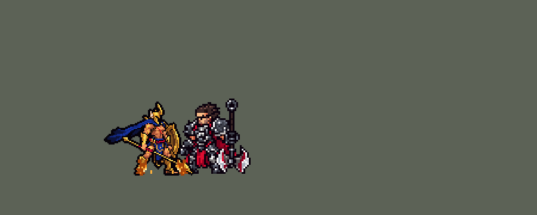

<!-- 本页上半部分由 tools/docs/gen_hero_docs.py 按仓库里现在的数据生成，手改会被覆盖；「开发记录」以下是手写的，生成时原样保留。 -->

# 潘森 Pantheon


| 项目 | 内容 |
|---|---|
| id | `league_pantheon` |
| 所属的包 | 主包（mod_id `league`） |
| 分路 | 打野 |
| 分类 / 标签 | 近战（Melee） · AD / Melee / CC |
| 高清帧 | PPU 1.5 |
| 附加包 | [潘森附加包](#附加包)（`league_pantheon`） |



其他预览：[逐帧预览](../preview/league_pantheon_frames.png)、[特效表](../preview/league_pantheon_effects.png)

## 现在的技能

下面是游戏里显示的技能说明（`league/text/champion.i18n` 的简体中文，去掉了颜色和图标），冷却、距离来自 `league/champion/league_pantheon.data_champion`；1 秒 = 60 tick。

### 普攻 / 被动

*攻击间隔 1.1 秒 · 攻击距离 27000*

长矛突刺。矢志不退：普攻命中和放技能各叠一层，5层时下一个技能强化（每条命开局满层）。大荒星陨被动：护甲穿透15%。

### 技能1 · 贯星长枪

*冷却 5.5 秒 · 施放距离 75000 · 施放：指定目标 · 敌人（不含防御塔）*

近处向前突刺，远处蓄力后掷出长矛，对线上的敌人造成90 + 100% 攻击力物理伤害（掷出时第一个之后减半）。强化：额外50 + 60% 攻击力。

### 技能2 · 斗盾跃击

*冷却 1 秒 · 施放距离 45000 · 施放：指定目标 · 敌方英雄*

跃向敌方英雄，造成其7%最大生命的伤害并晕眩1秒；强化：下次普攻连刺3下。神佑枪阵：举盾1.5秒，免疫控制、减伤60%，连刺前方后盾击造成110 + 100% 攻击力物理伤害。

### 大招 · 大荒星陨

*冷却 60 秒 · 施放距离 960000 · 施放：无目标 · 敌方英雄*

下蹲1秒后跃起，落向交战中的敌人：长矛先砸下造成80 + 100% 攻击力物理伤害并减速50%，落地造成300魔法伤害（边缘减半），叠满被动。

### 数值

攻击力 96（每级 +18）、生命 1000（每级 +105）、护甲 34（每级 +8）、魔抗 26（每级 +4）、移速 1000（每级 +10）。

## 附加包

附加包是可选的原生代码 mod（都在附加包合集 `league_addons` 里），**不装主包里的英雄也是完整的**。

### 潘森附加包

[潘森附加包](../../addons/league_pantheon/README.md)：`league_pantheon` v0.1.2

|  | 主包（纯数据） | 装了附加包 |
|---|---|---|
| 神佑枪阵 | 举盾期间四面都减伤（`e_red`%） | **只挡正面**：盾朝最近的敌方英雄，从盾那一侧的半圆打来的伤害全部还回去，背后来的不挡，防御塔打的也不挡（英雄联盟：免疫来自该方向的非防御塔伤害） |
| 贯星长枪 | 固定伤害 | 另外**对生命低于 20% 的目标再造成一份 Q 的伤害**（英雄联盟里对残血敌人伤害约翻一倍） |
| 大荒星陨 | 待命期间随机看一个正在交战的敌方英雄，身边有友军在打就跳过去 | **挑落点**：离潘森至少 `r_min`，身边有友军在打的里面，**落点敌方英雄最多的优先**，一样多时挑血量比例最低的（第一版没有友军、落点两个敌人也跳：游戏日志里 41 次有 35 次是一个人跳进敌人堆，几乎都在半分钟内阵亡） |

装上附加包后游戏里显示的说明（和主包不同的部分）：

- **技能1 · 贯星长枪**：【附加包】近处向前突刺，远处蓄力后掷出长矛，对线上的敌人造成90 + 100% 攻击力物理伤害（掷出时第一个之后减半）；目标生命低于20%时伤害翻倍。强化：额外50 + 60% 攻击力。
- **技能2 · 斗盾跃击**：【附加包】跃向敌方英雄，造成其7%最大生命的伤害并晕眩1秒；强化：下次普攻连刺3下。神佑枪阵：举盾1.5秒，免疫控制和正面伤害，连刺前方后盾击造成110 + 100% 攻击力物理伤害。
- **大招 · 大荒星陨**：【附加包】下蹲1秒后跃起，落向敌人最密集的战场：长矛先砸下造成80 + 100% 攻击力物理伤害并减速50%，落地造成300魔法伤害（边缘减半），叠满被动。

## 相关脚本和素材

- [`tools/kit/build_pantheon.py`](../../tools/kit/build_pantheon.py)
- [`tools/kit/setup_pantheon.py`](../../tools/kit/setup_pantheon.py)
- [`tools/lol/extract_pantheon.py`](../../tools/lol/extract_pantheon.py)
- [`tools/art/preview_pantheon.py`](../../tools/art/preview_pantheon.py)
- [`tools/art/rig_pantheon.py`](../../tools/art/rig_pantheon.py)
- [`assets/source/pantheon/`](../../assets/source/pantheon)

## 开发记录

> 下面是原来 README 里「英雄：潘森」一节，原样搬过来（只改了相对链接）。

| 部分 | 内容 |
|---|---|
| 定位 | 打野（Melee，标签 AD / Melee），第 112 位英雄。不屈之枪 潘森：长枪近戳远投、举盾跳脸、从天而降的战士。用户的选择：「方案可以，全按推荐做（上单，做附加包，PPU 1.5）」，做的时候按上单；之后用户确认定位是打野（0.71.0 的更新说明写的打野），技能和数值不用改（Q 本来就打小兵、野怪，见平衡一行）——技能 1 = Q 贯星长枪，技能 2 = W 斗盾跃击和 E 神佑枪阵（共用一格、各自冷却），大招 = R 大荒星陨；高清 PPU 1.5、原大（中间画成过 90%，见精灵图一行） |
| 普攻 / 被动 | 长枪突刺（近战，攻击距离 27000——英雄联盟里他的普攻比一般近战远，攻击间隔 66 tick，第 10 tick 打中）。**矢志不退**：普攻打中、放 Q / W / E 各叠一层，满 5 层时下一个 Q、W 或 E 强化并清空层数；每次出生（开局、复活）满层（英雄联盟一样）。R 的被动护甲穿透 15%（数据分不清等级，取中间值） |
| 技能1 | Q「贯星长枪」：冷却 330 tick，对 75000 内的敌人放（小兵、野怪也打）。目标在 20000 内就近戳：朝它一条 48000 × 5000 的直线，线上每个敌人 90 + 100% 攻击力；远了就举枪蓄力 19 tick，朝目标 6 tick 前站的地方掷出（走开能躲），穿过整条线：第一个单位全额，之后的一半（英雄联盟的递减）。强化：每个打中的单位多 50 + 60% 攻击力。英雄联盟近戳返还冷却，这里折进更短的冷却（`skill_cooldown_mult` 会连 W、E 一起缩）；对残血的加成在附加包里（数据读不到当前生命） |
| 技能2 | 两个技能共用一格，每 60 tick 试一次，对 45000 内的敌方英雄：**W「斗盾跃击」**（冷却 600 tick）好了就举盾跳到他身上，落地 30 + 7% 目标最大生命，眩晕 1 秒；强化：4 秒内下一次普攻换成连刺三下，每下 50% 攻击力。**E「神佑枪阵」**（冷却 1080 tick）：W 在冷却、32000 内有敌方英雄时，朝目标举盾 1.5 秒：免控、所有方向受到的伤害减 60%（附加包里只挡正面），朝前方扇形连刺 6 下（每下 15% 攻击力），最后盾击 110 + 100% 攻击力；强化：之后 4 秒护甲、魔抗 +20，1.5 秒移速 +60% |
| 大招 | R「大荒星陨」：冷却 3600 tick，**看时机**（用户的规则「看好时机」，加里奥 R 的做法）：放出后待命 15 秒，每 10 tick 看一个正在被他队伍打的敌方英雄，离他至少 35000、身边 30000 内有友方英雄在打（有仗可加入；第一版「或者还有别的敌方英雄」也跳，游戏日志里 41 次有 35 次是一个人跳进敌人堆、几乎都在半分钟内阵亡，用户：「看一下附加包的日志对不对」），并且他自己没被控，就下蹲 1 秒（隐身、免控，英雄联盟的第一段引导），跃起（放逐 40 tick，在天上），落向起跳时那个英雄站的地方：落点先出一圈金环，第 20 tick 长矛先砸下（32000 内 80 + 100% 攻击力、减速 50% 2 秒），然后他落地（传送）：12000 内 300 魔法伤害、到 32000 一半，并且凡人意志满层。15 秒没用上就缩短冷却（加里奥 R 的 `r_reset`），之后再待命 |
| 附加包 | 可选的附加包 [`addons/league_pantheon`](../../addons/league_pantheon/README.md)（在附加包合集里，原生代码，主包不装它也完整）：**E 只挡正面**（盾朝最近的敌方英雄，从盾那一侧打来的伤害全部加回血里，背后、防御塔打的不挡；布隆的做法）；**Q 对生命低于 20% 的目标再造成一份 Q 的伤害**；**R 挑落点**（身边有友军在打的里面，落点敌方英雄最多的优先，一样多挑血量比例最低的）。只看硬控、不用 `cc_count() > 0`；按模拟编号分开记。日志 `league_pantheon.log`（BLOCK、SHIELD、LOW、STARFALL） |
| 数值 | 攻击 96（+18）、生命 1000（+105）、护甲 34（+8）、魔抗 26（+4）、移速 1000（+10） |
| 平衡 | **打野**（2026-10-22 重测，现在的定位）：打野位对五个基础英雄（demon / circus_blade / hunter / inquisitor / ninja），三套阵容、两边各打，10 分钟经典引擎模拟两批 24 个种子：**+0.62 / +0.51**（种子 1–24 / 25–48），对忍者 +1.78 / +1.06、猎人 +0.88 / +1.42、审判官 +0.76 / +0.86，对恶魔 −0.15 / −0.42、马戏团刀手 −0.17 / −0.35；每局补刀 53、伤害 6000–6300、K/D/A 2.1 / 1.9 / 3.6，Q 每局 59 次（清野靠它）。同样的种子上主包的打野：男枪 +0.65 / +0.62、纳亚菲利 +0.76 / +1.20、狼人 +0.32 / +0.11（希瓦娜当时 −1.36 / −1.65，之后改了龙怒和数值，见她的小节）——和男枪同一档，数值不改。同一个模拟器上上单复测 +1.27（种子 1–16，下面记录里的 +1.43 之后引擎和别的英雄有改动），三人的打野数字也都比各自小节里当时记的低，只和同批比。<br>**旧的上单测试**（做的时候的定位）：上单对六个基础上单（fighter / executioner / lancer / pole_warrior / knight / berserker），三套阵容、两边各打，10 分钟经典引擎模拟：草案 +1.96 / +1.37（种子 1–8 / 9–24；同批德莱厄斯 +1.99、盖伦 −1.11）；按动作重新对时间后 +0.96 / +0.62；攻击 96 定稿 +1.40 / +1.60（种子 1–16 / 17–32），换上特效时间后复测 +1.23（种子 1–16），大招改成落点要有友军后 +1.30（每局阵亡 1.9 → 1.5）。强化 E 的双抗和加速原来从没加上（强化标志只挂 94 tick，盾击第 97 tick 才读），10 月 18 日修好（标志挂到盾击之后）：+1.30 → +1.43、+0.89 → +0.96（种子 1–16 / 17–32，同批改前改后）。亚索 R：潘森在中路同队时每局放 1.75 次，和德莱厄斯一样（基础闪电法师 3.40），亚索不改 |
| 精灵图（高清帧 PPU 1.5） | Codex 第 0 步画了两张原画（A、B），[`tools/art/design_pantheon_hd.py`](../../tools/art/design_pantheon_hd.py) 按它自己的格子读回（6.7 / 6.8 px 一格），用户选「A 40尺寸 PPU1.5」。直接缩到 PPU 1.5 糊了，加了第 1 步：Codex 照原画在格子上重画造型（[`tools/art/pack_pantheon_model.py`](../../tools/art/pack_pantheon_model.py)），[`tools/art/design_pantheon_cut.py`](../../tools/art/design_pantheon_cut.py) 按整行整列删到 40 行，用户：「造型用第1稿删行列的版本」。第 2 步 Codex 照英雄联盟的骨架（`poses.json`）画了全部动作（[`tools/art/pack_pantheon_strips.py`](../../tools/art/pack_pantheon_strips.py)，1536 的方画布，跳跃、翻越的帧不出界）；跑步 8 帧同一条腿在前，单独重画（[`tools/art/pack_pantheon_run.py`](../../tools/art/pack_pantheon_run.py)，`RUN_REDO.md`），重画的第 7、8 帧坏了，用 7 帧重排成左右腿交替的循环。用户：「完成这一步 有问题的地方你帮忙修复 然后自己review 完美了再喊我review」——[`tools/art/rig_pantheon.py`](../../tools/art/rig_pantheon.py) 只做无损修整（整帧平移、复用整帧）：普攻起手、投枪的蓄力和甩手、E 举盾的连刺、盾击、大招下蹲 / 起跳抬高 / 落地、死亡贴地，加待机呼吸（枪和盾跟着）和受击。用户：「动作美术通过」。之后「感觉模型太大了」：46 px（德莱厄斯、盖伦、慎 42）→ `hd.rs` SIZES 画成 90%（42 px），帧在 restyle 里下移 2 格让脚还在地上；卡片位置和头像点按 90% 的帧重新量。用户又看到「潘森的武器怎么看起来是歪的」：定稿的长枪折了两处（枪尾那段往下塌 2 格、枪头绕宝石转成 45°），选「折的拉成一条直线」——[`tools/art/straighten_pantheon_spear.py`](../../tools/art/straighten_pantheon_spear.py) 把枪尾端头整块平移、补一根 Codex 自己的枪杆、枪头每列整列平移到手到小腿那段本来就是 2:1 的直线上（待机、受击、落地最后一帧用定稿；Codex 画的动作里枪本来是直的）。「还有模型会变大变小」：Codex 重画的跑步比定稿大约 15%（头盔 11×17 格对 9×15），`rig_pantheon.py` 用 [`tools/art/shrink_frames.py`](../../tools/art/shrink_frames.py) 整行整列删到 87%（赛娜的做法，不重新采样，脚底不动）。用户：「长枪和大小都可以」。装进游戏后「潘森还是变大变小啊」「局内模型为什么变这么小了」：按每个动作在游戏里的显示高度和德莱厄斯比，问题在姿势——直立的定稿待机 42 px，Codex 画的动作全是压低的弓步（跑步 32–36、普攻 31–35；德莱厄斯站 42、跑 41），一切换就矮一截，再叠上 90% 和跑步的 87% 局内就显得小。改成待机、受击、落地最后一帧用 Codex 的备战姿势（Q 收招那帧 `skill_4`，就是定稿的姿势画低了一点，枪是一条 2:1 的直线；`rig_pantheon.py` IDLE_SRC，呼吸时枪整根跟着），`hd.rs` 去掉 90%（原大）：待机 41–43 px、跑步 36–40、普攻 34–39、Q 33–41、盾击 37–41。头像点 (−3, −36)、卡片 −9。用户：「可以」。2026-10-19 补帧：跑步 8 帧（近侧腿在前那一半补第三帧，每帧 117 ms，一圈仍是英雄联盟的 0.93 秒），死亡 8 帧（落地回弹） |
| 特效 | Codex 第 3 步的 19 个特效（用户贴在对话里，`assets/source/pantheon/codex_fx`）。[`tools/art/import_pantheon_fx.py`](../../tools/art/import_pantheon_fx.py)：去掉 Q 命中、W 命中图里的白色分隔线，落地爆炸 Codex 的第 2、3 帧偏了（镜像后成两团火）按 5 帧重切，落点圈压扁成地上的椭圆，按游戏大小缩；长枪和突刺光是飞行物，上下对称，其余左右对称。Q 近戳的光挂在直线投射物上（12 tick），落下的长矛是落点那颗抛物线的画面，从起跳那一刻开始砸。E 的神盾光和大招蓄力的星空画在他身后（z −1，画在身上会把人盖住）。写成 `league_pantheon_fx` 和 `league_pantheon_big`（突刺光、神盾光、盾击、蓄力、落点、长矛、落地）。用户：「特效通过」 |
| 音效 | 英雄联盟的音效和配音（[`tools/lol/extract_pantheon.py`](../../tools/lol/extract_pantheon.py)，21 段）：突刺出手 / 打中、被动满层、Q 近戳 / 蓄力 / 掷出 / 打中、W 跳起 / 砸中 / 三连刺、E 举盾 / 盾击、R 下蹲 / 起跳 / 长矛砸下 / 落地，配音 Q / W / E / R 和起跳的台词 |
| 图标 | 官方技能图标（Q 贯星长枪 / W 斗盾跃击 / R 大荒星陨，另有 E 神佑枪阵、被动矢志不退），从本地客户端取 |

重新生成（素材来自本机的英雄联盟客户端，音频不进仓库）：

```bash
python tools/lol/extract_pantheon.py --lol "D:\WeGameApps\lol" --vgmstream <vgmstream-cli.exe>
python tools/kit/build_pantheon.py                 # 技能数据，数字都在脚本的参数表 P 里
python tools/kit/setup_pantheon.py                 # 五种语言的文字、音效配置、共享文件里他的键（头像点、卡片位置在 VIEW）
python tools/art/design_pantheon_hd.py             # Codex 的原画读回
python tools/art/design_pantheon_cut.py            # 第 1 步的造型删到 40 行
python tools/art/straighten_pantheon_spear.py      # 定稿的长枪拉成一条直线（design_bent.png -> design.png）
python tools/art/rig_pantheon.py                   # 1 倍帧和 1.5 的原帧，无损修整、待机、受击
python tools/art/ppu_restyle.py --hero pantheon    # 描边、下移 2 格（不要加 --preview）
python tools/art/ppu_hd.py --hero pantheon         # hd_ / lo_ 帧
python tools/art/import_pantheon_fx.py             # 特效
python tools/art/preview_pantheon.py               # 预览和演示 GIF
python addons/league_pantheon/make_override.py     # 附加包的副本（主包的潘森改了就重跑）
```

美术提示词见 [`assets/source/pantheon/`](../../assets/source/pantheon) 里的 `PICTURE_PROMPT.md`、`MODEL_PROMPTS.md`、`MODEL_STRIPS.md`、`RUN_REDO.md`、`PROMPTS_FX.md`；Codex 的交付在 `codex_picture/`、`codex_model/`、`codex_strips/`、`codex_run/`、`codex_fx/`。

逐帧预览：[`docs/preview/league_pantheon_frames.png`](../preview/league_pantheon_frames.png?v=1016a)，特效：[`docs/preview/league_pantheon_effects.png`](../preview/league_pantheon_effects.png?v=1016a)。
