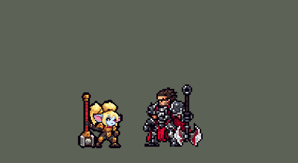

<!-- 本页上半部分由 tools/docs/gen_hero_docs.py 按仓库里现在的数据生成，手改会被覆盖；「开发记录」以下是手写的，生成时原样保留。 -->

# 波比 Poppy


| 项目 | 内容 |
|---|---|
| id | `league_poppy` |
| 所属的包 | 主包（mod_id `league`） |
| 分路 | 辅助 |
| 分类 / 标签 | 功能型（Util） · AD / Melee / Tank / CC / Shield |
| 高清帧 | PPU 1.2（画成 85%） |
| 附加包 | [波比附加包](#附加包)（`league_poppy`） |



其他预览：[逐帧预览](../preview/league_poppy_frames.png)、[特效表](../preview/league_poppy_effects.png)

## 现在的技能

下面是游戏里显示的技能说明（`league/text/champion.i18n` 的简体中文，去掉了颜色和图标），冷却、距离来自 `league/champion/league_poppy.data_champion`；1 秒 = 60 tick。

### 普攻 / 被动

*攻击间隔 1.33 秒 · 攻击距离 25000*

钢铁大使：每8秒普攻远远扔出圆盾，多造成60 + 30% 法强魔法伤害；盾落在地上，捡起得120 + 60% 攻击力护盾。坚定风采：双抗+16%；敌方英雄靠近时移速+40%，2秒内身边敌人不能位移。

### 技能1 · 圣锤猛击

*冷却 7 秒 · 施放距离 30000 · 施放：地点 · 敌人（不含防御塔）*

锤击地面，造成60 + 70% 攻击力物理伤害（英雄另受6%最大生命），地面减速25%，1秒后再炸一次。

### 技能2 · 英勇冲锋

*冷却 11 秒 · 施放距离 50000 · 施放：指定目标 · 敌方英雄*

冲向敌方英雄，造成70 + 80% 攻击力物理伤害并推着他走，结束时眩晕0.75秒。

### 大招 · 持卫的裁决

*冷却 60 秒 · 施放距离 55000 · 施放：方向 · 敌方英雄*

身边有2个以上敌方英雄时砸地：80 + 40% 攻击力物理伤害并击飞1秒；否则蓄力抡锤推出冲击波，打中的英雄受150 + 70% 攻击力物理伤害并被打飞到远处。

### 数值

攻击力 86（每级 +6）、法强 20（每级 +10）、生命 1150（每级 +115）、护甲 38（每级 +8）、魔抗 28（每级 +4）、移速 1000（每级 +10）。

## 附加包

附加包是可选的原生代码 mod（都在附加包合集 `league_addons` 里），**不装主包里的英雄也是完整的**。

### 波比附加包

[波比附加包](../../addons/league_poppy/README.md)：`league_poppy` v0.1.2

|  | 主包（纯数据） | 附加包 |
|---|---|---|
| 坚定风采的光环 | 光环里的敌方英雄放不出**新的**位移技能（数据只能禁位移） | 光环里**正在突进**的敌方英雄被挡下：击飞 0.5 秒、受魔法伤害，然后缚地并减速 2 秒（每次光环每人一次） |
| 坚定风采的双抗 | 一直 +16% | 生命低于 40% 时翻倍 |
| 英勇冲锋 | 每次推完都晕一下（数据看不到墙） | **撞到墙上**（地图的墙格、5v5 地图的四边）才再受一次伤害并眩晕；没墙就只推开 |
| 持卫的裁决（蓄满） | 从她身边击退 | 5v5 地图上**朝他自己的水晶方向**打飞很远（撞墙会停）；别的地图照主包 |
| 钢铁大使的护盾 | 固定值 + 攻击力加成 | **最大生命的 11%（1 级）到 21%（18 级）** |

装上附加包后游戏里显示的说明（和主包不同的部分）：

- **普攻 / 被动**：【扩展包】钢铁大使：每8秒普攻远远扔出圆盾，多造成60 + 30% 法强魔法伤害；捡起圆盾得11~21%最大生命护盾。坚定风采：双抗+16%（生命低于40%翻倍）；敌方英雄靠近时移速+40%，2秒内冲进她身边的敌人被击飞并缚地。
- **技能2 · 英勇冲锋**：【扩展包】冲向敌方英雄，造成70 + 80% 攻击力物理伤害并推着他走；撞到墙上再受一次伤害并眩晕1.75秒。
- **大招 · 持卫的裁决**：【扩展包】身边有2个以上敌方英雄时砸地：80 + 40% 攻击力物理伤害并击飞1秒；否则蓄力抡锤推出冲击波，打中的英雄受150 + 70% 攻击力物理伤害并被打回他家泉水方向。

## 相关脚本和素材

- [`tools/kit/build_poppy.py`](../../tools/kit/build_poppy.py)
- [`tools/kit/setup_poppy.py`](../../tools/kit/setup_poppy.py)
- [`tools/lol/extract_poppy.py`](../../tools/lol/extract_poppy.py)
- [`tools/art/preview_poppy.py`](../../tools/art/preview_poppy.py)
- [`tools/art/rig_poppy.py`](../../tools/art/rig_poppy.py)
- [`assets/source/poppy/`](../../assets/source/poppy)

## 开发记录

> 下面是原来 README 里「英雄：波比」一节，原样搬过来（只改了相对链接）。

| 部分 | 内容 |
|---|---|
| 定位 | 辅助（Support，类别 Util，标签 AD / Melee / Tank / CC / Shield），第 130 位英雄。圣锤之毅 波比：约德尔女战士，浅金色双马尾、浅蓝皮肤，扛着一把比她还大的巨锤（10-17 的分组计划 B 组的最后一位）。用户的选择：「波比放辅助，技能按方案 A 做（带扩展包 league_poppy）」。团战经理只有三个主动技能位：技能 1 = Q 圣锤猛击，技能 2 = E 英勇冲锋，大招 = R 持卫的裁决；被动钢铁大使在普攻里，**W 坚定风采的主动跟着她的每次出手自动开**（敌方英雄靠近时）。技能名照英雄联盟 16.20 的官方中文 |
| 普攻 / 被动 | 锤子横扫（射程 25000）。**钢铁大使**：每 8 秒她带着圆盾（普攻射程 +30000，AI 远远就扔），下一次普攻扔出圆盾，多造成 60 + 30% 法强 魔法伤害；圆盾弹回来、40 tick 后落在她和目标之间（离她 26000），在地上躺 4 秒，她走到 16000 内就捡起来，得到 120 + 60% 攻击力 的护盾 3 秒（护盾在她身上发金光） |
| W（在普攻和技能里） | **坚定风采**：被动护甲、魔抗 +16%。主动（冷却 15 秒）：敌方英雄在 40000 内时，她下一次出手顺带开启：移速 +40%，身边 2 秒的金色光环（半径 35000），光环里的敌方英雄**放不出新的位移技能**（`BlockMoveSkill`） |
| 技能1 | **Q 圣锤猛击**（对小兵、野怪也放，射程 30000）：锤子砸向目标脚下，半径 18000 内 60 + 70% 攻击力 物理伤害（英雄另受 6% 最大生命），地面裂开减速 25% 1 秒，然后原地再炸一次同样的伤害。冷却 7 秒 |
| 技能2 | **E 英勇冲锋**，只对敌方英雄放（射程 50000）：冲上去撞中目标，70 + 80% 攻击力 物理伤害，推着他走 30000（她跟着冲），推完**眩晕 0.75 秒**（主包看不到墙）。冷却 11 秒 |
| 大招 | **R 持卫的裁决**：AI 按不住键，照韦鲁斯 Q 的「聪明蓄力」：身边 28000 内有 2 个以上敌方英雄就**点放**砸地：80 + 40% 攻击力 物理伤害、击飞 1 秒（能接亚索 R）；否则**蓄力** 0.67 秒（压低身子、锤子拉到身后，减速 15%，方向出手时就定好），抡锤推出一道冲击波（70000 长、宽 18000），打中的敌方英雄受 150 + 70% 攻击力 物理伤害并**被打飞**：击飞 25 tick、同时从她身边击退 150000（英雄联盟蓄满后把人打飞到远处，在空中飞完全程；用户：「大招能把人弹飞吗 做的和联盟不一致的话就改」）。冷却 60 秒 |
| 连招 | 用户要求：「有连招要做连招」「都要帮我补」。英雄联盟里波比 E 把人撞到墙上晕住，接 Q 砸地。**E→Q**：英勇冲锋推人推到头时（接触后 12 tick：主包眩晕 0.75 秒的那一刻，附加包判定撞墙的那一刻），波比身上开一个 60 tick（1 秒）的连招窗口；窗口里放 Q，锤子立刻砸下（平时第 12 tick），砸在刚停下的人脚下，裂地和原地再炸一次照常。伤害、眩晕、冷却都不变。改在 [`tools/kit/build_poppy.py`](../../tools/kit/build_poppy.py)（参数 `e_combo`），附加包副本用 `make_override.py` 重新生成 |
| 附加包 | 可选的附加包 [`addons/league_poppy`](../../addons/league_poppy/README.md)（在附加包合集里，原生代码，主包不装它也完整），照英雄联盟：**坚定风采挡下突进**（光环里一 tick 移动 2200 以上的敌方英雄被击飞 0.5 秒、受 70 + 70% 法强 魔法伤害，然后缚地、减速 25% 2 秒），**生命低于 40% 双抗翻倍**，**英勇冲锋撞到墙上才晕**（卡蜜尔附加包的墙格和 5v5 地图四边：推到墙边，再受一次伤害并眩晕 1.75 秒；没墙就只推开），**持卫的裁决把人朝他自己的水晶打飞 150000**（一路在空中），**圆盾的护盾 = 最大生命的 11%–21%**（随等级）。日志 `league_poppy.log`（BLOCK、CHARGE、WALL、VERDICT、PICK） |
| 数值 | 攻击 86（+6）、法强 20（+10）、生命 1150（+115）、护甲 38（+8）、魔抗 28（+4）、移速 1000（+10）、射程 25000 |
| 平衡 | 10 分钟经典引擎模拟，辅助位对原版五个辅助（牧师、吟游诗人、附魔师、武僧、道士），三套阵容两边各打，每档两批种子（1–8、9–16）取平均：初稿（照牛头的坦克辅助数值）-0.79 / -1.60；Q、E、圆盾伤害加强 +0.30 / +0.51；再加攻击 86、生命 1150 +0.48 / +0.57；再把 E 的眩晕加到 0.75 秒、Q 6% 最大生命 +0.91 / +1.08（平均 +1.00，同批牛头 +0.97 / +1.12）。大招改成打飞以后 +0.82 / +0.92；R 伤害 190 + 80% +0.58 / +0.68；生命 1155 / 1160 / 1165 / 1175 分别 +1.33 / +1.35、+1.24 / +1.36、+1.40 / +1.14、+1.21 / +1.39（两批之间差 0.3 左右，这几档分不出来，合起来约 +1.2），**生命留在 1150**。游戏 AI 读得到她的伤害（期望秒伤从不为 0）。亚索 R：和她同队每局 2.50 次（蕾欧娜 2.12、牛头 1.92、原版牧师 0.58），亚索不用改 |
| 精灵图（高清帧 PPU 1.3） | Codex 第 0 步画了待机（A：锤头低低放在身后，锤柄斜过肩膀）和备战（B：锤子竖直立在脚边）两张原画（[`tools/art/pack_poppy_picture.py`](../../tools/art/pack_poppy_picture.py)），[`tools/art/review_poppy_size.py`](../../tools/art/review_poppy_size.py) 按游戏大小和 PPU 1.2 / 1.3 / 1.5 并排、和约德尔人和坦克辅助比，用户：「用 B（锤子竖着），游戏里 36 像素高，PPU 1.3」。第 1 步 Codex 在游戏格子上重画（[`tools/art/pack_poppy_model.py`](../../tools/art/pack_poppy_model.py)），[`tools/art/design_poppy_model.py`](../../tools/art/design_poppy_model.py) 读回 B-2（20 px 一格），[`tools/art/design_poppy_cut.py`](../../tools/art/design_poppy_cut.py) 整行整列删到马尾到鞋底 47 行（脸和锤柄的行列不删），42×55 格。动作照塔姆的做法自己摆（用户：「动作帧参考塔姆那种做法 不用依赖codex 然后做完了你自己review 完美了再喊我review」）：[`tools/art/rig_poppy.py`](../../tools/art/rig_poppy.py) 把巨锤当刚体，按设计图自己的颜色重铺成一根直的（Codex 画的锤柄上粗下细、中线差一格），只绕拳头整块直角转、在拳头里沿锤柄滑：站着时锤子立在地上、手顺着锤柄滑，举过头顶时握在锤柄下段，往前横扫时握在柄尾、拳头和前臂压低让锤柄横过腰间（不挡脸）。动作：待机（身子一起一伏）、跑（两腿用设计图自己的护膝和靴子整块迈步，锤子提离地面）、普攻（拉后、过顶、横扫）、Q（举高、蹲下砸到身前的地上）、E（锤头拖在身后冲出去）、R 蓄力（压低、锤子拉后、抖动）、R 横扫、R 点放（举起砸地）、挨打、阵亡（锤子掉在身前、跌坐在后面）。2026-10-18 降到 PPU 1.2（用户：「……波比……像素太高需要降低」） 2026-10-19 补帧：R 蓄力原来锤子拖在腰后、4 帧几乎一样，改成普攻 / Q 的举锤过头，身体和拳头上下抖一行（英雄联盟 Spell4_Windup）；死亡 8 帧（坐地回弹）。用户：「波比在游戏里体型也太大 需要缩小」——league.dll 按 85% 画（hd.rs SIZES，连竖着的锤子 44 → 约 37.6 像素，和约德尔人的 32–40 相当），每帧下移 2 格让脚踩在地上，头像点 (5, -22) → (4, -17)。2026-10-21 用户在游戏里：「波比放大招没有转动锤子的动作 你想办法帮我加」（诊断日志里蓄力动作照常播放，只是锤子举着只抖一行，看着像没动作）：R 蓄力改成锤子绕拳头抡两圈——举过头顶、横到身前、落到脚边、拉到身后，都是锤子自己的直角转动和普攻 / Q 用过的姿势，8 帧共 0.67 秒（蓄力的 40 tick 不变），最后从头顶接横扫 |
| 特效 | 第 3 步 19 张特效（[`tools/art/pack_poppy_fx.py`](../../tools/art/pack_poppy_fx.py)，颜色照英雄联盟：她的光是暖金色，砸地是棕色尘土和碎石，撞墙眩晕是紫金色）。两张弹道（飞出去的圆盾、冲击波）画成朝右、上下对称，跟着飞行方向转；其余全部左右对称（游戏不镜像特效图）。[`tools/art/import_poppy_fx.py`](../../tools/art/import_poppy_fx.py)：落在地上的圆盾和裂开的地面每 15 tick 续一张，光环和护盾跟着她，眩晕星星在敌人头上。写成 `league_poppy_fx` 和 `league_poppy_big` |
| 音效 | 英雄联盟的音效和配音（[`tools/lol/extract_poppy.py`](../../tools/lol/extract_poppy.py)，22 段）：普攻、扔盾 / 打中 / 落地 / 捡起、Q 出手 / 砸地 / 再炸、W 开启 / 挡下突进、E 出手 / 撞中 / 撞墙、R 蓄力 / 横扫 / 点放 / 打中，配音是她的 Q / W / E / R 台词（中文） |
| 图标 | 官方技能图标（圣锤猛击、英勇冲锋、持卫的裁决，另有坚定风采和被动），从本地客户端取 |

重新生成（素材来自本机的英雄联盟客户端，音频不进仓库）：

```bash
python tools/lol/extract_poppy.py --lol "D:\WeGameApps\lol" --vgmstream <vgmstream-cli.exe>
python tools/kit/build_poppy.py                     # 技能数据，数字都在脚本的参数表 P 里
python tools/kit/setup_poppy.py                     # 五种语言的文字、音效配置、共享文件里她的键
python tools/art/design_poppy_model.py              # Codex 第 1 步的造型读回
python tools/art/design_poppy_cut.py                # 删到 47 行（PPU 1.3，B-2）
python tools/art/rig_poppy.py                       # 1 倍帧和 1.3 的原帧（整块摆）
python tools/art/ppu_restyle.py --hero poppy        # 外描边（不要加 --preview）
python tools/art/ppu_hd.py --hero poppy             # hd_ / lo_ 帧
python tools/art/import_poppy_fx.py                 # 特效
python tools/art/preview_poppy.py                   # 预览和演示 GIF
python addons/league_poppy/make_override.py         # 附加包的副本（主包的波比改了就重跑）
```

逐帧预览：[`docs/preview/league_poppy_frames.png`](../preview/league_poppy_frames.png?v=1021r)，特效：[`docs/preview/league_poppy_effects.png`](../preview/league_poppy_effects.png?v=1018a)。
