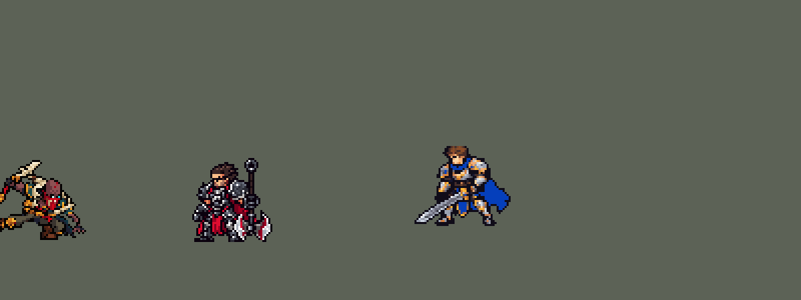

<!-- 本页上半部分由 tools/docs/gen_hero_docs.py 按仓库里现在的数据生成，手改会被覆盖；「开发记录」以下是手写的，生成时原样保留。 -->

# 派克 Pyke


| 项目 | 内容 |
|---|---|
| id | `league_pyke` |
| 所属的包 | 主包（mod_id `league`） |
| 分路 | 辅助 |
| 分类 / 标签 | 刺客（Assassin） · AD / Melee / CC |
| 高清帧 | 1 倍像素（无高清帧） |
| 附加包 | [派克精确斩杀附加包](#附加包)（`league_pyke`） |



其他预览：[逐帧预览](../preview/league_pyke_frames.png)、[特效表](../preview/league_pyke_effects.png)

## 现在的技能

下面是游戏里显示的技能说明（`league/text/champion.i18n` 的简体中文，去掉了颜色和图标），冷却、距离来自 `league/champion/league_pyke.data_champion`；1 秒 = 60 tick。

### 普攻 / 被动（被动「溺水之幸」）

*攻击间隔 0.92 秒 · 攻击距离 24000*

鱼叉挥砍。被动溺水之幸：挨打积攒灰血（最多5层），潜行或3秒没挨打时每层回复15 + 8% 攻击力生命。无法靠生命成长，攻击力成长更高。

### 技能1 · 透骨尖钉

*冷却 7 秒 · 施放距离 100000 · 施放：方向 · 敌人（不含防御塔）*

英雄贴身时戳刺，否则蓄力扔出鱼叉，命中第一个敌人：35 + 60% 攻击力物理伤害，减速90%，鱼叉命中的会被拉回。

### 技能2 · 魅影浪洄

*冷却 11 秒 · 施放距离 70000 · 施放：指定目标 · 敌方英雄*

幽潭潜行：潜行并加速，回复灰血。随即魅影浪洄：冲过敌方英雄，魅影随后飞回他身边，途经的英雄受到50 + 60% 攻击力物理伤害并晕眩1秒。

### 大招 · 涌泉之恨

*冷却 45 秒 · 施放距离 75000 · 施放：指定目标 · 刚交过手的敌方英雄*

X形打击：英雄受到180 + 60% 攻击力真实伤害，低于此值被处决，否则只受一半；其他敌人受一半物理伤害。有英雄死在X里时派克闪到其身上并刷新大招。

### 数值

攻击力 72（每级 +7）、生命 900（每级 +82）、护甲 26（每级 +8）、魔抗 18（每级 +4）、移速 1100（每级 +12）。

## 附加包

附加包是可选的原生代码 mod（都在附加包合集 `league_addons` 里），**不装主包里的英雄也是完整的**。

### 派克精确斩杀附加包

[派克精确斩杀附加包](../../addons/league_pyke/README.md)：`league_pyke` v0.1.1

主包 `league` 保持纯数据。数据读不到当前生命，主包里派克的 R 由 AI 对「队伍刚打过的敌方英雄」放出，满血的也会被砍
（用户：「大招逻辑也有点问题 总是满血砍人」）；X 里的英雄先吃斩杀线的真实伤害、下一 tick 活下来的回一半，近似「低于斩杀线处决」。
这个附加包用原生代码读生命，做成 League 的样子：

- **只砍斩得死的人**：AI 钩子 `league_pyke:ult`。斩杀线 T = 180 + 60% 攻击力（主包的 `r_dmg`、`r_ratio`）。R 只放向射程 75000 内
  生命不高于 T 的敌方英雄，几个时砍血最少的；AI 想对斩不死的人放 R，就改成打他（打不到就走过去）；R 好了、有斩得死的人，AI 没想放也放。
- **精确斩杀**：原生效果 `league_pyke:execute` 代替主包 X 里「真实伤害 + 一 tick 后回一半」：生命不高于 T 的英雄直接处决（击杀算派克的），
  其余吃 T 的一半真实伤害（同主包的净伤害）。处决后 4 tick（`league_pyke:after`）那人真死了，派克闪到他倒下的地方、R 刷新（游戏 0.6.4 起用 `entity_reduce_cooldown` 完全清零，原来的倍率 buff 会留约 1% 冷却），
  播主包的 R 刷新画面、声音和台词。主包 X 里那套击杀检查在副本里去掉：原生伤害要到这一 tick 结算完才扣，数据的检查当场看人还活着，
  就把闪现取消了（用户：「放大招的时候人没过去？」）。
- AI 钩子自己看 R 的冷却和等级（引擎的「输入合法」不看冷却：v0.1.0 在冷却里每 tick 下令放 R，把派克定住好几秒）；
  AI 想对射程外或已死的人放 R 时不拦，走进射程再看。
- 数字写在 `src/lib.rs` 的常数里，`make_override.py` 生成副本时核对它们和 `tools/kit/build_pyke.py` 的参数表 `P` 一致。

装上附加包后游戏里显示的说明（和主包不同的部分）：

- **大招 · 涌泉之恨**：【精确斩杀测试版】只对斩得死的英雄出手。X形打击：生命不高于180 + 60% 攻击力的英雄被处决，其余受到一半的真实伤害。英雄死在X里，派克闪到那里并刷新大招。

## 相关脚本和素材

- [`tools/kit/build_pyke.py`](../../tools/kit/build_pyke.py)
- [`tools/kit/setup_pyke.py`](../../tools/kit/setup_pyke.py)
- [`tools/lol/extract_pyke.py`](../../tools/lol/extract_pyke.py)
- [`tools/art/preview_pyke.py`](../../tools/art/preview_pyke.py)
- [`tools/art/rig_pyke.py`](../../tools/art/rig_pyke.py)
- [`tools/art/import_pyke.py`](../../tools/art/import_pyke.py)
- [`tools/art/design_pyke.py`](../../tools/art/design_pyke.py)
- [`assets/source/pyke/`](../../assets/source/pyke)

## 开发记录

> 下面是原来 README 里「英雄：派克」一节，原样搬过来（只改了相对链接）。

| 部分 | 内容 |
|---|---|
| 定位 | 辅助（刺客，分类 Assassin），用户排的第十三组的辅助（同组：上单蛮王、打野赵信、中单泽拉斯、ADC 莎弥拉），第 65 位英雄。血港鬼影 派克：近身戳刺或远处扔鱼叉把人钩回来，潜进幽水贴近、冲过去让魅影晕人，大招沿 X 斩下处决残血。四个选择都按推荐的来（用户选的）：技能位「Q / W→E 连招」，R「X 形处决 + 击杀可再放」，被动「灰血 + 生命换攻击」，分类刺客。数据读不到当前血量，用户：「这个读不到的话就改rust原码」——主包用下面的近似办法，自己完整能玩；精确的斩杀线处决以后做原生扩展包 |
| 普攻 / 被动 | 鱼叉近战，射程 24000，攻击间隔 55 tick，第 12 tick 砍中。被动「溺水之幸」：身上挂一层 1 点的护盾当受击感应（瑟提 W 的做法），普攻和大招时看一眼：被打破过就多一层灰血（最多 5 层，8 秒不叠就消失）；他进 W 的潜行，或者普攻后 3 秒没再挨打，每层灰血回复 15 + 8% 攻击力的生命（分 4 次）。「无法获得额外生命」体现在属性上：生命成长低、攻击力成长高（装备给的生命数据管不了） |
| 技能1 | Q「透骨尖钉」：冷却 420 tick（7 秒），射程 100000，也对小兵和野怪放。敌方英雄在 26000 内就秒放戳刺（第 13 tick 戳中那个英雄，35 + 60% 攻击力，减速 90% 1 秒，同英雄联盟）；否则蓄力 36 tick 扔出鱼叉：出手时射程内有敌方英雄就瞄他（鱼叉穿过小兵，AI 绕不开兵线，锤石 Q 的做法），否则沿施法方向打第一个敌人；命中同样伤害、减速，并把目标拉回他身边（每 tick 5000，最远约 0.3 秒），鱼叉跟着收回（原来每 tick 1500，鱼叉追着走动的派克飞一秒多，转来转去：「Q有点bug 回来的时候乱飞」；慢拉本身是一秒多的控制，拉快后减速从 60% 提到 90%，模拟两批 +1.37 / +1.25，和原来 +1.21 / +1.44 一样强） |
| 技能2 | W「幽潭潜行」→ E「魅影浪洄」：冷却 660 tick（11 秒），只对敌方英雄放（射程 70000）。先潜行 2.5 秒、移速 +40% 渐退，灰血回复；15 tick 后冲刺穿过目标落到他身后（每 tick 9000）；冲刺起点留下一滩水，12 tick 后魅影从那里飞回他身边（每 tick 12000，宽 12000），途经的敌方英雄受到 50 + 60% 攻击力的物理伤害并晕眩 1 秒 |
| 大招 | R「涌泉之恨」：冷却 2700 tick（45 秒），射程 75000，只对队友刚打过的敌方英雄放（诺手 R 的做法，更容易挑到残血）。目标脚下亮起 X，0.5 秒后斩下（能躲）：半径 28000 内的敌方英雄受到「斩杀线」180 + 60% 攻击力的真实伤害——血量低于它的直接死掉，没死的下一 tick 回补一半（所以只吃一半，和英雄联盟一样；SDK 模拟里量过：377 伤害、188 回补，死了的不会被救活），小兵野怪受一半物理伤害。有英雄死在 X 里，派克闪到他身上，大招冷却刷新、可以马上再放。英雄联盟给助攻者金币做不了 |
| 连招 | 用户：「另外加点高手的连招逻辑吧」。照盲僧的做法，每个连招都是下一个技能自己打出来的，不占别的技能：**Q→E**：鱼叉钩中英雄后 2.5 秒内放 W→E，潜行后 3 tick 就冲（平时 15 tick），冲进正被拉过来的那个人，拉完正好晕住；**E→Q→A**：魅影晕住英雄后 2.5 秒内按 Q，40000 内有英雄就戳刺（平时 26000），戳完直接接一刀普攻（普攻的动作和伤害，不占普攻冷却）。R 不另做连招：它本来就等残血、斩杀后刷新。SDK 模拟 6 局：40 次 E 里 6 次是钩中后秒接的，E 晕人后 3 次 Q 接普攻；两批 720 局击杀差 +1.21 / +1.44（没有连招时 +1.12 / +1.24），强度不变 |
| 精确斩杀附加包 | 用户：「大招逻辑也有点问题 总是满血砍人」。数据读不到当前生命，主包的 R 只能按「队友刚打过」挑人，满血的也会砍。附加包 [`addons/league_pyke`](../../addons/league_pyke/README.md)（在附加包合集里）用原生代码读生命：R 只放向 75000 内生命不高于斩杀线（180 + 60% 攻击力）的敌方英雄，几个时砍血最少的，AI 想砍斩不死的人就改成打他；X 落下时斩杀线以下的直接处决，其余吃一半真实伤害。主包不装附加包也完整可玩；附加包只做了单元测试，放 R 的时机要在游戏里看日志确认 |
| 数值 | 攻击 72（+7）、生命 900（+82）、护甲 26（+8）、魔抗 18（+4）、移速 1100（+12）。数值是自己设计的，用 SDK 对战模拟调：辅助位，对 5 个原版辅助（`priest`、`bard`、`enchanter`、`monk`、`taoist`），3 套阵容、两边各打，10 分钟。初稿 +3.80（伤害是日女的两倍多，R 一局放 6 次）；攻击 90 +16 → 72 +7、R 220 + 90% 每 25 秒 → 180 + 60% 每 45 秒、Q 60 + 100% → 35 + 60%、E 70 + 90% → 50 + 60%、灰血 22 + 12% → 15 + 8% 后 +1.12 / +1.24（同批种子日女 +0.78 / +1.23、洛 +0.84 / +0.41）。E 的魅影 40 tick 后才飞回时 37 次只中 3 次，12 tick 后飞回 32 次中 25 次 |
| 亚索联动 | E 的晕眩和 Q 的拉拽是亚索大招要的控制：派克在辅助位时亚索大招每局对英雄放 1.88 次（同批锤石 1.40、日女 2.33），不用调 |
| 精灵图 | 9 个动作 51 帧：待机、移动、普攻、Q 戳刺（`skill_stab`）、Q 扔鱼叉（`skill`）、W→E（`skill2`）、R（`ult`）、受击、死亡。造型 62 × 53 px（连举起的鱼叉；光头顶到脚底 40 行），29 色。待机 6 帧同一张，呼吸的缝在靴口；头像截取点 (10, −38)，选人卡片 `banpick_center` 0（鱼叉尖高出画布） |
| 特效 | Codex 生图的 16 张（`import_pyke.py` 缩成游戏像素）：`league_pyke_fx` 普攻、Q 戳刺、Q 钩中、E、R 的命中，Q 蓄力的光，飞出去和收回来的鱼叉，W 脚下炸开的幽水，晕眩和减速，R 处决后的赏金，灰血回复的幽水；`league_pyke_big` E 起点的水洼和飞回来的魅影，R 地上的 X 预警和 X 斩击 |
| 音效 | 英雄联盟的音效和配音（`tools/lol/extract_pyke.py`）：挥砍、命中，Q 戳刺、蓄力、扔出、钩中，W 潜入，E 冲刺、魅影飞回、晕眩，R 起手、斩下、处决刷新，灰血回复；Q（扔鱼叉、戳刺各一句）、E、R 处决的中文配音。版权属于 Riot Games，**不提交到仓库**，按下面的命令在本地生成 |
| 图标 | 官方技能图标（Q / E / R），从本地客户端提取，缩到 64×64 |

重新生成（素材来自本机的英雄联盟客户端，音频不进仓库）：

```bash
python tools/lol/extract_pyke.py --lol "D:\WeGameApps\lol" --vgmstream "<vgmstream-cli.exe 路径>"
python tools/kit/build_pyke.py          # 技能数据，数字都在脚本的参数表 P 里；--nodes 看每棵技能树的节点数
python tools/kit/setup_pyke.py          # 五种语言的文字、音效配置、共享文件里他的键（头像点在脚本的 VIEW 里）
python tools/art/design_pyke.py         # 造型：Codex 原稿 A-second 按格子读回、整行整列删到 40 行（脸不删），眼睛改亮
python tools/lol/native_pose.py assets/source/pyke/poses.json --out <渲染文件夹>   # 动作参考帧
python tools/art/rig_pyke.py            # 动作：每帧都是造型本身，鱼叉和手臂整块转；跑步的腿用 Codex 换皮的腿；--review <文件夹> 先看
python tools/art/import_pyke.py         # 特效；--raw assets/source/pyke/codex_fx 先把 Codex 的图缩成游戏尺寸的原尺寸条
python tools/art/import_native.py --hero pyke
python tools/art/preview_pyke.py
python addons/league_pyke/make_override.py   # 附加包的英雄数据和文字（主包的派克改了以后重跑）
```

美术（原画的提示词见 [`assets/source/pyke/PICTURE_PROMPT.md`](../../assets/source/pyke/PICTURE_PROMPT.md)，造型的见 [`MODEL_PROMPTS.md`](../../assets/source/pyke/MODEL_PROMPTS.md)，动作的见 [`MODEL_STRIPS.md`](../../assets/source/pyke/MODEL_STRIPS.md)，跑步换皮的见 [`RUN_SWAP.md`](../../assets/source/pyke/RUN_SWAP.md)，特效的见 [`PROMPTS_FX.md`](../../assets/source/pyke/PROMPTS_FX.md)；Codex 的交付在 [`codex_picture/`](../../assets/source/pyke/codex_picture)、[`codex_model/`](../../assets/source/pyke/codex_model)、[`codex_strips/`](../../assets/source/pyke/codex_strips)、[`codex_run/`](../../assets/source/pyke/codex_run)、[`codex_fx/`](../../assets/source/pyke/codex_fx)；附图包由 `tools/art/pack_pyke_*.py` 在本地生成，英雄联盟的渲染和 oppi 的图不进仓库）：

- 原画：Codex 画了 A（英雄联盟的待机：半蹲、鱼叉高举）和 B（站姿），用户选 A。渲染参考图时，派克的模型里藏着一只大海怪（Nensi），`pose_ref.py` 改成只按画出来的部分量身高和脚底。
- 造型：Codex 自己按格点取到 40 行碎成杂点；改成按原稿 A-second 自己的格子读回，分三段（头顶上的鱼叉、脸、身体）整行整列删，脸那几行不删，候选 40 / 44 / 48 行，用户选「40 行」（62 × 53）；读回来的眼睛是暗青色，只把 3 格眼睛改回原画的发光亮青。
- 动作：Codex 的第 2 步也是拿造型零件摆的，但前手被转成横着的棍子、Q 和 R 的叉刃藏在身体后面、跑步的腿整条转 45°，用户：「有问题的地方你帮忙修复 和之前做英雄一样 灵活运用工具」。`rig_pyke.py` 重摆：远侧手臂连鱼叉是一整块，绕肩膀整块转（RotSprite，15–45° 的整块角度，不弯不拉伸）——蓄力时鱼叉竖着举在身后，出手时鱼叉横在头顶、刃朝前，手臂从背上那根大獠牙后面伸出来（鱼叉在远侧手里、长度有限，往前刺会挡脸或挡身体，试过镜像和平移都读不清）；前手的爪子始终是待机的样子；头每帧贴回造型原像素。死亡照希维尔：受击、后退、整个人转 45° 往后倒、再转 90° 仰躺——仰躺时两腿换成造型自己的护膝腿并拢伸直（远侧暗一档），两手顺着身体，鱼叉掉在旁边地上。
- 跑步：派克是深蹲宽站姿、腿短，造型自己的腿平移只像在滑；照牛头的做法拿 oppi 雷恩加尔的跑步当骨架给 Codex 换皮画腿（`pack_pyke_run.py`），用户：「你直接拿过来修吧」——Codex 的原稿按 4.87 像素一格、每格取多数色读回，只用它的腿，上半身贴造型原像素。用户指出的三处都修了：「上下半身错位啊」——按腰带对齐 Codex 那一帧的身体（按头对齐差 2 行）；「移动时模型有点变形」——上半身保持待机的高度（落地帧低 1 行），腿顶藏到上半身下面，不再一跑就被拉高；「这里腿都歪了吧？？」——往后蹬的那条腿 Codex 画成水平、靴子悬空，整条绕胯往下转到靴子接近地面；「移动时手变形了」——Codex 腿图里带着它自己那条爪子手臂的描边，贴在造型手臂旁边，清掉后爪子和待机逐格一样。Codex 最后自己合成的跑步（腿没描边、下摆碎块飘着）只留作来源。
- 特效用 Codex 画的 16 张（`import_pyke.py --raw`：每张按格子等分，每个游戏像素取覆盖的像素里最多的颜色，颜色归到包里给每张的色阶——幽水的青绿、鱼叉的骨白和金红、大招的血红、赏金的金；水和血外圈最暗的一档去掉，飞出去的鱼叉保留描边）；收回的鱼叉是飞出去那张左右镜像（尾巴朝前）。
- 红色方：游戏只会按朝向镜像英雄自己的动作帧、不镜像特效图。飞行的画面（鱼叉、魅影）做成严格上下对称；晚于动作第一 tick 播放的（处决赏金、灰血回复）不跟随、严格左右对称；头顶的晕眩、脚下的减速、地上的水洼和 X 也左右对称。演示 GIF 后半段他转身朝左打，就是红色方的样子。

逐帧预览：[`docs/preview/league_pyke_frames.png`](../preview/league_pyke_frames.png?v=1014g)，特效：[`docs/preview/league_pyke_effects.png`](../preview/league_pyke_effects.png?v=1014g)。
