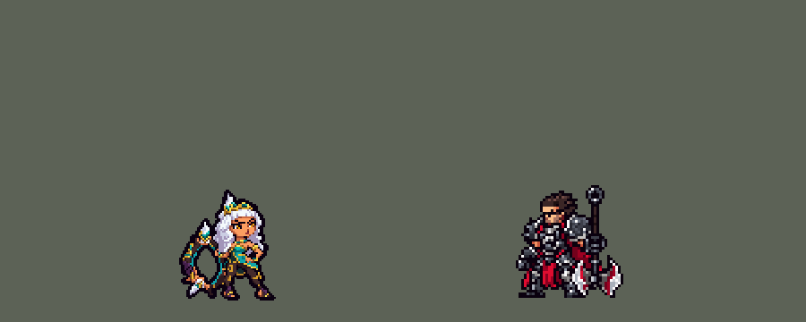

<!-- 本页上半部分由 tools/docs/gen_hero_docs.py 按仓库里现在的数据生成，手改会被覆盖；「开发记录」以下是手写的，生成时原样保留。 -->

# 奇亚娜 Qiyana


| 项目 | 内容 |
|---|---|
| id | `league_qiyana` |
| 所属的包 | 主包（mod_id `league`） |
| 分路 | 打野 |
| 分类 / 标签 | 刺客（Assassin） · AD / Melee |
| 高清帧 | PPU 1.5 |
| 附加包 | [奇亚娜附加包](#附加包)（`league_qiyana`） |



其他预览：[逐帧预览](../preview/league_qiyana_frames.png)、[特效表](../preview/league_qiyana_effects.png)

## 现在的技能

下面是游戏里显示的技能说明（`league/text/champion.i18n` 的简体中文，去掉了颜色和图标），冷却、距离来自 `league/champion/league_qiyana.data_champion`；1 秒 = 60 tick。

### 普攻 / 被动

*攻击间隔 0.97 秒 · 攻击距离 25000*

挥环攻击。凌人贵气：每4秒首次命中额外造成40 + 50% 攻击力物理伤害。武器附有元素时攻速+25%，攻击额外造成15 + 25% 攻击力魔法伤害。

### 技能1 · 以绪塔尔之锋

*冷却 1 秒 · 施放距离 30000 · 施放：指定目标 · 敌人（不含防御塔）*

挥环横扫前方，造成60 + 110% 攻击力物理伤害。附有元素时消耗元素：河流定身0.5秒后减速25%；岩石额外造成25 + 40% 攻击力；草丛伪装2.5秒并加速25%。

### 技能2 · 天纵之勇

*冷却 1 秒 · 施放距离 42000 · 施放：指定目标 · 敌人（不含防御塔）*

突进到敌人身上，造成60 + 70% 攻击力物理伤害；方圆塑令：为武器附上元素（草丛、河流、岩石轮换），并刷新以绪塔尔之锋。

### 大招 · 惊才绝景

*冷却 45 秒 · 施放距离 45000 · 施放：指定目标 · 敌方英雄*

挥环放出冲击波，对路径上的敌人造成120 + 120% 攻击力物理伤害，将其击退后晕眩0.9秒。

### 数值

攻击力 110（每级 +20）、生命 980（每级 +88）、护甲 26（每级 +8）、魔抗 18（每级 +4）、移速 1100（每级 +13）。

## 附加包

附加包是可选的原生代码 mod（都在附加包合集 `league_addons` 里），**不装主包里的英雄也是完整的**。

### 奇亚娜附加包

[奇亚娜附加包](../../addons/league_qiyana/README.md)：`league_qiyana` v0.2.2

|  | 主包（纯数据） | 装了附加包 |
|---|---|---|
| 元素 | 每次突进按草丛 → 河流 → 岩石轮换 | **按身边的地形**（英雄联盟的 W 朝哪块地形放就拿哪种）：天纵之勇落地时看她身边两格（64000）内——**草丛**格子给草丛，**墙**格子和地图四边的石墙给岩石，**河道**给河流；几种都在时拿局势想要的那种（下一行），不在身边就拿最近的一种。**身边什么都没有时按局势选**：她自己生命 35% 以下（或 60% 以下且身边两名以上敌方英雄）选草丛（伪装加速脱身）；目标是生命 50% 以下的英雄选岩石（斩杀）；其他英雄选河流（定身）；野怪和小兵选岩石 |
| 凌人贵气 | 一次触发后 4 秒内谁都不加伤 | **每个敌人单独算**：对同一个敌人 10 秒内只加一次（英雄联盟：对每个敌人的第一次普攻或技能） |
| 岩石 | 对谁都多打 25 + 40% 攻击力 | 只对**生命 50% 以下**的敌人多打，加倍为 50 + 80% 攻击力，50% 以上不加 |

装上附加包后游戏里显示的说明（和主包不同的部分）：

- **普攻 / 被动**：【附加包】挥环攻击。凌人贵气：对每个敌人10秒内的首次命中额外造成40 + 50% 攻击力物理伤害。武器附有元素时攻速+25%，攻击额外造成15 + 25% 攻击力魔法伤害。
- **技能1 · 以绪塔尔之锋**：【附加包】挥环横扫前方，造成60 + 110% 攻击力物理伤害。消耗元素：河流定身0.5秒后减速25%；岩石对生命低于50%的敌人额外造成50 + 80% 攻击力；草丛伪装2.5秒并加速25%。
- **技能2 · 天纵之勇**：【附加包】突进到敌人身上，造成60 + 70% 攻击力物理伤害；方圆塑令按身边地形附上元素：草丛选草丛，墙选岩石，河道选河流；身边都没有就按局势选（自己残血草丛，残血英雄岩石，其他英雄河流，野怪小兵岩石）；并刷新以绪塔尔之锋。

## 相关脚本和素材

- [`tools/kit/build_qiyana.py`](../../tools/kit/build_qiyana.py)
- [`tools/kit/setup_qiyana.py`](../../tools/kit/setup_qiyana.py)
- [`tools/lol/extract_qiyana.py`](../../tools/lol/extract_qiyana.py)
- [`tools/art/preview_qiyana.py`](../../tools/art/preview_qiyana.py)
- [`tools/art/rig_qiyana.py`](../../tools/art/rig_qiyana.py)
- [`assets/source/qiyana/`](../../assets/source/qiyana)

## 开发记录

> 下面是原来 README 里「英雄：奇亚娜」一节，原样搬过来（只改了相对链接）。

| 部分 | 内容 |
|---|---|
| 定位 | 打野（Melee，标签 AD / Melee），第 153 位英雄（G 组；用户选了打野）。元素女皇 奇亚娜：白色长发、金色发冠，青绿和金色的衣裳，手里一圈金色环刃。技能方案 A（用户选）：Q / E+W / R——英雄联盟的 W 方圆塑令并进 E |
| 元素 | 元素是她身上的标记（草丛、河流、岩石，挂着直到 Q 用掉）。主包是纯数据、读不到地图，每次突进按草丛 → 河流 → 岩石轮换；附加包按她落地时身边的地形挑：草丛格子给草丛，墙和地图边的石墙给岩石，河道给河流，身边都没有才按局势挑（用户先选了「插件按局势选」，后来改成「按地形：E 落地看附近的草丛、墙、河，附近都没有就退回按局势选」）。附着元素时攻速 +25%、普攻额外 15 + 25% 攻击 魔法伤害 |
| 普攻 / 被动 | 挥环一击（100% 攻击）。**凌人贵气**：命中额外 40 + 50% 攻击 物理伤害，之后 4 秒内不再触发（主包只能读她自己的标记；附加包按每个敌人单独算，同一个敌人 10 秒一次） |
| 技能1 | **以绪塔尔之锋**（冷却 6 秒，射程 30000，对 `EnemyWithoutTower`，野怪兵线也打）：挥环横扫前方，60 + 110% 攻击 物理伤害。附有元素时消耗它：**河流**定身 0.5 秒再减速 25% 1 秒，**岩石**额外 25 + 40% 攻击（附加包：只对生命 50% 以下的敌人、加倍），**草丛**伪装 2.5 秒、移速 +25%。四种挥法各有一套动作（`skill` / `skill_w` / `skill_r` / `skill_g`），横扫的环光画进她自己的帧 |
| 技能2 | **天纵之勇 + 方圆塑令**（冷却 9 秒，射程 42000）：突进到敌人身上 60 + 70% 攻击 物理伤害，落地时给环刃附上元素、刷新以绪塔尔之锋 |
| 大招 | **惊才绝景**（冷却 45 秒，射程 45000，只对敌方英雄）：挥环放出冲击波，路径上的敌人 120 + 120% 攻击 物理伤害、击退后晕眩 0.9 秒（英雄联盟是撞到地形或元素才晕；这里没有地形，都晕） |
| 连招 | 「有连招要做连招」：**E → Q**：突进落地立刻放附了元素的以绪塔尔之锋（英雄联盟的 E → W → Q）；**R → E → Q**：冲击波打中英雄后，E 好了就突进到晕住的英雄身上（接着就是 E → Q），E 没好而 Q 好了、英雄在够得着的地方就直接 Q |
| 附加包 | [`addons/league_qiyana`](../../addons/league_qiyana/README.md)（在附加包合集里，原生代码，主包不装它也完整）：**按地形挑元素**（地图读得到墙和草丛格子；河不在地图数据里，按中间穿过两个大野怪的那条斜带算；身边两格内都没有地形时按局势：她自己残血选草丛脱身，半血以下的英雄选岩石斩杀，其他英雄选河流定身，野怪小兵选岩石），**凌人贵气每个敌人单独算**，**岩石斩杀**只对半血以下、加倍 |
| 数值 | 攻击 110（+20）、生命 980（+88）、护甲 26（+8）、魔抗 18（+4）、移速 1100（+13）、射程 25000 |
| 平衡 | 经典引擎模拟（打野，对忍者、恶魔、猎人、狼人、吸血鬼，两边三套阵容）：草稿 −1.34，加强两版后 +1.54（种子 1-8）、+1.95（种子 9-16），定为这一版 |
| 精灵图（高清帧 PPU 1.5） | Codex 第 0 步画了她的样子；用户选「40 游戏像素，PPU 1.5，只做四分之三侧面」：60 行（发冠顶到脚底）。第 1 步两稿，用户选 A-1（[`tools/art/design_qiyana_model.py`](../../tools/art/design_qiyana_model.py)）。动作用户选「Codex 照骨架画姿势」（[`tools/art/pack_qiyana_poses.py`](../../tools/art/pack_qiyana_poses.py)，英雄联盟那一帧按造型大小放在格子上当参考）：第一批腿画成了大人的长腿，13 个姿势只让 Codex 照短腿骨架重画腿（[`tools/art/pack_qiyana_legs.py`](../../tools/art/pack_qiyana_legs.py)），[`tools/art/design_qiyana_legs.py`](../../tools/art/design_qiyana_legs.py) 读回时上身一格不动地保留、只取新腿，站在地上的姿势按画出来的脚落地；[`tools/art/rig_qiyana.py`](../../tools/art/rig_qiyana.py) 按英雄联盟的节奏拼成动作，Q 的四种横扫和 R 的挥环、地面炸开画进她自己的帧（[`assets/source/native/qiyana_bake.json`](../../assets/source/native/qiyana_bake.json)）。待机和选人卡片的小动作是普攻的蓄势 |
| 特效 | 22 张特效（[`tools/art/pack_qiyana_fx.py`](../../tools/art/pack_qiyana_fx.py) 的提示词，参考是英雄联盟里奇亚娜自己的贴图），用户让 Gemini 画的（JPG，没有透明）：[`tools/art/process_qiyana_fx.py`](../../tools/art/process_qiyana_fx.py) 抠掉背景（黑底、白底、灰底、画出来的棋盘格；棋盘格透过闭合形状的地方也抠掉）、按格子线切帧、缩到游戏尺寸、做成左右对称（冲击波上下对称，六张朝前的不对称）；最后两张（河流的冰水洼、草丛的加速草圈）线条和冰晶只有一格大，按像素种类分开缩（草圈的椭圆在原图上拟合后画成一格粗的线，草叶取原图的）。[`tools/art/import_qiyana_fx.py`](../../tools/art/import_qiyana_fx.py) 按技能放好 |
| 音效 | 英雄联盟的音效和配音（[`tools/lol/extract_qiyana.py`](../../tools/lol/extract_qiyana.py)）：普攻、四种元素的 Q 和命中、突进、大招的挥环和冲击波，台词 |
| 图标 | 官方技能图标（以绪塔尔之锋、天纵之勇、惊才绝景），从本地客户端取 |

重新生成（素材来自本机的英雄联盟客户端，音频不进仓库）：

```bash
python tools/lol/extract_qiyana.py --lol "D:\WeGameApps\lol" --vgmstream <vgmstream-cli.exe>
python tools/kit/build_qiyana.py                    # 技能数据，数字都在脚本的参数表 P 里
python tools/kit/setup_qiyana.py                    # 五种语言的文字、音效配置、共享文件里她的键（脸 1,-27）
python addons/league_qiyana/make_override.py        # 附加包的副本（按地形挑元素、凌人贵气每人一次、岩石斩杀）
python tools/art/design_qiyana_model.py             # Codex 第 1 步的造型读回（A-1）
python tools/art/design_qiyana_poses.py             # Codex 的姿势读回
python tools/art/design_qiyana_legs.py              # 腿重画的读回，接回原来的上身
python tools/art/process_qiyana_fx.py               # Gemini 的特效图 -> 游戏尺寸（--src 放 JPG 的文件夹）
python tools/art/import_qiyana_fx.py                # 特效 -> league_qiyana_fx / league_qiyana_big
python tools/art/rig_qiyana.py                      # 1 倍帧和 1.5 的原帧
python tools/art/ppu_restyle.py --hero qiyana       # 外描边、脸的位置（画进帧里的特效在描边之后）
python tools/art/ppu_hd.py --hero qiyana            # hd_ / lo_ 帧
python tools/art/hero_reels.py --hero qiyana        # 待机和选人卡片的小动作
python tools/art/preview_qiyana.py                  # 预览和演示 GIF
```
