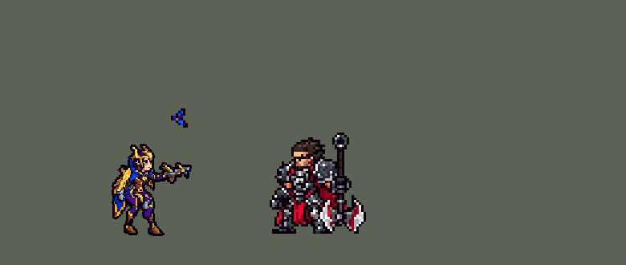

<!-- 本页上半部分由 tools/docs/gen_hero_docs.py 按仓库里现在的数据生成，手改会被覆盖；「开发记录」以下是手写的，生成时原样保留。 -->

# 奎因 Quinn


| 项目 | 内容 |
|---|---|
| id | `league_quinn` |
| 所属的包 | 主包（mod_id `league`） |
| 分路 | 上单 |
| 分类 / 标签 | 射手（Range） · AD / Range |
| 高清帧 | PPU 2 |
| 附加包 | [奎因附加包](#附加包)（`league_quinn`） |



其他预览：[逐帧预览](../preview/league_quinn_frames.png)、[特效表](../preview/league_quinn_effects.png)

## 现在的技能

下面是游戏里显示的技能说明（`league/text/champion.i18n` 的简体中文，去掉了颜色和图标），冷却、距离来自 `league/champion/league_quinn.data_champion`；1 秒 = 60 tick。

### 普攻 / 被动

*攻击间隔 1.03 秒 · 攻击距离 52500*

侵扰：每8秒华洛标记一次（技能也会标记），下次攻击额外造成40 + 60% 攻击力物理伤害。敏锐感知：之后2秒攻速+35%、移速+25%。

### 技能1 · 炫目攻势

*冷却 10 秒 · 施放距离 95000 · 施放：方向 · 敌人（不含防御塔）*

华洛飞出，在第一个敌人处爆开，周围敌人受90 + 110% 攻击力物理伤害；被打中的英雄缴械0.75秒并被标记。

### 技能2 · 旋翔掠杀

*冷却 11 秒 · 施放距离 60000 · 施放：指定目标 · 敌人（不含防御塔）*

冲向敌人，造成50 + 60% 攻击力物理伤害、打断并减速50%，然后向后空翻拉开距离；目标被标记。

### 大招 · 深入敌后

*冷却 40 秒 · 施放距离 60000 · 施放：指定目标 · 敌方英雄*

召来华洛骑上，高速冲向敌方英雄，落地施放鹰翼天翔：周围敌人受170 + 100% 攻击力物理伤害并被标记。

### 数值

攻击力 110（每级 +19）、生命 1000（每级 +95）、护甲 24（每级 +8）、魔抗 18（每级 +3）、移速 950（每级 +10）。

## 附加包

附加包是可选的原生代码 mod（都在附加包合集 `league_addons` 里），**不装主包里的英雄也是完整的**。

### 奎因附加包

[奎因附加包](../../addons/league_quinn/README.md)：`league_quinn` v0.3.0

|  | 主包（纯数据） | 装了附加包 |
|---|---|---|
| 深入敌后 | 骑上华洛一次冲到目标身边，落地施放鹰翼天翔 | **照英雄联盟骑着跑**：骑上华洛 6 秒，移速 +80%，她照常走位；骑着时下一次普攻、技能 1 或技能 2 会先施放鹰翼天翔，6 秒到了也会自动落地施放 |
| 旋翔掠杀 | 冲到目标身上踢一下，空翻的动作有，但人没往后退（冲刺停在目标身上、和它重合，「背离目标」的后跳没有方向，挪 0） | **踢完往冲过来的方向翻回去**约一个攻击距离（4000 x 12 tick，被控就停；用户 2026-10-22：「奎因E完人不会拉开距离」） |
| 骑乘的样子 | 只在大招的冲刺动作里骑着 | **整身换形态**：骑着的 6 秒里站着、走着、挨打都是骑在华洛背上（`r_idle` / `r_run` / `r_hit`） |

装上附加包后游戏里显示的说明（和主包不同的部分）：

- **大招 · 深入敌后**：【扩展包】召来华洛骑上，6秒内移速+80%；骑着时下一次普攻或技能、或骑行结束时施放鹰翼天翔：周围敌人受170 + 100% 攻击力物理伤害并被标记。

## 相关脚本和素材

- [`tools/kit/build_quinn.py`](../../tools/kit/build_quinn.py)
- [`tools/kit/setup_quinn.py`](../../tools/kit/setup_quinn.py)
- [`tools/lol/extract_quinn.py`](../../tools/lol/extract_quinn.py)
- [`tools/art/preview_quinn.py`](../../tools/art/preview_quinn.py)
- [`tools/art/rig_quinn.py`](../../tools/art/rig_quinn.py)
- [`assets/source/quinn/`](../../assets/source/quinn)

## 开发记录

> 下面是原来 README 里「英雄：奎因」一节，原样搬过来（只改了相对链接）。

| 部分 | 内容 |
|---|---|
| 定位 | 上单（Range，标签 AD / Range），第 134 位英雄。德玛西亚之翼 奎因：金色的鹰盔、深紫和蓝色的铠甲与披风，手腕上一把弩，头顶盘旋着她的鹰华洛（10-17 的分组计划 C 组的另一名射手）。用户的选择：「上单」「技能方案 A」、Q 的致盲做成缴械、「大招主包冲刺 + 附加包换形态」、华洛在头顶盘旋。团战经理只有三个主动技能位：技能 1 = Q 炫目攻势，技能 2 = E 旋翔掠杀，大招 = R 深入敌后（落地施放鹰翼天翔）；被动侵扰和 W 敏锐感知的被动部分在普攻里，W 的主动（视野）在这里没有用，不做。技能名照英雄联盟 16.20 的官方中文 |
| 普攻 / 被动 | 手腕弩射出追踪的弩箭（射程 52500，100% 攻击，也打塔）。**侵扰**：每 8 秒华洛标记一次她的下一个目标（Q、E、R 打中的也被标记），带着标记的那一下华洛俯冲到目标头上，多造成 40 + 60% 攻击 物理伤害；**敏锐感知**：之后 2 秒攻速 +35%、移速 +25%。华洛平时跟着她在头顶盘旋（跟随的 buff 图，每条命第一次出手挂上），Q 飞出去和她骑着他的时候不在头顶 |
| 技能1 | **Q 炫目攻势**（对小兵、野怪也放，射程 95000）：华洛直线飞出（最远 100000），在第一个碰到的敌人处爆开，半径 21000 内的敌人受 90 + 110% 攻击 物理伤害；第一个被打中的单位被标记，英雄还缴械 0.75 秒（英雄联盟是近视：数据改不了攻击距离，字段是无符号的，用老版奎因的致盲＝缴械）。华洛飞回来继续盘旋。冷却 10 秒 |
| 技能2 | **E 旋翔掠杀**（对小兵、野怪也放，射程 60000）：冲向目标，打中造成 50 + 60% 攻击 物理伤害、打断 0.1 秒、减速 50% 1.5 秒、标记，然后从目标身上向后空翻，退开大约一个攻击距离。冷却 11 秒 |
| 大招 | **R 深入敌后**，只对敌方英雄放（射程 60000）：召来华洛骑上（0.5 秒），高速冲向目标，到了施放**鹰翼天翔**：半径 30000 内的敌人受 170 + 100% 攻击 物理伤害并被标记，她跳下来。冷却 40 秒。英雄联盟可以一直骑着跑、出手才落地；数据不能在走路时换待机和跑步的画面，所以主包只在大招的冲刺里骑着 |
| 附加包 | 可选的附加包 [`addons/league_quinn`](../../addons/league_quinn/README.md)（在附加包合集里，原生代码，主包不装它也完整），照英雄联盟：**骑着华洛跑 6 秒**，移速 +80%，她照常走位；骑着时下一次普攻、技能 1 或技能 2 先施放鹰翼天翔，6 秒到了自动落地施放；**整身换形态**：骑着的 6 秒里站着、走着、挨打都画成骑在华洛背上（`r_idle` / `r_run` / `r_hit`，拉莫斯 / 雷克塞附加包的显示钩子）。日志 `league_quinn.log`（RIDE、FORM） |
| 数值 | 攻击 110（+19）、生命 1000（+95）、护甲 24（+8）、魔抗 18（+3）、移速 950（+10）、射程 52500 |
| 平衡 | 10 分钟经典引擎模拟，上路对六个原版战士（fighter / executioner / lancer / pole_warrior / knight / berserker），三套阵容、两边各打：初稿（生命 950、攻击 98、Q 50 + 90%、侵扰 25 + 40%、R 从 140000 外冲过去）-4.49（同批沃利贝尔 +1.31、提莫 +1.05）；R 射程改 60000 -2.58；生命 1000、攻击 106、Q 80 + 110%、侵扰 40 + 60% +2.14（去掉 R +1.38，去掉 E -0.19）；按动作条的时间（Q 28 tick、鹰翼天翔落地 29 tick）+0.27 / +0.29（两批种子 1–8、9–16）；Q 90、鹰翼天翔 170 +0.09 / +0.51；再加攻击 110 定稿 +0.60 / +1.23（换成生命 1050：+0.02 / +1.14） |
| 精灵图（高清帧 PPU 2.0） | Codex 第 0 步画了待机（A）、手放下（B）、华洛（V）、骑着华洛（R）四张原画（[`tools/art/pack_quinn_picture.py`](../../tools/art/pack_quinn_picture.py)），[`tools/art/design_quinn_hd.py`](../../tools/art/design_quinn_hd.py) 按各自的格子读回，[`tools/art/review_quinn_size.py`](../../tools/art/review_quinn_size.py) 和射手们按游戏大小并排，用户：「A」「38 像素、PPU 1.3」。第 1 步 Codex 在游戏格子上画了 3/4 正面、侧面、华洛、骑乘各两稿（[`tools/art/pack_quinn_model.py`](../../tools/art/pack_quinn_model.py)），[`tools/art/design_quinn_model.py`](../../tools/art/design_quinn_model.py) 读回、删到 49 行，用户选了 Q-1 / S-2 / V-2 / R-2。动作不找 Codex（两轮腿部姿势包回来都变形，用户：「你自己画吧 codex也画不好」）：[`tools/art/rig_quinn.py`](../../tools/art/rig_quinn.py) 用造型自己的像素无损摆，只整格平移、四分之一转；腿照锐雯重做的办法逐帧画在英雄联盟的骨骼上（[`tools/art/quinn_legs.py`](../../tools/art/quinn_legs.py)：大腿、小腿是按待机自己那一行腿的颜色画的带子，靴子整块盖在脚踝上，英雄联盟的关节去掉镜头俯角后脚落在同一个地面上，跪下的膝盖着地、后脚踮起脚尖；跑步用接近侧面的镜头）；弩不在肩膀正前方时，手臂从肩膀重新画（上臂、前臂两段袖子，远侧的手臂在身体后面），拳头连弩接在手腕上（用户：「手拿武器有点奇怪」）。每个动作对照英雄联盟的动画（`tools/lol/anim_graph.py Quinn`、`pose_ref.py`，[`tools/art/review_quinn_actions.py`](../../tools/art/review_quinn_actions.py) 左右并排）：待机（Quinn_idle1，举着弩呼吸）、跑（Quinn_run，大步、身体前倾、披风往后飘）、普攻（Quinn_attack1，蹲成宽步、射出时弩往上一跳）、Q（quinn_spell1，踮脚把弩举向天空放出华洛，然后前冲一步）、E 冲刺（Quinn_spell3_dash，身体前倾飞向目标）和空翻（Quinn_spell3_flip，向后翻一圈、落地站起）、R（Quinn_Spell4_Channel：瞄准、弩放到腰间、站直再瞄、单膝跪下把弩举起来等华洛）、骑乘（quinnvalor_run_glide，整组上下起伏）、鹰翼天翔（QuinnRFinale，人和鹰在空中翻一圈，她落地）、挨打（闪白后退）、阵亡 8 帧（quinn_death：中箭、弯腰时弩从手里飞到身后，膝盖一软单膝跪下，往前扑倒，弹一下躺平）、附加包的骑乘待机 / 骑着跑 / 骑着挨打。用户：「奎因腿部还是有轻微的变形」——腿改回待机自己的比例；「奎因动作可以了」。之后用户：「还有奎因的像素有点太低了 太多模糊的了 调一下PPU顺便」（选了 2.0）——Codex 在 13 px 一格的格子上重画了待机和骑乘图（[`tools/art/pack_quinn_grid.py`](../../tools/art/pack_quinn_grid.py)），[`tools/art/design_quinn_grid.py`](../../tools/art/design_quinn_grid.py) 按各自的格子读回、共用一套调色板，待机整行整列删到 75 行（脸的行列不删），用户选了 A-1（65 × 75）；「脸部给我弄好看点」「现在有点奇怪」——Codex 的眼睛、眉毛、嘴是用半格画的，读回后眼睛成了一块灰加一块橙、嘴成了下巴边上的一道红，于是脸按格子重画（每只眼睛白眼仁、深色瞳孔、下面一行琥珀色，两边睫毛在鼻梁处分开，腮红，嘴挪进脸里改小，下巴圆一些），骑乘图的脸同样重画。动作在 2.0 的造型上重新摆（姿势和通过的 1.3 版一样）；Q 和 R 举弩的两帧改成从肩膀画出手臂、弩举在头的右边（整条手臂转上去时弩的后叉压住了眼睛）。所有帧都是待机的那张脸 |
| 特效 | 第 3 步 16 张特效（[`tools/art/pack_quinn_fx.py`](../../tools/art/pack_quinn_fx.py)，颜色照英雄联盟：华洛是深蓝紫色的羽毛、亮蓝色的羽尖、金色的喙，她的弩箭是金色和钢色，风是白蓝色，鹰翼天翔的光芒是金色）。弹道图（弩箭、飞行的华洛，从正上方看）朝右画、上下对称（游戏按飞行方向转），华洛盘旋是绕一圈的循环，其余全部左右对称（游戏不镜像特效图）。[`tools/art/import_quinn_fx.py`](../../tools/art/import_quinn_fx.py) 写成 `league_quinn_fx` 和 `league_quinn_big` |
| 音效 | 英雄联盟的音效和配音（[`tools/lol/extract_quinn.py`](../../tools/lol/extract_quinn.py)，16 段）：普攻出手 / 打中，侵扰华洛俯冲 / 打中，Q 出手 / 爆开 / 打中，E 冲刺 / 打中 / 空翻，R 召唤 / 骑行 / 鹰翼天翔；Q、E、R 的配音（片段名 `league_quinn_sfx_*`，和声音名不同） |
| 图标 | 官方技能图标（炫目攻势、旋翔掠杀、深入敌后，另有敏锐感知和被动），从本地客户端取 |

重新生成（素材来自本机的英雄联盟客户端，音频不进仓库）：

```bash
python tools/lol/extract_quinn.py --lol "D:\WeGameApps\lol" --vgmstream <vgmstream-cli.exe>
python tools/kit/build_quinn.py                     # 技能数据，数字都在脚本的参数表 P 里
python tools/kit/setup_quinn.py                     # 五种语言的文字、音效配置、共享文件里她的键
python tools/art/design_quinn_grid.py               # Codex 的 PPU 2.0 重画读回（待机 A-1、骑乘图），脸按格子重画
python tools/art/rig_quinn.py                       # 1 倍帧和 2.0 的原帧（整块摆，腿画在英雄联盟的骨骼上）
python tools/art/ppu_restyle.py --hero quinn        # 外描边（不要加 --preview）
python tools/art/ppu_hd.py --hero quinn             # hd_ / lo_ 帧
python tools/art/import_quinn_fx.py                 # 特效
python tools/art/preview_quinn.py                   # 预览和演示 GIF
python addons/league_quinn/make_override.py         # 附加包的副本（主包的奎因改了就重跑）
```

逐帧预览：[`docs/preview/league_quinn_frames.png`](../preview/league_quinn_frames.png?v=1019a)，特效：[`docs/preview/league_quinn_effects.png`](../preview/league_quinn_effects.png?v=1019a)。
