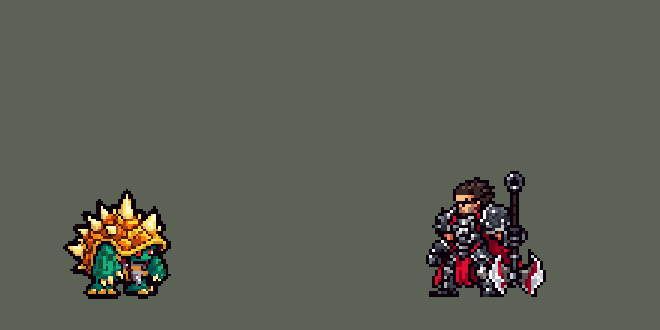

<!-- 本页上半部分由 tools/docs/gen_hero_docs.py 按仓库里现在的数据生成，手改会被覆盖；「开发记录」以下是手写的，生成时原样保留。 -->

# 拉莫斯 Rammus


| 项目 | 内容 |
|---|---|
| id | `league_rammus` |
| 所属的包 | 主包（mod_id `league`） |
| 分路 | 打野 |
| 分类 / 标签 | 近战（Melee） · AP / Magic / Melee / Tank / CC |
| 高清帧 | PPU 1.2 |
| 附加包 | [拉莫斯附加包](#附加包)（`league_rammus`） |



其他预览：[逐帧预览](../preview/league_rammus_frames.png)、[特效表](../preview/league_rammus_effects.png)

## 现在的技能

下面是游戏里显示的技能说明（`league/text/champion.i18n` 的简体中文，去掉了颜色和图标），冷却、距离来自 `league/champion/league_rammus.data_champion`；1 秒 = 60 tick。

### 普攻 / 被动

*攻击间隔 1.17 秒 · 攻击距离 25000*

翻身撞击。锥刺甲壳：普攻多造成15 + 30% 法强 + 2% 最大生命魔法伤害。尖刺防御：敌方英雄靠近时蜷起来，7秒内双抗+60%，反弹25%受到的伤害。

### 技能1 · 动力冲刺

*冷却 7 秒 · 施放距离 45000 · 施放：指定目标 · 敌人（不含防御塔）*

缩成球滚向目标，撞上时对周围造成110 + 110% 法强魔法伤害，击退并减速40%1秒。

### 技能2 · 狂乱嘲讽

*冷却 12 秒 · 施放距离 32500 · 施放：指定目标 · 敌方英雄*

嘲讽一名敌方英雄1.5秒。

### 大招 · 冲天猛撞

*冷却 60 秒 · 施放距离 60000 · 施放：指定目标 · 敌方英雄*

跳起砸向敌方英雄，对区域造成200 + 90% 法强魔法伤害并减速40%，之后余震3次；刚滚完动力冲刺时，中心的敌人再受一次冲刺伤害并击飞0.75秒。

### 数值

攻击力 84（每级 +6）、法强 30（每级 +15）、生命 1250（每级 +120）、护甲 44（每级 +11）、魔抗 30（每级 +5）、移速 1000（每级 +11）。

## 附加包

附加包是可选的原生代码 mod（都在附加包合集 `league_addons` 里），**不装主包里的英雄也是完整的**。

### 拉莫斯附加包

[拉莫斯附加包](../../addons/league_rammus/README.md)：`league_rammus` v0.1.0

|  | 主包（纯数据） | 装了附加包 |
|---|---|---|
| 动力冲刺 | 缩成球，一次冲到目标身上撞开 | **照英雄联盟滚**：缩成球后越滚越快（移速 +30% 到 +100%，2 秒加满，最多滚 4 秒），他照常走向目标，碰到第一个敌人（不算防御塔）就撞开；滚着时普攻也算撞上 |
| 滚球、蜷缩的样子 | 只在 Q 的动作条里是球，W 只有蜷起来的那一下 | **整身换形态**：滚着的时候站着、走着、挨打都是滚动的刺球（`b_idle` / `b_run` / `b_hit`），尖刺防御开着的 7 秒里是蜷着的防御姿势（`c_idle` / `c_run` / `c_hit`） |
| 锥刺甲壳 | 15 + 30% 法强 + 2% 最大生命 | **15 + 30% 法强 + 15% 护甲**（英雄联盟：10 + 15% 护甲） |

装上附加包后游戏里显示的说明（和主包不同的部分）：

- **普攻 / 被动**：【扩展包】翻身撞击。锥刺甲壳：普攻多造成15 + 30% 法强 + 15% 护甲魔法伤害。尖刺防御：敌方英雄靠近时蜷起来，7秒内双抗+60%，反弹25%受到的伤害。
- **技能1 · 动力冲刺**：【扩展包】缩成球滚动，越滚越快（移速+30%到+100%，最多4秒），撞上第一个敌人时对周围造成110 + 110% 法强魔法伤害，击退并减速40%1秒。

## 相关脚本和素材

- [`tools/kit/build_rammus.py`](../../tools/kit/build_rammus.py)
- [`tools/kit/setup_rammus.py`](../../tools/kit/setup_rammus.py)
- [`tools/lol/extract_rammus.py`](../../tools/lol/extract_rammus.py)
- [`tools/art/preview_rammus.py`](../../tools/art/preview_rammus.py)
- [`tools/art/rig_rammus.py`](../../tools/art/rig_rammus.py)
- [`assets/source/rammus/`](../../assets/source/rammus)

## 开发记录

> 下面是原来 README 里「英雄：拉莫斯」一节，原样搬过来（只改了相对链接）。

| 部分 | 内容 |
|---|---|
| 定位 | 打野（Jungle，类别 Melee，标签 AP / Magic / Melee / Tank / CC），第 132 位英雄。披甲龙龟 拉莫斯：背着带刺大甲壳的犰狳，甲壳前缘下探出绿色的小乌龟头（10-17 的分组计划 C 组的打野）。用户的选择：「技能方案 A（Q / E / R，W 自动）」「做附加包」「打野」。团战经理只有三个主动技能位：技能 1 = Q 动力冲刺，技能 2 = E 狂乱嘲讽，大招 = R 冲天猛撞；被动锥刺甲壳在普攻里，**W 尖刺防御没有自己的格子，敌方英雄靠近时由守望自动开**。技能名照英雄联盟 16.20 的官方中文 |
| 普攻 / 被动 | 翻身撞击（射程 25000，英雄联盟的 rammus_attack1：整个翻一个跟头用甲壳撞过去）。**锥刺甲壳**：普攻多造成 15 + 30% 法强 + 2% 最大生命 魔法伤害（英雄联盟 10 + 15% 护甲：数据读不到护甲，用最大生命代替，马尔扎哈 / 墨菲特的做法；附加包按真实护甲算） |
| W（守望自动） | **尖刺防御**：守望每 12 tick 看一次，冷却好、没在出招、30000 内有敌方英雄就蜷起来（`skill_w`）：7 秒内护甲、魔抗 +60%，受到的伤害反弹 25%（英雄联盟是对普攻他的人回敬 15 + 10% 护甲 + 10% 魔抗；引擎只有百分比反伤，安妮熔岩护盾的做法）。冷却 14 秒（英雄联盟结束后 7 秒） |
| 技能1 | **Q 动力冲刺**（对小兵、野怪也放，射程 45000）：缩成球（0.2 秒），滚向目标（`MoveToTarget` 每 tick 4000，动作 `skill_roll` 是整颗球的四分之一转），撞上时周围 18000 内 110 + 110% 法强 魔法伤害、击退 12500（英雄联盟 125）、减速 40% 1 秒，他从球里弹出来（`skill_hit`）。冷却 7 秒。英雄联盟的球最多滚 6 秒、越滚越快、玩家可以操控方向：主包的待机、跑步动画不能在运行中换，所以主包里 Q 是一次冲到目标的冲刺；附加包照英雄联盟滚 |
| 技能2 | **E 狂乱嘲讽**，只对敌方英雄放（射程 32500）：嘲讽 1.5 秒（英雄联盟 1.2–2.0 秒；对野怪的伤害没做，AI 把 E 留给英雄）。冷却 12 秒 |
| 大招 | **R 冲天猛撞**（射程 60000）：缩成球跳起、砸到目标身上（0.6 秒，跳的时候免控），36000 内 200 + 90% 法强 魔法伤害、减速 40% 1.5 秒，之后同一个地方余震 3 次（每 70 tick 一次，重复减速）。**刚撞完动力冲刺的 1.5 秒内**（英雄联盟：动力冲刺中放），中心 18000 内的敌人再受一次 Q 的伤害并击飞 0.75 秒；滚着放 R 会收起球、算刚撞完。冷却 60 秒 |
| 附加包 | 可选的附加包 [`addons/league_rammus`](../../addons/league_rammus/README.md)（在附加包合集里，原生代码，主包不装它也完整），照英雄联盟：**动力冲刺照英雄联盟滚**（缩成球后越滚越快，移速 +30% 到 +100%、2 秒加满，最多滚 4 秒，他照常走向目标，碰到第一个敌人就撞开；滚着普攻也算撞上），**整身换形态**（滚着的时候站着、走着、挨打都是滚动的刺球 `b_*`，尖刺防御开着的时候是蜷着的防御姿势 `c_*`；游戏 0.6.4），**锥刺甲壳按真实护甲**（15 + 30% 法强 + 15% 护甲）。日志 `league_rammus.log`（ROLL、SPIKES、FORM） |
| 数值 | 攻击 84（+6）、法强 30（+15）、生命 1250（+120）、护甲 44（+11）、魔抗 30（+5）、移速 1000（+11）、射程 25000 |
| 平衡 | 10 分钟经典引擎模拟，打野位对五个基础打野（demon / circus_blade / hunter / inquisitor / ninja），三套阵容、两边各打，每档两批种子（1–8、9–16）：初稿（生命 1100、攻击 72、Q 70 + 100%、R 100 + 60%、甲壳 10 + 20% + 1%、W 40% / 15%）-0.82（同批皇子 +2.57）；Q 90 + 110%、R 150 + 80%、甲壳 15 + 30% + 2%、攻击 78 ±0.00；再加生命 1200、W 反伤 25%、Q 冷却 7 秒 +0.33；再加 Q 110、攻击 84、生命 1250、嘲讽 1.5 秒 +1.30 / +1.82；再加 R 200 + 90%、W 60% +1.67 / +2.77；按动作条的时间定稿 +1.71 / +3.10（约 +2.4，雷克塞 +2.17） |
| 精灵图（高清帧 PPU 1.2） | Codex 第 0 步画了待机（A：3/4 正面，甲壳拱在背上、长手臂垂着）和动力冲刺的刺球（B）两张原画（[`tools/art/pack_rammus_picture.py`](../../tools/art/pack_rammus_picture.py)），[`tools/art/design_rammus_hd.py`](../../tools/art/design_rammus_hd.py) 按各自的格子读回（A 10 px、B 11 px 一格），[`tools/art/review_rammus_size.py`](../../tools/art/review_rammus_size.py) 和打野、坦克按游戏大小并排，用户：「36 像素、PPU 1.2」（最高的尖刺到鞋底 43 格）。第 1 步 Codex 在游戏格子上画了待机 A、侧面 S、刺球 B、尖刺防御 W（[`tools/art/pack_rammus_model.py`](../../tools/art/pack_rammus_model.py)，每格 26 px），[`tools/art/design_rammus_model.py`](../../tools/art/design_rammus_model.py) 按各自的格子读回，用户选了 A-2、S-1（51 行，整行整列删到 43 行，脸的行列不删）、B（64 行删到 44 行）、W，四张共用一套调色板。动作不找 Codex（2026-10-19 补帧的做法）：[`tools/art/rig_rammus.py`](../../tools/art/rig_rammus.py) 用造型自己的像素无损摆，只整格平移、四分之一转、镜像，每个动作对照英雄联盟的动画（`tools/lol/anim_graph.py Rammus`、`pose_ref.py`）：待机（A 的身子坐下一行再起来）、跑（侧面的两只脚整块迈步）、普攻（整只往前翻一个跟头，第 3 帧倒过来撞上目标；用户：「普攻和英雄联盟不一样吧？」——原来是手臂抓，改成 rammus_attack1 的翻滚）、Q（蹲下、蜷起来、变成球；滚动 = 整颗球每帧顺时针转四分之一；撞上弹回来、展开）、W（蹲下、蜷起来）、E（蜷着的姿势跳起来举爪）、R（蜷起来、球跳高 16 行转着落下；落地、展开）、挨打（闪白后退）、阵亡 8 帧（往后倒、翻成肚皮朝上躺在甲壳上、回弹一下）；附加包的 `b_idle / b_run / b_hit`（球）和 `c_idle / c_run / c_hit`（蜷着）。只有普攻翻跟头前手臂挥开露出的肚子是补画的（用户看过预览） |
| 特效 | 第 3 步 13 张特效（[`tools/art/pack_rammus_fx.py`](../../tools/art/pack_rammus_fx.py)，颜色照英雄联盟：他的光是甲壳的金色，动力冲刺和冲天猛撞掀起黄沙和碎石，砸出的坑里透着橙色熔岩裂纹，嘲讽是红橙色火光），全部左右对称（游戏不镜像特效图；没有弹道图）。[`tools/art/import_rammus_fx.py`](../../tools/art/import_rammus_fx.py)：滚球的沙尘在他脚下，撞击的沙环以他为中心，尖刺护盾围着他，嘲讽的怒气标记在敌人头上，砸地的坑和余震在落点，减速的沙 / 裂开的地面在敌人脚下。写成 `league_rammus_fx` 和 `league_rammus_big` |
| 音效 | 英雄联盟的音效（[`tools/lol/extract_rammus.py`](../../tools/lol/extract_rammus.py)，14 段）：普攻挥出 / 撞中、Q 缩成球 / 撞上、W、E 出手 / 嘲讽、R 起跳 / 落地 / 击飞；他没有技能台词，配音是他的「OK.」和几声哼 |
| 图标 | 官方技能图标（动力冲刺、狂乱嘲讽、冲天猛撞，另有尖刺防御和被动），从本地客户端取 |

重新生成（素材来自本机的英雄联盟客户端，音频不进仓库）：

```bash
python tools/lol/extract_rammus.py --lol "D:\WeGameApps\lol" --vgmstream <vgmstream-cli.exe>
python tools/kit/build_rammus.py                    # 技能数据，数字都在脚本的参数表 P 里
python tools/kit/setup_rammus.py                    # 五种语言的文字、音效配置、共享文件里他的键
python tools/art/design_rammus_model.py             # Codex 第 1 步的造型读回（A-2 / S-1 / B / W）
python tools/art/rig_rammus.py                      # 1 倍帧和 1.2 的原帧（整块摆）
python tools/art/ppu_restyle.py --hero rammus       # 外描边（不要加 --preview）
python tools/art/ppu_hd.py --hero rammus            # hd_ / lo_ 帧
python tools/art/import_rammus_fx.py                # 特效
python tools/art/preview_rammus.py                  # 预览和演示 GIF
python addons/league_rammus/make_override.py        # 附加包的副本（主包的拉莫斯改了就重跑）
```

逐帧预览：[`docs/preview/league_rammus_frames.png`](../preview/league_rammus_frames.png?v=1019a)，特效：[`docs/preview/league_rammus_effects.png`](../preview/league_rammus_effects.png?v=1019a)。
