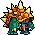
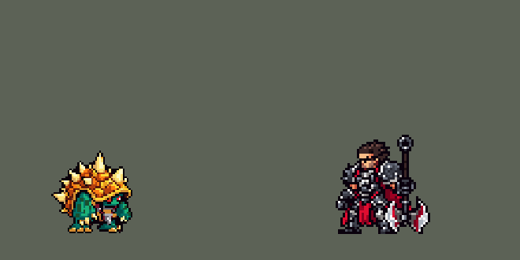

<!-- 本页上半部分由 tools/docs/gen_hero_docs.py 按仓库里现在的数据生成，手改会被覆盖；「开发记录」以下是手写的，生成时原样保留。 -->

# 拉莫斯 Rammus



| 项目 | 内容 |
|---|---|
| id | `league_rammus` |
| 所属的包 | 主包（mod_id `league`） |
| 分路 | 打野 |
| 分类 / 标签 | 坦克（Tank） · AP / Magic / Melee / Tank / CC |
| 高清帧 | PPU 1.2 |
| 附加包 | [拉莫斯附加包](#附加包)（`league_rammus`） |



其他预览：[逐帧预览](../preview/league_rammus_frames.png)、[特效表](../preview/league_rammus_effects.png)

## 现在的技能

下面是游戏里显示的技能说明（`league/text/champion.i18n` 的简体中文，去掉了颜色和图标），冷却、距离来自 `league/champion/league_rammus.data_champion`；1 秒 = 60 tick。

### 普攻 / 被动

*攻击间隔 1.17 秒 · 攻击距离 25000*

翻身撞击。锥刺甲壳：普攻多造成15 + 30% 法强 + 2% 最大生命魔法伤害。尖刺防御：放过动力冲刺后敌方英雄靠近时蜷起来，7秒内护甲+42（+40%）、魔抗+28（+40%），反弹25%受到的伤害；放动力冲刺、冲天猛撞时收起。

### 技能1 · 动力冲刺

*冷却 7 秒 · 施放距离 45000 · 施放：指定目标 · 敌人（不含防御塔）*

缩成球滚向目标，撞上时对周围造成110 + 110% 法强魔法伤害，击退、眩晕0.4秒并减速40%1秒。

### 技能2 · 狂乱嘲讽

*冷却 12 秒 · 施放距离 32500 · 施放：指定目标 · 敌方英雄*

嘲讽一名敌方英雄1.5秒。

### 大招 · 冲天猛撞

*冷却 60 秒 · 施放距离 60000 · 施放：指定目标 · 敌方英雄*

跳起砸向敌方英雄，对区域造成200 + 90% 法强魔法伤害并减速40%，之后余震3次；刚滚完动力冲刺时，中心的敌人再受一次冲刺伤害并击飞0.75秒。

### 数值

攻击力 84（每级 +6）、法强 30（每级 +15）、生命 1250（每级 +120）、护甲 44（每级 +11）、魔抗 30（每级 +5）、移速 1000（每级 +11）。

## 附加包

附加包是可选的原生代码 mod（都在附加包合集 `league_addons` 里），**不装主包里的英雄也是完整的**。

### 拉莫斯附加包

[拉莫斯附加包](../../addons/league_rammus/README.md)：`league_rammus` v0.2.1

|  | 主包（纯数据） | 装了附加包 |
|---|---|---|
| 锥刺甲壳 | 普攻多造成 15 + 30% 法强 + 2% 最大生命 魔法伤害 | **照英雄联盟 V25.12 起：额外攻击力 = 35% 总护甲 + 35% 总魔抗**（英雄联盟 15%，下面「0.2.0」一节），护甲、魔抗一变（升级、装备、尖刺防御）就跟着变，面板上看得到；普攻不再多一段魔法伤害 |
| 尖刺防御 | 放过动力冲刺后敌方英雄靠近时蜷起，7 秒护甲 +42（+40%）、魔抗 +28（+40%），反弹受到的每一下伤害的 25% | 敌方英雄靠近就蜷（不等动力冲刺），双抗一样；**只回敬普攻他的敌人**：每一下普攻，攻击者受到 20 + 10% 护甲 + 10% 魔抗 魔法伤害（英雄联盟 15 + 10% + 10%），技能、持续伤害、防御塔不算 |
| 动力冲刺 | 缩成球，一次冲到目标身上撞开 | **照英雄联盟滚**：缩成球后从 +0 开始越滚越快（移速每秒 +25%，12 级每秒 +41%，最多滚 6 秒），他照常走向目标，碰到第一个敌人（不算防御塔）就撞开；滚着时普攻也算撞上，滚着不放狂乱嘲讽 |
| 滚球、蜷缩的样子 | 只在 Q 的动作条里是球，W 只有蜷起来的那一下 | **整身换形态**：滚着的时候站着、走着、挨打都是滚动的刺球（`b_idle` / `b_run` / `b_hit`），尖刺防御开着的 7 秒里是蜷着的防御姿势（`c_idle` / `c_run` / `c_hit`） |

装上附加包后游戏里显示的说明（和主包不同的部分）：

- **普攻 / 被动**：【扩展包】翻身撞击。锥刺甲壳：获得护甲与魔抗之和35%的攻击力。尖刺防御：敌方英雄靠近时蜷起来，7秒内护甲+42（+40%）、魔抗+28（+40%），普攻他的敌人受到20+10%护甲+10%魔抗魔法伤害；放动力冲刺、冲天猛撞时收起。
- **技能1 · 动力冲刺**：【扩展包】缩成球滚动，越滚越快（移速每秒+25%~41%，随等级，最多6秒），撞上第一个敌人时对周围造成110 + 110% 法强魔法伤害，击退、眩晕0.4秒并减速40%1秒。
- **技能2 · 狂乱嘲讽**：【扩展包】嘲讽一名敌方英雄1.5秒。滚动时不能施放。

## 相关脚本和素材

- [`tools/kit/build_rammus.py`](../../tools/kit/build_rammus.py)
- [`tools/kit/setup_rammus.py`](../../tools/kit/setup_rammus.py)
- [`tools/lol/extract_rammus.py`](../../tools/lol/extract_rammus.py)
- [`tools/art/preview_rammus.py`](../../tools/art/preview_rammus.py)
- [`tools/art/rig_rammus.py`](../../tools/art/rig_rammus.py)
- [`assets/source/rammus/`](../../assets/source/rammus)

## 开发记录

> 下面是原来 README 里「英雄：拉莫斯」一节，原样搬过来（只改了相对链接）。

| 部分 | 内容 |
|---|---|
| 定位 | 打野（Jungle，类别 Melee，标签 AP / Magic / Melee / Tank / CC），第 132 位英雄。披甲龙龟 拉莫斯：背着带刺大甲壳的犰狳，甲壳前缘下探出绿色的小乌龟头（10-17 的分组计划 C 组的打野）。用户的选择：「技能方案 A（Q / E / R，W 自动）」「做附加包」「打野」。团战经理只有三个主动技能位：技能 1 = Q 动力冲刺，技能 2 = E 狂乱嘲讽，大招 = R 冲天猛撞；被动锥刺甲壳在普攻里，**W 尖刺防御没有自己的格子，敌方英雄靠近时由守望自动开**。技能名照英雄联盟 16.20 的官方中文 |
| 普攻 / 被动 | 翻身撞击（射程 25000，英雄联盟的 rammus_attack1：整个翻一个跟头用甲壳撞过去）。**锥刺甲壳**：普攻多造成 15 + 30% 法强 + 2% 最大生命 魔法伤害（英雄联盟 10 + 15% 护甲：数据读不到护甲，用最大生命代替，马尔扎哈 / 墨菲特的做法；附加包按真实护甲算） |
| W（守望自动） | **尖刺防御**：守望每 12 tick 看一次，冷却好、没在出招、30000 内有敌方英雄就蜷起来（`skill_w`）：7 秒内护甲、魔抗 +60%，受到的伤害反弹 25%（英雄联盟是对普攻他的人回敬 15 + 10% 护甲 + 10% 魔抗；引擎只有百分比反伤，安妮熔岩护盾的做法）。冷却 14 秒（英雄联盟结束后 7 秒） |
| 技能1 | **Q 动力冲刺**（对小兵、野怪也放，射程 45000）：缩成球（0.2 秒），滚向目标（`MoveToTarget` 每 tick 4000，动作 `skill_roll` 是整颗球每帧顺时针转 15 度，24 帧 1.2 秒一圈），撞上时周围 18000 内 110 + 110% 法强 魔法伤害、击退 12500（英雄联盟 125）、减速 40% 1 秒，他从球里弹出来（`skill_hit`）。冷却 7 秒。英雄联盟的球最多滚 6 秒、越滚越快、玩家可以操控方向：主包的待机、跑步动画不能在运行中换，所以主包里 Q 是一次冲到目标的冲刺；附加包照英雄联盟滚 |
| 技能2 | **E 狂乱嘲讽**，只对敌方英雄放（射程 32500）：嘲讽 1.5 秒（英雄联盟 1.2–2.0 秒；对野怪的伤害没做，AI 把 E 留给英雄）。冷却 12 秒 |
| 大招 | **R 冲天猛撞**（射程 60000）：缩成球跳起、砸到目标身上（0.6 秒，跳的时候免控），36000 内 200 + 90% 法强 魔法伤害、减速 40% 1.5 秒，之后同一个地方余震 3 次（每 70 tick 一次，重复减速）。**刚撞完动力冲刺的 1.5 秒内**（英雄联盟：动力冲刺中放），中心 18000 内的敌人再受一次 Q 的伤害并击飞 0.75 秒；滚着放 R 会收起球、算刚撞完。冷却 60 秒 |
| 附加包 | 可选的附加包 [`addons/league_rammus`](../../addons/league_rammus/README.md)（在附加包合集里，原生代码，主包不装它也完整），照英雄联盟：**动力冲刺照英雄联盟滚**（缩成球后越滚越快，移速 +30% 到 +100%、2 秒加满，最多滚 4 秒，他照常走向目标，碰到第一个敌人就撞开；滚着普攻也算撞上），**整身换形态**（滚着的时候站着、走着、挨打都是滚动的刺球 `b_*`，尖刺防御开着的时候是蜷着的防御姿势 `c_*`；游戏 0.6.4），**锥刺甲壳按真实护甲**（15 + 30% 法强 + 15% 护甲）。日志 `league_rammus.log`（ROLL、SPIKES、FORM） |
| 数值 | 攻击 84（+6）、法强 30（+15）、生命 1250（+120）、护甲 44（+11）、魔抗 30（+5）、移速 1000（+11）、射程 25000 |
| 平衡 | 10 分钟经典引擎模拟，打野位对五个基础打野（demon / circus_blade / hunter / inquisitor / ninja），三套阵容、两边各打，每档两批种子（1–8、9–16）：初稿（生命 1100、攻击 72、Q 70 + 100%、R 100 + 60%、甲壳 10 + 20% + 1%、W 40% / 15%）-0.82（同批皇子 +2.57）；Q 90 + 110%、R 150 + 80%、甲壳 15 + 30% + 2%、攻击 78 ±0.00；再加生命 1200、W 反伤 25%、Q 冷却 7 秒 +0.33；再加 Q 110、攻击 84、生命 1250、嘲讽 1.5 秒 +1.30 / +1.82；再加 R 200 + 90%、W 60% +1.67 / +2.77；按动作条的时间定稿 +1.71 / +3.10（约 +2.4，雷克塞 +2.17） |
| 精灵图（高清帧 PPU 1.2） | Codex 第 0 步画了待机（A：3/4 正面，甲壳拱在背上、长手臂垂着）和动力冲刺的刺球（B）两张原画（[`tools/art/pack_rammus_picture.py`](../../tools/art/pack_rammus_picture.py)），[`tools/art/design_rammus_hd.py`](../../tools/art/design_rammus_hd.py) 按各自的格子读回（A 10 px、B 11 px 一格），[`tools/art/review_rammus_size.py`](../../tools/art/review_rammus_size.py) 和打野、坦克按游戏大小并排，用户：「36 像素、PPU 1.2」（最高的尖刺到鞋底 43 格）。第 1 步 Codex 在游戏格子上画了待机 A、侧面 S、刺球 B、尖刺防御 W（[`tools/art/pack_rammus_model.py`](../../tools/art/pack_rammus_model.py)，每格 26 px），[`tools/art/design_rammus_model.py`](../../tools/art/design_rammus_model.py) 按各自的格子读回，用户选了 A-2、S-1（51 行，整行整列删到 43 行，脸的行列不删）、B（64 行删到 44 行）、W，四张共用一套调色板。动作不找 Codex（2026-10-19 补帧的做法）：[`tools/art/rig_rammus.py`](../../tools/art/rig_rammus.py) 用造型自己的像素无损摆，只整格平移、四分之一转、镜像，每个动作对照英雄联盟的动画（`tools/lol/anim_graph.py Rammus`、`pose_ref.py`）：待机（A 的身子坐下一行再起来）、跑（侧面的两只脚整块迈步）、普攻（整只往前翻一个跟头，第 3 帧倒过来撞上目标；用户：「普攻和英雄联盟不一样吧？」——原来是手臂抓，改成 rammus_attack1 的翻滚）、Q（蹲下、蜷起来、变成球；滚动 = 整颗球每帧顺时针转四分之一（2026-11-21 起每帧转 15 度、24 帧一圈，见下面「滚球看得出在滚」）；撞上弹回来、展开）、W（蹲下、蜷起来）、E（蜷着的姿势跳起来举爪）、R（蜷起来、球跳高 16 行转着落下；落地、展开）、挨打（闪白后退）、阵亡 8 帧（往后倒、翻成肚皮朝上躺在甲壳上、回弹一下）；附加包的 `b_idle / b_run / b_hit`（球）和 `c_idle / c_run / c_hit`（蜷着）。只有普攻翻跟头前手臂挥开露出的肚子是补画的（用户看过预览） |
| 特效 | 第 3 步 13 张特效（[`tools/art/pack_rammus_fx.py`](../../tools/art/pack_rammus_fx.py)，颜色照英雄联盟：他的光是甲壳的金色，动力冲刺和冲天猛撞掀起黄沙和碎石，砸出的坑里透着橙色熔岩裂纹，嘲讽是红橙色火光），全部左右对称（游戏不镜像特效图；没有弹道图）。[`tools/art/import_rammus_fx.py`](../../tools/art/import_rammus_fx.py)：滚球的沙尘在他脚下，撞击的沙环以他为中心，尖刺护盾围着他，嘲讽的怒气标记在敌人头上，砸地的坑和余震在落点，减速的沙 / 裂开的地面在敌人脚下。写成 `league_rammus_fx` 和 `league_rammus_big` |
| 音效 | 英雄联盟的音效（[`tools/lol/extract_rammus.py`](../../tools/lol/extract_rammus.py)，14 段）：普攻挥出 / 撞中、Q 缩成球 / 撞上、W、E 出手 / 嘲讽、R 起跳 / 落地 / 击飞；他没有技能台词，配音是他的「OK.」和几声哼 |
| 图标 | 官方技能图标（动力冲刺、狂乱嘲讽、冲天猛撞，另有尖刺防御和被动），从本地客户端取 |
| Q 撞上加 0.4 秒眩晕（附加包 0.1.3，2026-11-14） | 用户看了「和英雄联盟不一样的地方」清单后说「全改吧」。英雄联盟的动力冲刺撞上敌人：击退 125、减速，并且「stunned and revealed for 0.4 seconds」；这里原来只有击退和减速 40% 1 秒。现在撞到的敌人多一个 0.4 秒眩晕（`q_stun` 24 tick），别的数值没动；附加包的副本（滚着走的那一版）和它自己的 Q 说明一起改。经典引擎模拟（打野，240 局，种子 1–8）：击杀差 +2.62 → +2.08（在误差里），伤害 6069 → 5901，Q 每局 44.3 → 44.6 次。没做的：被动现在是「总护甲 15% + 总魔抗 15% 的额外攻击力」（V25.12 起的属性转换，数据没有按属性换算的 buff，这里还是普攻附加魔法伤害）；W 只对普攻他的人回敬 15 + 10% 护甲 + 10% 魔抗（引擎只有百分比反伤）。游戏里还没看过 |
| 动作补帧（2026-11-14） | 用户：「还有有的动画感觉只有一帧 不如oppi的地方都要补 参考联盟的动画」「动画你觉得少的地方就想办法补」。对照表里 Q 动力冲刺的蜷起只有 3 帧 0.2 秒（蹲下、蜷起、成球）；W 尖刺防御 3 帧里只有 2 个姿势（蜷起那张连放两次）；阵亡最后躺着那张连放三次；蜷着走路（附加包开 W 时的 `c_run`）是整团上下跳的同一张画。没有新画，也没交给 Codex：都是设计图自己的格子——蹲身时近处的手臂绕肩整格转四分之一圈伸到前面（从垂着到蜷起时举着的半路，rig 里原来就有的这个姿势），躺倒的脚、蜷着的脚整格挪（[`tools/art/rig_rammus.py`](../../tools/art/rig_rammus.py)）。下面写的是「几帧，其中几个不同的姿势」。**Q 蜷起** 3 帧（3 个姿势）→ 4 帧，其中 4 个：蹲下、手臂伸到前面、蜷起、成球，每张 50 毫秒（还是 200 毫秒蜷完）。**W 尖刺防御** 3 帧（2 个）→ 3 帧，其中 3 个：蹲下 80、手臂伸到前面 60、蜷起 127 毫秒。**E 狂乱嘲讽** 4 帧（3 个）→ 5 帧，其中 4 个：还是 70 毫秒挺身嘲讽，挺高那张 100 → 50 毫秒，后面加一张手臂收到前面的蹲身（50）再站起。**Q 撞上后、R 落地后的展开**（`skill_hit`、`ult_land`）各 3 帧（3 个）→ 4 帧，其中 4 个：球 80 毫秒、蜷着、手臂放到前面的蹲身、站起（50、50、53）。**阵亡** 8 帧（4 个）→ 8 帧，其中 6 个：翻倒弹一下以后两只脚往两边各蹬一下（整格 3 列），再躺着不动；每张时长不变。**蜷着走路** 4 帧（1 个，整团上下左右晃）→ 4 帧，其中 4 个：蜷姿自己的两只脚（从离开身子那行切开，垫在身子下面）一前一后迈步，整团的晃法照旧（每帧上下左右的边和原来一样）。总时长和技能数据读的时刻都没变（Q 200、E 70 毫秒挺身、W 267、展开 233，阵亡 1200），没有短于 50 毫秒的帧，技能数据没改；跑、普攻、滚球、R、受击、球形和蜷着的待机 / 受击逐帧没变。每帧 3 倍、脚 10 倍看过。`hero_reels.json` 里待机剪的 Q 片段 [0, 1, 2] → [0, 1, 2, 3]（还是蹲下到成球，中间多了伸手那张），W 片段 [0, 1, 2] 现在是蹲下、伸手、蜷起；选人卡片还是 Q、E、R、普攻。图集 2015×525 → 2041×615，选人格子用的那张 0.35 → 0.39 MiB。游戏里还没看过 |
| 照英雄联盟 V26.21 改机制（附加包 0.2.0，2026-11-21） | 用户：「龙龟好像也没完全还原吧 而且Q技能目前看起来不会在局内滚动」「你查出来后就按照你的建议直接改就行了 不用咨询我」（看不出在滚是滚球帧的问题，另外重画）。对照英雄联盟维基 V26.21 改了：**两个包**——尖刺防御的双抗改成「固定 + 总量 %」（护甲 +42（+40%）、魔抗 +28（+40%），以前双抗 +60%；数据先加固定值再乘百分比，`w_arm` 30 × 1.4 = 说明里的 42），放动力冲刺、冲天猛撞时收起（冷却从这时起算 7 秒），滚着时守望不蜷；主包的守望只在动力冲刺冷却时蜷（`w_gate`：游戏的 AI 一好就放 Q，先蜷会被 Q 收掉；英雄联盟也是滚完再蜷）；主包的锥刺甲壳（普攻附带魔法伤害）和 25% 全伤害反弹照旧（数据读不到护甲、没有「被普攻时」）。**附加包**——锥刺甲壳换成英雄联盟 V25.12 起的「额外攻击力 = 总护甲 + 总魔抗的 35%」（原生 buff `league_rammus_p_ad`，每 tick 按总护甲、总魔抗对一遍，普攻不再带魔法伤害；英雄联盟是 15%，这个游戏的坦克护甲、魔抗比英雄联盟后期低得多（10 分钟里他平均约 165），15% 只给他平均 25 攻击力，比 0.1.x 每下普攻约 59 的魔法伤害少一大截，经典引擎里副本的击杀差从 +3.80 掉到 +2.40；35% 平均约 60 攻击力，回到 +3.85）；尖刺防御只回敬普攻他的敌人 20 + 10% 护甲 + 10% 魔抗 魔法伤害，去掉 25% 全伤害反弹（`on_damaged` 没有伤害类型，按攻击者的冷却认：普攻在冷却、之后没放过技能才算，同一下普攻只算一次；经典引擎里拿引擎自己的类型对过：英雄的普攻认出约 93%，认成普攻的约 95% 是真的）；动力冲刺最多滚 6 秒、加速从 +0 起每秒 25%（12 级 40.83%）一 tick 一 tick 加，滚着不放 E（AI 钩子改成普攻同一个人 = 撞上去）；副本滚着时普攻在 AI 眼里是 0 伤害，经典引擎的打架计划拿它当除数（0.1.x 也会崩那一 tick），加了 decoy。狂乱嘲讽（没有攻速）、冲天猛撞（余震只减速、滚着放 R 中心击飞吃 Q）对过，本来就一样。经典引擎模拟（打野，每组 720 局，±0.27；副本在 sim3ram 里，`ram_emul.rs` 模拟附加包的原生部分）：主包改前 +2.35 / +2.47，定稿（双抗固定 + %、放 Q / R 收起、滚着不蜷、动力冲刺冷却时才蜷）+2.84 / +2.16（不等 Q 冷却的那一版 +2.17 / +1.59）；副本改前（0.1.4 + decoy）+3.80 / +3.81，0.2.0 锥刺甲壳 15% +2.40、30% +3.16、40% +3.75 / +3.47，定稿 35% +4.18 / +3.52；蜷着时先压下 AI 的 Q 试过（+2.12），没留。没做的：滚 1 秒后再按 Q 提前停、滚着普攻距离变短、R 射程随移速、嘲讽打野怪。塞拉斯副本里偷来的拉莫斯大招跟着重新生成。游戏里还没看过 |
| 滚球看得出在滚（2026-11-21） | 用户：「龙龟好像也没完全还原吧 而且Q技能目前看起来不会在局内滚动」「你查出来后就按照你的建议直接改就行了 不用咨询我」。局内其实一直在滚（附加包 0.1.4 的日志：每次 Q 都走了一段，`FORM` 也把 run 换成了 `b_run`），是画的问题：`b_run`（附加包滚着走时播的）和 `skill_roll`（主包 Q 冲刺时播的）都是 4 帧、每帧 60 毫秒，每帧把同一颗刺球整转四分之一圈，球外圈 8–10 根刺大约隔 45 度，转 90 度以后轮廓和纹路几乎和上一帧一样，看起来是一颗原地闪的球，看不出往哪边滚（而且 240 毫秒一圈，比他走得快很多）。现在 [`tools/art/rig_rammus.py`](../../tools/art/rig_rammus.py) 的 `Form.rolled(deg)` 把球的设计图绕自己的重心顺时针转：Scale2x 放大三次（8 倍）磨平斜边、最近邻转、按格取回，颜色全来自设计图，转完露出来的描边缺口原地补上。两个动作都是 24 帧、每帧 15 度、50 毫秒，1.2 秒一圈：1 游戏像素 = 1000 单位，日志里他每 tick 走 1324.5 单位（每秒 79.5 像素），按球身半径 18.36 格不打滑一圈约 1.21 秒；滚到最快时比不打滑慢一些（走路动画不随移速变）。刺每帧伸得不一样远，切图时宽高差半格会让球心逐帧晃 0.5–1 格：[`tools/art/ppu_rig.py`](../../tools/art/ppu_rig.py) 加了 `Rig.least`，滚球 24 帧都按最大那帧切（默认空，别的英雄不受影响）。逐帧量过战场上画的 `hd_b_run`：不透明格 1145–1185，重心 ±0.2 格，球身半径 18.29–18.54；改前每帧重新落地、重新居中，球上下左右挪了将近 3 格。别的 60 个动作逐帧像素和时长没变；`skill` 最后一帧 = `skill_roll` 第 0 帧，`b_idle_base` 第 0 帧 = `b_run` 第 0 帧。图集 2041×615 → 2041×823；`league.dll` 0.9.116（`hd.rs` 编进了他的动画表）。游戏里还没看过 |
| 滚球滚久一点（附加包 0.2.1，2026-11-21） | 用户：「龙龟不会滚动好像也是一样的原因么」「改，滚久一点」。日志里 99 次滚球 85 次不到半秒就撞上（中位数 8 tick）：AI 在敌方英雄 30000–45000 才开球，路上碰到小兵就停。附加包 0.2.1：AI 钩子在 30000–100000 就开球（目标在敌方塔 80000 内不开），副本 Q 施放距离 100000；滚向英雄时一路的小兵碾过去不停，AI 让他打别的、往别处走改成冲向那个英雄；副本 Q 冷却 7 → 10 秒（英雄联盟 12–8.8 秒）把多出来的强度压回去。经典引擎（打野位，种子 1–24，720 局）：平均每次滚 0.55 → 1.33 秒，每局滚满 1 秒 5.8 → 20.9 次，击杀差 +4.18 → +4.50（冷却 7 秒时种子 1–12 是 +5.02）。主包不变 |

重新生成（素材来自本机的英雄联盟客户端，音频不进仓库）：

```bash
python tools/lol/extract_rammus.py --lol "D:\WeGameApps\lol" --vgmstream <vgmstream-cli.exe>
python tools/kit/build_rammus.py                    # 技能数据，数字都在脚本的参数表 P 里
python tools/kit/setup_rammus.py                    # 五种语言的文字、音效配置、共享文件里他的键
python tools/art/design_rammus_model.py             # Codex 第 1 步的造型读回（A-2 / S-1 / B / W）
python tools/art/rig_rammus.py                      # 1 倍帧和 1.2 的原帧（整块摆）
python tools/art/ppu_restyle.py --hero rammus       # 外描边（不要加 --preview）
python tools/art/ppu_hd.py --hero rammus            # hd_ / lo_ 帧
python tools/art/hero_reels.py --hero rammus        # 待机剪辑、选人卡片（rig 重写整张图集，每次都要重跑）
python tools/art/thin_outline.py --hero rammus      # 高清帧收描边（要在 hero_reels 后面）
python tools/art/import_rammus_fx.py                # 特效
python tools/art/preview_rammus.py                  # 预览和演示 GIF
python addons/league_rammus/make_override.py        # 附加包的副本（主包的拉莫斯改了就重跑）
```

逐帧预览：[`docs/preview/league_rammus_frames.png`](../preview/league_rammus_frames.png?v=1019a)，特效：[`docs/preview/league_rammus_effects.png`](../preview/league_rammus_effects.png?v=1019a)。
