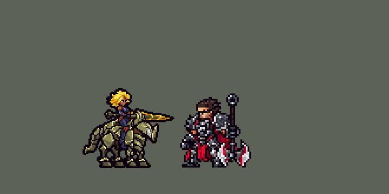

<!-- 本页上半部分由 tools/docs/gen_hero_docs.py 按仓库里现在的数据生成，手改会被覆盖；「开发记录」以下是手写的，生成时原样保留。 -->

# 芮尔 Rell


| 项目 | 内容 |
|---|---|
| id | `league_rell` |
| 所属的包 | 主包（mod_id `league`） |
| 分路 | 辅助 |
| 分类 / 标签 | 功能型（Util） · AP / Magic / Melee / Tank / CC / Shield |
| 高清帧 | PPU 1.5 |
| 附加包 | [芮尔附加包](#附加包)（`league_rell`） |



其他预览：[逐帧预览](../preview/league_rell_frames.png)、[特效表](../preview/league_rell_effects.png)

## 现在的技能

下面是游戏里显示的技能说明（`league/text/champion.i18n` 的简体中文，去掉了颜色和图标），冷却、距离来自 `league/champion/league_rell.data_champion`；1 秒 = 60 tick。

### 普攻 / 被动

*攻击间隔 1.33 秒 · 攻击距离 25000*

骑枪突刺，附带6+最大生命1%魔法伤害。溃敌沉力：普攻和技能命中英雄，5秒内削减其3%护甲和魔抗，自己获得3点护甲和魔抗（可叠加）。

### 技能1 · 裂阵

*冷却 10 秒 · 施放距离 38000 · 施放：指定目标 · 敌人（不含防御塔）*

前冲一刺，对直线上的敌人造成80 + 60% 法强魔法伤害并晕眩0.65秒。全速冲锋：与身边一名队友加速15%→30%，下次普攻或裂阵爆炸，额外造成英雄最大生命5%真实伤害。

### 技能2 · 驭铁术：轰落

*冷却 8 秒 · 施放距离 45000 · 施放：指定目标 · 敌方英雄*

跃向敌方英雄砸下，造成80 + 60% 法强魔法伤害并击飞0.83秒，获得90 + 40% 法强护盾，下马作战15秒（双抗、攻速提升）。驾临：上马冲锋，晕眩0.6秒并掀飞目标。

### 大招 · 极涌

*冷却 60 秒 · 施放距离 64000 · 施放：无目标 · 敌方英雄*

把附近敌人猛地拉到身边，2秒内持续拖拽并共造成280 + 112% 法强魔法伤害。等到身边有2个敌方英雄或有被控住的敌人时才放。

### 数值

攻击力 76（每级 +6）、法强 25（每级 +15）、生命 1200（每级 +120）、护甲 40（每级 +8）、魔抗 28（每级 +4）、移速 1010（每级 +10）。

## 附加包

附加包是可选的原生代码 mod（都在附加包合集 `league_addons` 里），**不装主包里的英雄也是完整的**。

### 芮尔附加包

[芮尔附加包](../../addons/league_rell/README.md)：`league_rell` v0.1.2

|  | 主包（纯数据） | 装了附加包 |
|---|---|---|
| 下马作战 | 待机、跑步、受击、阵亡还是骑马的画面，身上一层铁甲光环 | **整个身体换成披甲步行的她**：站着、走着、挨打、普攻、放裂阵、阵亡都是步行的样子（游戏 0.6.4），上马换回骑马 |
| 溃敌沉力 | 每次命中给目标挂一层 5 秒的 -3% 双抗、给自己 +3 双抗，按她的出手频率大约同时 4–5 层 | **每个英雄身上单独叠，最多 5 层**，每次命中刷新；**第一层时记下目标当时的双抗**，她每层拿快照的 3%（至少 2）——英雄联盟的规则 |
| 裂阵 | 伤害 + 晕眩 | 另外**打破命中单位身上所有护盾**（英雄联盟的裂阵先破盾） |
| 全速冲锋 | 她和一名队友加速 15%，1 秒后 30% | 一直 15%，**她或那名队友朝最近的敌方英雄、或朝对方跑时再加 15%**（英雄联盟：朝敌人或彼此时翻倍） |

装上附加包后游戏里显示的说明（和主包不同的部分）：

- **普攻 / 被动**：【附加包】骑枪突刺，附带6+最大生命1%魔法伤害。溃敌沉力：每个英雄身上单独叠，最多5层，每层削减其3%护甲和魔抗，芮尔得到首层时它双抗的3%。
- **技能1 · 裂阵**：【附加包】前冲一刺，打破护盾，造成80 + 60% 法强魔法伤害并晕眩0.65秒。全速冲锋：与身边一名队友加速15%，朝敌人或彼此跑时翻倍；下次普攻或裂阵爆炸。
- **技能2 · 驭铁术：轰落**：【附加包】跃向敌方英雄砸下，造成80 + 60% 法强魔法伤害并击飞0.83秒，获得90 + 40% 法强护盾，换成披甲步行作战15秒。驾临：上马冲锋，晕眩0.6秒并掀飞目标。

## 相关脚本和素材

- [`tools/kit/build_rell.py`](../../tools/kit/build_rell.py)
- [`tools/kit/setup_rell.py`](../../tools/kit/setup_rell.py)
- [`tools/lol/extract_rell.py`](../../tools/lol/extract_rell.py)
- [`tools/art/preview_rell.py`](../../tools/art/preview_rell.py)
- [`tools/art/rig_rell.py`](../../tools/art/rig_rell.py)
- [`assets/source/rell/`](../../assets/source/rell)

## 开发记录

> 下面是原来 README 里「英雄：芮尔」一节，原样搬过来（只改了相对链接）。

| 部分 | 内容 |
|---|---|
| 定位 | 辅助（Util，标签 AP / Magic / Melee / Tank / CC / Shield），第 115 位英雄。镕铁少女 芮尔：骑着铁甲战马冲锋、能把马化成铁甲下马作战的坦克辅助。用户的选择：「方案可以」——辅助、做附加包、PPU 1.5；技能 1 = Q 裂阵（E 全速冲锋没有自己的格子，跟着 Q 一起放），技能 2 = W 驭铁术（轰落 / 驾临两段），大招 = R 极涌。技能名照英雄联盟 16.20 的官方中文 |
| 普攻 / 被动 | 骑枪突刺，攻击间隔 80 tick（英雄联盟她的攻速很慢），附带 6 + 10% 法强 + 最大生命 1% 魔法伤害（英雄联盟按她的双抗算，数据读不到护甲，换成生命）。**溃敌沉力**：普攻和每个技能打中英雄时（只认英雄的替身投射物 / 区域），目标 5 秒内护甲和魔抗 −3%、她 +3 护甲和魔抗（每次一层、各自计时，按她的出手频率大约同时 4–5 层，英雄联盟每个目标最多 5 层） |
| 技能1 | **Q 裂阵**：对 38000 内的敌人放（小兵、野怪也打），出手那一刻就朝目标铺下一条 42000 × 5000 的线（锁定方向，走开就躲得掉），0.4 秒后打中线上每个敌人 80 + 60% 法强魔法伤害、晕眩 0.65 秒（英雄联盟的破盾只有附加包能做）。**E 全速冲锋**跟着 Q 一起放：自己的冷却 720 tick，目标是敌方英雄、身边 60000 内有友方英雄时才放——她和一名身边的友方英雄移速 +15%，1 秒后 +30% 再持续 2 秒（英雄联盟：朝敌人或彼此时翻倍）；下一次普攻或裂阵在打中的每个单位上爆炸：20 + 20% 法强魔法伤害，英雄另受最大生命 5% 的真实伤害（数据的魔法伤害不能按目标生命算） |
| 技能2 | **W 驭铁术**（3 级起），同一格两段（数据 buff `league_rell_foot` 区分）。**轰落**（骑马时）：对 45000 内的敌方英雄，**看时机**：身边 50000 内有友方英雄、或那个英雄已经冲到 22000 内才跳（不单独冲进人堆）；跳到他身上砸下，24000 内 80 + 60% 法强魔法伤害、击飞 0.83 秒，自己得到 90 + 40% 法强护盾 4 秒，然后下马作战 15 秒：护甲、魔抗 +15%，攻速 +20%，攻击距离 +6000，移速 −8%（失去骑马的速度）。**驾临**（下马时，冷却好了、附近有敌方英雄）：重新上马、移速 +30% 2 秒，冲向那个英雄：40 + 40% 法强魔法伤害、晕眩 0.6 秒、把他掀开一小段；下马 15 秒没打起来就自己上马。游戏的 AI 按标记当时选中的那一支给技能打分（奥莉安娜的教训），所以轰落那一支的打分分支放护盾、驾临那一支本身带伤害，两段都会放 |
| 大招 | **R 极涌**，**看时机**：放出后待命 10 秒，每 10 tick 看一次：身边 34000 内有 2 个敌方英雄、或 1 个被控住的敌方英雄且 50000 内有友方英雄，而且她自己没被控才放——把 34000 内的敌人猛地拉到身边，之后 2 秒每 15 tick 再往里拖一次并造成 35 + 14% 法强魔法伤害（共 280 + 112%）。没用上就缩短冷却 |
| 连招 | 用户要求：「有连招要做连招」「都要帮我补」。英雄联盟里芮尔 W 轰落击飞，马上 R 把人吸过来。**W→R**：极涌待命时，轰落击飞敌方英雄的下一个 tick 就按极涌自己的规则放出（被击飞的英雄在、50000 内有友方英雄，或 34000 内有 2 个敌方英雄，她自己没被控），不再等每 10 tick 一次的清点：待命的守望改成每 tick 跑、照旧每 10 tick 清点一次，轰落落地挂 2 tick 的 `league_rell_w_now` 让它当场清点。极涌没待命（还在冷却或 AI 还没按）就不接。伤害、范围、规则、冷却都不变，技能 2 每个落地副本只多一个标记。改在 [`tools/kit/build_rell.py`](../../tools/kit/build_rell.py)，附加包副本用 `make_override.py` 重新生成 |
| 骑马 / 下马 | 引擎里待机、跑步、受击、阵亡的动画不能在运行中换，所以主包里她一直是骑马的画面：轰落的动作条里马炸成甲片、她披甲砸下来，之后回到骑马的样子，下马状态是身上一圈漂着的铁甲碎片（`foot` 光环）；驾临的动作条从披甲的她开始、甲片合回成马再冲出去。装了附加包，下马期间整个身体换成披甲步行的她 |
| 附加包 | 可选的附加包 [`addons/league_rell`](../../addons/league_rell/README.md)（在附加包合集里，原生代码，主包不装它也完整）：**下马整身换形态**（站着、走着、挨打、普攻、放裂阵、放极涌、阵亡都是披甲步行的她，游戏 0.6.4；极涌 0.1.2）；**溃敌沉力按每个英雄各自叠层**（最多 5 层，第一层时记下目标当时的双抗、她每层拿快照的 3%）；**裂阵打破护盾**；**全速冲锋朝敌人或彼此跑时翻倍**。状态都在 buff 里，同一局的几份预模拟互不影响。日志 `league_rell.log`（FORM、MOLD、STEAL、SHATTER、TILT、ECAST、RFIRE） |
| 数值 | 攻击 76（+6）、法强 25（+15）、生命 1200（+120）、护甲 40（+8）、魔抗 28（+4）、移速 1010（+10）、射程 25000 |
| 平衡 | 辅助位对五个基础辅助（priest / monk / bard / pythoness / spirit_caller），三套阵容、两边各打，10 分钟经典引擎模拟：草案（生命 1150、攻击 72、间隔 90、Q / W 70、R 每跳 30、W 范围 36000 / 冷却 600）−1.32（种子 1–8；阿利斯塔 +0.27、蕾欧娜 +0.02、布隆 −0.21）——一局只普攻 68 次（阿利斯塔 101 次）、轰落 8 次；间隔 80、W 45000 / 480 → −0.81；再加生命 1200、攻击 76、Q / W 80、R 35 定稿：+1.13 / +0.05（种子 1–8 / 9–24；阿利斯塔同批 +0.27 / +0.13），合计约 +0.41。亚索 R：芮尔在辅助位同队时每局 2.04 次（蕾欧娜 2.17、阿利斯塔 1.88、基础牧师 0.62），亚索不改 |
| 精灵图（高清帧 PPU 1.5） | Codex 第 0 步画了骑马（A）和下马披甲（B）两张原画（[`tools/art/pack_rell_picture.py`](../../tools/art/pack_rell_picture.py)，英雄联盟的模型按马 / 铁甲两套子网格分开渲染），[`tools/art/design_rell_hd.py`](../../tools/art/design_rell_hd.py) 按它自己的格子读回，用户：「骑马 44、下马 40、头放大」。第 1 步 Codex 在格子上重画（[`tools/art/pack_rell_model.py`](../../tools/art/pack_rell_model.py)），[`tools/art/design_rell_cut.py`](../../tools/art/design_rell_cut.py) 两种缩法给用户挑，选「骑马 A-2 按面积取色、下马 B-2 删整行整列」。动作不找 Codex（用户：「动作帧你自己做吧 参考塔姆的方式」）：[`tools/art/rig_rell.py`](../../tools/art/rig_rell.py) 骑马的在 Codex 原稿的密度（100 × 86 格）上摆、每帧按定稿那一套网格和色板缩到 PPU 1.5（站立帧和定稿逐格相同），只做无损动作：四条马腿各自整块（蹄子整块、腿干按行斜移），小跑照英雄联盟 Run_Slow 的马蹄位置（对角两条腿一起抬，远侧的摆幅 ×0.6，1 秒一个循环）；出枪用重复枪身的同一列把枪尖推出去；轰落、死亡把马拆成整块的甲片一起飞散 / 落地（每块都在动，不会露出原画没画的地方），她倒地是身体转 90° 趴下、头保持竖直；下马的她（附加包用）在定稿 B 上摆，走路照 Biped_Walk（0.82 秒），死亡跪进甲裙里、上身前垂。用户：「动作通过」。头像点 (−2, −43)，骑马待机最高处 −33，卡片 −6。2026-10-19 补帧：普攻和 R（骑马）原来几乎是一个姿势，各改 6 帧、幅度加大（R：踏地、战马人立、再踏地）；新增下马的 `f_ult`（英雄联盟 Biped_Spell4_Cast，原来下马放大招马会冒出来半秒）；两种死亡各 8 帧；下马 R（`f_ult`）第 3、4 帧把长枪举起来 |
| 特效 | 第 3 步 20 张特效（[`tools/art/pack_rell_fx.py`](../../tools/art/pack_rell_fx.py)，颜色照英雄联盟：骑枪和裂阵是琥珀金色的光，马的橄榄铁甲化成飞散的甲片，轰落是土黄的尘土和土坑，极涌是蓝紫色的磁力场带金色电弧），Codex 画并读回成游戏大小（`assets/source/rell/codex_fx`）。[`tools/art/import_rell_fx.py`](../../tools/art/import_rell_fx.py) 按 Codex 给的锚点放：打中的在身上、晕眩星 / 破甲印记 / 磁铁印记在头顶、圈和尘土在脚下。**裂阵的画面挂在那条线上**（直线投射物的画面画在线的中点、跟着方向转，图上下对称），前三帧是预警线、第 4 帧在 0.38 秒打出冲击；线在打中后再留 15 tick 让冲击播完。其余全部左右对称（游戏不镜像特效图）。写成 `league_rell_fx` 和 `league_rell_big` |
| 音效 | 英雄联盟的音效和配音（[`tools/lol/extract_rell.py`](../../tools/lol/extract_rell.py)，19 段）：骑枪突刺 / 打中、裂阵、全速冲锋和爆炸、轰落起跳 / 落地 / 命中、驾临和冲锋命中、极涌和每跳，配音是她的 Q / E / W 两段 / R 台词（中文） |
| 图标 | 官方技能图标（裂阵、驭铁术：轰落、极涌，另有全速冲锋、驾临和被动），从本地客户端取 |

重新生成（素材来自本机的英雄联盟客户端，音频不进仓库）：

```bash
python tools/lol/extract_rell.py --lol "D:\WeGameApps\lol" --vgmstream <vgmstream-cli.exe>
python tools/kit/build_rell.py                     # 技能数据，数字都在脚本的参数表 P 里
python tools/kit/setup_rell.py                     # 五种语言的文字、音效配置、共享文件里她的键（头像点、卡片位置在 VIEW）
python tools/art/design_rell_hd.py                 # Codex 的原画读回
python tools/art/design_rell_cut.py                # 第 1 步的造型缩到 PPU 1.5（两种缩法）
python tools/art/rig_rell.py                       # 1 倍帧和 1.5 的原帧（无损摆姿，骑马 / 下马）
python tools/art/ppu_restyle.py --hero rell        # 描边（不要加 --preview）
python tools/art/ppu_hd.py --hero rell             # hd_ / lo_ 帧
python tools/art/import_rell_fx.py                 # 特效
python tools/art/preview_rell.py                   # 预览和演示 GIF
python addons/league_rell/make_override.py         # 附加包的副本（主包的芮尔改了就重跑）
```

美术提示词见 [`assets/source/rell/`](../../assets/source/rell) 里的 `PICTURE_PROMPT.md`、`MODEL_PROMPTS.md`、`PROMPTS_FX.md`；Codex 的交付在 `codex_picture/`、`codex_model/`、`codex_fx/`。

逐帧预览：[`docs/preview/league_rell_frames.png`](../preview/league_rell_frames.png?v=1017a)，特效：[`docs/preview/league_rell_effects.png`](../preview/league_rell_effects.png?v=1017a)。
