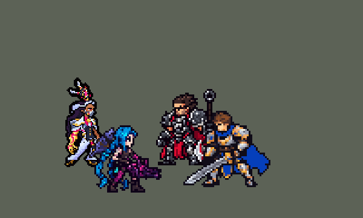

<!-- 本页上半部分由 tools/docs/gen_hero_docs.py 按仓库里现在的数据生成，手改会被覆盖；「开发记录」以下是手写的，生成时原样保留。 -->

# 烈娜塔 Renata


| 项目 | 内容 |
|---|---|
| id | `league_renata` |
| 所属的包 | 主包（mod_id `league`） |
| 分路 | 辅助 |
| 分类 / 标签 | 功能型（Util） · AP / Magic / CC / Shield |
| 高清帧 | PPU 1.5 |
| 附加包 | [烈娜塔附加包](#附加包)（`league_renata`） |



其他预览：[逐帧预览](../preview/league_renata_frames.png)、[特效表](../preview/league_renata_effects.png)

## 现在的技能

下面是游戏里显示的技能说明（`league/text/champion.i18n` 的简体中文，去掉了颜色和图标），冷却、距离来自 `league/champion/league_renata.data_champion`；1 秒 = 60 tick。

### 普攻 / 被动

*攻击间隔 1.5 秒 · 攻击距离 55000*

手枪普攻。物尽其用：命中英雄时额外造成最大生命2%真实伤害并标记；队友在旁攻击时引爆，造成30 + 20% 法强魔法伤害。及时救难：队友被控或团战时自动施放，攻速+40%、移速+20%，5秒内不会阵亡，结束时回复200 + 60% 法强生命。

### 技能1 · 忠诚激励

*冷却 10 秒 · 施放距离 80000 · 施放：指定目标 · 敌人（不含防御塔）*

发射一对飞弹，命中敌人或飞到尽头时爆炸，造成85 + 60% 法强魔法伤害并减速30%；途经的友方英雄获得90 + 50% 法强护盾，持续3秒。

### 技能2 · 铁腕竞合

*冷却 15 秒 · 施放距离 85000 · 施放：指定目标 · 敌方英雄*

射出机械手，抓住第一个敌人，造成95 + 85% 法强魔法伤害并禁锢0.83秒，随后把它甩向身后；落点周围的敌人受到75 + 50% 法强魔法伤害，甩出的是英雄时还会被眩晕0.5秒。

### 大招 · 恶意收购

*冷却 80 秒 · 施放距离 75000 · 施放：指定目标 · 敌方英雄*

附近有2个以上敌方英雄，或敌方英雄被控制时，放出化学波：命中的敌方英雄狂暴1.75秒，不能攻击我方、不能施法，每0.5秒攻击身边的队友，造成70 + 40% 法强魔法伤害。

### 数值

攻击力 80（每级 +6）、法强 30（每级 +15）、生命 950（每级 +85）、护甲 20（每级 +8）、魔抗 22（每级 +4）、移速 1000（每级 +10）。

## 附加包

附加包是可选的原生代码 mod（都在附加包合集 `league_addons` 里），**不装主包里的英雄也是完整的**。

### 烈娜塔附加包

[烈娜塔附加包](../../addons/league_renata/README.md)：`league_renata` v0.1.3

|  | 主包（纯数据） | 装了附加包 |
|---|---|---|
| 物尽其用 | 印记附近有两个她这边的英雄时引爆 | **队友真的打中它才引爆**（普攻或技能）：魔法伤害 + 最大生命 3% 的真实伤害 |
| 及时救难 | 队友被控或团战时：攻速 +40%、移速 +20%，5 秒内不会阵亡，结束时回复 200 + 60% 法强 | **英雄联盟的规则**：给危急的队友（身边有敌方英雄，被硬控或生命不到 45%），5 秒内受到致命伤害就回满生命，3 秒内流失到 1；这 3 秒里参与击杀就保住，没参与就阵亡 |
| 恶意收购的狂暴 | 不能攻击她这边、不能施法，每 0.5 秒对身边的自己人造成魔法伤害 | **真的转身打自己人**：走向最近的队友（英雄优先），按他自己的攻击间隔、用他自己的攻击力打；打死队友的击杀和助攻算烈娜塔的（和英雄联盟一样） |

装上附加包后游戏里显示的说明（和主包不同的部分）：

- **普攻 / 被动**：【附加包】手枪普攻。物尽其用：命中英雄时额外造成最大生命2%真实伤害并标记；队友打中它时引爆，造成30 + 20% 法强魔法伤害。及时救难：队友危急时自动施放，攻速+40%、移速+20%，5秒内受致命伤害时回满生命并逐渐流失，3秒内未参与击杀则阵亡。
- **大招 · 恶意收购**：【附加包】附近有2个以上敌方英雄，或敌方英雄被控制时，放出化学波：命中的敌方英雄狂暴1.75秒，不能攻击我方、不能施法，走向身边的队友，用自己的攻击力打他。

## 相关脚本和素材

- [`tools/kit/build_renata.py`](../../tools/kit/build_renata.py)
- [`tools/kit/setup_renata.py`](../../tools/kit/setup_renata.py)
- [`tools/lol/extract_renata.py`](../../tools/lol/extract_renata.py)
- [`tools/art/preview_renata.py`](../../tools/art/preview_renata.py)
- [`tools/art/rig_renata.py`](../../tools/art/rig_renata.py)
- [`tools/art/design_renata.py`](../../tools/art/design_renata.py)
- [`assets/source/renata/`](../../assets/source/renata)

## 开发记录

> 下面是原来 README 里「英雄：烈娜塔」一节，原样搬过来（只改了相对链接）。

| 部分 | 内容 |
|---|---|
| 定位 | 辅助（Util，标签 AP / Magic / CC / Shield），第 120 位英雄。炼金男爵 烈娜塔·戈拉斯克：祖安的化学科技女企业家，近侧是金色机械臂，手枪插在胯上，开大召出化学科技机甲。用户的选择：「方案可以，全按推荐做（辅助、Util，布局 A，做扩展包，PPU 1.5）」。技能 1 = E 忠诚激励，技能 2 = Q 铁腕竞合，大招 = R 恶意收购；W 及时救难没有自己的格子，由被动的守望自动放。技能名照英雄联盟 16.20 的官方中文 |
| 普攻 / 被动 | 手枪射出化学子弹（追踪），攻击间隔 90 tick，射程 55000。**物尽其用**：打中敌方英雄额外造成最大生命 2% 的真实伤害并挂上印记 4 秒；印记附近 60000 内有两个她这边的英雄（她和正在打它的队友）时引爆：30 + 20% 法强魔法伤害、最大生命 3% 的真实伤害（数据听不到队友的攻击，附加包改成队友真的打中才引爆） |
| W | **及时救难**（被动的守望每 15 tick 看一次，冷却 25 秒，不会给她自己）：80000 内被控住的友方英雄优先，否则她身边 70000 内有两个敌方英雄时给 60000 内的友方英雄：攻速 +40%、移速 +20%，5 秒内不会阵亡，结束时回复 200 + 60% 法强生命（数据读不到生命和击杀；附加包照英雄联盟：受到致命伤害时回满再流失，3 秒内参与击杀才保命） |
| 技能1 | **E 忠诚激励**（对 80000 内的敌人放，小兵、野怪也打）：出手前 8 tick 锁定方向，机械手射出两枚并排的化学飞弹，碰到第一个敌人（或飞满 80000）在 12000 内炸开：85 + 60% 法强魔法伤害、减速 30% 2 秒；飞弹经过的友方英雄得到 90 + 50% 法强护盾 3 秒。冷却 10 秒 |
| 技能2 | **Q 铁腕竞合**（对 85000 内的敌方英雄放）：出手前 8 tick 锁定方向，机械手射出化学之手，抓住第一个敌人（小兵会挡，和英雄联盟一样）：95 + 85% 法强魔法伤害、禁锢 0.83 秒；然后把它往她身后甩 36 格，落地时 14000 内的敌人受到 75 + 50% 法强魔法伤害，甩的是英雄时还会眩晕 0.5 秒。冷却 15 秒 |
| 大招 | **R 恶意收购**（5 级起），看场面才放：按 R 只是待命 6 秒，守望看到身边 100000 内有两个敌方英雄，或 75000 内有被控住的敌方英雄、身边 45000 内又有友方英雄时才放；没等到就退还冷却。召出化学科技机甲，放出一道 28 格宽的化学毒气浪（每 tick 2 格，飞 100 格），扫中的敌方英雄狂暴 1.75 秒：不能攻击她这边、不能放技能，每 0.5 秒对 25000 内的自己人造成 70 + 40% 法强魔法伤害（附加包：走向最近的队友，用自己的攻击力打）。冷却 80 秒 |
| 连招 | 用户要求：「有连招要做连招」「都要帮我补」。英雄联盟里烈娜塔 R 让人狂暴、E 减速，再 Q 抓住甩进他自己人里。**E→Q / R→Q**：E 的飞弹炸到敌方英雄（一个只对英雄的隐形爆炸圈）开 120 tick（2 秒，和减速一样长）的连招窗口，R 的毒气浪扫中英雄开 105 tick（1.75 秒，和狂暴一样长）；窗口里放 Q，化学之手第 1 tick 就飞出去（平时先锁定方向 8 tick、第 12 tick 才出手）。R 扫中英雄时 Q 还在冷却（Q 出手时自己记 930 tick 的冷却标记 `league_renata_q_cd`），就去掉标记、给她一个 2 tick 的 `skill_cooldown_mult` 10000（`ult_cooldown_mult` −10000 抵掉，R 自己的冷却不动），Q 马上就好（E 也一起好，这个字段分不开两个技能）：每次 R 最多多出一次 Q 和一次 E。伤害、禁锢、甩人、冷却数值都不变，Q 一定抛出化学之手。改在 [`tools/kit/build_renata.py`](../../tools/kit/build_renata.py)（参数 `q_refund`），附加包副本用 `make_override.py` 重新生成 |
| 附加包 | 可选的附加包 [`addons/league_renata`](../../addons/league_renata/README.md)（在附加包合集里，原生代码，主包不装它也完整）：**物尽其用由队友真的打中才引爆**（league_braum 读队友出手的做法）；**及时救难照英雄联盟**（受到致命伤害时回满生命、3 秒内流失，参与击杀才保命，没参与就阵亡）；**真的狂暴**（AI 钩子让被扫中的敌方英雄走向最近的队友，按他自己的攻击间隔、用他自己的攻击力打；0.1.1 起这一下算烈娜塔出手，打死队友的击杀和助攻算她的，和英雄联盟一样——引擎会把同队打死的击杀、赏金给狂暴的那个人自己）。日志 `league_renata.log`（POP、BAILOUT、REVIVE、SAVED、DOOMED、BERSERK、LASH） |
| 数值 | 攻击 80（+6）、法强 30（+15）、生命 950（+85）、护甲 20（+8）、魔抗 22（+4）、移速 1000（+10）、射程 55000 |
| 平衡 | 辅助对五个基础辅助（priest / bard / enchanter / monk / taoist），三套阵容、两边各打，10 分钟经典引擎模拟，按动作条的出手时间：草案 r3 +0.12 / +0.06（种子 1–16 / 17–32），同一批娜美 +0.78、璐璐 +0.90；定稿 r6（E 85 + 60%、Q 95 + 85%、甩落 75、生命 950、救难攻速 40% 回复 200、狂暴 70）+0.75 / +0.74 |
| 精灵图（高清帧 PPU 1.5） | Codex 第 0 步画了待机（A）、开枪（B）和大招（C，带机甲）三张原画（[`tools/art/pack_renata_picture.py`](../../tools/art/pack_renata_picture.py)），[`tools/art/review_renata_size.py`](../../tools/art/review_renata_size.py) 读回，用户：「选 A，40 行，第 1 步按游戏格子重画，头放大到约四分之一，C 去掉多余的手臂、机械单独一张」。第 1 步 Codex 在游戏格子上重画（[`tools/art/pack_renata_model.py`](../../tools/art/pack_renata_model.py)），[`tools/art/design_renata_cut.py`](../../tools/art/design_renata_cut.py) 取第 1 稿，[`tools/art/design_renata.py`](../../tools/art/design_renata.py) 读回机甲。动作照塔姆的方式（用户：「动作帧按照塔姆那样做吧」）：[`tools/art/rig_renata.py`](../../tools/art/rig_renata.py) 在定稿上无损摆（整块平移、90° 转动、翻转、叠层）。用户「烈娜塔在游戏里不拿枪吧」后改成平时空手、枪插在胯上，只有普攻拔枪开枪（英雄联盟的 Idle1 / Run / Attack1）；「上下摆动模型变形 模型太大 走路姿势很奇怪」后：待机改成上身往下沉一行（不再拉伸腰）、整体删行列缩到 36 行（「感觉模型还是有变形」后保护头、胯、大腿、裤脚和靴子的行）、走路找 Codex 换皮（[`tools/art/pack_renata_run.py`](../../tools/art/pack_renata_run.py)：英雄联盟自己的 Run 当骨架、我们的待机当皮；[`tools/art/import_renata_run.py`](../../tools/art/import_renata_run.py) 按它自己的格子读回，腿按固定间隔缩到定稿的长度，每帧贴回定稿的头）。机甲画进她自己的大招帧里。用户：「动作帧通过，可以做特效包了」。之后用户：「感觉不放大招时候背后没武器有点奇怪啊 和英雄联盟有点不一样」——原版平时就带着折叠的化学科技机甲（skin0.bin 出场时只隐藏展开的机翼等 6 个零件，每段动作都在摆机甲的骨骼），之前做参考图时我把它隐藏了。补上：Codex 按原版画折叠的机甲（[`tools/art/pack_renata_back.py`](../../tools/art/pack_renata_back.py)，原版大小的 80%，用户：「缩小一点」），[`tools/art/import_renata_back.py`](../../tools/art/import_renata_back.py) 读回；`rig_renata.py` 按原版每一帧机甲的位置（`assets/source/renata/machine_track.json`，移动也按 80%）整块摆在她身后，W 时原版机甲俯冲到她身侧，被她挡住超过六成就往上挪到露出四成；死亡最后两帧侧躺在地上；大招第 2 帧起换成展开的机甲。选人卡片按机甲顶设 `banpick_center` −1（原来 −2 让机甲顶压在卡片上沿，见「选人卡片位置」一节）。2026-10-19 补帧：及时救难（W）3→5 帧，R 第 4、5 帧重复改成低一行，普攻的拉开和踏步加宽一倍，死亡 5→8 帧（折叠机甲新帧的位置按 `TRACK_OF` 对到原来量好的轨迹） |
| 特效 | 第 3 步 24 张特效（[`tools/art/pack_renata_fx.py`](../../tools/art/pack_renata_fx.py)，颜色照英雄联盟：她的化学药剂是玫红色，从深酒红到白芯，最亮处带一点淡青白；W 的烟偏品红紫；金色只做点缀），Codex 画并读回成游戏大小（`assets/source/renata/codex_fx`）。[`tools/art/import_renata_fx.py`](../../tools/art/import_renata_fx.py)：子弹、两枚飞弹、化学之手、毒气浪朝方向转（上下对称），其余全部左右对称（游戏不镜像特效图）；印记和狂暴的毒气云在头顶，护盾泡泡、救难、抓人的大手在身上，飞弹的爆炸、砸地、狂暴冲击环在地上；枪口火光按她的细格子画进普攻开枪的三帧，描边之后才叠上（光外面没有黑边）。写成 `league_renata_fx` 和 `league_renata_big` |
| 音效 | 英雄联盟的音效和配音（[`tools/lol/extract_renata.py`](../../tools/lol/extract_renata.py)）：普攻开枪 / 打中、印记 / 引爆、铁腕竞合出手 / 飞行 / 抓住 / 甩出 / 落地、及时救难施放 / 增益 / 回血、忠诚激励出手 / 飞行 / 命中 / 爆炸 / 护盾、恶意收购召出机甲 / 毒气浪 / 命中，配音是她的 Q / W / E / R 台词（中文） |
| 图标 | 官方技能图标（忠诚激励、铁腕竞合、恶意收购，另有及时救难、被动和铁腕竞合的再次施放），从本地客户端取 |
| 修正（0.170.6） | 用户看了一局：「感觉是不放大招啊 烈娜塔」——那局 11 分半她的大招只放出一次。她的 R 是待命式（按 R 只开 6 秒窗口，条件满足才放），游戏 0.6.4 的 AI 很少按这种大招，而大招代按附加包 [`addons/league_ult_press`](../../addons/league_ult_press/README.md) 的名单里没有她：0.4.3 起照斯维因的做法，R 好了、75000 内有敌方英雄就替 AI 按下。经典引擎模拟里（旧 AI 一直在按）条件本身也太严，每局只放 2 次：用户不要「身边 1 个敌人就放」（「没啥意义吧」——中招的人身边没有队友可打），选了把「两个敌方英雄」的范围从 70000 放宽到 100000（波纹飞的距离，W 的 70000 不变）：每局 4 次，平衡 +1.30 → +1.07（误差内） |

重新生成（素材来自本机的英雄联盟客户端，音频不进仓库）：

```bash
python tools/lol/extract_renata.py --lol "D:\WeGameApps\lol" --vgmstream <vgmstream-cli.exe>
python tools/kit/build_renata.py                     # 技能数据，数字都在脚本的参数表 P 里
python tools/kit/setup_renata.py                     # 五种语言的文字、音效配置、共享文件里她的键（头像点在 VIEW）
python tools/art/design_renata_cut.py                # Codex 第 1 步的造型读回（第 1 稿）
python tools/art/design_renata.py                    # 定稿和机甲
python tools/art/import_renata_run.py                # Codex 换皮的走路读回
python tools/art/import_renata_back.py               # Codex 画的折叠机甲读回
python tools/art/rig_renata.py                       # 1 倍帧和 1.5 的原帧（无损摆姿，枪口火光单独一层）
python tools/art/ppu_restyle.py --hero renata        # 描边（不要加 --preview）
python tools/art/ppu_hd.py --hero renata             # hd_ / lo_ 帧
python tools/art/import_renata_fx.py                 # 特效
python tools/art/preview_renata.py                   # 预览和演示 GIF
python addons/league_renata/make_override.py         # 附加包的副本（主包的烈娜塔改了就重跑）
```

美术提示词见 [`assets/source/renata/`](../../assets/source/renata) 里的 `PICTURE_PROMPT.md`、`MODEL_PROMPTS.md`、`PROMPTS_FX.md`；Codex 的交付在 `codex_picture/`、`codex_model/`、`codex_run/`、`codex_fx/`。

逐帧预览：[`docs/preview/league_renata_frames.png`](../preview/league_renata_frames.png?v=1017b)，特效：[`docs/preview/league_renata_effects.png`](../preview/league_renata_effects.png?v=1017b)。
