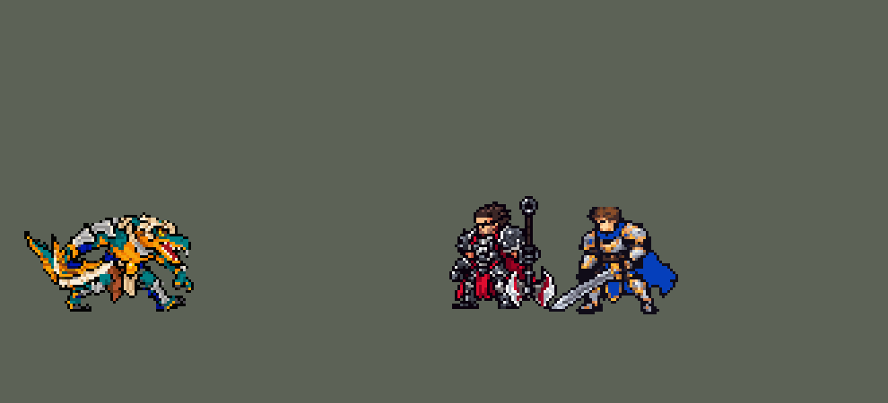

<!-- 本页上半部分由 tools/docs/gen_hero_docs.py 按仓库里现在的数据生成，手改会被覆盖；「开发记录」以下是手写的，生成时原样保留。 -->

# 雷克顿 Renekton


| 项目 | 内容 |
|---|---|
| id | `league_renekton` |
| 所属的包 | 主包（mod_id `league`） |
| 分路 | 上单 |
| 分类 / 标签 | 近战（Melee） · AD / Melee / Heal |
| 高清帧 | 1 倍像素（无高清帧） |
| 附加包 | [雷克顿低血怒气附加包](#附加包)（`league_renekton`） |



其他预览：[shrink](../preview/league_renekton_shrink.gif)、[逐帧预览](../preview/league_renekton_frames.png)、[特效表](../preview/league_renekton_effects.png)

## 现在的技能

下面是游戏里显示的技能说明（`league/text/champion.i18n` 的简体中文，去掉了颜色和图标），冷却、距离来自 `league/champion/league_renekton.data_champion`；1 秒 = 60 tick。

### 普攻 / 被动（被动「怒之领域」）

*攻击间隔 1.03 秒 · 攻击距离 25000*

近战挥砍。被动怒之领域：普攻和技能命中积攒怒气（最多5层，8秒没积攒就清空）；满层时下一个技能被强化并耗尽怒气。

### 技能1 · 巨鳄狂袭

*冷却 7 秒 · 施放距离 25000 · 施放：指定目标 · 敌人（不含防御塔）*

横扫周围，造成45 + 80% 攻击力物理伤害，每打中一个敌人回血，打中英雄回得更多。强化：100 + 140% 攻击力，回血×3（W 冷却时才用怒气）。

### 技能2 · 横冲直撞

*冷却 15 秒 · 施放距离 45000 · 施放：指定目标 · 敌方英雄*

冲过敌方英雄造成40 + 70% 攻击力，接冷酷捕猎：连砍两刀，眩晕0.75秒（强化三刀、1.5秒）；Q 好了接 Q，再冲一次，强化时削甲25%。

### 大招 · 终极统治

*冷却 90 秒 · 施放距离 70000 · 施放：指定目标 · 敌方英雄*

交战时变身10秒：生命+300，每0.5秒对周围造成15 + 1% 最大生命的魔法伤害，不断积攒怒气。

### 数值

攻击力 77（每级 +17）、生命 940（每级 +105）、护甲 32（每级 +8）、魔抗 25（每级 +4）、移速 1000（每级 +11）。

## 附加包

附加包是可选的原生代码 mod（都在附加包合集 `league_addons` 里），**不装主包里的英雄也是完整的**。

### 雷克顿低血怒气附加包

[雷克顿低血怒气附加包](../../addons/league_renekton/README.md)：`league_renekton` v0.1.1

主包 `league` 保持纯数据。数据读不到当前生命，所以主包雷克顿的被动「怒之领域」只做了怒气本身：普攻和技能命中积攒怒气
（雷克顿身上的一条阶梯，最多 5 层，8 秒没积攒就清空），满层时下一个技能被强化并耗尽怒气。英雄联盟里**生命低于一半时怒气获取
+50%**，这一条要读生命，放在这个附加包里：

- 原生被动 `league_renekton:anger` 每 tick 看一次雷克顿身上的怒气阶梯：这一刻往上走了几阶，就是积攒了几次；
- 生命低于 50% 时，这些积攒记进计数，**每满 2 次就再多走一阶**（两次变三次，就是 +50%）；已经满层时不再多给；
- 生命回到一半以上、怒气被技能耗尽或到时间清空时，计数从头数。
- 技能一字不改（`make_override.py` 生成副本时核对：副本和主包只差被动这一项）。数字（层数、计时、50%、每 2 次）从
  `tools/kit/build_renekton.py` 的参数表 `P`（`f_n`、`f_t`、`n_low`、`n_every`）写进副本的 `passive.params`。

装上附加包后游戏里显示的说明（和主包不同的部分）：

- **普攻 / 被动（被动「怒之领域」）**：【低血怒气测试版】近战挥砍。被动怒之领域：普攻和技能命中积攒怒气（最多5层，8秒没积攒就清空）；满层时下一个技能被强化并耗尽怒气。生命低于50%时怒气积攒+50%。

## 相关脚本和素材

- [`tools/kit/build_renekton.py`](../../tools/kit/build_renekton.py)
- [`tools/kit/setup_renekton.py`](../../tools/kit/setup_renekton.py)
- [`tools/lol/extract_renekton.py`](../../tools/lol/extract_renekton.py)
- [`tools/art/preview_renekton.py`](../../tools/art/preview_renekton.py)
- [`tools/art/import_renekton.py`](../../tools/art/import_renekton.py)
- [`tools/art/design_renekton.py`](../../tools/art/design_renekton.py)
- [`assets/source/renekton/`](../../assets/source/renekton)

## 开发记录

> 下面是原来 README 里「英雄：雷克顿」一节，原样搬过来（只改了相对链接）。

| 部分 | 内容 |
|---|---|
| 定位 | 上单（战士，分类 Melee），用户排的第十五组的上单（同组的其他英雄以后做），第 71 位英雄。荒漠屠夫 雷克顿：普攻和技能攒怒气，满怒气时下一个技能被强化；Q 转身横扫回血，E 冲过去接 W 连砍眩晕、再冲一次，R 变身加生命、脚下的沙暴烫周围的敌人。四个选择都按推荐的来（用户选的）：技能位「Q 单独 + E→W 连招」并加高手连招，怒气「5 层 + 强化技能，低血加速以后做附加包」，R「上膛，交战时变身」 |
| 普攻 / 被动 | 近战挥刀，100% 攻击力，射程 25000，攻击间隔 62 tick（第 7 tick 砍中）。被动「怒之领域」：怒气是他身上的一条 5 阶阶梯（同一时刻只有一阶），普攻、Q 每打中一个英雄（其余的合计一次）、E 每穿过一个单位、W（不强化时）各往上走一阶，R 开时两阶、之后每秒一阶；480 tick（8 秒）没积攒就全部清空（英雄联盟是脱战后慢慢掉，这里一次清掉）。满 5 阶（英雄联盟的 50 怒气）时下一个技能被强化并耗尽怒气；Q 只在 W 冷却时才用怒气（高手连招：怒气留给 W 晕 1.5 秒）。英雄联盟「低于一半生命时怒气 +50%」要读生命，在附加包里 |
| 技能1 | Q「巨鳄狂袭」：冷却 420 tick（7 秒），也对小兵和野怪放。第 7 tick 半径 32000 内的敌人受到 45 + 80% 攻击力的物理伤害；每打中一个敌人回 2 + 1% 攻击力，每打中一个英雄再回 10 + 10%。强化：100 + 140% 攻击力，回血 ×3 |
| 技能2 | E「横冲直撞」→ W「冷酷捕猎」：冷却 900 tick（15 秒），只对英雄放，射程 45000。冲刺穿过目标（40 + 70% 攻击力，路上每个单位都打）；落地接 W：连砍两刀（每刀 20 + 75% 攻击力，第 4、11 tick），最后一刀眩晕 0.75 秒；强化三刀（第 18 tick 第三刀）、眩晕 1.5 秒。然后 Q 好了先接 Q（眩晕后马上回血），再冲一次（二段 E，40 + 70%；强化时削甲 25% 4 秒） |
| 大招 | R「终极统治」：冷却 5400 tick（90 秒）。上膛（图奇 R 的做法）：35000 内有敌方英雄立刻变身，否则待命 10 秒、他的普攻碰到英雄就变身，没用上退还冷却。变身 10 秒：生命 +300（同时回 300），每 0.5 秒对身边 30000 内的敌人造成 15 + 1% 最大生命值的魔法伤害，怒气两阶、之后每秒一阶。体型不变，脚下一圈沙暴 |
| 低血怒气附加包 | 附加包 [`addons/league_renekton`](../../addons/league_renekton/README.md)（在附加包合集里）用原生代码读生命：生命低于 50% 时，他每积攒 2 次怒气就再多给一阶（+50%，英雄联盟的规则）；技能一字不改，副本和主包只差这一个被动。主包不装附加包也完整可玩；附加包只做了单元测试，要在游戏里看日志确认 |
| 数值 | 攻击 77（+17）、生命 940（+105）、护甲 32（+8）、魔抗 25（+4）、移速 1000（+11）。数值是自己设计的，用 SDK 对战模拟调：上路，对 6 个原版上单（`fighter`、`executioner`、`lancer`、`pole_warrior`、`knight`、`berserker`），3 套阵容、两边各打，10 分钟。初稿 +4.38（同批蛮王 +1.34、格温 +1.16、德莱厄斯 +1.18）；R 冷却 60 → 90 秒、变身 15 → 10 秒几乎没变化，降攻击生命（88 → 80、1050 → 980）、削 Q 回血和 E 伤害后 +2.48，E 冷却 12 → 15 秒、Q 60 + 100% → 45 + 80% 后 +1.51；按动作帧定下出手时机（普攻、Q 都提前到第 7 tick）后又到 +2.38，攻击 80 → 77、生命 980 → 940：两批种子 +1.78 / +1.07 |
| 亚索联动 | W 的眩晕算控制：雷克顿在亚索队里打上单时，亚索每局对英雄放 R 2.40 次（原版斗士 2.12、德莱厄斯 1.31，闪电法师以前测的 3.40），不用调 |
| 精灵图 | 9 个动作 52 帧：待机、移动、普攻、Q（`skill`）、E 冲刺（`skill2`）、W 连砍（`skill2_w`）、R（`ult`）、受击、死亡。造型 57 × 41 px（大月牙刀和尾巴在身后，蛮王 53 × 37），23 色。待机 6 帧同一张；头像截取点 (12, −24)（眼睛和长嘴），选人卡片中心 −10。原来是 65 × 41，用户在 BP 画面看到「雷克顿在BP画面里太大了」「都显示不完整」（选人格子约露 49 × 42 格，光身体就 51 格宽），选了只把刀和尾巴缩短：身体、头、腿逐格不变 |
| 特效 | Codex 画的 15 张，按游戏尺寸交付，两张表 `league_renekton_fx` / `league_renekton_big`：普攻、Q、E、W、R 光环的命中，Q 的刀光圈（强化版更大更红），W 强化的怒气、眩晕金星、削甲标记，满怒气的红光，R 的沙暴爆发和沙暴光环；普攻刀光和 E 的冲刺风痕画进动作帧里 |
| 音效 | 英雄联盟的音效和配音（`tools/lol/extract_renekton.py`）：挥刀、命中，Q 施放、命中，W 普通 / 强化、眩晕，E 冲刺、命中，R 施放、怒吼；Q、W、E、R 的中文配音。版权属于 Riot Games，**不提交到仓库**，按下面的命令在本地生成 |
| 图标 | 官方技能图标（Q / E / R），从本地客户端提取，缩到 64×64 |

重新生成（素材来自本机的英雄联盟客户端，音频不进仓库）：

```bash
python tools/lol/extract_renekton.py --lol "D:\WeGameApps\lol" --vgmstream "<vgmstream-cli.exe 路径>"
python tools/kit/build_renekton.py          # 技能数据，数字都在脚本的参数表 P 里；--nodes 看每棵技能树的节点数
python tools/kit/setup_renekton.py          # 五种语言的文字、音效配置、共享文件里他的键（头像点在脚本的 VIEW 里）
python tools/art/design_renekton.py         # 造型：Codex 原稿 B 按自己的格子读回，只删刀和尾巴那段的列（65 宽，再缩到 57 宽）
python tools/lol/native_pose.py assets/source/renekton/poses.json --out <渲染文件夹>   # 动作参考帧
python assets/source/renekton/codex_strips_narrow/rig/rebuild.py   # 动作：Codex 的零件脚本在缩窄的造型上重新生成
python tools/art/fix_renekton_strips.py     # 清掉腿边的残留描边，倒地时尾巴平躺；跑步用 Codex 换腿包的图层重拼；每帧身后加翘起的尾巴
python tools/art/import_renekton.py         # 特效
python tools/art/import_native.py --hero renekton   # 精灵（刀光、冲刺风痕按 renekton_bake.json 画进动作）
python tools/art/preview_renekton.py        # 逐帧预览、特效预览、演示 GIF
python addons/league_renekton/make_override.py   # 附加包的英雄数据和文字（主包的雷克顿改了以后重跑）
```

美术（原画的提示词见 [`assets/source/renekton/PICTURE_PROMPT.md`](../../assets/source/renekton/PICTURE_PROMPT.md)，造型的见 [`MODEL_PROMPTS.md`](../../assets/source/renekton/MODEL_PROMPTS.md)，动作的见 [`MODEL_STRIPS.md`](../../assets/source/renekton/MODEL_STRIPS.md)，特效的见 [`PROMPTS_FX.md`](../../assets/source/renekton/PROMPTS_FX.md)；Codex 的交付在 [`codex_picture/`](../../assets/source/renekton/codex_picture)、[`codex_model/`](../../assets/source/renekton/codex_model)、[`codex_strips/`](../../assets/source/renekton/codex_strips)、[`codex_fx/`](../../assets/source/renekton/codex_fx)；附图包由 `tools/art/pack_renekton_*.py` 在本地生成，英雄联盟的渲染不进仓库）：

- 原画：A 是英雄联盟的待机（弓背、刀低低地拖在身侧朝后），B 是冷酷捕猎起手（月牙刀竖着举在身侧）。用户选 A，再指定刀的形状照 B（「鳄鱼的斧头应该是这形状的」：一整把宽月牙，外弧象牙白尖齿刃、金框和绿宝石、深蓝握柄沿内弧），第 1 步的包里加了 B 的刀和它横躺的样子。
- 造型：按蛮王（37 行、拖着大剑 53 格宽）的个子要 38 / 40 行。Codex 自己删到 53 × 38 / 56 × 40 时在身体和脸上也删了列，碎了；按它的生图原稿自己的格子读回（B 76 × 41，28 色聚类），只删刀和尾巴那段的列。用户选「B 64」（65 × 41）。装进游戏后 BP 画面装不下（「雷克顿在BP画面里太大了」「都显示不完整」），用户选「刀和尾巴缩短」：在定稿上只删刀和尾巴那段的 8 列，57 × 41，身体那几列逐格不变；动作用 Codex 自己的零件脚本在新造型上重新生成（[`codex_strips_narrow/`](../../assets/source/renekton/codex_strips_narrow)，身体左边剩下的格子归给握刀的手臂和尾巴，挥刀不留残影）。
- 动作：英雄联盟的 Q 转一圈（有半圈是背影）、E 贴地扑出去、W 强化时刀会闪成另一把，包里改成正面横扫、压低前冲、举刀从头顶劈。Codex 第 2 步用造型自己的零件摆（头、身体、两条腿、尾巴、两只手臂连刀，整块平移和转动）。用户指出两处，`fix_renekton_strips.py` 只修这两处：「腿上有多余的像素」——零件切开时留下的描边残点（前膝旁浮着的 1–2 格黑点、后腿旁只靠斜角挂着的黑格），共 55 格；「死亡的时候尾巴有点怪」——倒地时尾巴跟着身体转成竖直戳向地面，改成绕尾根再转 90° 平躺在脚边；跑步几经修改：「鳄鱼走路有点僵硬」——原来只有两条腿动；「尾巴都变形了」「尾巴跟着后腿太怪了 还不如翘起来」——尾巴那一小块挨着后脚，后腿迈出去就浮在半空；「走路时候腿部模型严重变形」——零件拼法只挪小腿、横移 20 多格去交叉，大腿留在原处。用户选了「给 Codex 发换腿包」（`tools/art/pack_renekton_run.py`、[`RUN_SWAP.md`](../../assets/source/renekton/RUN_SWAP.md)，骨架是英雄联盟雷克顿自己的跑步）：Codex 重画了整条腿（交叉步、远侧腿暗一档）和翘在身后的尾巴，上半身是定稿原样（[`codex_run/`](../../assets/source/renekton/codex_run)）。「腿的连接处」——上半身里还留着两条大腿的顶端和皮裙右片的一截，腿迈开后悬空（布兰德那次的问题），拼帧前把腰带下面那 4 行修掉。「待机时攻击时放技能时尾巴看不到」——缩窄后的造型只剩刀下一小截尾巴，用户选「斜向后上翘」：Codex 跑步那轮画的整条鳄鱼尾（32 × 22 格）画在他身后，尾根在胯后、尾尖从刀后伸出来，除了倒地的几帧每个动作都有。
- 特效：Codex 第 3 步把 15 张都按游戏尺寸画了一份（[`codex_fx/pixel_1x/`](../../assets/source/renekton/codex_fx/pixel_1x)），`tools/art/import_renekton.py` 每格切出、按锚点（中心、脚底、风痕起点）放好，导入时逐格检查对称。
- 红色方：命中、他身上的刀光圈 / 怒气 / 沙暴爆发、挂着循环的满怒气 / 眩晕 / 削甲 / 沙暴光环都严格左右对称；只有普攻刀光和 E 的冲刺风痕有朝向，画进动作帧里（`renekton_bake.json`），跟着他一起翻转。

逐帧预览：[`docs/preview/league_renekton_frames.png`](../preview/league_renekton_frames.png?v=1014g)，特效：[`docs/preview/league_renekton_effects.png`](../preview/league_renekton_effects.png?v=1014g)。
